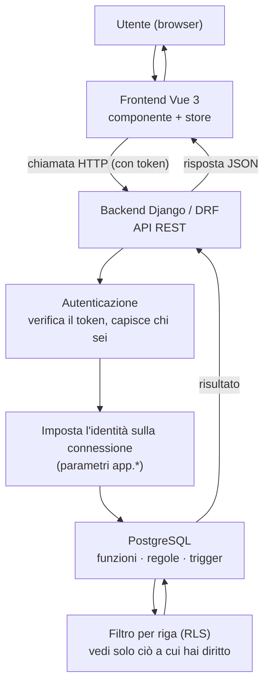

# Architettura a colpo d'occhio

> **Ultimo aggiornamento**: 24 ottobre 2026
>
> **Destinatari**: chi arriva sul progetto e vuole farsi un'idea del sistema **nel suo insieme** in
> pochi minuti: quali sono i pezzi, chi fa cosa, come viaggia una richiesta dall'utente fino ai dati.
> Per i dettagli di ogni argomento, i link rimandano alle guide dedicate.

---

## La regola che spiazza chi arriva

In Zero ERP **la logica di business vive nel database** (PostgreSQL), non nel backend.
Funzioni, regole, controlli e passaggi di stato stanno lì. Chi arriva da progetti dove le
regole stanno nel codice applicativo si aspetta di trovarle in Django: qui invece il backend
**orchestra** ed espone le API, e il frontend **mostra soltanto**.

Tenere a mente questa divisione fa risparmiare tempo: se cerchi una regola di calcolo o un
controllo, parti dal database. E una regola sta in **un posto solo**: se è nel database, non si
riscrive in Python né in Vue.

---

## I pezzi del sistema

| Strato               | Tecnologia                         | Di cosa si occupa                                                                                   |
| -------------------- | ---------------------------------- | --------------------------------------------------------------------------------------------------- |
| **Frontend**         | Vue 3 (single-page), PrimeVue      | Mostra le pagine, raccoglie l'input, chiama le API. Nessuna regola di business.                     |
| **Backend**          | Django + DRF (Python)              | Espone le API REST, mette in sequenza i passaggi (orchestrazione), gestisce l'autenticazione.       |
| **Database**         | PostgreSQL                         | Il cuore: dati, regole di business, controlli, calcoli, tracciabilità, storia delle modifiche.      |
| **Migrazioni**       | Liquibase                          | Versiona e applica le modifiche alla struttura del database.                                        |
| **Test del database**| pgTAP                              | Prova le regole scritte nel database.                                                               |
| **Cache**            | Redis                              | La cache del backend (per esempio i permessi). Nei test e in CI la sostituisce una cache in memoria. |
| **Lavori automatici**| pgAgent e timer systemd            | I lavori che il sistema fa da solo: di notte nel database, a intervalli nel backend.                 |

→ Le versioni stanno in [Versioni supportate](versioni-supportate.md); come si mette in piedi
un'installazione, in [Installazione](installazione.md).

---

## Il viaggio di una richiesta

Dal click dell'utente fino ai dati e ritorno:

Il punto chiave è il passaggio **"imposta l'identità sulla connessione"**: è ciò che permette
al database di sapere chi sta facendo la richiesta, di mostrare solo i dati giusti e di firmare
ogni modifica con il suo autore.

---

## Come il database sa chi sei (RLS e GUC)

Quando un nuovo sviluppatore vede che certe query restituiscono dati "già filtrati" senza un
`WHERE` esplicito, all'inizio sembra magia. Non lo è: è la **sicurezza a livello di riga**
(Row-Level Security) di PostgreSQL.

Funziona così, in breve:

1. All'**inizio** di ogni richiesta il backend azzera i parametri d'identità della connessione,
   così niente resta dalla richiesta precedente.
2. Se la richiesta è autenticata, legge dal token **quale identità** sta usando la persona e
   chiede al database a che cosa corrisponde: il ruolo applicativo (la «veste»), il soggetto, l'azienda
   emittente attiva. Scrive questi dati in alcuni **parametri della connessione** nel namespace
   `app.*` (per esempio `app.current_identita_id`, `app.ruolo_applicativo`, `app.current_emittente_id`).
   Se qualcosa non torna, i parametri restano vuoti e il database non mostra niente.
3. Le regole di sicurezza del database (le **policy RLS**) leggono quei parametri e mostrano a
   ciascuno solo le righe a cui ha diritto. Gli stessi parametri servono ai trigger per
   compilare i campi di tracciabilità (chi ha inserito o modificato un record).

Il vantaggio: il filtro non dipende dal fatto che il programmatore si ricordi di aggiungerlo —
è il database stesso a garantirlo. È un approccio "a prova di dimenticanza".

Per il dettaglio tecnico (nomi esatti dei parametri, contratto col backend, esempi di policy):

- [Architettura Multi-Face Auth](/guide/architettura-multi-face-auth) — chi può entrare nel sistema e con quale "faccia"
- [Contratto GUC `app.*`](/guide/contratto-guc-app) — i parametri d'identità, nel dettaglio
- [Architettura Permessi e Autorizzazioni](/guide/architettura-permessi-e-autorizzazioni) — il modello dei permessi

---

## Come si scrive: una scrittura, un verbo

Leggere passa dal filtro per riga. **Scrivere**, nei domini più recenti (magazzino, acquisti, la
configurazione), passa da un **verbo**: una funzione del database che come prima cosa controlla se
chi la chiama ha il permesso di quell'azione, e solo dopo scrive. L'applicazione, su quelle tabelle,
non ha più la scrittura diretta. Gli altri domini ci arrivano quando un lavoro tocca le loro
scritture.

Il modello protegge da un backend che **sbaglia**, non da uno **manomesso**: l'identità la dichiara
il backend. Dettaglio in
[Architettura Permessi e Autorizzazioni, §7.4](/guide/architettura-permessi-e-autorizzazioni).

---

## Chi si collega al database

Ogni pezzo del sistema entra nel database con un ruolo suo, con i soli privilegi che gli servono:

| Ruolo           | Chi lo usa                                         |
| --------------- | -------------------------------------------------- |
| `zeroerp_owner` | il proprietario di tutti gli oggetti: le migrazioni |
| `zeroerp_app`   | il backend, per le richieste degli utenti           |
| `zeroerp_job`   | i lavori notturni di pgAgent                        |
| `zeroerp_log`   | la scrittura dei registri degli errori              |

Come si creano e che cosa può ognuno: [Installazione, «Il database»](installazione.md) e
[Architettura Permessi e Autorizzazioni, §7.6](/guide/architettura-permessi-e-autorizzazioni).

---

## Il lavoro che il sistema fa da solo

Non tutto parte da un click. Tre meccanismi, con un registro unico dei processi che dice che cosa
esiste, se è acceso e se gira come dovrebbe:

- **pgAgent**, dentro il database: la manutenzione notturna (trigger generati, storico, indici,
  statistiche), vedi [Framework di automazione DB](/guide/automazione-db);
- **timer systemd** sul server del backend: la coda dei lavori, le stampe, le email, la mail dei
  controlli;
- **la coda dei lavori**, nel database: un lavoro che tocca i dati di un'azienda non gira dentro
  l'orologio, viene messo in coda ed eseguito per conto di qualcuno
  ([Gestione delle code di lavoro](/guide/gestione-code-di-lavoro)).

Il quadro si guarda in **Strumenti → Diagnostica → Processi automatici**. Il modello sta in
[I lavori automatici: che natura hanno e per conto di chi girano](/guide/processi-automatici-classe-e-identita).

---

## Come arriva una modifica

Il codice passa da due branch di lavoro (database e backend) a `Tito-dev`, dove la CI ricostruisce
il database da zero e lancia i test, e da lì a `main`, che pubblica il sito della documentazione e
l'immagine Docker. Il dettaglio è in [Configurazione GitHub](/dev/github/configurazione).

---


