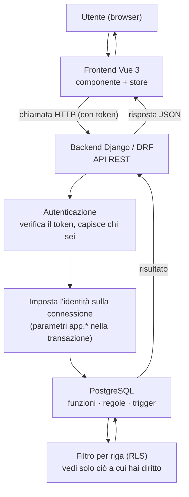

# Architettura a colpo d'occhio

> Questa pagina serve a farsi un'idea del sistema **nel suo insieme** in pochi minuti:
> quali sono i pezzi, chi fa cosa e come viaggia una richiesta dall'utente fino ai dati.
> Per i dettagli di ogni argomento, i link rimandano alle guide dedicate.

---

## La regola che spiazza chi arriva

In Zero ERP **la logica di business vive nel database** (PostgreSQL), non nel backend.
Funzioni, regole, controlli e passaggi di stato stanno lì. Chi arriva da progetti dove le
regole stanno nel codice applicativo si aspetta di trovarle in Django: qui invece il backend
**orchestra** ed espone le API, e il frontend **mostra soltanto**.

Tenere a mente questa divisione fa risparmiare tempo: se cerchi una regola di calcolo o un
controllo, parti dal database.

---

## I pezzi del sistema

| Strato | Tecnologia | Di cosa si occupa |
| --- | --- | --- |
| **Frontend** | Vue 3 (single-page) | Mostra le pagine, raccoglie l'input, chiama le API. Nessuna regola di business. |
| **Backend** | Django + DRF (Python) | Espone le API REST, mette in sequenza i passaggi (orchestrazione), gestisce l'autenticazione. |
| **Database** | PostgreSQL | Il cuore: dati, regole di business, controlli, calcoli, tracciabilità. |
| **Migrazioni** | Liquibase | Versiona e applica le modifiche alla struttura del database. |
| **Cache / sessioni** | Redis *(opzionale in dev)* | Supporto a sessioni e code, dove serve. |

→ Per le versioni testate vedi [Versioni supportate](versioni-supportate.md).

---

## Il viaggio di una richiesta

Dal click dell'utente fino ai dati e ritorno:

Il punto chiave è il passaggio **"imposta l'identità sulla connessione"**: è ciò che permette
al database di sapere chi sta facendo la richiesta e di mostrare solo i dati giusti.

---

## Come il database sa chi sei (RLS e GUC)

Quando un nuovo sviluppatore vede che certe query restituiscono dati "già filtrati" senza un
`WHERE` esplicito, all'inizio sembra magia. Non lo è: è la **sicurezza a livello di riga**
(Row-Level Security) di PostgreSQL.

Funziona così, in breve:

1. Quando arriva una richiesta autenticata, il backend legge dal token **chi sei** (utente,
   ruolo applicativo, soggetto) e scrive questi dati in alcuni **parametri di sessione**
   nel namespace `app.*` (es. `app.ruolo_applicativo`, `app.soggetto_ruolo_id`).
2. Questi parametri valgono **solo per quella transazione**: a fine richiesta spariscono da
   soli, quindi non "sporcano" le richieste successive.
3. Le regole di sicurezza del database (le **policy RLS**) leggono quei parametri e mostrano a
   ciascuno solo le righe a cui ha diritto. Gli stessi parametri servono anche ai trigger per
   compilare i campi di tracciabilità (chi ha inserito/modificato un record).

Il vantaggio: il filtro non dipende dal fatto che il programmatore si ricordi di aggiungerlo —
è il database stesso a garantirlo. È un approccio "a prova di dimenticanza".

Per il dettaglio tecnico (nomi esatti dei parametri, contratto col backend, esempi di policy):

- [Architettura Multi-Face Auth](/guide/architettura-multi-face-auth) — chi può entrare nel sistema e con quale "faccia"
- [Contratto GUC `app.*`](/guide/contratto-guc-app) — i parametri di sessione, nel dettaglio
- [Architettura Permessi e Autorizzazioni](/guide/architettura-permessi-e-autorizzazioni) — il modello dei permessi

---


</content>
