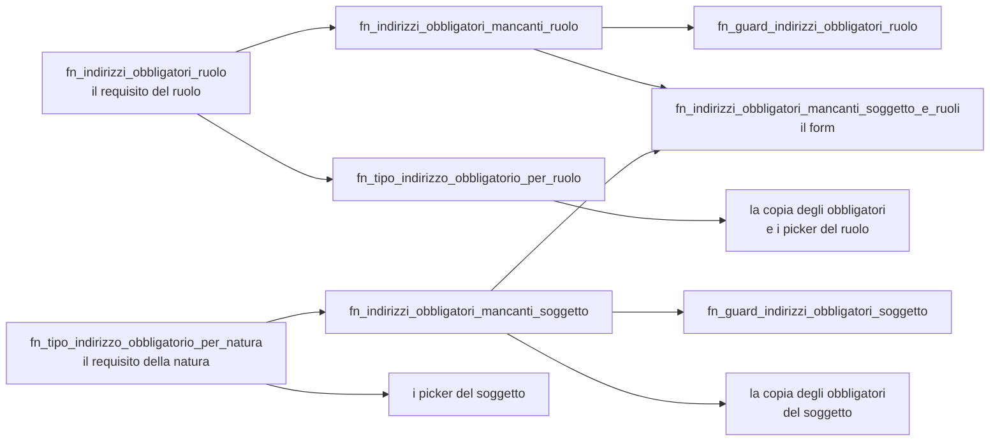

### 📍 Gli indirizzi obbligatori

> **Ultimo aggiornamento**: 24 novembre 2026

Un soggetto e i suoi ruoli devono avere certi indirizzi: per esempio una società la sede legale, un cliente
l'indirizzo di fatturazione. Il database lo pretende su due livelli, ognuno con la sua richiesta, le sue tabelle e il suo
codice di rifiuto.

| Livello | Chi chiede | La richiesta sta in | Si guarda fra | Rifiuto |
| --- | --- | --- | --- | --- |
| **Soggetto** | la natura del soggetto | `config.tipi_soggetto_dettaglio_tipi_indirizzo` | `anagrafiche.indirizzi_soggetti` | `E_INDIRIZZO_OBBLIGATORIO_MANCANTE_TIPO_SOGGETTO` |
| **Ruolo** | il tipo di ruolo, sulla natura del soggetto | `config.tipi_ruolo_tipi_indirizzo` | `anagrafiche.indirizzi` del ruolo, anche quelli legati a un'istanza | `E_INDIRIZZO_OBBLIGATORIO_MANCANTE` |

In tutte e due le matrici una riga col flag `obbligatorio` chiede il suo tipo, e può portare un **ripiego**
(`fallback_tipo_indirizzo_id`): un indirizzo del ripiego soddisfa la riga quanto uno del tipo. Una riga conta
solo se è attiva e valida nel giorno aziendale (`script.fn_data_operativa()`); la finestra la giudica lo stesso
predicato che dice quali tipi sono **ammessi**, e che ha le sue schede:
[fn_tipo_indirizzo_ammesso_per_natura](/dbzero/anagrafiche/funzioni/fn_tipo_indirizzo_ammesso_per_natura) e
[fn_tipo_indirizzo_ammesso_per_ruolo](/dbzero/anagrafiche/funzioni/fn_tipo_indirizzo_ammesso_per_ruolo).

#### ⭐ Il requisito del ruolo dipende dalla natura

Un ruolo non può avere un tipo d'indirizzo che il suo soggetto non potrebbe avere: per questo ciò che un ruolo
deve avere lo decide il tipo di ruolo **letto sulla natura** del soggetto. Lo calcola una funzione sola,
`anagrafiche.fn_indirizzi_obbligatori_ruolo`, riga obbligatoria per riga obbligatoria:

| La natura del soggetto… | Il ruolo deve avere |
| --- | --- |
| ammette il tipo della riga | il tipo, oppure il ripiego, se il ruolo e la natura ammettono anche quello |
| non ammette il tipo, ammette il ripiego (e il ruolo lo ammette) | il ripiego, da solo |
| non ammette né l'uno né l'altro | niente, per quella riga |

Se il fornitore chiedesse la sede legale col ripiego del domicilio fiscale, a un fornitore privato si
chiederebbe il domicilio fiscale. Lo stesso ruolo su due nature può chiedere indirizzi diversi, e un cambio di natura può
lasciarlo incompleto senza che nessun indirizzo sia stato toccato. Su un soggetto **senza natura** la natura
non conta: il ruolo chiede le sue righe come sono.

Il livello del soggetto è più semplice: la natura chiede le sue righe obbligatorie, il ripiego vale se la natura
lo ammette, e un soggetto senza natura non deve avere niente. Quali tipi la natura chiede lo dice una funzione
sola, `anagrafiche.fn_tipo_indirizzo_obbligatorio_per_natura`, gemella di quella del ruolo: la leggono i
mancanti, la copia, i picker e gli strumenti di sviluppo e di prova.

#### Una lettura sola, per chi controlla e per chi propone

* **I mancanti**: `anagrafiche.fn_indirizzi_obbligatori_mancanti_soggetto` e
  `anagrafiche.fn_indirizzi_obbligatori_mancanti_ruolo` dicono, per una natura data, quali righe nessun
  indirizzo soddisfa, col tipo richiesto e il ripiego. Le leggono i guard e il form.
* **I guard**: `anagrafiche.fn_guard_indirizzi_obbligatori_soggetto` e
  `anagrafiche.fn_guard_indirizzi_obbligatori_ruolo` sono la sede unica del controllo di ciascun livello; le
  trigger function si limitano a chiamarli col soggetto o col ruolo da giudicare.
* **Chi propone**: la copia automatica degli obbligatori quando nascono gli indirizzi
  ([fn_crea_indirizzi_ruolo](/dbzero/anagrafiche/funzioni/fn_crea_indirizzi_ruolo),
  [fn_crea_indirizzi_soggetto](/dbzero/anagrafiche/funzioni/fn_crea_indirizzi_soggetto)) e la colonna
  «obbligatorio» dei picker del ruolo
  ([fn_tipi_indirizzo_proponibili_ruolo](/dbzero/anagrafiche/funzioni/fn_tipi_indirizzo_proponibili_ruolo),
  [fn_tipi_indirizzo_proponibili_tipo_ruolo](/dbzero/anagrafiche/funzioni/fn_tipi_indirizzo_proponibili_tipo_ruolo))
  leggono lo stesso requisito: ciò che il form segna obbligatorio è ciò che il salvataggio pretende.

#### Le strade, e quando si controlla

Ogni strada per cui il requisito può smettere di essere rispettato ha il suo trigger. Sono tutti
constraint trigger **differiti alla conferma della transazione** (`DEFERRABLE INITIALLY DEFERRED`, verificato su
`pg_trigger`):

| Strada | Trigger function | Tabella ed evento | Chi si giudica |
| --- | --- | --- | --- |
| nasce il soggetto, o gli si cambia la natura | `anagrafiche.trgfn_soggetti_guard_indirizzi_required` | `soggetti`, INSERT e UPDATE che cambia la natura (`WHEN`) | il soggetto |
| nasce il ruolo | `anagrafiche.trgfn_soggetti_ruoli_guard_indirizzi_required` | `soggetti_ruoli`, INSERT | il ruolo |
| si cancella un indirizzo del soggetto, o se ne cambia il tipo | `anagrafiche.trgfn_indirizzi_soggetti_guard_obbligatori_soggetto` | `indirizzi_soggetti`, DELETE e UPDATE | il soggetto da cui l'indirizzo esce, per ciò che l'indirizzo dava |
| si cancella un indirizzo del ruolo, o se ne cambia il tipo | `anagrafiche.trgfn_indirizzi_guard_obbligatori_ruolo` | `indirizzi`, DELETE e UPDATE | il ruolo da cui l'indirizzo esce, per ciò che l'indirizzo dava |
| cambia la natura del soggetto | [trgfn_soggetti_guard_obbligatori_ruoli](/dbzero/anagrafiche/funzioni/trgfn_soggetti_guard_obbligatori_ruoli) | `soggetti`, UPDATE della natura | tutti i suoi ruoli |

Aggiungere un indirizzo non toglie mai niente, e nessun trigger lo guarda. Il titolare di un indirizzo non si
sposta, salvo dalla porta di manutenzione: soggetto e ruolo sono bloccati
(`E_INDIRIZZO_SOGGETTO_TITOLARE_IMMUTABILE`, `E_INDIRIZZO_RUOLO_TITOLARE_IMMUTABILE`), quindi sugli indirizzi le
strade sono la cancellazione e il cambio di tipo.

⭐ **Una riga di matrice che cambia vale per le scritture che toccano il requisito**, come per i tipi ammessi.
Chi esiste già non si rigiudica a ogni scrittura: un soggetto o un ruolo a cui una riga nuova chiede un indirizzo
che non ha resta modificabile su ogni altra colonna. Quando un indirizzo esce, il guard riceve il suo tipo e
guarda solo le righe che quel tipo soddisfaceva, come tipo o come ripiego: l'unico indirizzo che dava una riga
obbligatoria non si toglie, uno che nessuno chiede sì. Alla nascita e al cambio di natura si giudica tutto.

Perché il controllo è alla conferma:

* il soggetto o il ruolo nasce prima dei suoi indirizzi, nella stessa transazione, e si giudica a lavoro finito;
* sostituire un indirizzo obbligatorio, cancellandolo e scrivendone un altro, passa se le due scritture stanno
  nella stessa transazione;
* cancellare un soggetto o un ruolo coi suoi indirizzi passa: chi non c'è più non si giudica;
* chi scrive può comunque chiedere di anticipare i vincoli differiti, e avere il rifiuto subito.

#### Che cosa manca, prima di salvare

Le funzioni dei mancanti prendono la natura come **parametro**, non la leggono dal soggetto: chi prepara un
cambio di natura chiede che cosa la natura proposta pretende, prima di salvarla.
`anagrafiche.fn_indirizzi_obbligatori_mancanti_soggetto_e_ruoli` mette insieme i due livelli per il form del
cambio di natura, che chiede questi indirizzi e li manda nello stesso salvataggio, scritti dopo la natura: al
COMMIT i guard trovano ciò che la lista aveva chiesto. Gli indirizzi che la natura nuova **vieta** non sono
qui: sono motivi di rifiuto di [fn_check_cambio_natura_soggetto](/dbzero/anagrafiche/funzioni/fn_check_cambio_natura_soggetto),
che li ferma prima.

#### Il rifiuto

Il guard solleva il **primo** mancante, nell'ordine dell'id del tipo richiesto. La frase nomina la natura (o il
ruolo) e il tipo richiesto col suo ripiego, per descrizione, come li compone
[fn_nomi_tipo_indirizzo_richiesto](/dbzero/anagrafiche/funzioni/fn_nomi_tipo_indirizzo_richiesto); gli id
(soggetto o ruolo, natura, tipo di ruolo, tipo richiesto, ripiego) viaggiano nel contesto dell'errore. I due
codici sono distinti di proposito: chi rimedia corregge una matrice diversa, come per il tipo non ammesso
(`E_TIPO_INDIRIZZO_TIPO_SOGGETTO_NON_PERMESSO` contro `E_TIPO_INDIRIZZO_NON_PERMESSO`).
