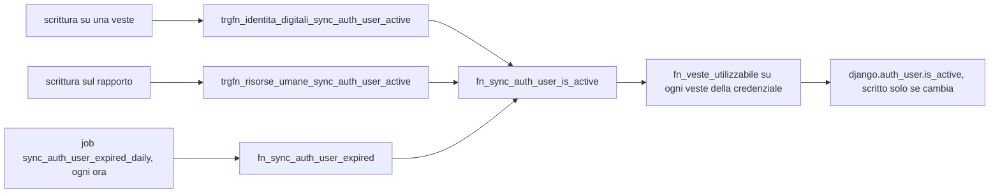

### 🧩 La sincronizzazione dell'accesso

> **Ultimo aggiornamento**: 22 novembre 2026

Una **credenziale** è la riga di `django.auth_user`: lo username e la password, una sola per tutte le porte. Le
**vesti** sono le righe di `anagrafiche.identita_digitali` che la legano a un ruolo d'impresa: operatore, cliente
del portale, fornitore, cliente dello shop, sistema esterno. Il flag `is_active` della credenziale dice a Django se
quella persona, o quel processo, può autenticarsi. Il database lo tiene allineato alle vesti: nessuno lo scrive a
mano.

#### La regola: la credenziale è accesa quando almeno una veste è utilizzabile

`is_active` è vero se e solo se la credenziale ha **almeno una** veste utilizzabile oggi. È un «oppure» fra le
vesti, non un «e»: spegnere una veste non spegne la credenziale se gliene resta un'altra utilizzabile. La singola
porta chiusa la chiude chi legge la veste, non questo flag.

«Utilizzabile» ha una **sede sola**, `script.fn_veste_utilizzabile`, e la sincronizzazione non la ricopia. Una veste
è utilizzabile quando:

* è accesa (`attivo`);
* oggi sta fra `valido_dal` e `valido_al`, estremi compresi. «Oggi» è il **giorno operativo**, la data nel fuso
  dell'azienda (`script.fn_data_operativa`), non la data della sessione;
* il suo soggetto è attivo;
* se è la veste di un **operatore umano** (`OPERATORE` con `tecnica = false`), anche il suo rapporto lo è: la risorsa
  umana dello stesso ruolo del soggetto è accesa e oggi sta nelle sue date. Un operatore umano senza risorsa umana
  non è utilizzabile. L'identità tecnica di un processo non ha rapporto e non lo pretende.

Una credenziale **senza vesti** sta fuori dalla regola: la sincronizzazione periodica la lascia com'è, e la
segnala il presidio `dbops.vw_credenziali_da_sanare` (motivo `NESSUNA_VESTE`).

#### Tre strade, una funzione che decide

Tutte e tre le strade finiscono in `anagrafiche.fn_sync_auth_user_is_active`, che riceve una credenziale, calcola
se deve essere accesa e scrive `is_active` **solo se cambia**. Chiamarla due volte non cambia niente.

| Chi | Quando scatta | Quale credenziale passa |
| --- | --- | --- |
| `trgfn_identita_digitali_sync_auth_user_active` | dopo l'inserimento di una veste, e dopo ogni modifica che nomina `attivo`, `valido_dal`, `valido_al`, `ruolo_applicativo` o `auth_user_id`, anche se il valore resta uguale | quella scritta nella riga nuova della veste |
| `trgfn_risorse_umane_sync_auth_user_active` | dopo una modifica della risorsa umana che cambia davvero `attivo`, `valido_dal` o `valido_al` | quella della veste `OPERATORE` dello stesso ruolo del soggetto, se c'è |
| `fn_sync_auth_user_expired` | ogni ora al minuto 10, e a mano dal comando di gestione del backend | ogni credenziale che ha delle vesti e il cui `is_active` non dice più la regola, nei due versi |

I due trigger girano dopo i controlli della riga, nella stessa transazione di chi scrive: una scrittura rifiutata
non arriva alla sincronizzazione, e una transazione annullata annulla anche il cambio del flag.

#### ⭐ Perché serve il passaggio periodico: il tempo non scrive

Una data che arriva non scrive niente e non fa scattare nessun trigger. La veste che finisce oggi, il rapporto
chiuso a ieri sera, la veste che comincia stamattina cambiano la risposta della regola senza che nessuno tocchi
una riga. Le riallinea `fn_sync_auth_user_expired`, nei due versi: spegne la credenziale che non ha più vesti
utilizzabili e accende quella che ne ha una diventata valida.

Lo chiama il job pgAgent `sync_auth_user_expired_daily`, attraverso la procedura
`maintenance.proc_sync_auth_user_expired_job`, che lascia la corsa nel giornale dei job. Il job ha una sveglia
**oraria, al minuto 10**, e parte solo se la sua sveglia è accesa. Il nome dice «daily» e resta: la funzione è
idempotente, e una sveglia ogni ora riallinea una scadenza entro l'ora invece che il mattino dopo.

#### ⚠️ Che cosa nessun trigger copre

Sono le scritture che cambiano la risposta della regola senza passare da uno dei due trigger. Quando la credenziale
ha ancora delle vesti, le riallinea il passaggio periodico **entro l'ora**; fino ad allora il flag dice il vero di
prima.

* **Una veste che cambia credenziale.** Il trigger passa solo la credenziale nuova: quella di prima resta com'era.
  Se le restano altre vesti la riallinea il passaggio periodico; se quella era la sua ultima veste, non la
  riallinea nessuno.
* **Una veste cancellata.** Sulla cancellazione non scatta niente, con la stessa conseguenza: se era l'ultima veste,
  la credenziale resta accesa com'era.
* **Una veste che cambia ruolo del soggetto, o natura.** `soggetto_ruolo_id` e `tecnica` non sono fra le colonne
  del trigger, e per l'operatore cambiano il rapporto che la regola guarda.
* **Un rapporto che cambia ruolo del soggetto, o che nasce.** Il trigger della risorsa umana non guarda
  `soggetto_ruolo_id` e non scatta sull'inserimento: una risorsa umana creata dopo la veste dell'operatore la rende
  utilizzabile senza che il flag lo sappia.
* **Il soggetto spento.** La regola lo legge, e nessun trigger su `anagrafiche.soggetti` chiama la
  sincronizzazione. Oggi però il caso non si raggiunge: un soggetto non si spegne finché ha un ruolo (il blocco di
  disattivazione conta ogni riga di `soggetti_ruoli`, che non ha una colonna `attivo`), e una veste ha sempre un
  ruolo.
* **La sveglia spenta.** Con la sveglia del job spenta nessuno riallinea le date, se non il comando del backend
  lanciato a mano.
