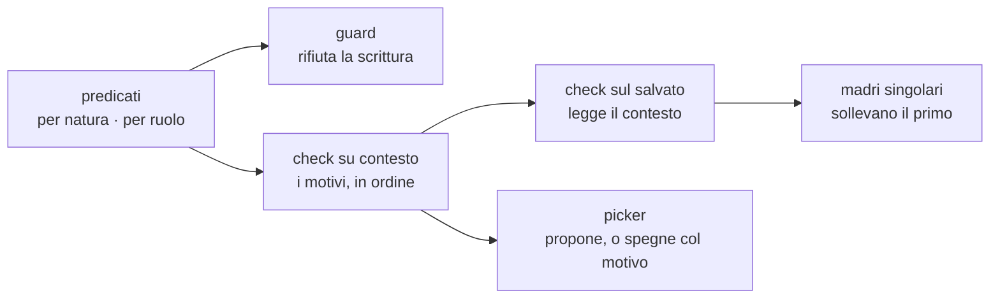

### 🏠 Il tipo d'indirizzo ammesso

> **Ultimo aggiornamento**: 22 novembre 2026

Un indirizzo ha un **tipo** (residenza, sede legale, fatturazione, fornitura…, `config.tipi_indirizzi`), e non
ogni tipo va bene per ogni titolare. Lo decidono due matrici di configurazione: quella della **natura** di
dettaglio del soggetto (`config.tipi_soggetto_dettaglio_tipi_indirizzo`) e quella del **tipo di ruolo**
(`config.tipi_ruolo_tipi_indirizzo`). Un privato non ha una sede legale: non la può avere né sul soggetto né su
un suo ruolo.

#### Due strati, due matrici

| Strato | Tabella | Che cosa deve ammettere il tipo |
| --- | --- | --- |
| Soggetto | `anagrafiche.indirizzi_soggetti` | la natura del soggetto |
| Ruolo (sul ruolo o su una sua istanza) | `anagrafiche.indirizzi` | il tipo di ruolo **e** la natura del soggetto del ruolo |

Sul ruolo valgono tutte e due le regole, nell'ordine: prima il tipo di ruolo, poi la natura. Un ruolo che
ammette la sede legale non la dà a un privato.

#### ⭐ La regola di una matrice: libera finché non dice niente

Per ciascuna matrice il giudizio è lo stesso:

* la natura (o il tipo di ruolo) è **vuota**, oppure **non ha nessuna riga** di matrice: gli indirizzi sono
  liberi, ogni tipo è ammesso;
* altrimenti il tipo è ammesso solo se c'è la riga della coppia, **attiva** e **valida** il giorno del
  giudizio (`valido_dal` e `valido_al` compresi, ciascuno aperto se vuoto).

Basta una riga, anche spenta o scaduta, perché la matrice valga per quella natura o quel tipo di ruolo: da lì in
poi un tipo che non vi compare è rifiutato. Il **giorno** è il giorno operativo, `script.fn_data_operativa()`,
per tutti i lettori: il guard, le check, i picker.

La regola sta in due predicati, uno per matrice: `anagrafiche.fn_tipo_indirizzo_ammesso_per_natura` e
`anagrafiche.fn_tipo_indirizzo_ammesso_per_ruolo`. Nessun altro oggetto legge le due matrici per dire se un
tipo è ammesso. La stessa riga di matrice porta anche `obbligatorio` e il ripiego (`fallback_tipo_indirizzo_id`):
sono la regola degli indirizzi obbligatori, che legge questi predicati e conta come obbligatori solo i tipi che
ammettono.

#### Una regola, quattro lettori

* I **guard** delle due tabelle (`anagrafiche.trgfn_indirizzi_soggetti_guard_tipo_indirizzo`,
  `anagrafiche.trgfn_indirizzi_guard_tipo_ruolo_tipi_indirizzo`) chiedono ai predicati e rifiutano. Sono il
  presidio di ogni strada, anche di chi scrive la tabella senza passare dalle madri.
* Le **check su contesto** (`anagrafiche.fn_check_tipo_indirizzo_soggetto_su_contesto`,
  `anagrafiche.fn_check_tipo_indirizzo_ruolo_su_contesto`) sono pure: ricevono il contesto (natura, tipo di
  ruolo, tipi già presenti, giorno) e restituiscono l'elenco ordinato dei motivi, vuoto se il tipo si può
  scrivere. Non leggono il titolare, così servono anche quando il titolare non esiste ancora.
* Le **check sul salvato** (`anagrafiche.fn_check_tipo_indirizzo_soggetto`,
  `anagrafiche.fn_check_tipo_indirizzo_ruolo`) leggono il contesto dal soggetto o dal ruolo salvato e lo passano
  alla check su contesto. Le chiamano le madri singolari (`anagrafiche.fn_crea_indirizzo_soggetto`,
  `anagrafiche.fn_crea_indirizzo_ruolo`), che sollevano il primo motivo prima di scrivere.
* I **picker** (`anagrafiche.fn_tipi_indirizzo_proponibili_*`) chiamano la check su contesto per ogni tipo
  del catalogo: una riga per tipo, ammessa oppure spenta col suo primo motivo.

Il picker e la madre leggono la stessa check, e la check legge gli stessi predicati del guard: ciò che il
picker propone è ciò che il salvataggio accetta.

#### I motivi, nell'ordine

Ogni motivo porta il **codice** dell'errore, il **motivo macchina** (`reason`) con la sua chiave di traduzione
(`reason_key`), il **dettaglio** (gli id del contesto) e i **valori** della frase, per descrizione.

| Strato | # | Motivo | Codice | `reason` |
| --- | --- | --- | --- | --- |
| Soggetto | 1 | Il soggetto ha già un indirizzo di quel tipo | `E_INDIRIZZO_SOGGETTO_TIPO_GIA_PRESENTE` | `TIPO_GIA_PRESENTE` |
| Soggetto | 2 | La natura non ammette il tipo | `E_TIPO_INDIRIZZO_TIPO_SOGGETTO_NON_PERMESSO` | `TIPO_NON_AMMESSO_DALLA_NATURA` |
| Ruolo | 1 | La chiave (ruolo, istanza) ha già quel tipo | `E_INDIRIZZO_RUOLO_TIPO_GIA_PRESENTE` | `TIPO_GIA_PRESENTE` |
| Ruolo | 2 | Il tipo di ruolo non ammette il tipo | `E_TIPO_INDIRIZZO_NON_PERMESSO` | `TIPO_NON_AMMESSO_DAL_RUOLO` |
| Ruolo | 3 | La natura del soggetto del ruolo non ammette il tipo | `E_TIPO_INDIRIZZO_TIPO_SOGGETTO_NON_PERMESSO` | `TIPO_NON_AMMESSO_DALLA_NATURA` |

* La natura ha **un solo codice**, sui due strati: la regola e la matrice sono le stesse, e il dettaglio dice
  lo strato (`soggetto_id` o `soggetto_ruolo_id`). Il tipo di ruolo ha il suo.
* Il **tipo già presente** non è una regola delle matrici: sono gli indici unici
  (`uq_indirizzi_soggetti_soggetto_tipo`; sul ruolo `uq_indirizzi_ruolo_tipo_no_istanza` e
  `uq_indirizzi_ruolo_istanza_tipo`). La check lo anticipa con un codice e il tipo; gli indici restano per due
  scritture concorrenti. Sul ruolo la chiave comprende l'istanza: un tipo del ruolo non occupa la stessa
  istanza, e viceversa.
* I guard sollevano solo i motivi delle matrici, con gli stessi codici e gli stessi valori delle check.

#### Il picker: una riga per tipo

I picker sono quattro, uno per form: due sul titolare salvato, due sul titolare che non esiste ancora.

| Strato | Titolare salvato | Titolare da creare |
| --- | --- | --- |
| Soggetto | `anagrafiche.fn_tipi_indirizzo_proponibili_soggetto` (il soggetto) | `anagrafiche.fn_tipi_indirizzo_proponibili_natura` (la natura scelta nel form) |
| Ruolo | `anagrafiche.fn_tipi_indirizzo_proponibili_ruolo` (il ruolo e l'istanza) | `anagrafiche.fn_tipi_indirizzo_proponibili_tipo_ruolo` (il tipo di ruolo e il soggetto) |

Rispondono tutti allo stesso modo:

* **una riga per ogni tipo** del catalogo `config.tipi_indirizzi`, ammesso o no: il form mostra anche i tipi
  spenti, col perché;
* `ammesso` è vero quando la check non ha motivi; `motivo_codice`, `reason`, `reason_key` e `reason_valori`
  sono il **primo** motivo, quello che la madre solleverebbe; `motivi` li porta tutti;
* `obbligatorio` dice che il tipo è richiesto al titolare: sul soggetto, una riga obbligatoria della matrice
  della natura che il predicato ammette; sul ruolo, la regola degli obbligatori del ruolo
  (`anagrafiche.fn_tipo_indirizzo_obbligatorio_per_ruolo`), che tiene conto anche della natura del soggetto;
* prima i tipi ammessi, poi gli spenti, ciascun gruppo per codice interno;
* sul titolare da creare non ci sono tipi presenti: i motivi possibili sono solo quelli delle matrici;
* una chiave **vuota** (nessuna natura scelta, nessun tipo di ruolo, nessun soggetto ancora scelto) non dà
  motivi, come per il guard; una chiave **valorizzata che non esiste** non dà nessuna riga, come un soggetto o
  un ruolo che non c'è.

I picker sul titolare salvato servono ad «Aggiungi» e ai tipi di destinazione della copia di un indirizzo:
quando nessun tipo resta ammesso, le due azioni si spengono insieme.

#### Quando si giudica

* **Quando si scrive il tipo**: alla nascita dell'indirizzo e quando ne cambia `tipo_indirizzo_id`. Il titolare
  di un indirizzo non cambia (`E_INDIRIZZO_SOGGETTO_TITOLARE_IMMUTABILE`, `E_INDIRIZZO_RUOLO_TITOLARE_IMMUTABILE`),
  né il soggetto di un ruolo.
* **Quando cambia la natura del soggetto**: non lo giudicano i guard degli indirizzi, ma la regola del cambio
  di natura, `anagrafiche.fn_check_cambio_natura_soggetto`, che rifiuta il cambio finché il soggetto o un suo
  ruolo hanno indirizzi di un tipo che la natura nuova non ammette.
* **Quando cambia una matrice**: nessuno rigiudica gli indirizzi già scritti. Una riga spenta o scaduta vale per
  le scritture che vengono dopo.
