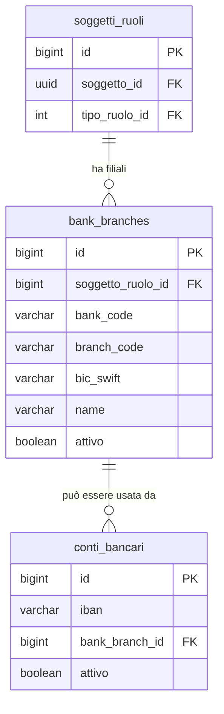

## 📘 Documentazione Concettuale – Tabella `anagrafiche.bank_branches`

> 👀 **Vedi anche**
>
> Approfondimento tabelle:  
>
> * [anagrafiche.soggetti_ruoli](/dbzero/anagrafiche/tabelle/soggetti_ruoli)   
> * [anagrafiche.conti_bancari](/dbzero/anagrafiche/tabelle/conti_bancari)   
> * [anagrafiche.soggetti_ruoli_conti_bancari](/dbzero/anagrafiche/tabelle/soggetti_ruoli_conti_bancari)   
>
> Approfondimento funzioni/trigger:   
>
> * [anagrafiche.trgfn_bank_check_ruolo_bank_branches](/dbzero/anagrafiche/funzioni/trgfn_bank_check_ruolo_bank_branches)   
> 
>
> Altre guide correlate:
>
> * [Gestione conti bancari](/guide/gestione-conti-bancari)

---

### 🎯 Scopo Principale
(latest review 02-12-25)
La tabella **`anagrafiche.bank_branches`** rappresenta le **filiali di istituti di credito** (branch bancarie) collegate a un determinato **ruolo di soggetto** di tipo *ISTITUTO_CREDITO* (`anagrafiche.soggetti_ruoli`).

Obiettivi principali:

* Centralizzare l'anagrafica delle **filiali bancarie** collegate a uno specifico istituto.
* Collegare in modo strutturato **IBAN/conti** (`anagrafiche.conti_bancari.bank_branch_id`) alla relativa filiale.
* Garantire **univocità** di filiale per istituto tramite la combinazione (`soggetto_ruolo_id`, `bank_code`, `branch_code`).
* Supportare use-case internazionali tramite `bic_swift` opzionale.

In sintesi: è il **catalogo delle filiali** per ogni banca censita come ruolo in `anagrafiche.soggetti_ruoli`.

---

### 🔗 Collegamenti con Altre Tabelle

| Campo               | Tabella di riferimento                      | Descrizione                                                                     |
| ------------------- | ------------------------------------------- | ------------------------------------------------------------------------------- |
| `soggetto_ruolo_id` | `anagrafiche.soggetti_ruoli(id)`            | Collegamento al ruolo di tipo ISTITUTO_CREDITO (banca proprietaria filiale)     |
| *(indiretto)*       | `anagrafiche.conti_bancari(bank_branch_id)` | I conti bancari (IBAN) possono referenziare la filiale tramite `bank_branch_id` |

Note:

* Il collegamento con il **soggetto** avviene in modo indiretto: `bank_branches.soggetto_ruolo_id → soggetti_ruoli.soggetto_id → soggetti`.
* Questo modello consente di differenziare più ruoli dello stesso soggetto (es. banca che svolge più funzioni) e di associare le filiali solo al ruolo corretto (ISTITUTO_CREDITO).

---

### 🚩 Regole di Validazione e Vincoli

1. **PK e univocità filiale per istituto**

   * `pk_bank_branches` su `id` → identifica univocamente ogni filiale.
   * `uq_bank_branches_soggetto_ruolo_bank_branch_code` → garantisce che per lo stesso `soggetto_ruolo_id` non possano esistere due filiali con la stessa coppia (`bank_code`, `branch_code`).

2. **Formato BIC/SWIFT**

   * `check_bank_branches_bic_swift_fmt` → se valorizzato, `bic_swift` deve rispettare il formato **8 o 11 caratteri alfanumerici uppercase**.

3. **Coerenza con ruolo**

   * Il trigger `trg_bank_check_ruolo_bank_branches_ins_upd` demanda alla funzione `anagrafiche.trgfn_bank_check_ruolo_bank_branches()` i controlli di coerenza, tipicamente:

     * verificare che `soggetto_ruolo_id` punti a un ruolo coerente (es. **ISTITUTO_CREDITO**);
     * impedire associazioni a ruoli non bancari.

4. **Attivazione/Disattivazione filiale**

   * `attivo BOOLEAN NOT NULL DEFAULT TRUE` → controlla la possibilità di utilizzo operativo della filiale;
   * la disabilitazione della filiale non elimina il record, ma lo rende **non selezionabile** nei flussi applicativi.

5. **Storicizzazione (se abilitata)**

   * `storicizza BOOLEAN NOT NULL DEFAULT TRUE` → abilita la futura eventuale integrazione con trigger di storico generico (non definiti qui, ma coerenti con il framework globale di Zero ERP).

---

### 🔍 Indicizzazione

* **`ix_bank_branches_attivo`**

  * Indicizza il campo `attivo` per filtrare rapidamente solo le filiali utilizzabili.

* **`ix_bank_branches_soggetto_ruolo_id`**

  * Ottimizza ricerche per ruolo di banca (es. caricamento filiali di uno specifico istituto per UI o API).

Queste index supportano bene:

* caricamento filiali per banca (by `soggetto_ruolo_id`);
* filtri su filiali attive vs non attive.

---

### 🧩 Ruolo nel Modello Conti Bancari

La tabella `anagrafiche.bank_branches` è pensata per integrarsi con:

* `anagrafiche.conti_bancari` → ogni IBAN può referenziare una filiale tramite `bank_branch_id`;
* `anagrafiche.soggetti_ruoli_conti_bancari` / `anagrafiche.soggetti_conti_bancari` → legano i conti a soggetti/ruoli, mentre **questo oggetto** lega la filiale all'**istituto bancario**.

Vantaggi:

* Possibilità di riportare in stampa e in UI **nome filiale**, **ABI/CAB** o equivalenti.
* Supporto a controlli di coerenza tra IBAN e banca/filiale (es. match tra `bank_code`/`branch_code` e parti dell'IBAN nazionale).
* Modello adatto ad essere arricchito con ulteriori metadati in `meta` (es. indirizzo filiale, orari, codici interni banca, ecc.).

---

### ⚙️ Trigger e Funzioni Coinvolte

| Trigger                                      | Evento                  | Funzione chiamata                                    | Scopo principale                          |
| -------------------------------------------- | ----------------------- | ---------------------------------------------------- | ----------------------------------------- |
| `trg_bank_check_ruolo_bank_branches_ins_upd` | BEFORE INSERT OR UPDATE | `anagrafiche.trgfn_bank_check_ruolo_bank_branches()` | Verifica coerenza del ruolo banca/filiale |

> 📌 Altri trigger di audit/tx-id potrebbero essere aggiunti in futuro per allineare la tabella al framework comune (`dbops.trgfn_tx_id_managed`, `script.trgfn_audit_data_user_generic`, `script.trgfn_storico_generic`, ecc.).

---

### 💡 Vantaggi Operativi

* **Chiarezza anagrafica**: separa il concetto di **istituto bancario** (ruolo del soggetto) dalla **singola filiale**.
* **Riutilizzo**: la stessa filiale può essere referenziata da più conti (`conti_bancari`) evitando duplicazioni incoerenti di ABI/CAB/BIC.
* **Estensibilità**: il campo `meta JSONB` consente di aggiungere dati specifici di integrazione (codici interni, tag, attributi per country-specific rules) senza modificare la struttura.
* **Governance**: l'attributo `attivo` consente di "ritirare" filiali senza perdere lo storico delle relazioni.

---

### 🧾 Note sul Modello Dati

* L'esistenza di un record in `anagrafiche.bank_branches` implica che l'istituto di credito sia **censito come ruolo** in `anagrafiche.soggetti_ruoli`.
* Il modello è adatto a scenari multi-paese: `bank_code` e `branch_code` non sono legati a un formato specifico (ABI/CAB è solo un esempio).
* `bic_swift` è opzionale ma validato quando presente, e può costituire base per future integrazioni con servizi bancari esterni.

---

### 🧭 Diagramma ER relazioni (semplificato)

---

### ✅ Riepilogo

La tabella **`anagrafiche.bank_branches`** è il **punto di raccordo** tra:

* l'anagrafica del **ruolo banca** (`soggetti_ruoli`),
* e i **conti bancari** (`conti_bancari`) attraverso `bank_branch_id`.

Consente di gestire in modo strutturato:

* catalogo filiali per istituto;
* coerenza tra IBAN, banca e filiale;
* attivazione/disattivazione controllata di filiali;
* arricchimento progressivo tramite `meta`.

È quindi un tassello fondamentale per una gestione bancaria **pulita, normalizzata e pronta a integrazioni future** nel contesto Zero ERP.

---


