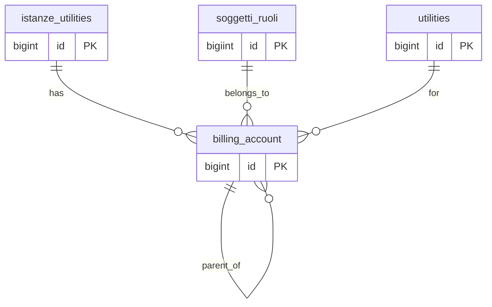

## 📘 Documentazione Concettuale – Tabella `anagrafiche.billing_account`
>
> 👀 **Vedi anche**
> 
> Guide generali:    
>
>  * [Generazione di un cliente](/guide/generazione-cliente)    
> 
> Approfondimento tabelle :   
>
>   * [anagrafiche.istanze_utilities](/dbzero/anagrafiche/tabelle/istanze_utilities)    
>   * [anagrafiche.clienti](/dbzero/anagrafiche/tabelle/clienti)    
>   * [anagrafiche.soggetti_ruoli](/dbzero/anagrafiche/tabelle/soggetti_ruoli)    
>   * [config.utilities](/dbzero/config/tabelle/utilities)     
>
> Approfondimeto funzioni:    
>
> * [anagrafiche.trgfn_billing_account_guard_normalize](/dbzero/anagrafiche/funzioni/trgfn_billing_account_guard_normalize)

> **Aggiornamenti dicembre 2025:** 
> Per i dettagli completi, le motivazioni progettuali e tutti i vincoli formali introdotti, consulta la sezione **7** dedicata nella documentazione :
>
>👉 [anagrafiche.istanze_utilities](/dbzero/anagrafiche/tabelle/istanze_utilities)
>

---

### 🎯 Scopo Principale    

(latest review 16-01-26)
La tabella `anagrafiche.billing_account` mantiene lo **storico dei codici cliente** per ciascuna `utility`, consentendo:

* **Generazione anticipata** del `codice (account)` in fase precontrattuale.
* **Unicità di `codice`** grazie al vincolo `uq_billing_account_codice`.
* **Unicità per istanza+utility**: non possono esistere due record con la stessa coppia (`istanza_utility_id`, `utility_id`).
* **Strutture gerarchiche** dei codici tramite `parent_account_id`, utile per Modellare:

---

La tabella `anagrafiche.billing_account` mantiene lo **storico dei codici cliente** per ciascuna `utility`, consentendo:

* Generazione anticipata del `codice (account)` in fase precontrattuale
* Gestione di più codici nel tempo tramite il campo `parent_account_id`
* Unicità per coppia `istanza_utility_id` + `utility_id`

Nota naming utility:

* `anagrafiche.billing_account` usa `utility_id`;
* `anagrafiche.pdp` usa `utility_id`.

Entrambe puntano a `config.utilities.id`; il naming e' uniforme anche nelle query/join.

---

### 🔗 Collegamenti con Altre Tabelle

| Campo                | Tabella di riferimento              | Azione                                |
| -------------------- | ----------------------------------- | ------------------------------------- |
| `istanza_utility_id` | `anagrafiche.istanze_utilities(id)` | ON UPDATE CASCADE, ON DELETE SET NULL |
| `soggetto_ruolo_id`  | `anagrafiche.soggetti_ruoli(id)`    | ON UPDATE CASCADE, ON DELETE RESTRICT |
| `utility_id`         | `config.utilities(id)`              | ON UPDATE CASCADE, ON DELETE RESTRICT |
| `parent_account_id`  | `anagrafiche.billing_account(id)`   | ON UPDATE CASCADE, ON DELETE SET NULL |

---

### 🚩 Regole di Validazione Condizionale

1. **Unicità account**

   * `codice` deve essere univoco (`uq_billing_account_codice`).
2. **Unicità per istanza-utility**

   * Non possono esistere due billing account per la stessa coppia (`istanza_utility_id`, `utility_id`).
3. **Range di validità**

   * Periodi di validità: valido_dal è obbligatorio se parent_account_id non è NULL; valido_al, se presente, deve essere ≥    valido_dal

---

### 💡 Vantaggi Operativi

* **Fatturazione precontrattuale**: codice disponibile anche prima del customer finale.
* **Storico completo**: tracciamento di versioni e sub-account.
* **Integrità fiscale**: raggruppamento sullo stesso `id_fiscale_univoco_cf_piva` del soggetto.

---

### 🔑 Gerarchia e Periodo di Validità

1. **`parent_account_id`**

   * Definisce relazioni padre-figlio tra account.
   * Se `parent_account_id IS NULL`, la fattura è emessa per l’account stesso.
   * Se non NULL, la fattura somma i consumi di tutti i figli e li addebita al padre.

2. **`valido_dal` / `valido_al`**

   * `valido_dal`: data inizio validità dell’associazione al parent (obbligatoria se `parent_account_id` è presente).
   * `valido_al`: data fine validità, se NULL l’associazione è ancora in corso.

3. **Coerenza fiscale**

   * il `codice (account)` del padre e dei figli deve condividere lo stesso `id_fiscale_univoco_cf_piva` del soggetto.

---

### ✅ Controlli di Coerenza

* FK e vincoli CHECK assicurano la validità dei periodi (`valido_dal`, `valido_al`) e delle gerarchie.
* Il trigger `trgfn_billing_account_gen_codice` genera `codice` se mancante.

---

### Policy fatturazione ordini

Il campo `fatturazione_ordini` (default `CONFERMATO`) definisce il default
per `ordini.fatturazione_trigger` al momento dell'inserimento ordine:

| Valore | Significato |
| --- | --- |
| `CONFERMATO` | Fatturazione alla conferma ordine (push ordine a commessa) |
| `SPEDITO` | Fatturazione alla spedizione DDT (push DDT a commessa) |
| `CONSEGNATO` | Fatturazione alla consegna DDT (push DDT a commessa) |

Il valore e` ereditato automaticamente sugli ordini tramite
`vendite.trgfn_ordini_normalize` e puo` essere sovrascritto per singolo ordine.

---

### Note Finali

Questa tabella e` la base per la gestione avanzata dei codici di fatturazione, con meccanismi di storicizzazione e aggregazione utili in scenari di multi-utenza e subentri tipici del settore utilities.

###  Diagramma ER relazioni

---



---
