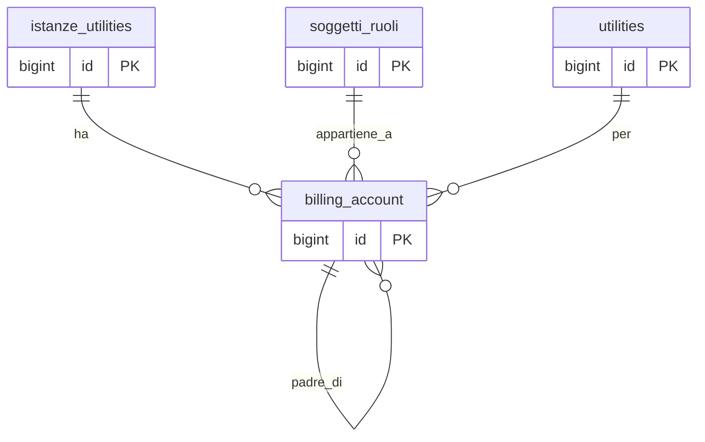

## Documentazione – Tabella `anagrafiche.billing_account`

> Vedi anche
>
> Guide generali:
>
> * [Generazione di un cliente](/guide/generazione-cliente)
> * [Glossario termini utility](/guide/glossario/glossario-utility)
>
> Approfondimento tabelle:
>
> * [anagrafiche.istanze_utilities](/dbzero/anagrafiche/tabelle/istanze_utilities)
> * [anagrafiche.clienti](/dbzero/anagrafiche/tabelle/clienti)
> * [anagrafiche.soggetti_ruoli](/dbzero/anagrafiche/tabelle/soggetti_ruoli)
> * [config.utilities](/dbzero/config/tabelle/utilities)
>
> Approfondimento funzioni:
>
> * [anagrafiche.trgfn_billing_account_guard_normalize](/dbzero/anagrafiche/funzioni/trgfn_billing_account_guard_normalize)

---

### 🎯 Scopo Principale

(latest review 01-03-26)

Il **billing account** (BA) e l'account di fatturazione associato a un'istanza utility. In termini semplici: e il "contenitore" che identifica **a chi fatturare** e **con quale codice** per un determinato servizio (gas, energia, ecc.).

Caratteristiche principali:

* Il codice account (`codice`) puo essere generato **prima del contratto** (fase precontrattuale), quando il soggetto non e ancora ufficialmente cliente
* Ogni BA e legato a una sola istanza e a una sola utility
* Il BA supporta una **gerarchia padre/figlio** per aggregare la fatturazione di piu utenze
* Il BA resta attivo anche dopo la chiusura del cliente, per consentire fatture finali e conguagli

---

### Collegamenti con altre tabelle

| Campo                | Tabella di riferimento              | Azione                                |
| -------------------- | ----------------------------------- | ------------------------------------- |
| `istanza_utility_id` | `anagrafiche.istanze_utilities(id)` | ON UPDATE CASCADE, ON DELETE SET NULL |
| `soggetto_ruolo_id`  | `anagrafiche.soggetti_ruoli(id)`    | ON UPDATE CASCADE, ON DELETE RESTRICT |
| `utility_id`         | `config.utilities(id)`              | ON UPDATE CASCADE, ON DELETE RESTRICT |
| `parent_account_id`  | `anagrafiche.billing_account(id)`   | ON UPDATE CASCADE, ON DELETE SET NULL |

Nota naming: sia `anagrafiche.billing_account` sia `anagrafiche.pdp` usano `utility_id`, entrambi puntano a `config.utilities.id`. Il naming e uniforme anche nelle query/join.

---

### Regole di validazione

* **Unicita account**: `codice` deve essere univoco (`uq_billing_account_codice`)
* **Unicita per istanza+utility**: non possono esistere due BA con la stessa coppia (`istanza_utility_id`, `utility_id`)
* **Range di validita**: `valido_dal` e obbligatorio se `parent_account_id` non e NULL; `valido_al`, se presente, deve essere >= `valido_dal`

---

### Gerarchia padre/figlio

Il BA supporta una struttura gerarchica tramite `parent_account_id`. Questa gerarchia serve per **aggregare la fatturazione** di piu utenze sullo stesso intestatario.

#### Come funziona

* Se `parent_account_id IS NULL` → il BA e un account autonomo (o e esso stesso un padre)
* Se `parent_account_id IS NOT NULL` → il BA e un figlio, e la sua fatturazione viene aggregata al padre

#### Periodo di validita dell'associazione

* `valido_dal`: data inizio validita dell'associazione al padre (obbligatoria se c'e un parent)
* `valido_al`: data fine validita; se NULL, l'associazione e ancora in corso

#### Coerenza fiscale

Il `codice` del padre e dei figli deve condividere lo stesso `id_fiscale_univoco_cf_piva` del soggetto.

#### Guard sulla dissociazione del parent

Non e possibile rimuovere `parent_account_id` da un BA figlio quando esistono attivita fatturabili non ancora fatturate (`vendite.attivita_fatturabili` con `fatturato = FALSE`) collegate al BA. Questo vincolo e implementato nel trigger `trgfn_billing_account_guard_normalize` e serve a prevenire la perdita di coerenza nella pipeline fatturazione: se il parent venisse rimosso a meta lavorazione, le attivita gia raggruppate sotto il padre resterebbero orfane.

---

### Tracciabilita del BA nella pipeline fatturazione

Quando un BA ha un parent (gerarchia), nella catena di fatturazione il BA figlio viene **risolto al padre** per la testata fattura, ma **preservato per ogni riga**. Questo consente di sapere sempre da quale utenza originale proviene ogni importo.

| Tabella                        | Colonna                   | Contiene                                     | Sempre valorizzata? |
| ------------------------------ | ------------------------- | -------------------------------------------- | ------------------- |
| `vendite.attivita_fatturabili` | `billing_account_id`      | BA figlio (originale, mai risolto al padre)  | Si                  |
| `vendite.fatture`              | `billing_account_id`      | BA padre (risolto da `fn_build_fattura_key`) | Si                  |
| `vendite.fatture_righe`        | `dest_billing_account_id` | BA figlio (preservato per tracciabilita)     | Si                  |

Flusso in dettaglio:

1. `fn_build_fattura_key`: usa `COALESCE(ba.parent_account_id, a.billing_account_id)` per risolvere al padre
2. `fn_group_attivita_fatturabili`: estrae `a.billing_account_id` (figlio) come `dest_billing_account_id`
3. `fn_generate_fatture_righe`: inserisce `dest_billing_account_id` nelle righe fattura
4. `trgfn_fatture_righe_guard_normalize`: fallback — se `dest_billing_account_id` e NULL, eredita da `fatture.billing_account_id`

La risoluzione al padre e **incondizionata**: se `parent_account_id` e valorizzato, la fattura va al padre. Se non si vuole aggregare un figlio al padre, la soluzione e **non impostare `parent_account_id`** (non serve un flag separato).

---

### Policy fatturazione ordini

Il campo `fatturazione_ordini` (default `CONFERMATO`) definisce il default per `ordini.fatturazione_trigger` al momento dell'inserimento ordine:

| Valore       | Significato                                                |
| ------------ | ---------------------------------------------------------- |
| `CONFERMATO` | Fatturazione alla conferma ordine (push ordine a commessa) |
| `SPEDITO`    | Fatturazione alla spedizione DDT (push DDT a commessa)     |
| `CONSEGNATO` | Fatturazione alla consegna DDT (push DDT a commessa)       |

Il valore e ereditato automaticamente sugli ordini tramite `vendite.trgfn_ordini_normalize` e puo essere sovrascritto per singolo ordine.

---

### Trigger e funzioni coinvolte

| Trigger                                 | Scopo                                                               |
| --------------------------------------- | ------------------------------------------------------------------- |
| `trgfn_billing_account_gen_codice`      | Genera `codice` automaticamente se mancante                         |
| `trgfn_billing_account_guard_normalize` | Guard di coerenza (validazioni, normalizzazione, protezione parent) |
| `dbops.trgfn_tx_id_managed`             | Genera `tx_id` per tracciabilita transazionale                      |
| `script.trgfn_audit_data_user_generic`  | Aggiorna campi audit                                                |
| `script.trgfn_storico_generic`          | Snapshot storico su update/delete                                   |

---

### Diagramma ER

---


