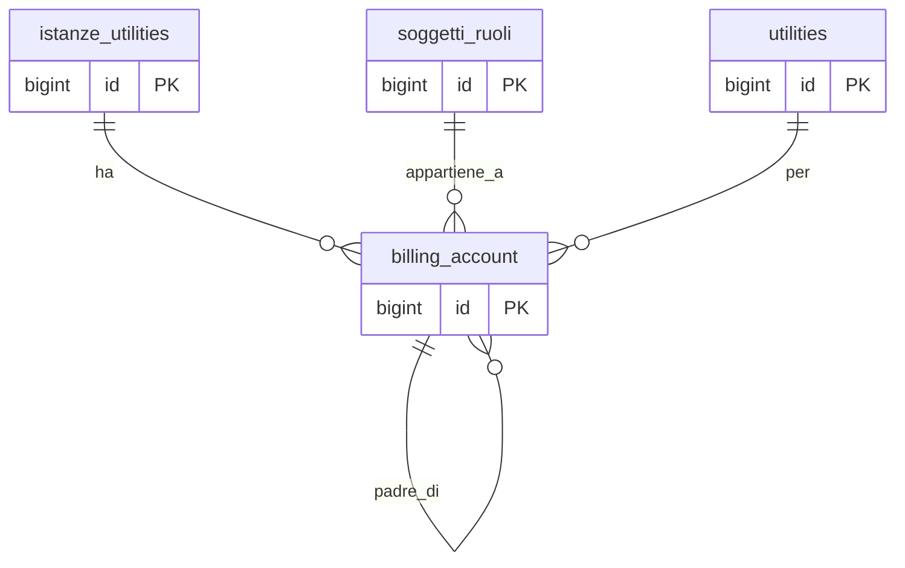

## Documentazione – Tabella `anagrafiche.billing_account`

> Vedi anche
>
Guide generali:
>
[Generazione di un cliente](/guide/generazione-cliente)
> [Glossario termini utility](/glossario/glossario-utility)
>
Approfondimento tabelle:
>
[anagrafiche.istanze_utilities](/dbzero/anagrafiche/tabelle/istanze_utilities)
> [anagrafiche.clienti](/dbzero/anagrafiche/tabelle/clienti)
> [anagrafiche.soggetti_ruoli](/dbzero/anagrafiche/tabelle/soggetti_ruoli)
> [config.utilities](/dbzero/config/tabelle/utilities)
>
Approfondimento funzioni:
>
[anagrafiche.trgfn_billing_account_guard_normalize](/dbzero/anagrafiche/funzioni/trgfn_billing_account_guard_normalize)

---
### 🎯 Scopo Principale
(latest review 20-04-2026 — aggiunta colonna `canale_origine`)

Il **billing account** (BA) e l'account di fatturazione associato a un'istanza utility. In termini semplici: e il "contenitore" che identifica **a chi fatturare** e **con quale codice** per un determinato servizio (gas, energia, ecc.).

Caratteristiche principali:

* Il codice account (`codice`) puo essere generato **prima del contratto** (fase precontrattuale), quando il soggetto non e ancora ufficialmente cliente
* Ogni BA e legato a una sola istanza e a una sola utility
* Il BA supporta una **gerarchia padre/figlio** per aggregare la fatturazione di piu utenze
* Il BA resta attivo anche dopo la chiusura del cliente, per consentire fatture finali e conguagli
* **BA separati per canale self-service** (post 20-04-2026): un SR-CL puo avere piu BA, uno per ogni `canale_origine` (`ADMIN`, `PORTALE`, `SHOP`). I BA portale e shop sono concettualmente distinti — portale gestisce fatture B2B con partita IVA, shop gestisce ricevute consumer.

---

### Collegamenti con altre tabelle

| Campo                | Tabella di riferimento              | Azione                                |
| -------------------- | ----------------------------------- | ------------------------------------- |
| `istanza_utility_id` | `anagrafiche.istanze_utilities(id)` | ON UPDATE CASCADE, ON DELETE SET NULL |
| `soggetto_ruolo_id`  | `anagrafiche.soggetti_ruoli(id)`    | ON UPDATE CASCADE, ON DELETE RESTRICT |
| `utility_id`         | `config.utilities(id)`              | ON UPDATE CASCADE, ON DELETE RESTRICT |
| `parent_account_id`  | `anagrafiche.billing_account(id)`   | ON UPDATE CASCADE, ON DELETE SET NULL |
| `categoria_cliente_id` | `anagrafiche.categorie_clienti(id)` | ON UPDATE CASCADE, ON DELETE NO ACTION |

Nota naming: sia `anagrafiche.billing_account` sia `anagrafiche.pdp` usano `utility_id`, entrambi puntano a `config.utilities.id`. Il naming e uniforme anche nelle query/join.

---

### Regole di validazione

* **Unicita account**: `codice` deve essere univoco (`uq_billing_account_codice`)
* **Unicita per istanza+utility**: non possono esistere due BA con la stessa coppia (`istanza_utility_id`, `utility_id`)
* **Range di validita**: `valido_dal` e obbligatorio se `parent_account_id` non e NULL; `valido_al`, se presente, deve essere >= `valido_dal`
* **`canale_origine` immutabile post-INSERT**: trigger `trg_billing_account_a10_canale_origine_immutable_upd` impedisce modifiche alla colonna. Codice errore `E_CANALE_ORIGINE_IMMUTABILE` (id 385).

---

### Canale di origine

Colonna `canale_origine` di tipo `config.canale_origine` (ENUM `ADMIN` /
`PORTALE` / `SHOP`), `NOT NULL DEFAULT 'ADMIN'`. Introdotta con migration
20260420-03 per il modello SSO multi-canale (§6.4 guida multi-face-auth).

**Semantica:**

* `ADMIN` — BA creato da operatore interno (back-office, pipeline
  fatturazione, migrazioni). Caso comune per i BA pre-refactor.
* `PORTALE` — BA creato da cliente B2B via portale self-service (fase di
  onboarding guidata). Supporta fatturazione elettronica, partita IVA
  fatturante, split payment.
* `SHOP` — BA creato da shop customer B2C via registrazione shop. Usato
  solo per ricevute consumer (niente fattura elettronica, pagamento
  immediato).

**Implicazioni RLS:**

* La policy **`rls_billing_account_self_ownership`** (portale B2B) ammette
  solo `CLIENTE_PORTALE` e non filtra su `canale_origine`: un cliente B2B
  vede tutti i propri BA (caso 2 §5.1 guida multi-face — portale consolida
  la vista del rapporto).
* La policy **`rls_billing_account_shop`** (shop B2C) ammette solo
  `SHOP_CUSTOMER` e filtra `canale_origine = 'SHOP'`: un consumer vede
  solo i propri BA shop, non quelli portale della stessa azienda.

**Coesistenza sullo stesso SR-CL:** un'azienda che ha sia accesso portale
B2B sia un account shop B2C puo' avere contemporaneamente:

* BA `ADMIN` / `PORTALE` per la fatturazione B2B (partita IVA, fattura
  elettronica, pipeline fatturabili)
* BA `SHOP` per acquisti consumer occasionali (ricevute, pagamento
  immediato)

I due BA sono fisicamente distinti e non si mescolano nelle pipeline di
fatturazione.

---

### Gerarchia padre/figlio

Il BA supporta una struttura gerarchica tramite `parent_account_id`. Questa gerarchia serve per **aggregare la fatturazione** di piu utenze sullo stesso intestatario.

#### Come funziona

* Se `parent_account_id IS NULL` → il BA e un account autonomo (o e esso stesso un padre)
* Se `parent_account_id IS NOT NULL` → il BA e un figlio, e la sua fatturazione viene aggregata al padre

#### Periodo di validita dell'associazione

* `valido_dal`: data inizio validita dell'associazione al padre (obbligatoria se c'e un parent)
* `valido_al`: data fine validita; se NULL, l'associazione e ancora in corso

#### Coerenza fiscale

Il `codice` del padre e dei figli deve condividere lo stesso `id_fiscale_univoco_cf_piva` del soggetto.

#### Guard sulla dissociazione del parent

Non e possibile rimuovere `parent_account_id` da un BA figlio quando esistono attivita fatturabili non ancora fatturate (`vendite.attivita_fatturabili` con `fatturato = FALSE`) collegate al BA. Questo vincolo e implementato nel trigger `trgfn_billing_account_guard_normalize` e serve a prevenire la perdita di coerenza nella pipeline fatturazione: se il parent venisse rimosso a meta lavorazione, le attivita gia raggruppate sotto il padre resterebbero orfane.

---

### Tracciabilita del BA nella pipeline fatturazione

Quando un BA ha un parent (gerarchia), nella catena di fatturazione il BA figlio viene **risolto al padre** per la testata fattura, ma **preservato per ogni riga**. Questo consente di sapere sempre da quale utenza originale proviene ogni importo.

| Tabella                        | Colonna                   | Contiene                                     | Sempre valorizzata? |
| ------------------------------ | ------------------------- | -------------------------------------------- | ------------------- |
| `vendite.attivita_fatturabili` | `billing_account_id`      | BA figlio (originale, mai risolto al padre)  | Si                  |
| `vendite.fatture`              | `billing_account_id`      | BA padre (risolto da `fn_build_fattura_key`) | Si                  |
| `vendite.fatture_righe`        | `dest_billing_account_id` | BA figlio (preservato per tracciabilita)     | Si                  |

Flusso in dettaglio:

1. `fn_build_fattura_key`: usa `COALESCE(ba.parent_account_id, a.billing_account_id)` per risolvere al padre
2. `FattureRigheService._build_group_key` (backend): estrae `a.billing_account_id` (figlio) come `dest_billing_account_id` e lo mette nella chiave di raggruppamento
3. `FattureRigheService.generate_fatture_righe` (backend): inserisce `dest_billing_account_id` nelle righe fattura
4. `trgfn_fatture_righe_guard_normalize`: fallback — se `dest_billing_account_id` e NULL, eredita da `fatture.billing_account_id`

La risoluzione al padre e **incondizionata**: se `parent_account_id` e valorizzato, la fattura va al padre. Se non si vuole aggregare un figlio al padre, la soluzione e **non impostare `parent_account_id`** (non serve un flag separato).

---

### Categoria cliente per pricing (v5, 14-04-26)

Il BA e' sempre associato a una **categoria commerciale** (`categoria_cliente_id` NOT NULL, FK verso [`anagrafiche.categorie_clienti`](/dbzero/anagrafiche/tabelle/categorie_clienti)). La categoria e' la dimensione su cui si appoggia lo STADIO 2 del resolver prezzi v5:

* Un BA **senza contratto individuale** risolve il prezzo tramite la matrice `anagrafiche.categorie_clienti_listini` filtrata per `(categoria_cliente_id, utility_id, emittente, classe_utenza)`.
* Un BA **con contratto** salta la categoria: STADIO 1 (contratto) batte STADIO 2.
* La **partecipazione alla promo** (STADIO 0) e' decisa a livello di categoria (`categorie_clienti.partecipa_promo`), non di singolo BA.

Strategia di rollout: al primo deploy tutti i BA esistenti vengono backfillati alla categoria `STANDARD` (non partecipa alle promo); la colonna e' `NOT NULL` dal changeSet `20260414-03`. Nessun BA puo' restare orfano di categoria, quindi il resolver non incontra mai la condizione `BA senza categoria`.

---

### Policy fatturazione ordini

Il campo `fatturazione_ordini` (default `CONFERMATO`) definisce il default per `ordini.fatturazione_trigger` al momento dell'inserimento ordine:

| Valore       | Significato                                                |
| ------------ | ---------------------------------------------------------- |
| `CONFERMATO` | Fatturazione alla conferma ordine (push ordine a commessa) |
| `SPEDITO`    | Fatturazione alla spedizione DDT (push DDT a commessa)     |
| `CONSEGNATO` | Fatturazione alla consegna DDT (push DDT a commessa)       |

Il valore e ereditato automaticamente sugli ordini tramite `vendite.trgfn_ordini_normalize` e puo essere sovrascritto per singolo ordine.

---

### Trigger e funzioni coinvolte

| Trigger                                     | Fase           | Scopo                                                                                  |
| ------------------------------------------- | -------------- | -------------------------------------------------------------------------------------- |
| `trgfn_billing_account_gen_codice`          | BEFORE INS/UPD | Genera `codice` automaticamente se mancante                                            |
| `trgfn_billing_account_guard_admin_globale` | BEFORE INSERT  | Vieta di creare un BA a chi non ha un emittente su cui scrivere (né appartenenza né emittente di lavoro), quando esistono emittenti (rev 2026-08-04) |
| `trgfn_billing_account_guard_normalize`     | BEFORE INS/UPD | Guard di coerenza (validazioni, normalizzazione, protezione parent)                    |
| `dbops.trgfn_tx_id_managed`                 | BEFORE INS/UPD | Genera `tx_id` per tracciabilita transazionale                                         |
| `script.trgfn_audit_data_user_generic`      | BEFORE INS/UPD | Aggiorna campi audit                                                                   |
| `trgfn_billing_account_link_ef`             | AFTER INSERT   | Auto-link BA → emittente fiscale dell'operatore corrente (refactor 2026-04-08)         |
| `script.trgfn_storico_generic`              | BEFORE UPD/DEL | Snapshot storico su update/delete                                                      |

#### Auto-link BA ↔ emittente fiscale (refactor 2026-04-08)

Alla creazione di un BA, il trigger `trgfn_billing_account_link_ef` (fase `z90`) crea automaticamente la riga in `anagrafiche.emittenti_fiscali_billing_account` collegando il BA all'emittente dell'operatore corrente. La risoluzione passa per:

1. Lettura GUC `app.current_user_id` (settato dal middleware Django).
2. Resolver [`script.fn_resolve_emittente_for_user`](/dbzero/script/funzioni/fn_resolve_emittente_for_user).
3. Lookup `emittenti_fiscali.soggetto_ruolo_id` (la tabella di mapping usa `soggetto_ruolo_id`, non la PK reale).
4. INSERT mapping con `is_default = false` (mapping specifico, non default globale).

Il trigger è **idempotente** (skip se la riga di mapping esiste già) e **fail‑open** in assenza di GUC (seed/bootstrap/job CLI senza utente autenticato).

Il guard a monte [`trgfn_billing_account_guard_admin_globale`](/dbzero/anagrafiche/funzioni/trgfn_billing_account_guard_admin_globale) (fase `a10`) impedisce agli admin globali (utenti senza riga in `config.user_emittenti_fiscali`) di creare BA quando esistono emittenti fiscali attivi nel sistema. Errore: `E_BA_ADMIN_GLOBALE_VIETATO`.

---

### Diagramma ER

---


