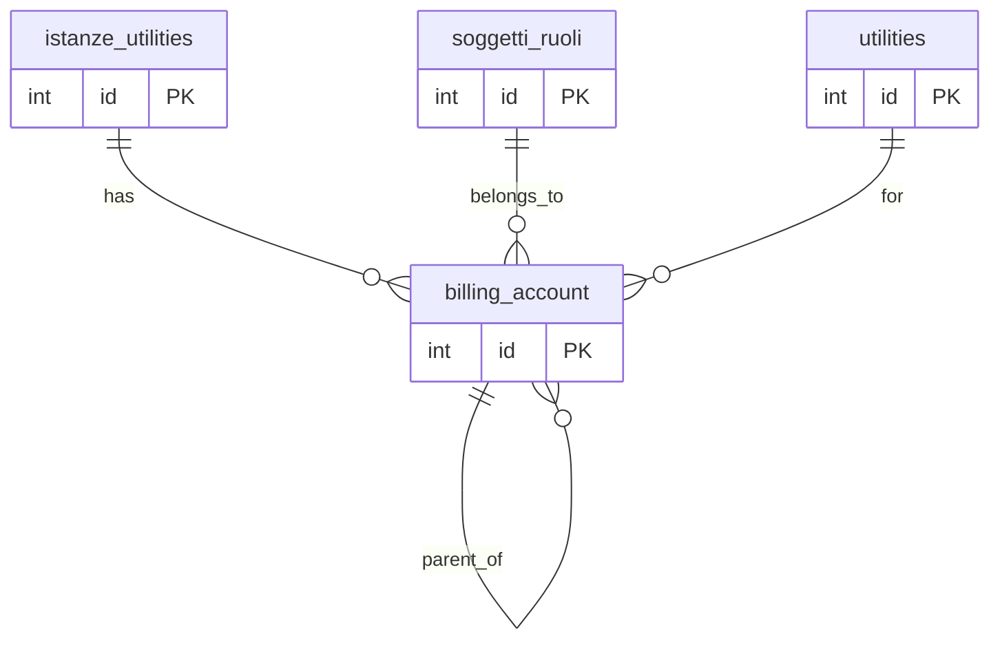
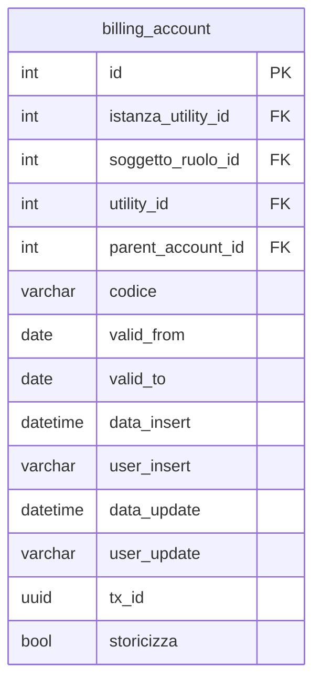

## 📘 Documentazione Concettuale – Tabella `anagrafiche.billing_account`

> 👀 **Vedi anche**
> 
> Guide generali: 
>
>  * [Generazione di un cliente](/guide/generazione-cliente)
> 
> Approfondimento tabelle :
>
>   * [anagrafiche.istanze_utilities](/dbzero/anagrafiche/tabelle/istanze_utilities)
>   * [anagrafiche.clienti](/dbzero/anagrafiche/tabelle/clienti)
>   * [anagrafiche.soggetti_ruoli](/dbzero/anagrafiche/tabelle/soggetti_ruoli)
>   * [config.utilities](/dbzero/config/tabelle/utilities)
>
> Approfondimeto funzioni:
>courtesy_title
> * [anagrafiche.trgfn_billing_account_clean_fields](/dbzero/anagrafiche/funzioni/trgfn_billing_account_clean_fields)
> * [script.fn_generate_codice](/dbzero/script/funzioni/fn_generate_codice)
> * [dbops.trgfn_tx_id_managed](/dbzero/dbops/funzioni/trgfn_tx_id_managed)
---

### 🎯 Scopo Principale

La tabella `anagrafiche.billing_account` mantiene lo **storico dei codici cliente** per ciascuna `utility`, consentendo:

* **Generazione anticipata** del `codice (account)` in fase precontrattuale.
* **Unicità di `codice`** grazie al vincolo `uq_billing_account_codice`.
* **Unicità per istanza+utility**: non possono esistere due record con la stessa coppia (`istanza_utility_id`, `utility_id`).
* **Strutture gerarchiche** dei codici tramite `parent_account_id`, utile per Modellare:

---

La tabella `anagrafiche.billing_account` mantiene lo **storico dei codici cliente** per ciascuna `utility`, consentendo:

* Generazione anticipata del `codice (account)` in fase precontrattuale
* Gestione di più codici nel tempo tramite il campo `parent_account_id`
* Unicità per coppia `istanza_utility_id` + `utility_id`

---

### 🔗 Collegamenti con Altre Tabelle

| Campo                | Tabella di riferimento              | Azione                                |
| -------------------- | ----------------------------------- | ------------------------------------- |
| `istanza_utility_id` | `anagrafiche.istanze_utilities(id)` | ON UPDATE CASCADE, ON DELETE SET NULL |
| `soggetto_ruolo_id`  | `anagrafiche.soggetti_ruoli(id)`    | ON UPDATE CASCADE, ON DELETE RESTRICT |
| `utility_id`         | `config.utilities(id)`              | ON UPDATE CASCADE, ON DELETE RESTRICT |
| `parent_account_id`  | `anagrafiche.billing_account(id)`   | ON UPDATE CASCADE, ON DELETE SET NULL |

---

### 🚩 Regole di Validazione Condizionale

1. **Unicità account**

   * `codice` deve essere univoco (`uq_billing_account_codice`).
2. **Unicità per istanza-utility**

   * Non possono esistere due billing account per la stessa coppia (`istanza_utility_id`, `utility_id`).
3. **Range di validità**

   * Periodi di validità: valid_from è obbligatorio se parent_account_id non è NULL; valid_to, se presente, deve essere ≥    valid_from

---

### 🔍 Indicizzazione

* **`ix_billing_account_parent_account_id`**: supporta gerarchie di account tramite `parent_account_id`.
* **`ix_billing_account_soggetto_ruolo_id`**: ricerca dei codici per soggetto.
* **`ix_billing_account_utility_id`**: filtri per tipo di servizio.

---

### 💡 Vantaggi Operativi

* **Fatturazione precontrattuale**: codice disponibile anche prima del customer finale.
* **Storico completo**: tracciamento di versioni e sub-account.
* **Integrità fiscale**: raggruppamento sullo stesso `id_fiscale_univoco_cf_piva` del soggetto.

---

### 🔑 Gerarchia e Periodo di Validità

1. **`parent_account_id`**

   * Definisce relazioni padre-figlio tra account.
   * Se `parent_account_id IS NULL`, la fattura è emessa per l’account stesso.
   * Se non NULL, la fattura somma i consumi di tutti i figli e li addebita al padre.

2. **`valid_from` / `valid_to`**

   * `valid_from`: data inizio validità dell’associazione al parent (obbligatoria se `parent_account_id` è presente).
   * `valid_to`: data fine validità, se NULL l’associazione è ancora in corso.

3. **Coerenza fiscale**

   * il `codice (account)` del padre e dei figli deve condividere lo stesso `id_fiscale_univoco_cf_piva` del soggetto.

---

### ⚙️ Trigger e Funzioni Coinvolte

| Trigger                                        | Evento                  | Funzione                                                   |
| ---------------------------------------------- | ----------------------- | ---------------------------------------------------------- |
| `trg_billing_account_clean_fields_ins_upd`     | BEFORE INSERT OR UPDATE | `anagrafiche.trgfn_billing_account_clean_fields_ins_upd()` |
| `trg_billing_account_gen_account_code_ins_upd` | BEFORE INSERT OR UPDATE | `script.fn_generate_codice('billing_account')`             |
| `trg_billing_account_audit_data_user_upd`      | BEFORE UPDATE           | `script.trgfn_upd_audit_data_user_generic_upd()`           |

---

### ✅ Controlli di Coerenza

* FK e vincoli CHECK assicurano la validità dei periodi (`valid_from`, `valid_to`) e delle gerarchie.
* Il trigger `clean_fields` genera `codice` se mancante.

---

### 🧾 Note Finali

Questa tabella è la base per la gestione avanzata dei codici di fatturazione, con meccanismi di storicizzazione e aggregazione utili in scenari di multi-utenza e subentri tipici del settore utilities.

###  Diagramma ER relazioni

---

###  Diagramma ER attributi

---



---