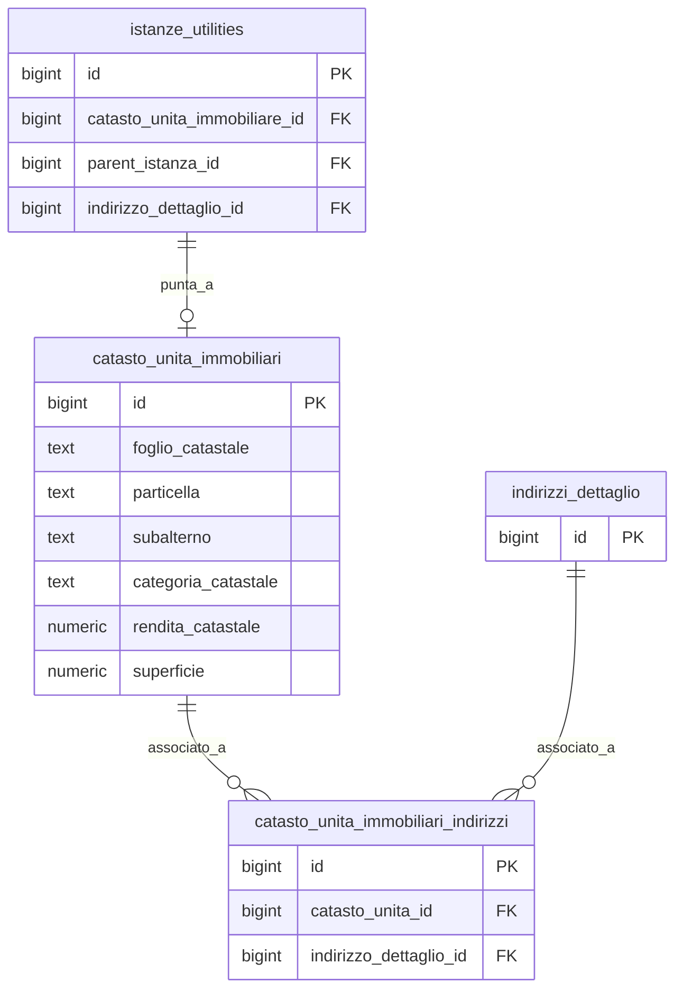

## Architettura del sotto-sistema Catasto

> Vedi anche
>
[Guida – Generazione di un Cliente](/guide/generazione-cliente)
> [Glossario termini utility](/guide/glossario/glossario-utility)
>
Tabelle:
>
[anagrafiche.catasto_unita_immobiliari](/dbzero/anagrafiche/tabelle/catasto_unita_immobiliari)
> [anagrafiche.catasto_unita_immobiliari_indirizzi](/dbzero/anagrafiche/tabelle/catasto_unita_immobiliari_indirizzi)
> [anagrafiche.istanze_utilities](/dbzero/anagrafiche/tabelle/istanze_utilities)
> [anagrafiche.indirizzi_dettaglio](/dbzero/anagrafiche/tabelle/indirizzi_dettaglio)
>
Funzioni:
>
[script.fn_get_catasto_source_by_istanza](/dbzero/script/funzioni/fn_get_catasto_source_by_istanza)
> [script.fn_clone_catasto_from_parent_by_istanza](/dbzero/script/funzioni/fn_clone_catasto_from_parent_by_istanza)
> [anagrafiche.trgfn_iu_clone_catasto_from_parent](/dbzero/anagrafiche/funzioni/trgfn_iu_clone_catasto_from_parent)
> [anagrafiche.trgfn_iu_sync_catasto_unita_indirizzo](/dbzero/anagrafiche/funzioni/trgfn_iu_sync_catasto_unita_indirizzo)

---

### Cos'e il catasto nel contesto Zero ERP

(latest review 01-03-26)

I **dati catastali** (foglio, particella, subalterno, categoria, rendita, ecc.) descrivono l'unita immobiliare associata a un punto di erogazione del servizio. Nel settore utility sono necessari per la fatturazione, per gli adempimenti normativi e per identificare con precisione dove viene erogato il servizio.

In Zero ERP il catasto e modellato come un **sotto-sistema autonomo** con le proprie tabelle, regole e trigger. Questo documento riunisce tutti i pezzi in un unico punto di riferimento.

---

### Principi di progettazione

**1. Il catasto e un'entita autonoma**

Il record catastale (`catasto_unita_immobiliari`) non dipende dal cliente ne dal contratto. Vive indipendentemente e puo essere creato, modificato e storicizzato senza impatto sulle altre entita.

**2. Il legame con l'istanza e 1:1**

Ogni istanza puo avere **al massimo un** record catastale, collegato tramite `istanze_utilities.catasto_unita_immobiliare_id`. La FK e sull'istanza, non sul catasto: e l'istanza che "punta" al suo catasto.

**3. Il legame con l'indirizzo e N:M**

La stessa unita catastale puo essere associata a piu indirizzi (casi complessi) e lo stesso indirizzo puo avere piu unita catastali. Questo legame e gestito dalla tabella ponte `catasto_unita_immobiliari_indirizzi`.

**4. Il catasto non e mai condiviso tra istanze**

Quando un subentro crea una nuova istanza sullo stesso PDP, il catasto viene **clonato** (duplicato), non condiviso. Ogni istanza ha il proprio record catastale indipendente. Questo garantisce che modifiche al catasto di un'istanza non impattino sulle altre.

---

### Modello dati

#### Tabelle

| Tabella | Ruolo |
| --- | --- |
| `anagrafiche.catasto_unita_immobiliari` | Record catastale con i dati dell'unita immobiliare (foglio, particella, subalterno, categoria, rendita, superficie, ecc.) |
| `anagrafiche.catasto_unita_immobiliari_indirizzi` | Tabella ponte tra catasto e indirizzo. Vincolo di unicita su `(catasto_unita_id, indirizzo_dettaglio_id)` |
| `anagrafiche.istanze_utilities` | Contiene `catasto_unita_immobiliare_id` (FK al catasto) e `parent_istanza_id` (sorgente per la clonazione) |

#### Relazioni



---

### Ciclo di vita del catasto

#### Creazione iniziale

Il catasto viene creato manualmente (inserimento diretto) o automaticamente durante un subentro (clonazione). Alla creazione:

* I campi catastali (foglio, particella, subalterno, ecc.) vengono valorizzati
* L'istanza viene aggiornata con `catasto_unita_immobiliare_id`
* Il trigger `trgfn_iu_sync_catasto_unita_indirizzo` crea automaticamente il legame nella tabella ponte

#### Clonazione nel subentro

Quando un nuovo cliente subentra sullo stesso PDP, il catasto viene clonato dall'istanza precedente. Questo avviene automaticamente tramite trigger (vedi sezione successiva).

#### Modifica

Le modifiche al catasto (es. aggiornamento rendita, rettifica particella) vengono storicizzate dal trigger `trgfn_storico_generic`. Il record storico conserva lo stato precedente per tracciabilita.

#### Versioning

Ogni istanza ha il proprio record catastale. Se il catasto cambia nel tempo (es. frazionamento, riaccatastamento), la nuova versione esiste solo per l'istanza corrente. Le istanze precedenti (storiche) mantengono il catasto originale.

---

### Flusso di clonazione nel subentro

Questo e il flusso piu importante del sotto-sistema catasto. Avviene automaticamente quando un nuovo cliente viene creato sullo stesso PDP di un cliente precedente.

#### Sequenza dei trigger

```text
1. INSERT INTO clienti (nuovo cliente)
     │
     ▼
2. trgfn_clienti_set_parent_istanza  (BEFORE INSERT su clienti)
   → Cerca l'istanza precedente sullo stesso PDP
   → UPDATE istanze_utilities SET parent_istanza_id = istanza_precedente
     │
     ▼
3. trgfn_iu_clone_catasto_from_parent  (AFTER UPDATE su istanze_utilities)
   → Chiama fn_clone_catasto_from_parent_by_istanza(nuova_istanza_id)
     │
     ▼
4. fn_clone_catasto_from_parent_by_istanza
   → Verifica: l'istanza ha gia un catasto? Se si, idempotenza (ritorna il catasto esistente)
   → Verifica: c'e un parent? Se no, ritorna NULL (nessuna sorgente)
   → Chiama fn_get_catasto_source_by_istanza per trovare il catasto sorgente
   → INSERT INTO catasto_unita_immobiliari (clone dei dati)
   → UPDATE istanze_utilities SET catasto_unita_immobiliare_id = nuovo_catasto
     │
     ▼
5. trgfn_iu_sync_catasto_unita_indirizzo  (AFTER UPDATE su istanze_utilities)
   → INSERT idempotente in catasto_unita_immobiliari_indirizzi
   → Crea il legame catasto-indirizzo per la nuova istanza
```

#### Regole della clonazione

* **Sorgente unica**: il catasto viene sempre cercato tramite `parent_istanza_id`. Non si risale lungo la catena: si guarda solo il parent diretto
* **Idempotenza**: se l'istanza ha gia un catasto agganciato, la clonazione non avviene (ritorna l'id esistente)
* **No-op se manca la sorgente**: se il parent non ha un catasto, la funzione ritorna NULL senza errore. Il flusso di creazione cliente continua normalmente
* **Lock anti-concorrenza**: la riga dell'istanza viene bloccata con `FOR UPDATE` per evitare race condition

---

### Funzioni coinvolte

| Funzione | Tipo | Scopo |
| --- | --- | --- |
| `script.fn_get_catasto_source_by_istanza(p_istanza_id)` | Lookup puro | Trova il record catastale sorgente dalla parent istanza. Nessun side effect |
| `script.fn_clone_catasto_from_parent_by_istanza(p_istanza_id)` | Mutazione | Clona il catasto e lo aggancia all'istanza. Idempotente |
| `anagrafiche.trgfn_iu_clone_catasto_from_parent()` | Trigger (AFTER UPDATE su istanze) | Wrapper: chiama `fn_clone_catasto_from_parent_by_istanza` |
| `anagrafiche.trgfn_iu_sync_catasto_unita_indirizzo()` | Trigger (AFTER INSERT/UPDATE su istanze) | Inserisce il legame catasto-indirizzo nella tabella ponte |

---

### Tabella ponte: catasto_unita_immobiliari_indirizzi

Questa tabella e un semplice collegamento tra un'unita catastale e un indirizzo civico. Serve a separare il **concetto catastale** (foglio/particella/subalterno) dal **concetto topografico** (via, numero civico, scala, interno).

* **Vincolo di unicita**: `(catasto_unita_id, indirizzo_dettaglio_id)` — lo stesso indirizzo non puo essere associato due volte alla stessa unita
* **FK con CASCADE**: essendo una tabella ponte pura, la cancellazione a cascata e voluta e corretta
* **Inserimento automatico**: il trigger `trgfn_iu_sync_catasto_unita_indirizzo` la popola in modo idempotente ogni volta che un'istanza ha sia catasto che indirizzo

---

### Esempio pratico: subentro con catasto

Situazione iniziale:

* PDP GAS su Via Roma 1 int. 3
* Istanza A (Mario Rossi), catasto: Foglio 10, Particella 200, Sub 3

Subentro — Anna Verdi subentra a Mario Rossi:

1. `fn_subentro_cliente` chiude Mario Rossi (stato CH)
2. Si crea Istanza B per Anna Verdi sullo stesso PDP
3. Si crea il nuovo cliente per Anna Verdi
4. Il trigger imposta `parent_istanza_id` di Istanza B = Istanza A
5. Il trigger clona il catasto: nuovo record con Foglio 10, Particella 200, Sub 3
6. Il trigger crea il legame nella tabella ponte: nuovo catasto ↔ Via Roma 1 int. 3

Risultato finale:

* Istanza A → Catasto #1 (Foglio 10/200/3) — record storico di Mario Rossi
* Istanza B → Catasto #2 (Foglio 10/200/3) — clone indipendente per Anna Verdi
* Se Anna Verdi aggiorna il catasto (es. nuova rendita), il catasto di Mario Rossi non viene toccato

---

### Evoluzioni future

Il modello attuale e predisposto per:

* **Multi-indirizzo per unita**: la tabella ponte gia supporta N:M
* **Storicizzazione dei legami**: se necessario, la tabella ponte puo essere estesa con date di validita
* **Catasto senza istanza**: il record catastale puo esistere indipendentemente, utile per pre-censimenti territoriali

---


