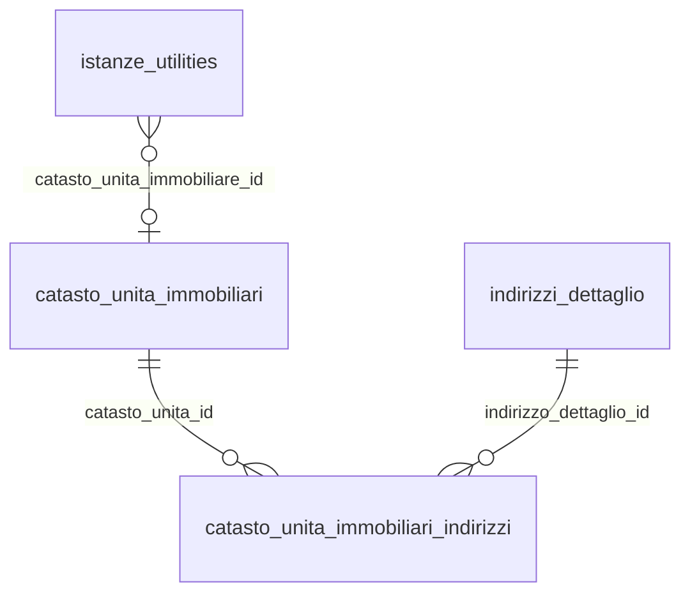

## 📘 Documentazione Concettuale – Tabella `anagrafiche.catasto_unita_immobiliari`

> **Ultimo aggiornamento**: 22 novembre 2026
>
> 👀 **Vedi anche**
>
> Approfondimento tabelle:
>
> * [anagrafiche.istanze_utilities](/dbzero/anagrafiche/tabelle/istanze_utilities) — l'istanza, che nomina la sua unità in `catasto_unita_immobiliare_id`
> * [anagrafiche.catasto_unita_immobiliari_indirizzi](/dbzero/anagrafiche/tabelle/catasto_unita_immobiliari_indirizzi) — gli indirizzi civici dell'unità
> * [anagrafiche.indirizzi_dettaglio](/dbzero/anagrafiche/tabelle/indirizzi_dettaglio) — il civico, legato all'unità solo attraverso la ponte
>
> Approfondimento funzioni:
>
> * [anagrafiche.trgfn_iu_clone_catasto_from_parent](/dbzero/anagrafiche/funzioni/trgfn_iu_clone_catasto_from_parent) — al subentro l'unità si clona
> * [script.fn_clone_catasto_from_parent_by_istanza](/dbzero/script/funzioni/fn_clone_catasto_from_parent_by_istanza) — la sola funzione del DB che scrive in questa tabella
> * [anagrafiche.trgfn_iu_sync_catasto_unita_indirizzo](/dbzero/anagrafiche/funzioni/trgfn_iu_sync_catasto_unita_indirizzo) — il legame con l'indirizzo dell'istanza
> * [script.trgfn_storico_generic](/dbzero/script/funzioni/trgfn_storico_generic) — lo storico delle modifiche
>
> Guide:
>
> * [Il catasto delle istanze](/guide/catasto-delle-istanze) — il flusso intero, dalla catena delle istanze al clone
> * [Generazione di un cliente](/guide/generazione-cliente) — dove il catasto entra nella nascita del cliente

---

### 🎯 Scopo Principale

`anagrafiche.catasto_unita_immobiliari` contiene i dati catastali di un'unità immobiliare: sezione, foglio,
particella, subalterno, categoria, classe, rendita e gli altri attributi dell'accatastamento. La riga non sa a
quale istanza né a quale indirizzo appartiene: sono le altre tabelle a nominarla.

---

### ⭐ Il legame sta sull'istanza, non sul catasto

La tabella non ha colonne verso l'istanza o verso l'indirizzo. I due legami stanno fuori:

* **l'istanza → l'unità**: `istanze_utilities.catasto_unita_immobiliare_id`, con la chiave esterna
  `fk_iu_catasto_unita_immobiliare`. È l'istanza che punta al suo catasto;
* **l'unità ↔ il civico**: la tabella ponte `anagrafiche.catasto_unita_immobiliari_indirizzi`, che
  `anagrafiche.trgfn_iu_sync_catasto_unita_indirizzo` riempie con la coppia (unità dell'istanza, indirizzo
  dell'istanza).

Un'unità può quindi esistere senza istanza (inserita e non ancora agganciata, o lasciata da un'istanza che è
passata a un'altra unità) e senza indirizzo.

---

### Un'unità per istanza, per costruzione e non per vincolo

Il modello vuole che ogni istanza abbia la sua unità: al subentro l'unità della precedente si **clona**, non si
condivide, e una modifica sul catasto dell'istanza nuova non tocca quello dell'uscente. Lo garantisce la strada
della clonazione, che crea sempre una riga nuova. Il racconto del flusso sta in
[Il catasto delle istanze](/guide/catasto-delle-istanze).

---

### I valori catastali non sono mai stringhe vuote

Le colonne testuali dell'identificazione (`sezione_catastale`, `foglio_catastale`, `particella`, `subalterno`)
possono mancare, ma se ci sono non sono fatte di soli spazi: lo dicono quattro vincoli `CHECK`, uno per colonna.
`rendita_catastale` ha un vincolo che rifiuta l'infinito (`chk_catasto_unita_immobiliari_rendita_catastale_finito`). `immobile_rurale` è obbligatoria, falsa se non detta.

---

### ⭐ Lo storico è continuo

La tabella è registrata in `config.storico_set_storicizza`: `script.trgfn_storico_generic` lascia in
`storico.catasto_unita_immobiliari` la versione precedente a ogni modifica e a ogni cancellazione, e non spegne il
flag `storicizza` dopo averla scritta. Il clone porta con sé il flag della riga di partenza.

---

### Chi la scrive

Oltre al clone del subentro, la tabella la scrive l'applicazione: `zeroerp_app` ha inserimento, lettura, modifica
e cancellazione. La tabella non ha una colonna azienda né la RLS, come l'istanza che la nomina. Un'unità nominata
da un'istanza non si cancella: la chiave esterna dell'istanza non ha un'azione alla cancellazione e la ferma.
Cancellata un'unità, i suoi legami con i civici se ne vanno con lei.

---

### ⚠️ Che cosa oggi non copre

* **Due istanze sulla stessa unità.** Nessun vincolo unico su `istanze_utilities.catasto_unita_immobiliare_id`:
  un'istanza agganciata a mano all'unità di un'altra la condivide, e una modifica dell'una cambia il catasto
  dell'altra.
* **Le unità orfane restano.** Un'istanza che passa a un'altra unità lascia la prima senza nessuno che la nomini,
  e nessun oggetto del DB la ritira.

---

### Test

* `db/pgtap/anagrafiche/test-simula-subentro.sql` — l'unità della prima istanza, il legame col civico creato dal
  trigger, il clone sull'istanza del subentro (id diverso, dati uguali) e il suo legame col civico.

---

### Note di migrazione

* 2026-11-22 — ritirato `db/pgtap/anagrafiche/test-catasto-unita-immobiliare.sql`, scritto sul modello in cui
  l'unità nominava l'istanza (`istanza_utility_id`): provava colonne e chiavi esterne che non esistono più.
* 2025-12-10 — la tabella perde `indirizzo_dettaglio_id`: il legame col civico passa alla tabella ponte.
* 2025-12-15 — la tabella perde `istanza_utility_id`: il legame con l'istanza passa a
  `istanze_utilities.catasto_unita_immobiliare_id`, e il vincolo unico su (indirizzo, istanza) non esiste più.

---


