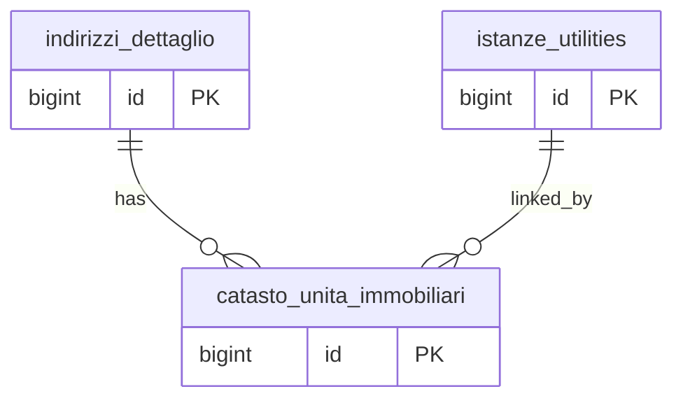

## 📘 Documentazione Concettuale – Tabella `anagrafiche.catasto_unita_immobiliari`

> **Ultimo aggiornamento**: 3 novembre 2026
>
> 👀 **Vedi anche**
>
Approfondimento tabelle:   
>
[anagrafiche.istanze_utilities](/dbzero/anagrafiche/tabelle/istanze_utilities)
> [anagrafiche.indirizzi_dettaglio](/dbzero/anagrafiche/tabelle/indirizzi_dettaglio)
>
Approfondimento funzioni:   
>
[dbops.trgfn_tx_id_managed](/dbzero/dbops/funzioni/trgfn_tx_id_managed)
> [script.trgfn_storico_generic](/dbzero/script/funzioni/trgfn_storico_generic)

---
### 🎯 Scopo Principale
La tabella `anagrafiche.catasto_unita_immobiliari` archivia i **dati catastali** associati a un `indirizzo_dettaglio` e a una specifica `istanza_utility`. Questo approccio:

* **Evita ridondanza** delle informazioni catastali su più istanze nello stesso indirizzo.
* Permette di **storico** e versioning dei dati per singola istanza.
* Supporta sia dati generici (fallback su indirizzo) sia specifici per istanza.

---

### Collegamenti con Altre Tabelle

| Campo                    | Tabella di riferimento                | Azione                                |
| ------------------------ | ------------------------------------- | ------------------------------------- |
| `indirizzo_dettaglio_id` | `anagrafiche.indirizzi_dettaglio(id)` | ON UPDATE CASCADE, ON DELETE CASCADE  |
| `istanza_utility_id`     | `anagrafiche.istanze_utilities(id)`   | ON UPDATE CASCADE, ON DELETE SET NULL |

---

### 🚩 Regole di Validazione Condizionale

1. **Unicità**

   * È garantita dal vincolo `uq_catasto_unita_immobiliari_indirizzo_istanza` su (`indirizzo_dettaglio_id`, `istanza_utility_id`).
2. **Campi obbligatori**

   * `indirizzo_dettaglio_id` NOT NULL
   * `istanza_utility_id` NOT NULL
3. **Boolean Flag**

   * `immobile_rurale` deve essere `true` o `false`.
   * `storicizza` deve essere `true` o `false`.

---

### Indicizzazione

* **Nessun indice addizionale** oltre al PK e al vincolo univoco. Le FK su indirizzo e istanza possono essere usate nelle query.

---

### Vantaggi Operativi

* **Normalizzazione**: un solo set di dati catastali per combinazione indirizzo+istanza.
* **Storico**: ogni modifica viene snapshot con `trg_catasto_unita_immobiliari_z90_storico_upd_dlt`.
* **Audit**: i trigger di audit mantengono traccia delle modifiche in `data_update`/`user_update`.

---

### Trigger e Funzioni Coinvolte

| Trigger                                             | Tabella                     | Scopo                                                                             |
| --------------------------------------------------- | --------------------------- | --------------------------------------------------------------------------------- |
| `trg_catasto_unita_immobiliari_gen_tx_id_ins_upd`   | `catasto_unita_immobiliari` | Genera `tx_id` se assente (dbops.trgfn_tx_id_managed)                             |
| `trg_catasto_unita_immobiliari_audit_data_user_upd` | `catasto_unita_immobiliari` | Aggiorna `data_update` e `user_update` (script.trgfn_audit_data_user_generic) |
| `trg_catasto_unita_immobiliari_z90_storico_upd_dlt` | `catasto_unita_immobiliari` | Crea snapshot in storico (script.trgfn_storico_generic)                   |

---

### Controlli di Coerenza

* **Unicità** su indirizzo + istanza impedisce righe duplicate.
* **FK** assicurano che non esistano dati orfani.
* **Boolean** correttamente tipizzati.

---

### 🧾 Note Finali

Questa tabella è fondamentale per gestire in modo **flessibile** e **storicizzato** i dati catastali, garantendo integrità e riducendo duplicazioni tra più attivazioni sullo stesso indirizzo.

---

###  Diagramma ER relazioni 

---


---
