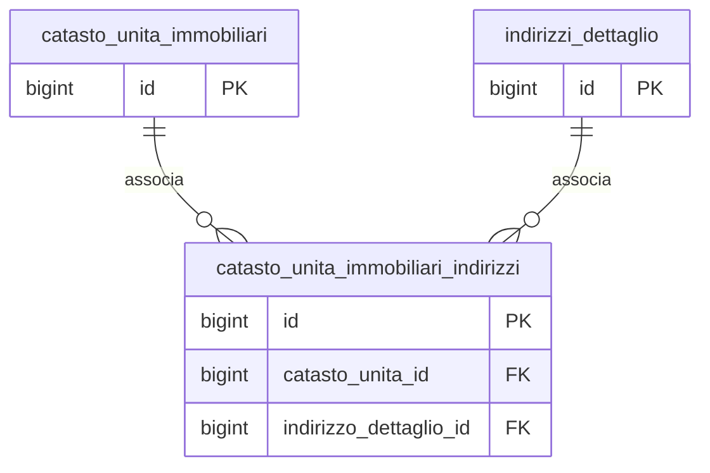

## 🧭 Documentazione Tecnica – Tabella `anagrafiche.catasto_unita_immobiliari_indirizzi`

> 🧩 **Destinatari:** DBA / backend / analisti funzionali
>
> 👀 **Vedi anche**
>
> **Tabelle**
>
> * [`anagrafiche.catasto_unita_immobiliari`](/dbzero/anagrafiche/tabelle/catasto_unita_immobiliari)
> * [`anagrafiche.indirizzi_dettaglio`](/dbzero/anagrafiche/tabelle/indirizzi_dettaglio)
> * [`anagrafiche.istanze_utilities`](/dbzero/anagrafiche/tabelle/istanze_utilities)

---

### 🎯 Scopo Principale
(latest review 16-12-25)
La tabella `anagrafiche.catasto_unita_immobiliari_indirizzi` è una **tabella ponte** che esplicita la relazione tra:

* 🏠 una **unità immobiliare catastale** (`catasto_unita_immobiliari`)
* 📍 uno **indirizzo civico dettagliato** (`indirizzi_dettaglio`)

Il suo scopo è separare in modo netto:

* il **concetto catastale** (unità immobiliare: foglio/particella/subalterno)
* dal **concetto topografico/logistico** (indirizzo, scala, piano, interno)

consentendo una modellazione **robusta**, **riusabile** e coerente con i flussi di **subentro** tipici delle utilities.

---

### 🧱 Struttura della tabella

| Campo                    |            Tipo | Null  | Descrizione                                          |
| ------------------------ | --------------: | :---: | ---------------------------------------------------- |
| `id`                     | bigint identity |  NO   | Chiave primaria tecnica                              |
| `catasto_unita_id`       |          bigint |  NO   | FK verso `anagrafiche.catasto_unita_immobiliari(id)` |
| `indirizzo_dettaglio_id` |          bigint |  NO   | FK verso `anagrafiche.indirizzi_dettaglio(id)`       |

---

### 🔐 Vincoli e integrità

**🔑 Chiave primaria**

* `pk_catasto_unita_immobiliari_indirizzi (id)`

**♻️ Unicità logica**

* `uq_catunitaindir (catasto_unita_id, indirizzo_dettaglio_id)`

Garantisce che **lo stesso indirizzo non venga associato due volte alla stessa unità immobiliare**.

**🔗 Foreign key**

| Vincolo                              | Colonna                  | Riferimento                     | ON UPDATE | ON DELETE |
| ------------------------------------ | ------------------------ | ------------------------------- | --------- | --------- |
| `fk_cat_un_imm_indir_cat_un_imm`     | `catasto_unita_id`       | `catasto_unita_immobiliari(id)` | CASCADE   | CASCADE   |
| `fk_cat_un_imm_indir_indirizzo_dett` | `indirizzo_dettaglio_id` | `indirizzi_dettaglio(id)`       | CASCADE   | CASCADE   |

📌 Essendo una tabella ponte pura, l’uso di `ON DELETE CASCADE` è **voluto e corretto**.

---

### 🔄 Ruolo nei flussi di business

**🔁 Subentro / riattivazione utenza**

Nel flusso tipico:

1. 🔒 una istanza/cliente viene **chiusa** (stato CH)
2. 🆕 viene creata una **nuova istanza** sullo stesso indirizzo
3. 🧩 la nuova istanza viene collegata alla **stessa unità immobiliare catastale**

Questa tabella consente di:

* verificare che l’indirizzo della nuova istanza punti alla **medesima unità**
* mantenere continuità catastale indipendentemente dal soggetto/contratto

---

### 🧪 Controlli consigliati (pgTAP)

I test automatici dovrebbero verificare:

1. ✅ inserimento corretto del legame unità↔indirizzo
2. ❌ rifiuto di duplicati su `(catasto_unita_id, indirizzo_dettaglio_id)`
3. 🔗 coerenza FK (no record orfani)
4. 🔁 scenario di subentro:

   * stessa unità catastale
   * stesso indirizzo
   * nuova istanza / nuovo cliente

---

### 🗺️ Diagramma ER

---

### 📝 Note finali

* La tabella **non contiene logica di dominio**, ma è fondamentale per la **coerenza del modello**.
* Permette di evolvere in futuro verso:

  * multi-indirizzo per unità (casi complessi)
  * storicizzazione dei legami (se necessario)
* È un punto chiave per i test di **regressione funzionale** su subentri e riattivazioni.

---


