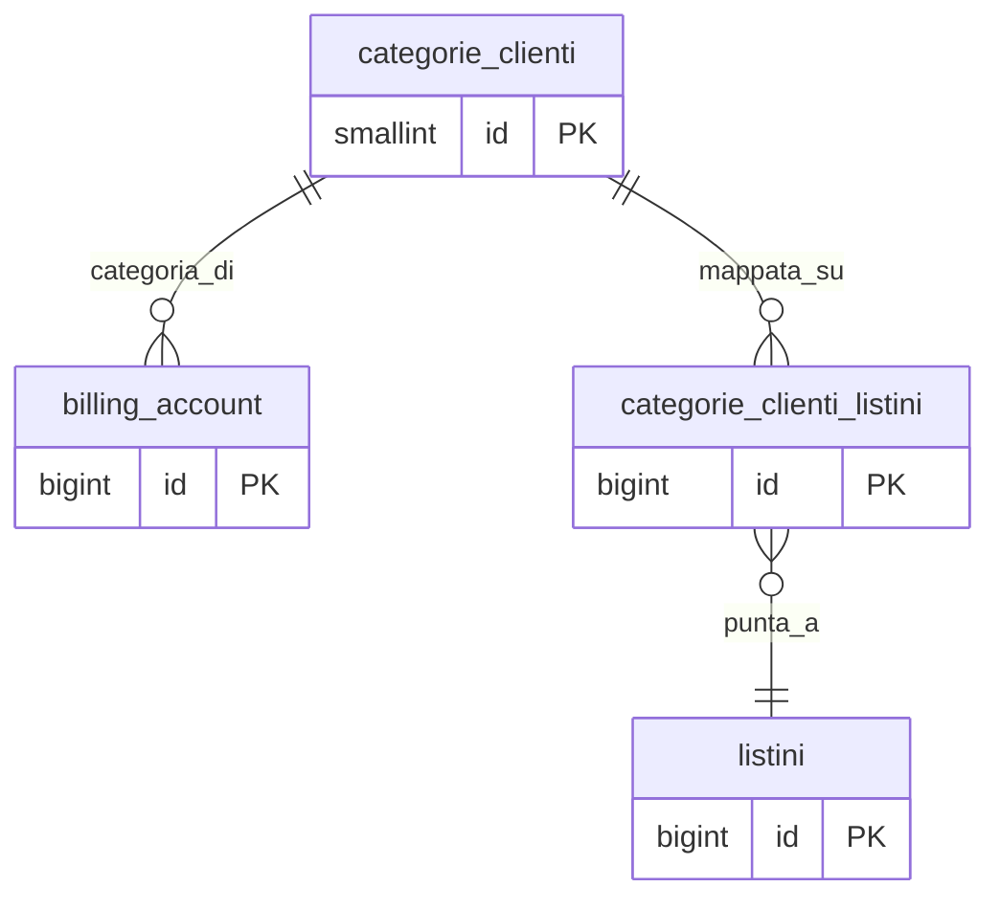

## Documentazione – Tabella `anagrafiche.categorie_clienti`

> Vedi anche
>
Guide generali:
>
[Gestione listini](/guide/gestione-listini)
>
Approfondimento tabelle:
>
[anagrafiche.billing_account](/dbzero/anagrafiche/tabelle/billing_account)
> [anagrafiche.categorie_clienti_listini](/dbzero/anagrafiche/tabelle/categorie_clienti_listini)
> [vendite.listini](/dbzero/vendite/tabelle/listini)
> [vendite.promo_articoli](/dbzero/vendite/tabelle/promo_articoli)

---

### 🎯 Scopo Principale
(latest review 14-04-26)

Le **categorie clienti** rappresentano le fasce commerciali trasversali a cui un billing account puo appartenere (STANDARD, BASE, SILVER, GOLD, PLATINUM). Sono la dimensione principale su cui si appoggia il resolver prezzi v5 nello **STADIO 2 — CATEGORIA CLIENTE**: ogni BA senza contratto individuale risolve il prezzo via categoria.

Caratteristiche principali:

* Una sola categoria per BA in un dato momento (`billing_account.categoria_cliente_id`)
* La categoria determina **a quale listino** e **con quale variazione** il BA viene mappato, via la matrice `anagrafiche.categorie_clienti_listini`
* Il flag `partecipa_promo` abilita o disabilita l'applicazione della promo overlay (STADIO 0 resolver) per l'intera categoria
* Nessuna logica di pricing risiede nella categoria stessa: la categoria e un puro contenitore commerciale; la politica di sconto vive nella matrice `categorie_clienti_listini` o nei contratti

---

### Collegamenti con altre tabelle

| Campo / Riferimento inverso                            | Tabella                                          | Azione                                                                |
| ------------------------------------------------------ | ------------------------------------------------ | --------------------------------------------------------------------- |
| `anagrafiche.billing_account.categoria_cliente_id`     | FK -> `anagrafiche.categorie_clienti(id)`        | ON UPDATE CASCADE, ON DELETE NO ACTION (BA categorizzati bloccano il delete) |
| `anagrafiche.categorie_clienti_listini.categoria_cliente_id` | FK -> `anagrafiche.categorie_clienti(id)` | ON UPDATE CASCADE, ON DELETE NO ACTION                                |

---

### Campi principali

| Colonna           | Tipo         | Nullable | Default       | Descrizione                                                        |
| ----------------- | ------------ | -------- | ------------- | ------------------------------------------------------------------ |
| `id`              | smallint     | NO       | sequence      | PK surrogata                                                       |
| `codice`          | varchar(32)  | NO       |               | Codice univoco (es. `STANDARD`, `SILVER`). UNIQUE                  |
| `descrizione`     | varchar(255) | NO       |               | Descrizione estesa UI                                              |
| `partecipa_promo` | boolean      | NO       | `true`        | Abilita la promo overlay sui BA della categoria                    |
| `ordinamento`     | smallint     | NO       | `100`         | Ordine di presentazione in UI; valori bassi appaiono prima         |
| `meta`            | jsonb        | NO       | `'{}'::jsonb` | Metadati estensibili                                               |
| `attivo`          | boolean      | NO       | `true`        | Flag di abilitazione                                               |
| `tx_id`           | uuid         | YES      |               | Transaction ID per correlazione audit                              |
| audit (`data_insert`, `user_insert`, `data_update`, `user_update`) | — | misto | `now()` / `CURRENT_USER` | Campi audit standard                      |

---

### Seed iniziale

Il seed in `80_data/sql/anagrafiche/categorie_clienti.csv` popola 5 categorie standard:

| id | codice     | descrizione      | `partecipa_promo` | `ordinamento` |
| -- | ---------- | ---------------- | ----------------- | ------------- |
| 1  | `STANDARD` | Cliente standard | `false`           | 10            |
| 2  | `BASE`     | Cliente base     | `true`            | 20            |
| 3  | `SILVER`   | Cliente silver   | `true`            | 30            |
| 4  | `GOLD`     | Cliente gold     | `true`            | 40            |
| 5  | `PLATINUM` | Cliente platinum | `true`            | 50            |

`STANDARD` e la categoria di fallback: ogni BA senza categoria assegnata esplicitamente viene backfillato a `STANDARD` e non partecipa alle promo. Questo garantisce che lo STADIO 2 del resolver abbia sempre una categoria su cui cadere.

---

### Regole di validazione

* `codice` UNIQUE (vincolo `uq_categorie_clienti_codice`)
* Nessun vincolo di esclusione temporale: la categoria non ha validita; la scadenza delle mappe categoria -> listino e gestita dalla tabella `categorie_clienti_listini` via `daterange`

---

### Ruolo nel resolver prezzi v5

| Stadio resolver | Uso della categoria                                                                 |
| --------------- | ----------------------------------------------------------------------------------- |
| STADIO 0 — PROMO| Filtro: la promo si applica solo ai BA la cui categoria ha `partecipa_promo = true` |
| STADIO 1 — CONTRATTO | Non coinvolta: il contratto batte la categoria                                 |
| STADIO 2 — CATEGORIA | Chiave primaria di lookup nella matrice `categorie_clienti_listini`            |

Un BA senza contratto ricade in STADIO 2; se la matrice non ha una riga per la quadrupla `(categoria, utility, emittente, classe_utenza)` il resolver solleva `E_CATEGORIA_LISTINO_NON_MAPPATA`.

---

### Diagramma ER

---


