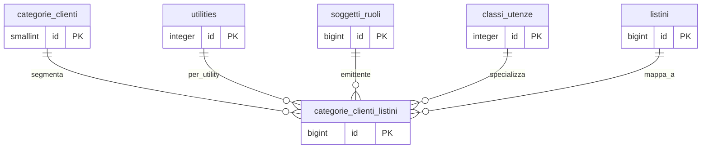

## Documentazione – Tabella `anagrafiche.categorie_clienti_listini`

> Vedi anche
>
Guide generali:
>
[Gestione listini](/guide/gestione-listini)
>
Approfondimento tabelle:
>
[anagrafiche.categorie_clienti](/dbzero/anagrafiche/tabelle/categorie_clienti)
> [anagrafiche.billing_account](/dbzero/anagrafiche/tabelle/billing_account)
> [vendite.listini](/dbzero/vendite/tabelle/listini)
> [config.utilities](/dbzero/config/tabelle/utilities)
> [config.classi_utenze](/dbzero/config/tabelle/classi_utenze)

---

### 🎯 Scopo Principale
(latest review 14-04-26)

Matrice che mappa una **categoria commerciale** cliente a un **listino** concreto, filtrata per dimensioni di contesto (utility, emittente fiscale, classe utenza). E' la chiave primaria di lookup dello **STADIO 2** del resolver prezzi v5: un BA senza contratto individuale trova qui il listino da usare per la propria utility.

Caratteristiche principali:

* Ogni riga esprime una relazione *(categoria, utility, emittente, classe_utenza)* -> *listino* valida su un periodo
* La **variazione** (sconto o maggiorazione) e' opzionale: se `tipo_variazione` e' NULL, il prezzo base del listino vale tal quale
* Il campo `classe_utenza_id` ammette NULL con significato speciale di **fallback**: vale per ogni classe utenza non specificata altrove nella quadrupla
* Nessuna sovrapposizione temporale per la stessa quadrupla (vincolo di esclusione GIST)

---

### Collegamenti con altre tabelle

| Campo                         | Tabella di riferimento                   | Azione                               |
| ----------------------------- | ---------------------------------------- | ------------------------------------ |
| `categoria_cliente_id`        | `anagrafiche.categorie_clienti(id)`      | ON UPDATE CASCADE, ON DELETE NO ACTION |
| `utility_id`                  | `config.utilities(id)`                   | ON UPDATE CASCADE, ON DELETE NO ACTION |
| `emittente_soggetto_ruolo_id` | `anagrafiche.soggetti_ruoli(id)`         | ON UPDATE CASCADE, ON DELETE NO ACTION |
| `classe_utenza_id` (nullable) | `config.classi_utenze(id)`               | ON UPDATE CASCADE, ON DELETE NO ACTION |
| `listino_id`                  | `vendite.listini(id)`                    | ON UPDATE CASCADE, ON DELETE NO ACTION |

---

### Campi principali

| Colonna                       | Tipo          | Nullable | Descrizione                                                                 |
| ----------------------------- | ------------- | -------- | --------------------------------------------------------------------------- |
| `id`                          | bigint        | NO       | PK surrogata                                                                |
| `categoria_cliente_id`        | smallint      | NO       | Categoria commerciale di riferimento                                        |
| `utility_id`                  | integer       | NO       | Utility (Gas, EE, Base per commercio, ...)                                  |
| `emittente_soggetto_ruolo_id` | bigint        | NO       | Emittente fiscale (dimensione obbligatoria del contesto)                    |
| `classe_utenza_id`            | integer       | YES      | Classe utenza specifica, oppure NULL come **fallback** su tutte le classi   |
| `listino_id`                  | bigint        | NO       | Listino selezionato per la quadrupla                                        |
| `tipo_variazione`             | varchar(16)   | YES      | `PERCENTUALE` o `VALORE_FISSO`; NULL = prezzo base tal quale                |
| `valore_variazione`           | numeric(10,4) | YES      | Coerente con `tipo_variazione` (vincolo CHECK)                              |
| `valido_dal`                  | date          | NO       | Inizio validita                                                             |
| `valido_al`                   | date          | YES      | Fine validita (NULL = +infinity)                                            |
| `validita`                    | daterange     | NO       | Colonna generata da `valido_dal`/`valido_al` (linee-guida-sql §7b)          |
| `meta` / `attivo` / audit     | —             | —        | Campi standard                                                              |

---

### Regole di validazione

* **`chk_categ_cli_listini_tipo_variazione`**: `tipo_variazione` ∈ {`PERCENTUALE`, `VALORE_FISSO`} oppure NULL. `PREZZO_FISSO` **non** e' ammesso qui (e' una semantica riservata alla promo, dove rappresenta un prezzo assoluto temporale).
* **`chk_categ_cli_listini_variazione_coerente`**: `tipo_variazione` e `valore_variazione` sono entrambi NULL o entrambi NOT NULL.
* **`chk_categ_cli_listini_valido_al_ge_dal`**: `valido_al IS NULL OR valido_al >= valido_dal`.
* **`ex_categ_cli_listini_no_overlap`**: nessuna sovrapposizione di `validita` per la stessa quadrupla `(categoria_cliente_id, utility_id, emittente_soggetto_ruolo_id, COALESCE(classe_utenza_id, -1))` quando `attivo IS TRUE`. Implementato come `EXCLUDE USING gist` (richiede `btree_gist`, attivo dalla baseline).

Il sentinel `-1` per `classe_utenza_id` NULL e' sicuro: `config.classi_utenze.id` e' `serial` e parte da 1.

⭐ **Il listino è della utility e dell'azienda della riga** (rev 16-10-2026, decisione di Tid).
Una riga «clienti dell'azienda A, utility Gas» può puntare solo a un listino dell'azienda A per
il Gas. È la stessa regola che contratti e offerte hanno già, con lo stesso controllo
(`script.fn_check_listino_documento`) e codici propri della matrice:
`E_CATEGORIA_LISTINO_UTILITY_DIVERSA` ed `E_CATEGORIA_LISTINO_EMITTENTE_DIVERSO`. Prima la
configurazione sbagliata entrava, il resolver sceglieva il listino dell'altra azienda e lo
sbaglio veniva fuori solo al push in commessa, come errore tecnico. Guard:
[anagrafiche.trgfn_categorie_clienti_listini_guard_listino](/dbzero/anagrafiche/manual/trgfn_categorie_clienti_listini_guard_listino).

---

### Semantica del fallback `classe_utenza_id`

Il resolver, in STADIO 2, esegue due tentativi in sequenza:

1. **Match specifico**: `classe_utenza_id = <classe_derivata_dal_BA_o_contratto>`.
2. **Match fallback**: `classe_utenza_id IS NULL`.

Se nessun match: errore `E_CATEGORIA_LISTINO_NON_MAPPATA`.

Esempio:

| categoria | utility | emittente | classe_utenza | listino      |
| --------- | ------- | --------- | ------------- | ------------ |
| SILVER    | GAS     | EF1       | DOM-BTA       | GAS-DOM-2026 |
| SILVER    | GAS     | EF1       | NULL          | GAS-GEN-2026 |

Un BA SILVER con classe `DOM-BTA` risolve su `GAS-DOM-2026`; un BA SILVER con classe `COND-BTA` (non presente in tabella) cade sul fallback `GAS-GEN-2026`.

Per il dominio commercio (utility `Base`) il campo e' **sempre NULL**: non esistono classi utenza commerciali.

---

### Trigger coinvolti

Nessun trigger di tabella per `validita`: e' una colonna generata. L'ordine delle
due date lo verifica il guard comune `script.trgfn_guard_date_validita`, montato
dall'automazione `DATE_VALIDITA` su ogni tabella con `valido_dal`/`valido_al`.

`trg_categorie_clienti_listini_a10_guard_listino_ins` e `_upd` (dal 16-10-2026): il listino è
della utility e dell'azienda della riga. In modifica scattano solo se cambiano listino, utility
o azienda.

Trigger di audit e `tx_id` si applicano per policy globale del progetto (vedi `linee-guida-trigger.md`).

---

### Ruolo nel resolver prezzi v5 (STADIO 2)

```
BA ha categoria_cliente_id -> sempre vero per v5 (NOT NULL)
    Cerca in categorie_clienti_listini con:
        (categoria_cliente_id, utility_id, emittente, validita @> data)
        1) tentativo con classe_utenza_id = <derivata>
        2) fallback con classe_utenza_id IS NULL
    Match trovato:
        prezzo_base   = riga listino per (listino_id, versione attiva, articolo, uom)
        prezzo_finale = applica tipo_variazione/valore_variazione (se presenti)
        origine       = 'CATEGORIA'
```

---

### Diagramma ER



---


