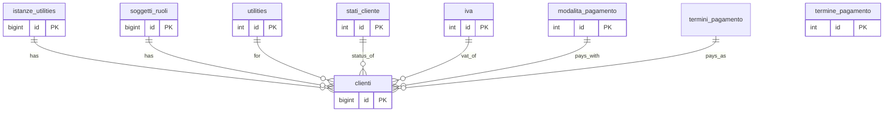

## 📘 Documentazione Concettuale – Tabella `anagrafiche.clienti`

> 👀 **Vedi anche**
>
**Guide generali:**

> [Generazione di un cliente](/guide/generazione-cliente)  
>
**Approfondimento tabelle:**  
>
[anagrafiche.istanze_utilities](/dbzero/anagrafiche/tabelle/istanze_utilities)  
> [anagrafiche.billing_account](/dbzero/anagrafiche/tabelle/billing_account)    
> [anagrafiche.soggetti_ruoli](/dbzero/anagrafiche/tabelle/soggetti_ruoli)  
> [vendite.contratti](/dbzero/vendite/tabelle/contratti)  
> [config.termini_pagamento](/dbzero/config/tabelle/termini_pagamento)  
> [config.modalita_pagamento](/dbzero/config/tabelle/modalita_pagamento)  
> [config.stati_cliente](/dbzero/config/tabelle/stati_cliente)  
> [config.iva](/dbzero/config/tabelle/iva)  
> [config.utilities](/dbzero/config/tabelle/utilities)  
>
>**Approfondimeto funzioni:**
>
[config.sistema_codici](/dbzero/config/manual/sistema_codici)

---
### 🎯 Scopo Principale
(latest review 15-02-26)
La tabella `anagrafiche.clienti` memorizza le informazioni contrattuali e di fatturazione di un soggetto per una specifica *istanza* di servizio. Rappresenta la fase in cui un'attivazione (istanza) diventa un cliente ufficiale, includendo dettagli di scadenze, pagamento e classificazioni speciali (PA, split payment).

Nota naming utility:

* `anagrafiche.clienti` usa la colonna `utility_id`;
* il PDP collegato usa `utility_id` (`anagrafiche.pdp`).

Il significato funzionale e' identico (FK verso `config.utilities.id`) e ora anche il naming e' uniforme.

---

### 🚩 Regole di Validazione Condizionale

1. **Servizio da fatturare (`servizio_da_fatturare`)**
   Valori ammessi: `true`, `false`.

> ⛔ **rev 2026-08-29 — `cliente_pa`, `split_payment` e `iva_id` NON sono piu' qui**,
> e nemmeno `codice_cig` / `codice_cup` / `codice_commessa` (changeSet `20260829-22`).
>
> ⭐ **Non erano un gruppo solo**, ed e' il motivo per cui se ne sono andate in tre
> direzioni diverse: stavano tutte su `clienti` perche' questa e' l'unica tabella «per
> fornitura» (allora `UNIQUE uq_clienti_istanza_utility`; dal 2026-10-08 `uq_clienti_billing_account`, un cliente per BA), ma rispondono a **tre domande con tre
> padroni**:
>
> * `cliente_pa` e `split_payment` → [anagrafiche.soggetti](/dbzero/anagrafiche/tabelle/soggetti).
>   Un ente **e'** o **non e'** una PA: non lo e' per il gas e non per l'acqua. Qui una riga
>   per fornitura ammetteva che lo stesso soggetto dichiarasse valori diversi;
> * i tre codici → [vendite.contratti](/dbzero/vendite/tabelle/contratti). Un CIG identifica
>   una **gara**: una PA con tre contratti ha tre CIG, e su una riga per fornitura ne entrava
>   uno solo — ripetuto su tutte le forniture dello stesso contratto e incapace di tenerne
>   due sulla stessa;
> * `iva_id` → **nessuna sede nuova**: il suo lavoro e' di altri tre (l'articolo, il tipo
>   d'uso della fornitura, il titolo documentato del soggetto). Era `NOT NULL` e il backend
>   la riempiva con un parametro di sistema, quindi ogni cliente portava un codice IVA **che
>   nessuno aveva scelto**.
>
> Cantiere: `brief-db-be-iva-risolutore-e-regime-cliente.md`, I0-B / I8-B.

---

---

### Vantaggi Operativi

* **Un cliente per billing account** (`uq_clienti_billing_account`, dal 2026-10-08): un'istanza ha tanti clienti quanti BA, uno per utility. Fino a quel giorno il vincolo era `uq_clienti_istanza_utility`, un cliente per istanza.
* ⚠️ **Nessun vincolo di unicita' sul ruolo**, ed e' voluto: un soggetto con un solo ruolo CLIENTE ha un cliente per ogni sua fornitura (gas a casa, luce in ufficio). E' l'eccezione fra le specializzazioni dei ruoli.
* **Flessibilità di fatturazione**: possibilità di gestire PA, split payment e modalità diverse.
* **Validazioni integrate** riducono errori in fase di inserimento.

---

### Implementazioni Aggiuntive

* Può essere estesa con **campi di contratto** specifici (es. durata, condizioni).
* I trigger di audit (`trg_clienti_audit_data_user_upd`) mantengono traccia di modifiche.

---

### Controlli di Coerenza

* **Obbligatorietà** di `istanza_utility_id`, garantisce che ogni cliente derivi da una specifica istanza di servizio.
* **FK e check** impediscono dati fuori standard e assicurano integrità referenziale.

---

### 🧾 Note Finali

* La tabella `clienti` è il **fulcro** della logica di fatturazione: garantisce il passaggio dalla fase precontrattuale (istanza) alla fase contrattuale.
* Il cliente **assume lo stesso** `billing_account` generato in fase di istanza, mantenendo continuità nelle relazioni.
* ⚠️ Un soggetto-ruolo cliente ha una riga di `clienti` **per ogni billing account**: `soggetto_ruolo_id` non è univoco. Chi vuole contare o elencare clienti distinti parte dai valori distinti di `soggetto_ruolo_id`, non da un collegamento diretto alla tabella, che moltiplica le righe.
* La tabella `config.termini_pagamento` permette di impostare in maniera parametrica, sia la possibilità di calcolare una data scadenza che generare "n" pagamenti della fattura(esempio classico 30/60/90 o scadenza fine mese o calcalata in base al nr.giorni dalla data emissione) 

---

###  Diagramma ER relazioni

---



---
