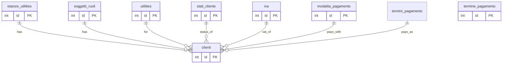
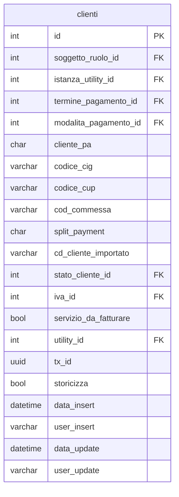

## 📘 Documentazione Concettuale – Tabella `anagrafiche.clienti`

> 👀 **Vedi anche**
>
> **Guide generali:**

> * [Generazione di un cliente](/guide/generazione-cliente)
>
> **Approfondimento tabelle:**
>
> * [anagrafiche.istanze_utilities](/dbzero/anagrafiche/tabelle/istanze_utilities)
> * [anagrafiche.billing_account](/dbzero/anagrafiche/tabelle/billing_account)
> * [anagrafiche.soggetti_ruoli](/dbzero/anagrafiche/tabelle/soggetti_ruoli)
> * [config.termini_pagamento](/dbzero/config/tabelle/termini_pagamento)
> * [config.modalita_pagamento](/dbzero/config/tabelle/modalita_pagamento)
> * [config.stati_cliente](/dbzero/config/tabelle/stati_cliente)
> * [config.iva](/dbzero/config/tabelle/iva)
> * [config.utilities](/dbzero/config/tabelle/utilities)
>
>**Approfondimeto funzioni:**
>
> * [script.trgfn_upd_audit_data_user_generic](/dbzero/script/funzioni/trgfn_upd_audit_data_user_generic)
> * [script.trgfn_upd_dlt_storico_generic](/dbzero/script/funzioni/trgfn_upd_dlt_storico_generic)
> * [script.fn_generate_codice](/dbzero/script/funzioni/fn_generate_codice)
> * [dbops.trgfn_tx_id_managed](/dbzero/dbops/funzioni/trgfn_tx_id_managed)

---

### 🎯 Scopo Principale

La tabella `anagrafiche.clienti` memorizza le informazioni contrattuali e di fatturazione di un soggetto per una specifica *istanza* di servizio. Rappresenta la fase in cui un'attivazione (istanza) diventa un cliente ufficiale, includendo dettagli di scadenze, pagamento e classificazioni speciali (PA, split payment).

---

### 🚩 Regole di Validazione Condizionale

1. **Cliente PA (`cliente_pa`)**
   Valori ammessi: `S` (Pubblica Amministrazione), `N` (Privato).
2. **Split payment (`split_payment`)**
   Valori ammessi: `S`, `N`.
3. **Servizio da fatturare (`servizio_da_fatturare`)**
   Valori ammessi: `true`, `false`.

---

---

### 💡 Vantaggi Operativi

* **Univocità del collegamento** tra cliente e istanza, garantita da `istanza_utility_id NOT NULL`.
* **Flessibilità di fatturazione**: possibilità di gestire PA, split payment e modalità diverse.
* **Validazioni integrate** riducono errori in fase di inserimento.

---

### ⚙️ Implementazioni Aggiuntive

* Può essere estesa con **campi di contratto** specifici (es. durata, condizioni).
* I trigger di audit (`trg_upd_clienti_audit_data_user`) mantengono traccia di modifiche.

---

### ✅ Controlli di Coerenza

* **Obbligatorietà** di `istanza_utility_id`, garantisce che ogni cliente derivi da una specifica istanza di servizio.
* **FK e check** impediscono dati fuori standard e assicurano integrità referenziale.

---

### 🧾 Note Finali

* La tabella `clienti` è il **fulcro** della logica di fatturazione: garantisce il passaggio dalla fase precontrattuale (istanza) alla fase contrattuale.
* Il cliente **assume lo stesso** `billing_account` generato in fase di istanza, mantenendo continuità nelle relazioni.
* La tabella `config.termini_pagamento` permette di impostare in maniera parametrica, sia la possibilità di calcolare una data scadenza che generare "n" pagamenti della fattura(esempio classico 30/60/90 o scadenza fine mese o calcalata in base al nr.giorni dalla data emissione) 

---

###  Diagramma ER relazioni

---

###  Diagramma ER attributi

---



---
