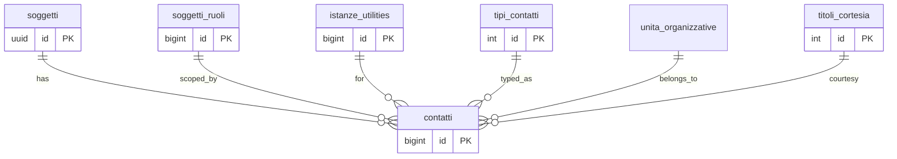

## 📘 Documentazione Concettuale – Tabella `anagrafiche.contatti`

> 👀 **Vedi anche**
> Approfondimento tabelle:
>
[anagrafiche.soggetti](/dbzero/anagrafiche/tabelle/soggetti)
> [anagrafiche.soggetti_ruoli](/dbzero/anagrafiche/tabelle/soggetti_ruoli)
> [config.tipi_contatti](/dbzero/config/tabelle/tipi_contatti)
> [config.unita_organizzative](/dbzero/config/tabelle/unita_organizzative)
> [anagrafiche.istanze_utilities](/dbzero/anagrafiche/tabelle/istanze_utilities)
>
Approfondimenti funzioni:
>
[anagrafiche.trgfn_contatti_set_default_contatto](/dbzero/anagrafiche/funzioni/trgfn_contatti_set_default_contatto)


La tabella **`anagrafiche.contatti`** è il **punto di raccolta centralizzato** per tutte le informazioni di contatto nell'applicazione, a diversi livelli di granularità:

- **Soggetto** (`soggetto_id` obbligatorio)
- **Ruolo assegnato al soggetto** (`soggetto_ruolo_id`, opzionale)
- **Istanza di servizio** (`istanza_utility_id`, opzionale)

In questo modo è possibile definire:

1. **Contatto "globale" del soggetto**
   (solo `soggetto_id`, `soggetto_ruolo_id` e `istanza_utility_id` a `NULL`)

2. **Contatto legato a uno specifico ruolo**
   (ad es. l'amministratore di un soggetto, con `soggetto_ruolo_id` valorizzato)

3. **Contatto associato a una specifica istanza di servizio**
   (ad es. referente tecnico per il contratto GAS di Corridonia, con `istanza_utility_id` valorizzato)

---
### 🎯 Scopo Principale
(latest review 25-03-26)
* **Centralizzare i contatti**
  Un'unica tabella per tutti i numeri di telefono, email, PEC e nominativi, evitando duplicazioni e frammentazione.

* **Gestire livelli di contesto (3 livelli)**
  Tramite i campi `soggetto_ruolo_id` e `istanza_utility_id` (che possono essere **`NULL`**), si modellano contatti generici o specifici:
  - **Livello 1 — Istanza**: `soggetto_ruolo_id` e `istanza_utility_id` valorizzati → specifico per servizio
  - **Livello 2 — Ruolo generico**: `soggetto_ruolo_id` valorizzato, `istanza_utility_id` NULL → generico del ruolo
  - **Livello 3 — Soggetto**: `soggetto_ruolo_id` NULL, `istanza_utility_id` NULL → fallback soggetto

* **Identificare il contatto "default"**
  Il flag `is_default` permette di marcare un solo contatto di riferimento per ciascun soggetto.

* **Separare reparto e categoria**
  Il reparto/ufficio e' indicato da `unita_organizzativa_id`, mentre `tipo_contatto_id`
  identifica la categoria del contatto ed e' **obbligatoria**: ogni contatto ha un tipo.
  Questo evita di usare `tipi_contatti` come reparto.

---

### Vincoli e Relazioni

- **`PK (id)`**: identificatore univoco del contact record.
- **Vincoli UNIQUE**: 3 partial unique index per i 3 livelli di contesto:
  - `uq_contatti_soggetto_tipo (soggetto_id, tipo_contatto_id) WHERE soggetto_ruolo_id IS NULL AND istanza_utility_id IS NULL` — soggetto puro
  - `uq_contatti_ruolo_tipo_no_istanza (soggetto_id, soggetto_ruolo_id, tipo_contatto_id) WHERE soggetto_ruolo_id IS NOT NULL AND istanza_utility_id IS NULL` — ruolo generico
  - `uq_contatti_ruolo_istanza_tipo (soggetto_id, soggetto_ruolo_id, istanza_utility_id, tipo_contatto_id) WHERE soggetto_ruolo_id IS NOT NULL AND istanza_utility_id IS NOT NULL` — ruolo + istanza
- **Foreign Keys**
  - `soggetto_id` → `anagrafiche.soggetti(id)` **ON DELETE CASCADE**
  - `soggetto_ruolo_id` → `anagrafiche.soggetti_ruoli(id)` **ON DELETE CASCADE**
  - `tipo_contatto_id` → `config.tipi_contatti(id)` **ON DELETE RESTRICT**
  - `unita_organizzativa_id` → `config.unita_organizzative(id)` **ON DELETE RESTRICT**
  - `istanza_utility_id` → `anagrafiche.istanze_utilities(id)`

---

### Relazioni e Trigger

- **Trigger `trg_contatti_set_default_contatto_ins_upd`**
  Assicura che esista al più un contatto `is_default = TRUE` per ogni `soggetto_id`:
  - Se `NEW.is_default = TRUE`, resetta gli altri a `FALSE`.
  - Se nessun contatto precedente è `default`, marca automaticamente il primo inserito/aggiornato.

- **Trigger `trg_contatti_audit_data_user_upd`**
  Aggiorna i campi `data_update` e `user_update` ad ogni modifica.


---

### Indici

* `ix_contatti_soggetto` su `soggetto_id` per ricerche rapide per soggetto.
* `ix_contatti_tipo` su `tipo_contatto_id` per filtrare contatti per tipologia.
* `ix_contatti_unita_organizzativa_id` su `unita_organizzativa_id` per filtrare contatti per reparto.
* `ix_contatti_istanza_utility_id` su `istanza_utility_id` per isolare contatti per istanza di servizio.

Migliorano le performance nelle query di recupero contatti per soggetto, tipo o istanza.


---

### Esempi di Utilizzo

```sql
-- 1) Contatto globale per il soggetto UUID '123e4567-e89b-12d3-a456-426614174000'
INSERT INTO anagrafiche.contatti (
  tipo_contatto_id, unita_organizzativa_id, soggetto_id,
  nominativo, email, telefono, is_default
) VALUES (
  1, 1, '123e4567-e89b-12d3-a456-426614174000',
  'Mario Rossi', 'm.rossi@example.com', '0123456789', TRUE
);

-- 2) Contatto specifico per ruolo (soggetto_ruolo_id = 10)
INSERT INTO anagrafiche.contatti (
  tipo_contatto_id, unita_organizzativa_id, soggetto_id, soggetto_ruolo_id,
  nominativo, cellulare
) VALUES (
  2, 2, '123e4567-e89b-12d3-a456-426614174000', 10,
  'Luca Bianchi', '3801234567'
);

-- 3) Contatto per istanza specifica (istanza_utility_id = 5)
INSERT INTO anagrafiche.contatti (
  tipo_contatto_id, unita_organizzativa_id, soggetto_id, soggetto_ruolo_id,
  istanza_utility_id, nominativo, pec
) VALUES (
  3, 3, '123e4567-e89b-12d3-a456-426614174000', 10, 5,
  'Ufficio Tecnico', 'tecnico@azienda.pec'
);

--  4) Impostare un contatto come default (il trigger resetta gli altri)
UPDATE anagrafiche.contatti
   SET is_default = TRUE
 WHERE id = 42;

-- 5) Recuperare il contatto default di un soggetto
SELECT *
  FROM anagrafiche.contatti
 WHERE soggetto_id = '123e4567-e89b-12d3-a456-426614174000'
   AND is_default;

```
---

### Vantaggi Operativi

 - Flessibilità: un singolo modello per ogni combinazione soggetto/ruolo/istanza e tipo di contatto.

 - Univocità: constraint e trigger assicurano coerenza e un solo contatto predefinito per soggetto.

 - Manutenzione semplificata: aggiornare o estendere i tipi di contatto avviene solo in tabelle di configurazione.

 - Tracciabilità: audit dei cambiamenti con timestamp e utente, per compliance e debugging.

---

> **Centralizzare i contatti in un'unica tabella con supporto multi-contesto e contact default migliora coerenza, performance e usabilità del sistema."**


---

###  Diagramma ER relazioni




---


---
