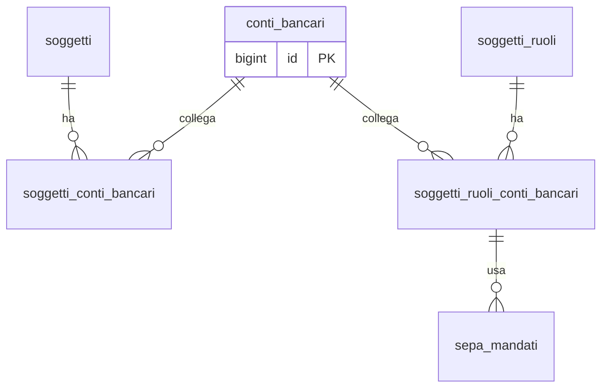

## 📘 Documentazione Concettuale – Tabella `anagrafiche.conti_bancari`

> 👀 **Vedi anche**
>
> **Approfondimento tabelle**    
> • [anagrafiche.soggetti](/dbzero/anagrafiche/tabelle/soggetti)  
> • [anagrafiche.soggetti_ruoli](/dbzero/anagrafiche/tabelle/soggetti_ruoli)   
> • [anagrafiche.soggetti_conti_bancari](/dbzero/anagrafiche/tabelle/soggetti_conti_bancari)   
> • [anagrafiche.soggetti_ruoli_conti_bancari](/dbzero/anagrafiche/tabelle/soggetti_ruoli_conti_bancari)   
> • [pagamenti.sepa_mandati](/dbzero/pagamenti/tabelle/sepa_mandati)  
>
> **Artefatti di selezione**   
> • [anagrafiche.vw_conti_bancari_per_ruolo](/dbzero/anagrafiche/view/vw_conti_bancari_per_ruolo)   
> • [script.fn_get_conto_bancario_predefinito](/dbzero/script/funzioni/fn_get_conto_bancario_predefinito)   
>

---

### 🎯 Scopo Principale

(latest review 02-12-25)
`anagrafiche.conti_bancari` è l’**anagrafe unica degli IBAN**. Centralizza e **deduplica** i conti correnti, li **normalizza** (uppercase, senza spazi) e li rende riusabili da **qualsiasi soggetto** e **ruolo**. Questo disaccoppiamento:

* evita duplicazioni dello stesso IBAN su più anagrafiche;
* abilita **override di ruolo** e **fallback di soggetto** tramite una semplice **VIEW** + **FUNCTION**;
* semplifica integrazioni con moduli di pagamenti/fatturazione.

---

### 🔗 Collegamenti con Altre Tabelle

> La tabella non contiene FK verso altre entità; è invece **referenziata** da:

| Tabella che referenzia                     | Campo → `conti_bancari.id`    | Azioni FK                              |
| ------------------------------------------ | ----------------------------- | -------------------------------------- |
| `anagrafiche.soggetti_conti_bancari`       | `conto_bancario_id`           | ON UPDATE CASCADE, ON DELETE NO ACTION |
| `anagrafiche.soggetti_ruoli_conti_bancari` | `conto_bancario_id`           | ON UPDATE CASCADE, ON DELETE NO ACTION |
| *(indiretto)* `pagamenti.sepa_mandati`     | via `soggetto_ruolo_conto_id` | — (il conto è risolto a monte)         |

---

### 🚩 Regole di Validazione Condizionale

1. **Unicità**

   * `uq_conti_bancari_iban` su `iban` → un solo record per IBAN (anagrafe globale).

2. **Campi obbligatori**

   * `iban` NOT NULL; audit (`data_insert`, `data_update`, `user_insert`).

3. **Formati e normalizzazione**

   * `iban` **uppercase**, senza spazi, pattern: `^[A-Z0-9]{15,34}$`
   * `bic_swift` opzionale: `^[A-Z0-9]{8}([A-Z0-9]{3})?$`
   * `paese` opzionale: `^[A-Z]{2}$` (ISO‑3166, derivato dalle prime 2 del IBAN)

4. **Boolean flag**

   * `attivo` (default `true`), `verificato` (default `false`), `storicizza` (default `true`).

---

### 🔍 Indicizzazione

* **Univoco**: `uq_conti_bancari_iban (iban)`.
* **Operativo**: `ix_conti_bancari_attivo (attivo)` per filtri amministrativi.

---

### 💡 Vantaggi Operativi

* **Registro unico** → nessuna ridondanza di IBAN su client/fornitori/gestori.
* **Riuso trasversale** → lo stesso IBAN può servire più ruoli/soggetti.
* **Selezione semplificata** → con `vw_conti_bancari_per_ruolo` e `fn_get_conto_bancario_predefinito` ottieni il **conto corretto** per uso (`INCASSO|PAGAMENTO|RIMBORSO|GENERICO`) senza logiche duplicate.
* **Governance** → validazioni formali, flag `attivo`/`verificato`, audit e storico centralizzati.

> **Nota**: la selezione del conto “effettivo” per ruolo/uso avviene tramite:
> • `anagrafiche.vw_conti_bancari_per_ruolo` (priorità **RUOLO → SOGGETTO**, validità odierna, non bloccato, conto attivo)
> • `script.fn_get_conto_bancario_predefinito(soggetto_ruolo_id, uso)` (ritorna al massimo 1 riga; fallback a `GENERICO`).

---

### ✅ Controlli di Coerenza

* `iban` normalizzato e **univoco** a livello globale.
* Pattern formali su `iban` / `bic_swift` / `paese`.
* Righe **referenziate** dai legami soggetto/ruolo: vietata la cancellazione se ci sono figli (NO ACTION).
* Flag `attivo` usato come **guard‑rail** dai trigger dei legami (impedisce associazioni a conti disattivati).

---

### 🧾 Note Finali

Questa tabella è il **punto di verità** per gli IBAN. Insieme ai legami (`soggetti_conti_bancari`, `soggetti_ruoli_conti_bancari`), elimina la duplicazione di dati e abilita un recupero **semplice e consistente** del conto giusto in tutti i processi (incasso, pagamento, rimborso).

---

### Diagramma ER relazioni

---



---
