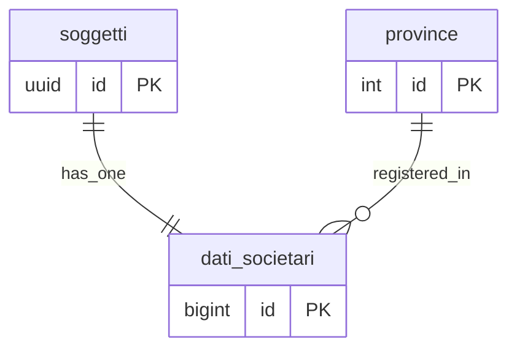

## 📘 Documentazione Concettuale – Tabella `anagrafiche.dati_societari`

> 👀 **Vedi anche**  
> 
Approfondimento Tabelle:   
>
[anagrafiche.soggetti](/dbzero/anagrafiche/tabelle/soggetti)  
> [config.province](/dbzero/config/tabelle/province)
>
Approfondimento funzioni e trigger:   
>   
[anagrafiche.trgfn_dati_societari_check_tipo_soggetto](/dbzero/anagrafiche/funzioni/trgfn_dati_societari_guard_tipo_soggetto)
> [script.trgfn_storico_generic](/dbzero/script/funzioni/trgfn_storico_generic)
> [dbops.trgfn_tx_id_managed](/dbzero/dbops/funzioni/trgfn_tx_id_managed)


La tabella **`anagrafiche.dati_societari`** contiene i dati societari estesi per ciascun soggetto di tipo aziendale presente in **`anagrafiche.soggetti`**. Ogni riga rappresenta un insieme di informazioni obbligatorie e opzionali relative alla forma giuridica, capitale sociale, iscrizione REA, stato di liquidazione e modalità di fatturazione elettronica.

---
### 🎯 Scopo Principale
(latest update 05-12-25)
- **Estendere l’anagrafica generale**  
  I soggetti di tipo giuridico (aziende) hanno esigenze di memorizzazione di dati societari che non interessano le persone fisiche. Spostando queste informazioni in `dati_societari`, si mantiene la tabella `anagrafiche.soggetti` leggera e focalizzata sui campi anagrafici di base. Solo per i tipi soggetti appropriati controllati dalla trigger function `anagrafiche.trgfn_dati_societari_guard_tipo_soggetto`

- **Gestione iscrizione REA e capitale sociale**  
  Memorizzare la provincia di iscrizione REA (`id_prov_iscri_rea` + `iscrizione_rea`) e il capitale sociale in Euro (`capitale_sociale`), dato fondamentale per valutazioni finanziarie e di business.

- **Informazioni su socio unico e liquidazione**  
  Tenere traccia degli stati societari tramite i campi enumerati `socio_unico` (se è “Socio Unico” o “Socio Multiplo”) e `liquidazione` (se la società è in liquidazione o meno).

- **Dati di fatturazione elettronica**  
  Dire **come** arriva la fattura elettronica al cliente (`destinatario_fe`, il canale: PEC o codice SDI) e **dove**: la PEC dedicata (`pec_fatturazione`) o il codice destinatario SDI (`codice_sdi`).

---

### Collegamenti con Altre Tabelle

- **`anagrafiche.soggetti`**  
  - Il campo `soggetto_id` (UUID) fa riferimento alla chiave primaria di `anagrafiche.soggetti(id)`.  
  - Vincolo `fk_soggetti_anagrafiche`:  
    - **ON UPDATE CASCADE** (se cambia l’ID del soggetto, si propaga)  
    - **ON DELETE CASCADE** (se un soggetto viene eliminato, si rimuovono automaticamente i suoi dati societari).  
  - Ogni soggetto di tipo “azienda” può avere **al massimo una** riga in `dati_societari` (vincolo di unicità `uq_ds_soggetto`).

- **`config.province`**  
  - Il campo `id_prov_iscri_rea` (integer) fa riferimento a `config.province(id)`.  
  - Vincolo `fk_province_config`:  
    - **ON UPDATE CASCADE** (se l’ID di una provincia cambia, si propaga)  
    - **ON DELETE RESTRICT** (non si può eliminare una provincia se esistono aziende iscritte lì).  
  - Il binomio (`id_prov_iscri_rea`, `iscrizione_rea`) è garantito unico da `uq_ds_prov_cea`, evitando duplicati di iscrizione REA nella stessa provincia.

---

### 🚩 Vincoli di Unicità e Integrità

- **Primary Key**  
  - `pk_dati_societari` su `id_dati_societari`, gestito da sequenza automatica.

- **Codice SDI e PEC non sono unici**  
  Lo stesso codice SDI (quello di un intermediario, per esempio il software di fatturazione) e la stessa PEC (quella di un commercialista) servono più clienti. Fino al 2026-10-10 erano unici, e un secondo cliente dello stesso intermediario veniva rifiutato.

- **Unicità iscrizione REA**  
  - `uq_ds_prov_cea` su (`id_prov_iscri_rea`, `iscrizione_rea`), garantendo che non esistano due aziende con la stessa iscrizione REA nella stessa provincia.

- **Vincolo `uq_ds_soggetto`**  
  - Assicura che ogni `soggetto_id` compaia al più una volta in `dati_societari`, evitando duplicati di scheda societaria.

---

### Descrizione dei Campi Principali

- **`soggetto_id`**  
  Riferimento al soggetto (UUID) in `anagrafiche.soggetti`. Identifica in modo univoco l’azienda cui appartengono questi dati societari.

- **`forma_giuridica`**  
  Testo che indica la forma giuridica della società (es. “SRL”, “SPA”, “SNC”). È un campo obbligatorio.

- **`capitale_sociale`**  
  Valore numerico (precisione 15,2) che rappresenta il capitale sociale, espresso in Euro. Campo obbligatorio.

- **`id_prov_iscri_rea`**  
  Intero che indica la provincia di iscrizione al Registro delle Imprese (REA), collegato a `config.province(id)`.

- **`iscrizione_rea`**  
  Testo (fino a 30 caratteri) che indica il numero di iscrizione REA. Deve essere valorizzato ed è unito a `id_prov_iscri_rea` dal vincolo di unicità.

- **`socio_unico`**  
  Tipo enumerato `anagrafiche.socio_unico_enum`:  
  - `SU` = Socio Unico  
  - `SM` = Socio Multiplo  
  Valorizzato di default a `SU`.

- **`liquidazione`**  
  Tipo enumerato `anagrafiche.liquidazione_enum`:  
  - `LN` = Non in liquidazione (default)  
  - `LS` = In liquidazione  

- **`destinatario_fe`**  
  Il **canale** della fattura elettronica: `P` = via PEC, `C` = via codice SDI, vuoto = nessun canale indicato (un cliente estero, o uno di cui non si sa ancora). Il canale scelto pretende il suo recapito: con `P` serve la PEC, con `C` il codice SDI. Se manca, il salvataggio si ferma con un messaggio che indica il campo da compilare.

- **`pec_fatturazione`**  
  PEC (testo fino a 100 caratteri) dedicata alla fatturazione elettronica. Obbligatoria quando il canale è `P`.

- **`codice_sdi`**  
  Il codice destinatario che il Sistema di Interscambio assegna: **7 caratteri** (lettere maiuscole e cifre) per un'azienda o un professionista, **6** per una pubblica amministrazione. Obbligatorio quando il canale è `C`.

- **`data_costituzione`**  
  Data di costituzione dell’azienda. Campo opzionale: può essere `NULL` se non disponibile.

---

### Vantaggi Operativi

- **Separazione dei dati societari dal resto**  
  Consolidando le informazioni strettamente legate alla natura giuridica e fiscale di un’azienda in una tabella dedicata, si migliora la coerenza e la manutenzione. La tabella `anagrafiche.soggetti` resta focalizzata su campi di base comuni a tutte le tipologie di soggetti.

- **Garanzia di unicità e integrità**  
  I vincoli di unicità su `codice_sdi`, `pec_fatturazione`, `iscrizione_rea` (assieme a `id_prov_iscri_rea`) e `soggetto_id` impediscono duplicazioni di dati critici, evitando errori nelle fasi di fatturazione e verifica anagrafica.

- **Tracciabilità della relazione soggetto → dati societari**  
  La cancellazione a cascata del soggetto rimuove automaticamente la scheda societaria associata, semplificando l’amministrazione dei dati e riducendo la possibilità di record orfani.

- **Supporto a processi di fatturazione elettronica**  
  Con `destinatario_fe`, `pec_fatturazione` e `codice_sdi`, la tabella fornisce tutte le informazioni necessarie per l’invio di fatture elettroniche conformi alle normative italiane.

---

> **“Un’estensione dedicata ai dati societari, che valorizza la tabella anagrafica base separando informazioni fiscali, legali e di fatturazione in un unico punto, con regole di integrità che evitano inconsistenze.”**  

---

###  Diagramma ER relazioni 




---

## ⭐ Chi scrive i dati societari, e con quali regole (dal 2026-10-11)

### Una porta sola: il verbo

L'applicazione **legge** `anagrafiche.dati_societari` ma non la scrive. Scrive soltanto il verbo
`anagrafiche.fn_scrivi_dati_societari` (`SECURITY DEFINER`), che **crea o aggiorna** la riga del
soggetto. Lo chiamano il backend quando si modifica un soggetto, le fixture pgTAP e, alla nascita
di un soggetto, il BB
[fn_scrivi_dati_societari_alla_nascita](/dbzero/anagrafiche/manual/fn_scrivi_dati_societari_alla_nascita).

### Alla nascita: le due porte di creazione (dal 2026-10-20)

Una società o un ente (`fn_crea_soggetto_pg`) e una persona fisica (`fn_crea_soggetto_pf`) nascono
**con** la loro sezione, nella stessa chiamata: soggetto e dati societari nascono insieme o non
nascono. Le due porte ricevono gli stessi campi, data di costituzione compresa, e lasciano decidere
**quando** scriverli allo stesso BB: se la natura li pretende (`REQUIRED`), oppure se la sezione
c'è, cioè almeno un campo con un valore (socio unico e liquidazione da soli non contano: hanno
sempre un valore). Una sezione passata a una natura che non la ammette (il privato) viene
rifiutata, non scartata. Fino al 2026-10-19 la ditta individuale perdeva la sezione in creazione,
e la data di costituzione si perdeva per tutti (brief-db-dati-societari-in-creazione).

* Il verbo riceve lo **stato intero** della sezione: un valore assente scrive `NULL` dove la
  colonna lo ammette. Socio unico e liquidazione, che sono obbligatori, prendono il default dei
  parametri.
* Il verbo **non** contiene regole: forma, natura, REA, capitale e canale FE stanno nei trigger
  della tabella, e scattano anche da qui. Il permesso resta al backend, come per `anagrafiche.soggetti`.
* La postura (niente `INSERT`/`UPDATE`/`DELETE` per l'app) è dichiarata in tre posti: il
  changeSet `90_end/20261011-04`, il loop dei grant di `ci_apply`, il provisioning.

### La forma giuridica decide

* Se ci sono i dati societari c'è la forma: la colonna è `NOT NULL`.
* La forma deve essere **ammessa dalla natura** del soggetto (matrice delle forme per natura).
* **REA e capitale li decide la forma**, non la colonna (ora nullable): una SRL li pretende, una
  ditta individuale o un'associazione no. Prima le tre colonne erano obbligatorie per tutti, e un
  ente o una ditta con dati societari non si potevano creare.

Il dettaglio dei controlli e dei codici è nel manuale del guard,
[trgfn_dati_societari_guard_forma_giuridica](/dbzero/anagrafiche/manual/trgfn_dati_societari_guard_forma_giuridica).

### Cambiare natura

Una società che diventa ente cambia anche la forma, e nella stessa transazione si fa **prima la
natura, poi la forma**: il controllo che le lega scatta al COMMIT
(`trgfn_soggetti_guard_forma_giuridica_natura`, `E_TIPO_SOGGETTO_FORMA_GIURIDICA_NON_AMMESSA`).

---

## 📘 Integrazione – Coerenza tra `dati_societari`, Tipo Soggetto e Tipologie Fiscali

*(Aggiornamento del 2025-12-03)*

Questa integrazione descrive le nuove regole introdotte per la tabella **`anagrafiche.dati_societari`**, basate sul refactoring di:

* `config.tipi_soggetto`
* `config.tipi_soggetto_dettaglio`
* formati CF/P.IVA (NUM_N, ALFA_N, ALFANUM_N, NON_APPLICABILE)
* `dati_societari_policy` (NONE / OPTIONAL / REQUIRED)

La documentazione estende quella già presente e rappresenta la logica aggiornata di coerenza tra le varie componenti anagrafiche.

---

### 1. Ruolo delle Tabelle Coinvolte

 **`config.tipi_soggetto`** → Macro natura del soggetto

Contiene la classificazione generale:

* **PF** → Persona Fisica
* **PG** → Persona Giuridica
* **ENTE** → Ente / Ente non commerciale
* **ALTRO** → Categoria residuale

Questa tabella determina la **natura giuridica** di un soggetto.

---

 **`config.tipi_soggetto_dettaglio`** → Regole fiscali e nazionali

Per ogni tipo soggetto definisce:

* Paese (`stato_iso2`)
* Formati fiscali (`formato_cf`, `formato_piva`)
* Policy dati societari (`dati_societari_policy`)

Valori ammessi per i formati:

* `NUM_<N>`
* `ALFA_<N>`
* `ALFANUM_<N>`
* `NON_APPLICABILE`

Valori ammessi per la policy:

* `NONE`
* `OPTIONAL`
* `REQUIRED`

Questa tabella è il livello in cui si definisce **se** un soggetto prevede la P.IVA e **se** deve avere una scheda societaria.

---

 **`anagrafiche.soggetti`**

Contiene l'anagrafica generale e ha un FK verso:

```
tipo_soggetto_dettaglio_id → config.tipi_soggetto_dettaglio.id
```

---

 **`anagrafiche.dati_societari`**

Contiene la scheda societaria, soggetta alle policy definite nel dettaglio soggetto.

---

### 2. Regole di Coerenza

✔ **Regola 1 — Dati societari NON ammessi**

Se nel dettaglio soggetto:

```

dati_societari_policy = 'NONE'
```

allora:

* non deve esistere alcuna riga in `anagrafiche.dati_societari`
* se un inserimento/modifica viene tentato → **errore** (bloccato dal trigger)

Tipico per:

* Persona Fisica senza P.IVA

---

 ✔ **Regola 2 — Dati societari AMMESSI (opzionali)**

Se:

```
OPTIONAL
```

allora:

* la scheda societaria può esistere
* non è obbligatoria

Esempi:

* PF con P.IVA (professionista)
* Associazioni semplici

---

 ✔ **Regola 3 — Dati societari OBBLIGATORI**

Se:

```
REQUIRED
```

allora:

* deve esistere **esattamente una** riga in `dati_societari`
* il trigger vieta inserimento/aggiornamento incoerente

Tipico per:

* PG (SRL, SPA, SNC, SAPA)
* ENTI strutturati

---

### 3. Applicazione tramite Trigger

 🔧 `anagrafiche.trgfn_dati_societari_guard_tipo_soggetto`

Gestisce:

* rispetto della policy (NONE / OPTIONAL / REQUIRED)
* presenza massima di una riga per soggetto
* blocco di inserimenti/modifiche quando non ammessi
* coerenza completa con `config.tipi_soggetto_dettaglio`

 🔧 `anagrafiche.trgfn_soggetti_valida_cf_piva_dispatch`

* valida CF/P.IVA solo se `stato_iso2 = 'IT'`
* si attiva solo quando il dettaglio soggetto **prevede** CF/P.IVA (`formato_cf/piva <> 'NON_APPLICABILE'`)

---

### 📚 4. Esempi Pratici

 🔸 Caso: Persona Fisica senza partita IVA

* `formato_cf = ALFANUM_16`
* `formato_piva = NON_APPLICABILE`
* `dati_societari_policy = NONE`
  → non deve esistere una scheda societaria

---

 🔸 Caso: PF con partita IVA

* `formato_piva = NUM_11`
* `dati_societari_policy = OPTIONAL`
  → può avere scheda societaria

---

 🔸 Caso: PG (azienda)

* `formato_cf = NUM_11`
* `formato_piva = NUM_11`
* `dati_societari_policy = REQUIRED`
  → deve avere scheda societaria

---

### Beneficio Architetturale

> **La gestione della scheda societaria diventa completamente configurabile e allineata al dominio.**
>
La combinazione di macro‑tipo, dettaglio fiscale e policy permette a Zero ERP di:
>
integrare nuovi paesi,
> distinguere correttamente PF/PG/Enti,
> fornire validazioni dinamiche senza logica hardcoded,
> evitare incoerenze nella gestione delle informazioni societarie.

---

Se vuoi, posso aggiornare anche la doc completa della tabella `anagrafiche.dati_societari` incorporando automaticamente questa integrazione nella sezione finale.

---



---