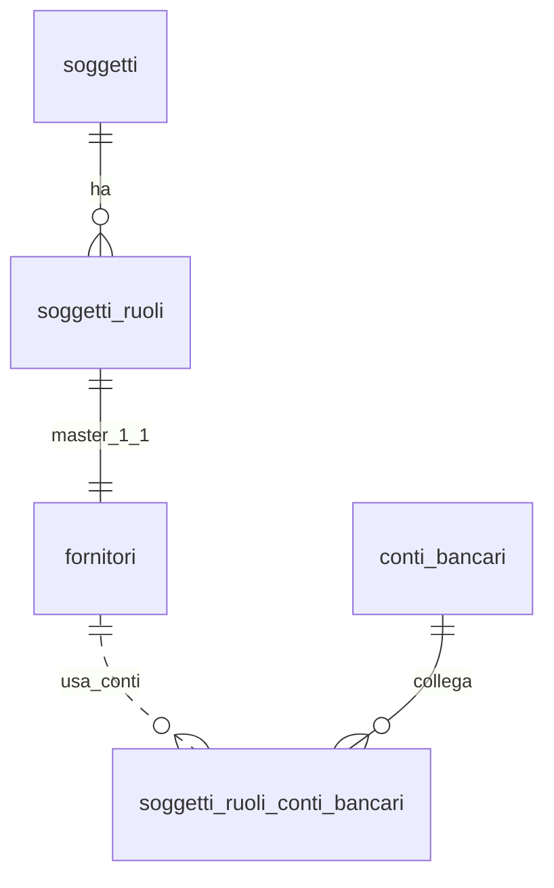

## 📘 Documentazione Concettuale – Tabella `anagrafiche.fornitori`

> 👀 **Vedi anche**
>
> **Approfondimento Tabelle**   
> • [anagrafiche.soggetti](/dbzero/anagrafiche/tabelle/soggetti)   
> • [anagrafiche.soggetti_ruoli](/dbzero/anagrafiche/tabelle/soggetti_ruoli)   
> • [config.valute](/dbzero/config/tabelle/valute)    
> • [config.modalita_pagamento](/dbzero/config/tabelle/modalita_pagamento)    
> • [anagrafiche.soggetti_ruoli_conti_bancari](/dbzero/anagrafiche/tabelle/soggetti_ruoli_conti_bancari)    
> • [anagrafiche.conti_bancari](/dbzero/anagrafiche/tabelle/conti_bancari)    
>

---

### 🎯 Scopo Principale

`anagrafiche.fornitori` è la **tabella master del ruolo FORNITORE** (relazione **1:1** con `anagrafiche.soggetti_ruoli`). Contiene le **impostazioni fiscali/operative** necessarie per la gestione dei fornitori, le **preferenze di pagamento** (valuta, modalità e termini), parametri di **qualifica/valutazione** e l’**audit**.

Questo disaccoppiamento consente di mantenere separati i **dati di identità** del soggetto (in `anagrafiche.soggetti`) dalle **caratteristiche di ruolo** (fornitore) senza duplicazioni.

---

### 🔗 Relazioni

| Tipo        | Tabella ↔ Campo                                           | Descrizione                                             |
| ----------- | --------------------------------------------------------- | ------------------------------------------------------- |
| FK →        | `anagrafiche.soggetti_ruoli(id)` ← `soggetto_ruolo_id`    | Collega il record al ruolo FORNITORE del soggetto (1:1) |
| FK →        | `config.valute(id)` ← `valuta_id`                         | Valuta preferita del fornitore                          |
| FK →        | `config.modalita_pagamento(id)` ← `modalita_pagamento_id` | Modalità di pagamento predefinita                       |
| (indiretto) | `anagrafiche.soggetti_ruoli_conti_bancari`                | Associa i conti bancari a livello di ruolo (override)   |

> **Nota:** i conti bancari **non** sono salvati qui per evitare duplicazioni. Si usano i legami di ruolo (`soggetti_ruoli_conti_bancari`) e, in loro assenza, il fallback di soggetto (`soggetti_conti_bancari`).

---

### 🧱 Struttura logica (campi chiave)

* **Identità/Stato**
  `id BIGINT` (PK), `soggetto_ruolo_id BIGINT` (FK, **UNIQUE** 1:1), `codice VARCHAR(32)` (**UNIQUE**),
  `attivo BOOLEAN DEFAULT true`, `stato_operativo VARCHAR(16)` *(es. `QUALIFICATO|IN_VERIFICA|SOSPESO`)*

* **Fatturazione / Fiscale**
  `valuta_id INT` → `config.valute`, `modalita_pagamento_id INT` → `config.modalita_pagamento`,
  `giorni_pagamento SMALLINT`, `fine_mese BOOLEAN`, `split_payment BOOLEAN`,
  `ritenuta_acconto BOOLEAN`, `ritenuta_aliquota NUMERIC(5,2)`,
  `regime_fiscale VARCHAR(8)` *(codice RF SdI, opz.)*, `bollo_esente BOOLEAN`,
  `canale_fe VARCHAR(7)` *(codice destinatario)*, `pec_email VARCHAR(256)` *(PEC per FE, opz.)*

* **Operativo / Qualità**
  `rating SMALLINT` *(0–100 o 1–5, vedi check)*, `qualifica_scadenza DATE`, `note TEXT`

* **Estensioni / Audit**
  `meta JSONB`, `tx_id UUID`, `storicizza BOOLEAN`, `data_*`, `user_*`

---

### 🚦 Vincoli & Regole

* **Univocità**
  `UNIQUE (soggetto_ruolo_id)` → relazione **1:1** con `soggetti_ruoli`.
  `UNIQUE (codice)` → codice interno univoco.

* **Check**
  `rating` in **0..100** *(o modifica la check a 1..5 se adotti la scala 1–5)*.
  `char_length(canale_fe) = 7` *(quando valorizzato)*.
  `ritenuta_aliquota` **0..100%** *(quando valorizzata)*.

* **Pulizia/Normalizzazione**
  Trigger di guardia normalizza `canale_fe` **uppercase senza spazi**.

* **Referential Integrity**
  Cancellazione **NO ACTION** su FK per evitare orfani; usare `attivo=false` o storicizzazione per dismettere.


---

### 🔎 Query tipiche

**1) Fornitori attivi e qualificati**

```sql
SELECT f.id, f.codice, f.stato_operativo, f.rating
FROM anagrafiche.fornitori f
WHERE f.attivo = true
  AND (f.stato_operativo = 'QUALIFICATO')
ORDER BY f.rating DESC NULLS LAST;
```

**2) Verifica 1:1 con `soggetti_ruoli`**

```sql
SELECT sr.id AS soggetto_ruolo_id
FROM anagrafiche.soggetti_ruoli sr
LEFT JOIN anagrafiche.fornitori f ON f.soggetto_ruolo_id = sr.id
WHERE sr.ruolo = 'FORNITORE' AND f.id IS NULL;
```

**3) Parametri di pagamento consolidati (join essenziali)**

```sql
SELECT f.codice,
       v.codice_iso AS valuta,
       mp.codice    AS mod_pag,
       f.giorni_pagamento,
       f.fine_mese,
       f.split_payment
FROM anagrafiche.fornitori f
LEFT JOIN config.valute v               ON v.id  = f.valuta_id
LEFT JOIN config.modalita_pagamento mp  ON mp.id = f.modalita_pagamento_id;
```

---

### 🧭 Best practice

* Mantieni **coerenti** i parametri di pagamento con i **conti bancari di ruolo** nella tabella `soggetti_ruoli_conti_bancari` (es. conto specifico per fornitori pagamenti).
* Usa `qualifica_scadenza` per **alert** su rinnovi documentali; integra con una tabella documentale se necessario.
* Per FE, compila **uno** tra `canale_fe` (7 char) e `pec_email`; definisci regole applicative di priorità.
* Per dismettere un fornitore, preferisci `attivo=false` e lascia la storicizzazione attiva.

---

### Diagramma ER relazioni (focus fornitore)



---



---
