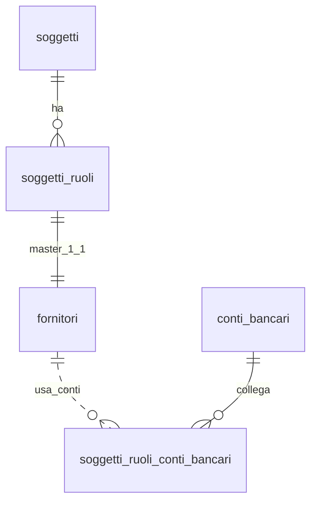

## 📘 Documentazione Concettuale – Tabella `anagrafiche.fornitori`

> 👀 **Vedi anche**
>
**Approfondimento Tabelle**   
> • [anagrafiche.soggetti](/dbzero/anagrafiche/tabelle/soggetti)   
> • [anagrafiche.soggetti_ruoli](/dbzero/anagrafiche/tabelle/soggetti_ruoli)   
> • [config.valute](/dbzero/config/tabelle/valute)    
> • [config.modalita_pagamento](/dbzero/config/tabelle/modalita_pagamento)    
> • [config.termini_pagamento](/dbzero/config/tabelle/termini_pagamento)    
> • [config.regimi_fiscali](/dbzero/config/tabelle/regimi_fiscali)    
> • [anagrafiche.soggetti_ruoli_conti_bancari](/dbzero/anagrafiche/tabelle/soggetti_ruoli_conti_bancari)    
> • [anagrafiche.conti_bancari](/dbzero/anagrafiche/tabelle/conti_bancari)    
>
### 🎯 Scopo Principale
(rev 2026-11-21)

`anagrafiche.fornitori` è la **tabella master del ruolo FORNITORE** (relazione **1:1** con `anagrafiche.soggetti_ruoli`). Contiene le **impostazioni fiscali/operative** necessarie per la gestione dei fornitori, le **preferenze di pagamento** (valuta, modalità e termini), parametri di **qualifica/valutazione** e l’**audit**.

Questo disaccoppiamento consente di mantenere separati i **dati di identità** del soggetto (in `anagrafiche.soggetti`) dalle **caratteristiche di ruolo** (fornitore) senza duplicazioni.

---

### Relazioni

| Tipo        | Tabella ↔ Campo                                           | Descrizione                                             |
| ----------- | --------------------------------------------------------- | ------------------------------------------------------- |
| FK →        | `anagrafiche.soggetti_ruoli(id)` ← `soggetto_ruolo_id`    | Collega il record al ruolo FORNITORE del soggetto (1:1) |
| FK →        | `config.valute(id)` ← `valuta_id`                         | Valuta preferita del fornitore                          |
| FK →        | `config.modalita_pagamento(id)` ← `modalita_pagamento_id` | Modalità di pagamento predefinita                       |
| FK →        | `config.termini_pagamento(id)` ← `termine_pagamento_id`   | Termine di pagamento: giorni, fine mese, rate           |
| FK →        | `config.regimi_fiscali(codice_interno)` ← `regime_fiscale_rf` | Regime fiscale del fornitore (codice RF)            |
| FK →        | `config.stati_fornitore(id)` ← `stato_fornitore_id`       | Stato del fornitore (nasce «in verifica»)               |
| (indiretto) | `anagrafiche.soggetti_ruoli_conti_bancari`                | Associa i conti bancari a livello di ruolo (override)   |

> **Nota:** i conti bancari **non** sono salvati qui per evitare duplicazioni. Si usano i legami di ruolo (`soggetti_ruoli_conti_bancari`) e, in loro assenza, il fallback di soggetto (`soggetti_conti_bancari`).

---

### Struttura logica (campi chiave)

* **Identità/Stato**
  `id BIGINT` (PK), `soggetto_ruolo_id BIGINT` (FK, **UNIQUE** 1:1), `codice VARCHAR(32)` (**UNIQUE**),
  `attivo BOOLEAN DEFAULT true`, `stato_fornitore_id` → `config.stati_fornitore`

* **Pagamento** — la stessa base del cliente
  `valuta_id` → `config.valute`, `modalita_pagamento_id` → `config.modalita_pagamento`,
  `termine_pagamento_id` → `config.termini_pagamento`. Giorni, fine mese, rate e
  intervallo stanno nel termine, non sul fornitore.

* **Fiscale**
  `ritenuta_acconto BOOLEAN`, `ritenuta_aliquota NUMERIC(5,2)`,
  `regime_fiscale_rf` → `config.regimi_fiscali(codice_interno)` *(codice RF del tracciato, facoltativo:
  un privato non ne ha)*. È la stessa forma del regime dell'emittente.

* **Cosa non sta qui** *(sono del soggetto, per ogni suo ruolo)*
  lo split payment (`anagrafiche.soggetti.split_payment`) e l'instradamento della fatturazione
  elettronica (codice destinatario, codice SdI, PEC: `anagrafiche.dati_societari`). Il bollo lo
  decide chi emette il documento.

* **Operativo / Qualità**
  `rating SMALLINT` *(0–100 o 1–5, vedi check)*, `qualifica_scadenza DATE`, `note TEXT`

* **Estensioni / Audit**
  `meta JSONB`, `tx_id UUID`, `storicizza BOOLEAN`, `data_*`, `user_*`

---

### 🚦 Vincoli & Regole

* **Univocità**
  `UNIQUE (soggetto_ruolo_id)` → relazione **1:1** con `soggetti_ruoli`.
  `UNIQUE (codice)` → codice interno univoco.

* **Check**
  `rating` in **0..100** *(o modifica la check a 1..5 se adotti la scala 1–5)*.
  `ritenuta_aliquota` **0..100%** *(quando valorizzata)*.

* **Ritenuta d'acconto**
  Il trigger di guardia pretende un'aliquota maggiore di zero quando c'è la ritenuta, e la
  azzera quando non c'è.

* **Regime fiscale**
  Un codice che non è nel catalogo dei regimi è rifiutato dalla FK `fk_fornitori_regimi_fiscali`.
  ⭐ Un regime **spento** non si assegna a un fornitore acceso: `E_ATTIVO_PADRE_NON_ATTIVO`, col
  campo `regime_fiscale_rf` nel contesto. Un regime che un fornitore acceso usa non si spegne
  (`E_ATTIVO_BLOCK_CHILDREN_ACTIVE`). Un fornitore spento tiene il suo regime anche se il regime
  si spegne, ma riaccenderlo è rifiutato finché non gli si dà un regime acceso. Un fornitore senza
  regime non controlla niente. È la coppia ATTIVO del framework, dichiarata in
  [dbops.automazione_attivo_inclusioni](/dbzero/dbops/tabelle/automazione_attivo_inclusioni):
  la regola completa sta in [config.regimi_fiscali](/dbzero/config/tabelle/regimi_fiscali).

* **Referential Integrity**
  Cancellazione **NO ACTION** su FK per evitare orfani; usare `attivo=false` o storicizzazione per dismettere.


---

### Query tipiche

**1) Fornitori attivi e qualificati**

```sql
SELECT f.id, f.codice, sf.codice_interno AS stato, f.rating
FROM anagrafiche.fornitori f
JOIN config.stati_fornitore sf ON sf.id = f.stato_fornitore_id
WHERE f.attivo = true
ORDER BY f.rating DESC NULLS LAST;
```

**2) Verifica 1:1 con `soggetti_ruoli`**

```sql
SELECT sr.id AS soggetto_ruolo_id
FROM anagrafiche.soggetti_ruoli sr
LEFT JOIN anagrafiche.fornitori f ON f.soggetto_ruolo_id = sr.id
WHERE sr.ruolo = 'FORNITORE' AND f.id IS NULL;
```

**3) Parametri di pagamento consolidati (join essenziali)**

```sql
SELECT f.codice,
       v.codice_iso AS valuta,
       mp.codice    AS mod_pag,
       tp.codice    AS termine
FROM anagrafiche.fornitori f
LEFT JOIN config.valute v               ON v.id  = f.valuta_id
LEFT JOIN config.modalita_pagamento mp  ON mp.id = f.modalita_pagamento_id
LEFT JOIN config.termini_pagamento tp   ON tp.id = f.termine_pagamento_id;
```

---

### Best practice

* Mantieni **coerenti** i parametri di pagamento con i **conti bancari di ruolo** nella tabella `soggetti_ruoli_conti_bancari` (es. conto specifico per fornitori pagamenti).
* Usa `qualifica_scadenza` per **alert** su rinnovi documentali; integra con una tabella documentale se necessario.
* Per dismettere un fornitore, preferisci `attivo=false` e lascia la storicizzazione attiva.

---

### Diagramma ER relazioni (focus fornitore)



---



---
