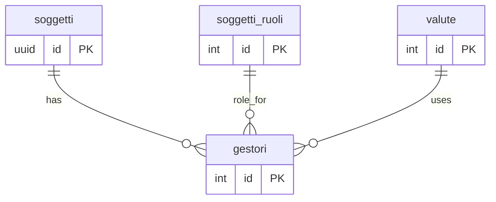
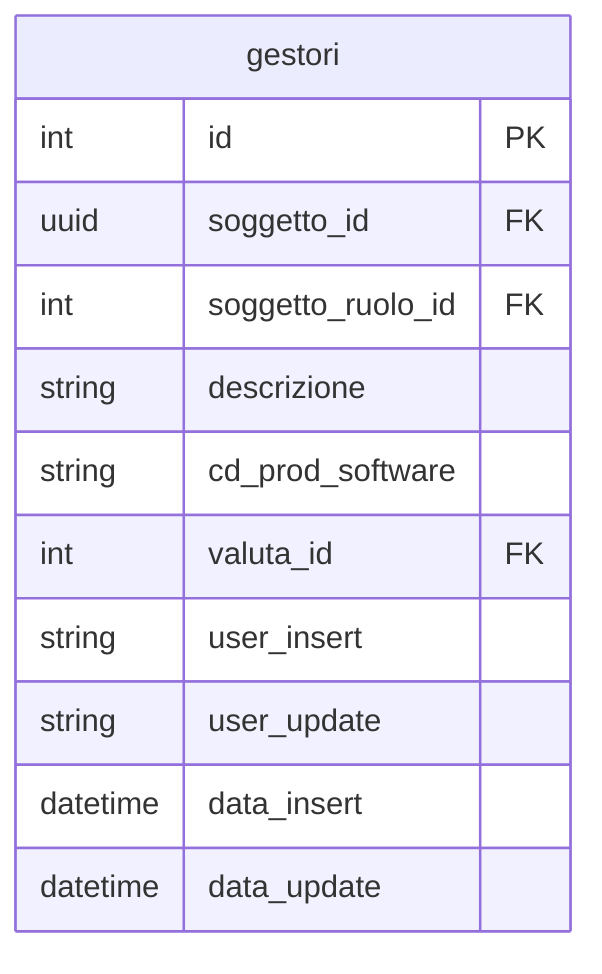

## 📘 Documentazione Concettuale – Tabella `anagrafiche.gestori`

> 👀 **Vedi anche**  
>
> Approfondimento Tabelle:   
>
> * [anagrafiche.soggetti](/dbzero/anagrafiche/soggetti)   
> * [anagrafiche.soggetti_ruoli](/dbzero/anagrafiche/soggetti_ruoli)    
> * [config.valute](/dbzero/config/tabelle/valute)   
>
> Approfondimenti funzioni:   
>
> * [anagrafiche.trgfn_gestori_guard_ruolo_gestore](/dbzero/anagrafiche/funzioni/trgfn_gestori_guard_check_ruolo_gestore)   
> * [script.fn_guard_soggetto_ruolo](/dbzero/script/funzioni/fn_guard_soggetto_ruolo)  

La tabella **`anagrafiche.gestori`** rappresenta l’azienda stessa che utilizza e amministra il sistema Zero ERP (“gestore”). Attualmente raccoglie le informazioni di base necessarie a identificare il gestore, ma è ancora in fase di definizione: in futuro potrà essere estesa per includere ulteriori parametri funzionali e di configurazione del software.

---

### 🎯 Scopo Principale
(latest update 05-12-25)
- **Identificare il gestore del sistema**  
  Memorizzare la riga unica che corrisponde all’azienda proprietaria o amministratrice di Zero ERP, distinguendola da tutti gli altri soggetti (clienti, fornitori, partner, ecc.).

- **Collegare il gestore all’anagrafica generica**  
  Utilizzare il campo `soggetto_id` per riferirsi al record corrispondente in `anagrafiche.soggetti` (azienda di tipo giuridico), garantendo coerenza fra scheda anagrafica e scheda gestore.

- **Assicurare il ruolo corretto**  
  Contribuire al rispetto della logica applicativa: il trigger `trg_gestori_guard_ruolo_gestore_ins_upd` verifica che il record inserito o aggiornato faccia effettivamente riferimento a una relazione soggetto-ruolo di tipo “Gestore” (presente in `anagrafiche.soggetti_ruoli`).

---

### 🔗 Collegamenti con Altre Tabelle

- **`anagrafiche.soggetti`**  
  - Il campo `soggetto_id` (UUID) è una chiave esterna che punta a `anagrafiche.soggetti(id)`.  
  - Vincolo `fk_soggetti_anagrafiche`:  
    - **ON UPDATE NO ACTION**  
    - **ON DELETE RESTRICT** (non è consentito eliminare il soggetto di tipo “gestore” finché rimane collegato).  

- **`anagrafiche.soggetti_ruoli`**  
  - Il campo `soggetto_ruolo_id` (integer) fa riferimento a una riga di `anagrafiche.soggetti_ruoli(id)` avente ruolo “Gestore”.  
  - Vincolo `fk_soggetti_ruoli_anagrafiche`:  
    - **ON UPDATE NO ACTION**  
    - **ON DELETE RESTRICT** (non è consentito eliminare la relazione soggetto-ruolo “Gestore” se è in uso).  

- **`config.valute`**  
  - Il campo `valuta_id` (integer) rimanda a `config.valute(id)`, indicando la valuta di default per le operazioni gestionali.  
  - Vincolo `fk_valute_config`:  
    - **ON UPDATE NO ACTION**  
    - **ON DELETE RESTRICT** (la valuta di default non può essere eliminata se è assegnata a un gestore).  

---

### 🚩 Vincoli di Unicità e Integrità

- **Primary Key**  
  - `pk_gestori` su `id` (seriale intero generato automaticamente).

- **Riga singleton per gestore**  
  - Il vincolo `uq_gestori_singleton EXCLUDE USING gist ((1) WITH =) WHERE (id IS NOT NULL)` assicura che esista al massimo una sola riga nella tabella `gestori`. In tal modo, zero o un record potranno rappresentare il gestore di Zero ERP.

- **Riferimento obbligatorio a soggetto**  
  - `soggetto_id` deve sempre esistere in `anagrafiche.soggetti`.  
  - `soggetto_ruolo_id` deve sempre esistere in `anagrafiche.soggetti_ruoli` e deve corrispondere a un ruolo “Gestore”.

- **Riferimento obbligatorio a valuta**  
  - `valuta_id` deve sempre esistere in `config.valute`, per definire la moneta utilizzata dal gestore.

- **Campi testuali obbligatori**  
  - `descrizione` (50 caratteri) e `cd_prod_software` (20 caratteri) non possono essere nulli, al fine di fornire un’etichetta descrittiva e l’indicazione del prodotto software in uso.

---

### 🔍 Descrizione dei Campi Principali

- **`id`**  
  Identificativo univoco (seriale intero) per la riga “gestore”.

- **`soggetto_id`**  
  Riferimento al record di `anagrafiche.soggetti` che rappresenta l’azienda amministratrice. È vincolato alla presenza di un soggetto di tipo giuridico.

- **`soggetto_ruolo_id`**  
  Riferimento alla riga di `anagrafiche.soggetti_ruoli` associata al ruolo “Gestore” per il soggetto indicato. Garantisce che il soggetto abbia già un ruolo valido di tipo “Gestore”.

- **`descrizione`**  
  Etichetta testuale (50 caratteri) utilizzata per mostrare un nominativo breve (ad esempio, “ACME S.r.l. – Gestore Sistema”) nelle interfacce utente.

- **`cd_prod_software`**  
  Codice del prodotto software in uso (20 caratteri). Può essere utile per identificare versioni, edizioni o configurazioni specifiche attivate per il gestore (es. “ZEROERP_PRO” o “ZEROERP_STD”).

- **`valuta_id`**  
  Riferimento a `config.valute(id)`, indica la valuta di default per prezzi, bilanci e reporting amministrativo (es. EUR, USD, GBP).

- **`user_insert`, `data_insert`, `user_update`, `data_update`**  
  Campi di audit standard:
  - `user_insert`: login utente che ha creato la riga.  
  - `data_insert`: timestamp di creazione.  
  - `user_update`: login utente che ha eseguito l’ultima modifica.  
  - `data_update`: timestamp dell’ultima modifica.

---

### 💡 Vantaggi Operativi

- **Singleton azienda gestore**  
  Grazie al vincolo di esclusione su `(1)`, si garantisce che esista al massimo una sola riga che rappresenta l’azienda “gestore”. Ciò semplifica la logica applicativa, perché non è necessario gestire più istanze di gestore.

- **Controllo automatico del ruolo**  
  Il trigger `check_ruolo_gestore` impedisce l’inserimento di record non validi, assicurando che il soggetto collegato abbia già il ruolo “Gestore” in `anagrafiche.soggetti_ruoli`.

- **Collegamenti diretti a dati anagrafici e valute**  
  Le chiavi esterne verso `anagrafiche.soggetti` e `config.valute` assicurano coerenza e consentono di risalire rapidamente alle informazioni base dell’azienda e alla valuta di riferimento.

- **Tracciabilità delle modifiche**  
  Il trigger di audit registra tutti gli aggiornamenti, mantenendo un log implicito di chi e quando ha modificato i dati del gestore.

---

### 🚀 Sviluppi Futuri

- **Estensione dei parametri funzionali**  
  In futuro, `anagrafiche.gestori` potrà contenere campi aggiuntivi di configurazione software, quali:
  - Parametri di default per fatturazione elettronica (ad es. metodi di invio, codici destinatario).  
  - Impostazioni di branding (logo, colori, template PDF).  
  - Soglie operative (es. scorte minime, limiti di credito).  
  - Configurazioni API per integrazione con servizi esterni (es. CRM, sistemi bancari).

- **Integrazione con tabelle di telemetria**  
  Possibile aggiunta di relazioni verso tabelle di monitoraggio (log di accesso, statistiche di performance, volumi di documenti) collegate al gestore, per analisi di utilizzo e ottimizzazione del sistema.

- **Multitenancy e permessi**  
  Se in futuro Zero ERP dovrà supportare ambienti multi-tenant, saranno previsti campi aggiuntivi per definire permessi, ruoli amministrativi e ambiti di visibilità dati in funzione del gestore.

> 🚧 **Stato di sviluppo**  
> Questa tabella è già funzionante per memorizzare le informazioni di base del gestore, ma rimane soggetta a evoluzione. I campi e i vincoli futuri saranno aggiunti a seconda delle esigenze di progetto.

---

> 🧠 **“Una singola entità per identificare l’azienda gestore e gettare le basi per la futura configurazione avanzata del sistema Zero ERP.”**  

---

###  Diagramma ER relazioni 

---

###  Diagramma ER attributi

---


---