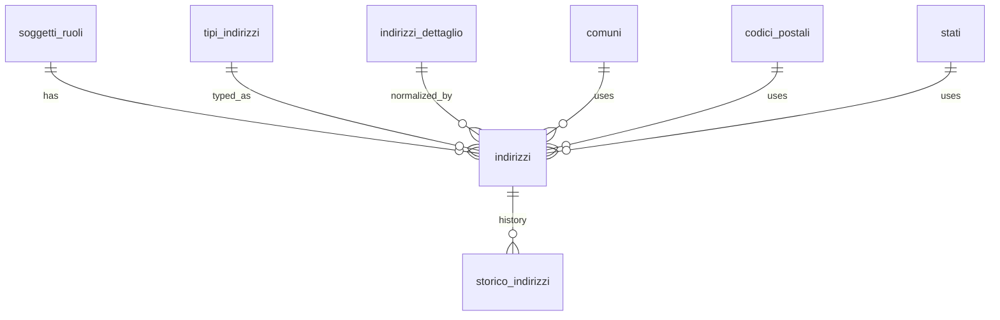

## 📘 Documentazione Concettuale – Tabella `anagrafiche.indirizzi`

> 👀 **Vedi anche**    
>
> Guide:   
>
> * [Gestione degli indirizzi](/guide/gestione-degli-indirizzi)       
>
> Approfondimento Tabelle:   
>
> * [anagrafiche.soggetti](/dbzero/anagrafiche/tabelle/soggetti)       
> * [anagrafiche.soggetti_ruoli](/dbzero/anagrafiche/tabelle/soggetti_ruoli)  
> * [anagrafiche.indirizzi_dettaglio](/dbzero/anagrafiche/tabelle/indirizzi_dettaglio)  
> * [storico.indirizzi](/dbzero/storico/tabelle/indirizzi)     
> * [config.comuni](/dbzero/config/tabelle/comuni)    
> * [config.codici_postali](/dbzero/config/tabelle/codici_postali)    
> * [config.stati](/dbzero/config/tabelle/stati)   
> * [config.tipi_indirizzi](/dbzero/config/tabelle/tipi_indirizzi)   
>
> Approfondimento funzioni e trigger:  
>
> * [anagrafiche.trgfn_indirizzi_ins_upd_clean_fields](/dbzero/anagrafiche/funzioni/trgfn_indirizzi_ins_upd_clean_fields)  
> * [script.trgfn_upd_dlt_storico_generic](/dbzero/script/funzioni/trgfn_upd_dlt_storico_generic) 
> * [script.fn_get_default_by_param](/dbzero/script/funzioni/fn_get_default_by_param)   
> * [dbops.trgfn_tx_id_managed](/dbzero/dbops/funzioni/trgfn_tx_id_managed)   

---

La tabella **`anagrafiche.indirizzi`** gestisce l’associazione tra un soggetto/ruolo e un indirizzo, integrando sia **indirizzi normalizzati** (collegati a `indirizzi_dettaglio`), sia **indirizzi liberi**, utili per contesti internazionali o non strutturati.

Supporta:
- Identificazione del tipo di indirizzo (es. legale, sede operativa, corrispondenza)
- Riferimenti geografici completi
- Storicizzazione delle modifiche
- Geolocalizzazione
- Vincoli di integrità per garantire coerenza tra i dati

---

### 🎯 Scopo Principale

* **Associazione soggetto/ruolo → indirizzo**  
  Ogni soggetto può avere più indirizzi distinti in base al ruolo (es. cliente, fornitore) e al tipo di indirizzo (es. sede legale, spedizione, residenza).

* **Supporto per due modalità**  
  - **Normalizzata**: tramite `indirizzo_dettaglio_id`, si collega a una via e civico specifici (con geolocalizzazione puntuale e struttura gerarchica).
  - **Libera**: tramite `indirizzo_libero`, con campi ausiliari (`comune_id`, `stato_id`, `locality`, `postal_box`, ecc.), utile per indirizzi internazionali o non standardizzati.

* **Controllo di coerenza**  
  Tramite vincoli `CHECK`, è garantita l’alternatività tra le due modalità (o normalizzata o libera) e la completezza minima dei dati se si usa la modalità libera.

* **Tracciabilità e storicizzazione**  
  Con il campo `storicizza` e i trigger associati, le modifiche vengono salvate come snapshot nella tabella `storico.indirizzi`.

---

### 🔗 Collegamenti con Altre Tabelle

* **`anagrafiche.soggetti_ruoli`**  
  - Ogni indirizzo è riferito a una specifica combinazione soggetto/ruolo.  
  - Vincolo `RESTRICT` in caso di eliminazione (non si può eliminare un ruolo associato a indirizzi).  

* **`config.tipi_indirizzi`**  
  - Definisce la tipologia dell’indirizzo (es. domicilio fiscale, sede legale, corrispondenza).  
  - Obbligatoria per ogni record.  

* **`anagrafiche.indirizzi_dettaglio`**  
  - Se presente, indica che l’indirizzo è in modalità normalizzata.  
  - In caso contrario, devono essere valorizzati i campi dell’indirizzo libero.  

* **`config.comuni`, `config.codici_postali`, `config.stati`**  
  - Utilizzati solo per la modalità libera per fornire contesto geografico anche a indirizzi non normalizzati.  

---

### 💡 Vantaggi Operativi

* **Gestione flessibile degli indirizzi**  
  Si adatta a tutti i contesti: locali (normalizzati) o esteri/non strutturati (liberi), senza perdere integrità dei dati.

* **Storicizzazione automatica**  
  Le modifiche vengono archiviate tramite trigger in `storico.indirizzi`, mantenendo tracciabilità completa nel tempo.

* **Geolocalizzazione precisa**  
  In modalità normalizzata, è disponibile una posizione puntuale (`geoloc`) utile per sistemi GIS, ottimizzazione logistica o analisi territoriali.

* **Ricerca e normalizzazione**  
  Gli indirizzi normalizzati consentono query full-text, deduplicazione e aggregazioni più efficienti.

* **Controlli automatici e consistenza**  
  I vincoli `CHECK` garantiscono che non si verifichino ambiguità nei dati (es. indirizzo sia normalizzato che libero insieme).

---

> 🧠 **“Una tabella ponte tra struttura e flessibilità: `anagrafiche.indirizzi` consente di mappare ogni possibile indirizzo di un soggetto, conservando coerenza, precisione geografica e tracciabilità delle modifiche.”**

---

###  Diagramma ER relazioni

---
