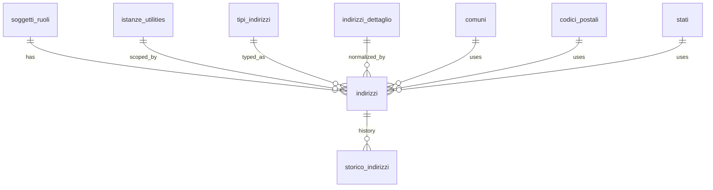

## 📘 Documentazione Concettuale – Tabella `anagrafiche.indirizzi`

> 👀 **Vedi anche**    
>
Guide:   
>
[Gestione degli indirizzi](/guide/gestione-degli-indirizzi)       
>
Approfondimento Tabelle:   
>
[anagrafiche.soggetti](/dbzero/anagrafiche/tabelle/soggetti)       
> [anagrafiche.soggetti_ruoli](/dbzero/anagrafiche/tabelle/soggetti_ruoli)  
> [anagrafiche.indirizzi_dettaglio](/dbzero/anagrafiche/tabelle/indirizzi_dettaglio)  
> [storico.indirizzi](/dbzero/storico/tabelle/indirizzi)     
> [config.comuni](/dbzero/config/tabelle/comuni)    
> [config.codici_postali](/dbzero/config/tabelle/codici_postali)    
> [config.stati](/dbzero/config/tabelle/stati)   
> [config.tipi_indirizzi](/dbzero/config/tabelle/tipi_indirizzi)   
>
Approfondimento funzioni e trigger:  
>
[anagrafiche.trgfn_indirizzi_base_normalize](/dbzero/anagrafiche/funzioni/trgfn_indirizzi_base_normalize)  
> [script.trgfn_storico_generic](/dbzero/script/funzioni/trgfn_storico_generic)  
> [anagrafiche.trgfn_indirizzi_guard_forma_libera](/dbzero/anagrafiche/funzioni/trgfn_indirizzi_guard_forma_libera)   
> [script.fn_stato_proposto_id](/dbzero/script/funzioni/fn_stato_proposto_id)   
> [dbops.trgfn_tx_id_managed](/dbzero/dbops/funzioni/trgfn_tx_id_managed)   

---

La tabella **`anagrafiche.indirizzi`** gestisce l’associazione tra un soggetto/ruolo e un indirizzo, integrando sia **indirizzi normalizzati** (collegati a `indirizzi_dettaglio`), sia **indirizzi liberi**, utili per contesti internazionali o non strutturati.

Supporta:

- Identificazione del tipo di indirizzo (es. legale, sede operativa, corrispondenza)
- **Differenziazione per istanza di servizio** tramite `istanza_utility_id` (opzionale)
- Riferimenti geografici completi
- Storicizzazione delle modifiche
- Geolocalizzazione
- Vincoli di integrità per garantire coerenza tra i dati

---
### 🎯 Scopo Principale
(latest review 25-03-26)
* **Associazione soggetto/ruolo/istanza → indirizzo**
  Ogni soggetto può avere più indirizzi distinti in base al ruolo (es. cliente, fornitore), al tipo di indirizzo (es. sede legale, spedizione, residenza) e all'istanza di servizio (es. GAS Corridonia vs GAS Civitanova).

* **Cascata a 3 livelli**
  - **Livello 1 — Istanza**: `istanza_utility_id` valorizzato → indirizzo specifico per il servizio
  - **Livello 2 — Ruolo generico**: `istanza_utility_id` NULL → indirizzo generico del ruolo
  - **Livello 3 — Soggetto**: indirizzo da `indirizzi_soggetti` (fallback readonly)

* **Supporto per due modalità**  
  - **Normalizzata**: tramite `indirizzo_dettaglio_id`, si collega a una via e civico specifici (con geolocalizzazione puntuale e struttura gerarchica).
  - **Libera**: tramite `indirizzo_libero`, con lo stato e, secondo lo stato, comune e CAP del catalogo oppure località e codice postale (`postal_code`), utile per indirizzi esteri o non ancora normalizzabili.

> ⚠️ **Nota Bene**  
> La modalità **normalizzata** è sempre preferibile.  
> L’inserimento di indirizzi **liberi** deve essere considerato **solo come opzione estrema** (es. migrazioni da altri database o casi non normalizzabili).

* **Controllo di coerenza**  
  Tramite vincoli `CHECK` è garantita l’alternatività tra le due modalità (o normalizzata o libera); la completezza dell'indirizzo libero ha due forme:
  - se `indirizzo_dettaglio_id` è `NULL` → servono `indirizzo_libero` e `stato_id` (se lo stato non è detto, lo propone il sistema);
  - poi la forma la decide lo stato (`config.stati.catalogo_comuni_completo`): **catalogo** = `comune_id` + `codice_postale_id` coerenti fra loro e con lo stato, senza `locality`, `postal_code` e `administrative_area`; **estera** = `locality`, con `postal_code`, `administrative_area` e `sublocality` facoltativi.
  - il rifiuto, col codice e il campo, lo dà il guard [`trgfn_indirizzi_guard_forma_libera`](/dbzero/anagrafiche/manual/trgfn_indirizzi_guard_forma_libera); il CHECK `chk_*_free_requirements` resta come rete (rev 18-10-2026).

* **Tracciabilità e storicizzazione**  
  Con il campo `storicizza` e i trigger associati, le modifiche vengono salvate come snapshot nella tabella `storico.indirizzi`.
  La generazione dei trigger (TX_ID, AUDIT_UPDATE, STORICO) e' affidata al framework di automazione DB
  (`dbops.fn_run_automations_*`, vedi [Guida Automazioni DB](/guide/automazione-db)).
  Se le automazioni non sono state eseguite, i campi restano presenti ma non vengono gestiti automaticamente.

---

### Collegamenti con Altre Tabelle

* **`anagrafiche.soggetti_ruoli`**
  - Ogni indirizzo è riferito a una specifica combinazione soggetto/ruolo.
  - Vincolo `RESTRICT` in caso di eliminazione (non si può eliminare un ruolo associato a indirizzi).

* **`anagrafiche.istanze_utilities`** (opzionale)
  - Se `istanza_utility_id` è valorizzato, l’indirizzo è specifico per quell’istanza di servizio.
  - Se NULL, l’indirizzo è generico del ruolo (fallback per tutte le istanze).

* **`config.tipi_indirizzi`**
  - Definisce la tipologia dell’indirizzo (es. domicilio fiscale, sede legale, corrispondenza).
  - Obbligatoria per ogni record.

* **`anagrafiche.indirizzi_dettaglio`**
  - Se presente, indica che l’indirizzo è in modalità normalizzata.
  - In caso contrario, devono essere valorizzati i campi dell’indirizzo libero.

* **`config.comuni`, `config.codici_postali`, `config.stati`**
  - Utilizzati solo per la modalità libera per fornire contesto geografico anche a indirizzi non normalizzati.

### Vincoli UNIQUE

Due partial unique index per gestire la cascata istanza/ruolo generico:

- `uq_indirizzi_ruolo_tipo_no_istanza (soggetto_ruolo_id, tipo_indirizzo_id) WHERE istanza_utility_id IS NULL` — un solo indirizzo generico per tipo per ruolo
- `uq_indirizzi_ruolo_istanza_tipo (soggetto_ruolo_id, istanza_utility_id, tipo_indirizzo_id) WHERE istanza_utility_id IS NOT NULL` — un solo indirizzo per tipo per istanza

---

### Vantaggi Operativi

* **Gestione flessibile degli indirizzi**  
  Si adatta a tutti i contesti: locali (normalizzati) o esteri/non strutturati (liberi), senza perdere integrità dei dati.

* **Storicizzazione automatica**  
  Le modifiche vengono archiviate tramite trigger in `storico.indirizzi`, mantenendo tracciabilità completa nel tempo.

* **Geolocalizzazione precisa**  
  In modalità normalizzata, è disponibile una posizione puntuale (`geoloc`) utile per sistemi GIS, ottimizzazione logistica o analisi territoriali.

* **Ricerca e normalizzazione**  
  Gli indirizzi normalizzati consentono query full-text, deduplicazione e aggregazioni più efficienti.

* **Controlli automatici e consistenza**  
  I vincoli `CHECK` garantiscono che non si verifichino ambiguità nei dati (es. indirizzo sia normalizzato che libero insieme).

---

> **“Una tabella ponte tra struttura e flessibilità: `anagrafiche.indirizzi` consente di mappare ogni possibile indirizzo di un soggetto, conservando coerenza, precisione geografica e tracciabilità delle modifiche.”**

---

###  Diagramma ER relazioni

---

