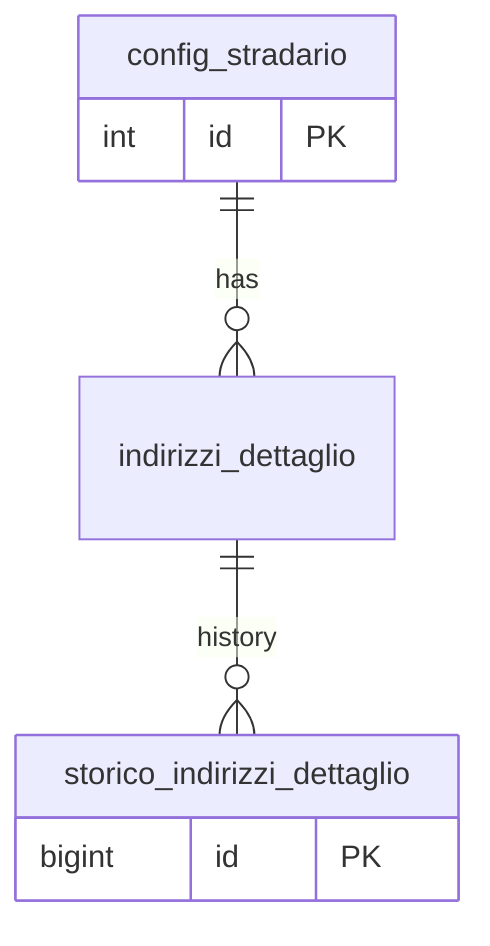

## 📘 Documentazione Concettuale – Tabella `anagrafiche.indirizzi_dettaglio`

> **Ultimo aggiornamento**: 25 ottobre 2026
>
> 👀 **Vedi anche**
>
> Guide:
>
> * [Gestione degli indirizzi](/guide/gestione-degli-indirizzi)
> * [Linee guida SQL §8.4-bis](/linee-guida-sql#84-bis-indici-unique-con-colonne-nullable) — indici `UNIQUE` con colonne nullable
>
> Approfondimento tabelle:
>
> * [anagrafiche.indirizzi](/dbzero/anagrafiche/tabelle/indirizzi)
> * [config.stradario](/dbzero/config/tabelle/stradario)
> * [config.comuni](/dbzero/config/tabelle/comuni)
> * [config.province](/dbzero/config/tabelle/province)
> * [storico.indirizzi_dettaglio](/dbzero/storico/tabelle/indirizzi_dettaglio)
>
> Approfondimento funzioni:
>
> * [anagrafiche.fn_get_or_create_indirizzo_dettaglio](/dbzero/anagrafiche/funzioni/fn_get_or_create_indirizzo_dettaglio) — il «trova o crea» del civico
> * [anagrafiche.fn_build_indirizzo_normalizzato](/dbzero/anagrafiche/funzioni/fn_build_indirizzo_normalizzato) — la normalizzazione, unica sorgente
> * [anagrafiche.trgfn_indirizzi_dettaglio_normalize](/dbzero/anagrafiche/funzioni/trgfn_indirizzi_dettaglio_normalize)
> * [anagrafiche.trgfn_indirizzi_dettaglio_protect_update](/dbzero/anagrafiche/funzioni/trgfn_indirizzi_dettaglio_protect_update)
> * [maintenance.proc_bump_indirizzi_dettaglio](/dbzero/maintenance/funzioni/proc_bump_indirizzi_dettaglio)
> * [script.trgfn_storico_generic](/dbzero/script/funzioni/trgfn_storico_generic)

La tabella **`anagrafiche.indirizzi_dettaglio`** contiene il dettaglio degli indirizzi civici, collegati a una specifica via (tramite `stradario_id`) e, attraverso la via, al contesto geografico (comune, provincia, regione, stato). Vi sono memorizzati numero civico, estensione, palazzina, scala, piano, interno, i dati di geolocalizzazione e tre campi calcolati dalla normalizzazione.

---

### 🎯 Scopo principale

* **Dettagliare lo stradario**
  Associare a ciascuna via (`config.stradario`) le singole unità civiche (numero civico, estensione, palazzina, scala, piano, interno), ottenendo l'indirizzo completo.
* **Geolocalizzazione**
  `civic_geoloc` memorizza il punto del singolo civico, `street_geoloc` la posizione media della via. Per le ricerche spaziali sul civico c'è un indice **GiST** su `civic_geoloc`.
* **Indirizzo normalizzato**
  Un trigger `BEFORE INSERT OR UPDATE` delega a `fn_build_indirizzo_normalizzato` e scrive:
  * le colonne strutturali normalizzate (`UPPER` + `BTRIM`); l'estensione prende il prefisso `/` (`A` → `/A`);
  * `via_norm`: tipo toponimo + nome della via, in maiuscolo;
  * `civico_norm`: numero + estensione, oppure **`SNC`** (senza numero civico) quando il civico è `NULL` o `0`;
  * `indirizzo_normalizzato`: la stringa completa (via, civico, palazzina, scala, piano, interno), usata per i confronti testuali e per la ricerca con l'indice GIN trigram.

---

### Regola sul cambio di via

Il cambio di via (`stradario_id`) è bloccato dal guard `trgfn_indirizzi_dettaglio_protect_update` (`E_COLONNA_NON_MODIFICABILE`): un civico non si sposta su un'altra via.

Quando cambia la via stessa (per esempio il toponimo), i civici si rinormalizzano con la procedura `maintenance.proc_bump_indirizzi_dettaglio(p_stradario_id)`: apre la manutenzione solo per la durata della procedura, riscrive le righe di quella via (il trigger ricalcola i campi normalizzati, lo storico registra la versione precedente) e richiude la manutenzione anche se l'aggiornamento fallisce.

---

### Collegamenti con altre tabelle

* **`config.stradario`**
  * `stradario_id` (integer, obbligatorio) fa riferimento alla chiave primaria di `config.stradario` (`fk_stradario_config`):
    * **ON UPDATE CASCADE**: se cambia l'id della via, si propaga;
    * **ON DELETE NO ACTION**: una via con civici collegati non si cancella.
  * Attraverso `config.stradario` si risale alla catena via → comune → provincia → regione → stato.
* **Tabelle figlie** (indirizzi, indirizzi dei soggetti, PDP, istanze utilities, magazzini, unità catastali): un civico con figli attivi non si disattiva. Lo presidiano i trigger `a10_*_block_deact` generati dall'automazione.
* **`storico.indirizzi_dettaglio`**: ogni `UPDATE` e `DELETE` lascia la versione precedente nello storico.

---

### Unicità del civico

L'indice `uq_indirizzi_dettaglio_norm` (definizione esatta nella sezione Indici della pagina) è costruito sulla **chiave naturale**: `stradario_id`, `civico` e, nella forma `COALESCE(…, '')`, `estensione_civico`, `palazzina`, `scala`, `piano`, `interno`. Lavora sui valori **già normalizzati** dal trigger.

Il «trova o crea» è `fn_get_or_create_indirizzo_dettaglio`: cerca per la stessa chiave (`civico IS NOT DISTINCT FROM`, `COALESCE` sulle altre colonne), crea se non trova e, su `unique_violation`, rilegge.

> ⚠️ **Limiti noti (verificati il 25 ottobre 2026, da correggere)**: la correzione è nel
> [brief-db-unicita-civico-indirizzi-dettaglio](/dev/work-in-progress/brief-db-unicita-civico-indirizzi-dettaglio).
>
> * **Civico senza numero non coperto dall'indice**: `civico` è nullable ed entra nell'indice senza `COALESCE` né `NULLS NOT DISTINCT`, quindi due civici `SNC` con lo stesso dettaglio sulla stessa via non collidono. Il lookup del «trova o crea» li evita in sequenza, ma due inserimenti concorrenti, o un `INSERT` diretto, creano la riga gemella; da lì il lookup ne sceglie una senza errore.
> * **`civico = 0` e `civico NULL`** sono entrambi `SNC` (stesso `indirizzo_normalizzato`) ma restano due chiavi diverse, sia nell'indice sia nel lookup.
> * **Il lookup confronta i parametri grezzi coi valori salvati normalizzati**: un'estensione passata come `A` (salvata `/A`) o un interno in minuscolo non trovano la riga esistente; l'`INSERT` urta l'indice e la ri-lettura fallisce di nuovo, così la funzione restituisce `NULL` invece dell'id.

---

### Vantaggi operativi

* **Ricostruzione gerarchica completa**: da `stradario_id` si risale a via → comune → provincia → regione → stato senza duplicare dati.
* **Geolocalizzazione**: `civic_geoloc` e `street_geoloc` danno la posizione del civico e quella media della via.
* **Ricerche testuali uniformi**: `indirizzo_normalizzato` permette confronti indipendenti dalla formattazione manuale.
* **Varianti civiche**: `estensione_civico`, `palazzina`, `scala`, `piano` e `interno` coprono le varianti (lettere, palazzine, scale, piani, interni) senza alterare lo schema.

---

### Diagramma ER

---

