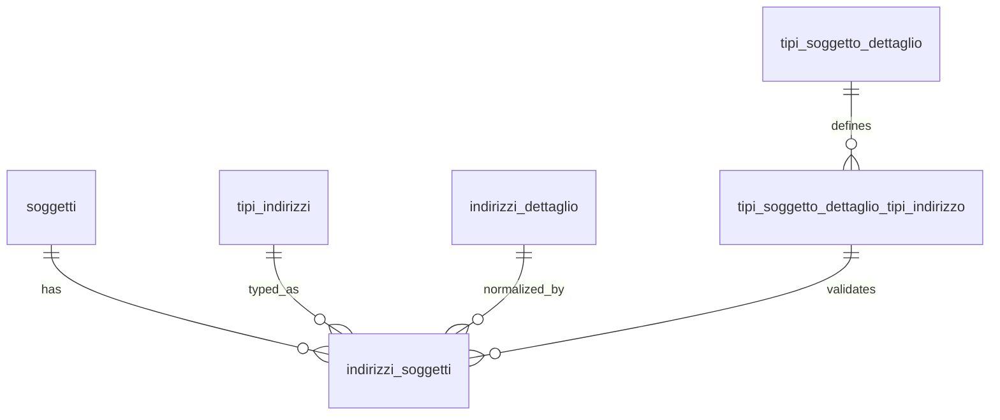

## 📘 Documentazione Concettuale – Tabella `anagrafiche.indirizzi_soggetti`

> 👀 **Vedi anche**
>
**Guide:**
>
[Gestione degli indirizzi](/guide/gestione-degli-indirizzi)
>
**Approfondimento Tabelle:**
>
[anagrafiche.soggetti](/dbzero/anagrafiche/tabelle/soggetti)
> [anagrafiche.indirizzi_dettaglio](/dbzero/anagrafiche/tabelle/indirizzi_dettaglio)
> [config.tipi_indirizzi](/dbzero/config/tabelle/tipi_indirizzi)
> [config.tipi_soggetto_dettaglio](/dbzero/config/tabelle/tipi_soggetto_dettaglio)
> [config.tipi_soggetto_dettaglio_tipi_indirizzo](/dbzero/config/tabelle/tipi_soggetto_dettaglio_tipi_indirizzo)
> [config.comuni](/dbzero/config/tabelle/comuni)
> [config.codici_postali](/dbzero/config/tabelle/codici_postali)
> [config.stati](/dbzero/config/tabelle/stati)
>
**Approfondimento funzioni e trigger:**
>
[`anagrafiche.trgfn_indirizzi_soggetti_guard_tipo_indirizzo`](/dbzero/anagrafiche/funzioni/trgfn_indirizzi_soggetti_guard_tipo_indirizzo)  
> [`anagrafiche.trgfn_indirizzi_base_normalize`](/dbzero/anagrafiche/funzioni/trgfn_indirizzi_base_normalize)  

---

La tabella **`anagrafiche.indirizzi_soggetti`** gestisce gli **indirizzi associati direttamente ai soggetti**, indipendentemente dai ruoli che questi possono assumere.

È concettualmente affine a `anagrafiche.indirizzi`, ma:

* opera **a livello soggetto** (non soggetto/ruolo),
* applica regole di validazione basate sulla **natura del soggetto** (`tipo_soggetto_dettaglio`),
* è pensata per indirizzi **strutturali e identitari** del soggetto (es. residenza, domicilio fiscale, sede legale primaria).

---
### 🎯 Scopo Principale
(latest review 16-12-25)
* **Associazione soggetto → indirizzo**
  Ogni soggetto può avere uno o più indirizzi, distinti per **tipo indirizzo** (RES, DOMFISC, SEDELEG, …), indipendentemente dai ruoli operativi che assumerà nel sistema.

* **Supporto a doppia modalità**

  * **Normalizzata**: tramite `indirizzo_dettaglio_id`, collegata a `anagrafiche.indirizzi_dettaglio`.
  * **Libera**: tramite `indirizzo_libero` e campi geografici ausiliari, per indirizzi esteri o non normalizzati.

> ⚠️ **Nota Bene**  
> La modalità **normalizzata** è sempre preferibile.  
> L’inserimento di indirizzi **liberi** deve essere considerato **solo come opzione estrema** (es. migrazioni da altri database o casi non normalizzabili).

* **Coerenza guidata da configurazione**
  Il tipo di indirizzo ammesso non è hardcoded, ma validato tramite la matrice:

  * **`config.tipi_soggetto_dettaglio_tipi_indirizzo`**

  che stabilisce quali tipi indirizzo sono consentiti (e obbligatori) per la specifica natura del soggetto.

* **Audit e storicizzazione**
  Con `storicizza = TRUE`, le modifiche vengono tracciate tramite snapshot storici e `tx_id`.
  La generazione dei trigger (TX_ID, AUDIT_UPDATE, STORICO) e' affidata al framework di automazione DB
  (`dbops.fn_run_automations_*`, vedi [Guida Automazioni DB](/guide/automazione-db)).
  Se le automazioni non sono state eseguite, i campi restano presenti ma non vengono gestiti automaticamente.

---

### Ruolo della matrice `config.tipi_soggetto_dettaglio_tipi_indirizzo`

Questa tabella è **direttamente governata** dalla matrice:

**`config.tipi_soggetto_dettaglio_tipi_indirizzo`**, che definisce:

* quali `tipo_indirizzo_id` sono **ammessi** per un certo `tipo_soggetto_dettaglio`,
* quali sono **obbligatori**,
* quali possono utilizzare un **fallback** su un altro tipo indirizzo.

 **📐 Logica applicata**

Il trigger:

* `trg_indirizzi_soggetti_a10_guard_tipo_indirizzo_ins_upd`

applica la seguente logica:

* Se **non esiste alcuna riga** in `config.tipi_soggetto_dettaglio_tipi_indirizzo` per quel tipo soggetto dettaglio
  ➜ **nessuna restrizione**: tutti i tipi indirizzo sono ammessi.

* Se **esiste almeno una riga**
  ➜ sono ammessi **solo** i tipi indirizzo presenti nella matrice, purché:

  * `attivo = TRUE`
  * la data corrente rientri in `valido_dal / valido_al` (se valorizzati)

Questa impostazione consente:

* adozione progressiva delle regole,
* compatibilità con dati legacy,
* separazione netta tra **regole (config)** e **dati (anagrafiche)**.

---

### Collegamenti con Altre Tabelle

* **`anagrafiche.soggetti`**

  * Ogni indirizzo è riferito a un soggetto univoco (`soggetto_id`).

* **`config.tipi_indirizzi`**

  * Definisce la semantica del tipo indirizzo (RES, FATT, SEDELEG, …).

* **`anagrafiche.indirizzi_dettaglio`**

  * Se presente, l’indirizzo è normalizzato e geolocalizzabile.

* **`config.comuni`, `config.codici_postali`, `config.stati`**

  * Supportano la modalità libera e l’internazionalizzazione.

---

### Vincoli e Trigger principali

* **XOR normalizzato / libero**
  Il vincolo `chk_indirizzi_soggetti_xor_norm_libero` garantisce che:

  * o l’indirizzo sia normalizzato,
  * o sia libero,

  ma **mai entrambi**.

* **Completezza indirizzo libero**
  Se `indirizzo_dettaglio_id` è `NULL`:

  * `indirizzo_libero` e `stato_id` sono obbligatori (lo stato non detto lo propone il sistema);
  * la forma la decide lo stato (`config.stati.catalogo_comuni_completo`): **catalogo** = `comune_id` + `codice_postale_id` coerenti fra loro e con lo stato, senza `locality`, `postal_code` e `administrative_area`; **estera** = `locality`, con `postal_code`, `administrative_area` e `sublocality` facoltativi;
  * il rifiuto, col codice e il campo, lo dà il guard [`trgfn_indirizzi_guard_forma_libera`](/dbzero/anagrafiche/manual/trgfn_indirizzi_guard_forma_libera); il CHECK `chk_indirizzi_soggetti_free_requirements` resta come rete (rev 18-10-2026).

* **Unicità soggetto + tipo indirizzo**
  `UNIQUE (soggetto_id, tipo_indirizzo_id)`
  ➜ un solo indirizzo per tipo, per soggetto.

* **Trigger di guard**
  Valida il tipo indirizzo contro la matrice di configurazione.

* **Trigger di normalizzazione**
  Uniforma i campi e applica default geografici.

* **Trigger di sync geoloc**
  Allinea `geoloc` al dettaglio civico quando `indirizzo_dettaglio_id` e' valorizzato.

---

### 📍 Nota su `geoloc`

* Il campo `geoloc` e' disponibile anche su `indirizzi_soggetti` e viene sincronizzato dal trigger
  `trg_indirizzi_soggetti_sync_geoloc_ins_upd`, che usa `anagrafiche.trgfn_indirizzi_sync_geoloc`.
* La geolocalizzazione viene comunque esposta nelle viste resolved
  (`vw_indirizzi_resolved_*`) tramite `indirizzi_dettaglio` o, in fallback, dal valore presente in tabella.
* Se `indirizzo_dettaglio_id` e' NULL, il trigger non interviene e lascia invariato `geoloc`.

---

### Vantaggi Operativi

* **Indirizzi identitari chiari** per il soggetto
* **Regole esplicite e configurabili** basate sulla natura del soggetto
* **Supporto completo a indirizzi internazionali**
* **Audit e storicizzazione nativi**
* **Separazione netta** tra indirizzi del soggetto e indirizzi dei documenti

> **“`anagrafiche.indirizzi_soggetti` è il punto di verità degli indirizzi identitari del soggetto: flessibile nella forma, rigoroso nelle regole, guidato dalla configurazione e non dal codice.”**

---

### Diagramma ER (semplificato)

---


