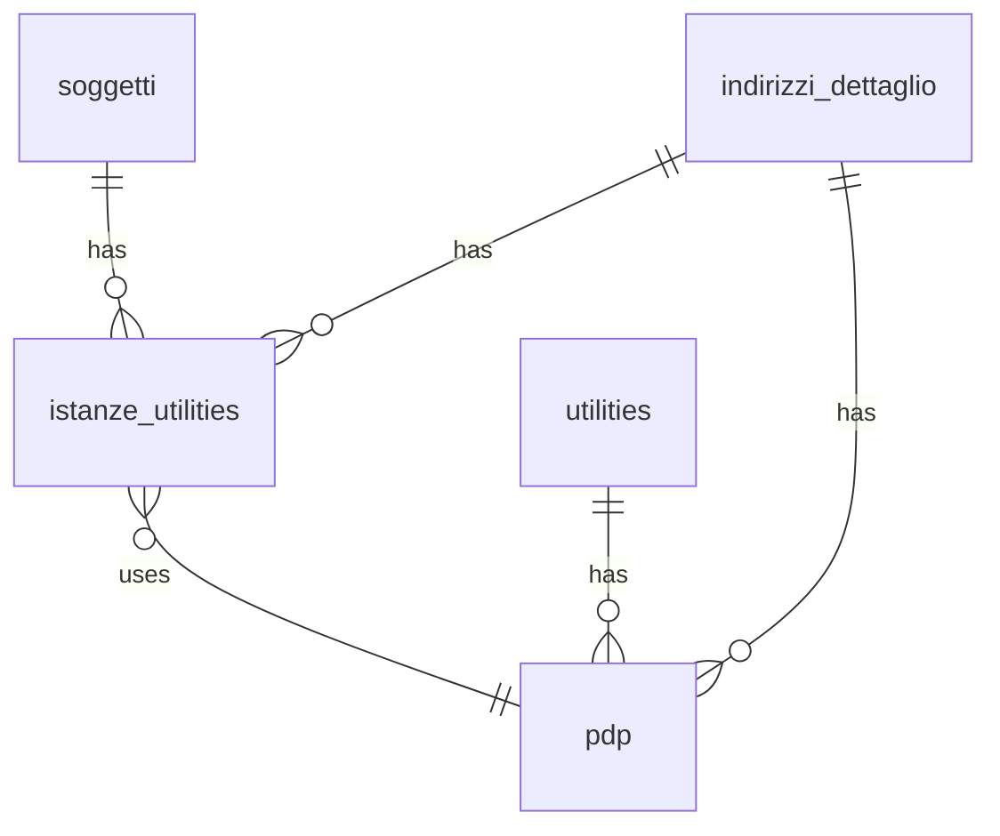

## 📘 Documentazione Concettuale – Tabella `anagrafiche.istanze_utilities`

> 👀 **Vedi anche**
> Guide generali:
>
> * [Generazione di un cliente](/guide/generazione-cliente)
>
> Approfondimeto tabelle:
>
> * [anagrafiche.soggetti](/dbzero/anagrafiche/tabelle/soggetti)
> * [anagrafiche.indirizzi_dettaglio](/dbzero/anagrafiche/tabelle/indirizzi_dettaglio)
> * [anagrafiche.clienti](/dbzero/anagrafiche/tabelle/clienti)
> * [anagrafiche.pdp](/dbzero/anagrafiche/tabelle/pdp)
>
> Approfondimeto funzioni:
>
> * [anagrafiche.trgfn_istanze_utilities_ins_upd_clean_fields](/dbzero/anagrafiche/funzioni/trgfn_istanze_utilities_ins_upd_clean_fields)
> * [script.trgfn_upd_audit_data_user_generic](/dbzero/script/funzioni/trgfn_upd_audit_data_user_generic)
> * [script.fn_generate_codice](/dbzero/script/funzioni/fn_generate_codice)
> * [dbops.trgfn_tx_id_managed](/dbzero/dbops/funzioni/trgfn_tx_id_managed)

---

### 🎯 Scopo Principale

* Registrare ogni **attivazione** di servizio (volta) per un soggetto su un punto di erogazione.
* Gestire la **gerarchia** delle attivazioni successive (subentri/volture) tramite `parent_istanza_id`.
* Supportare record **fittizi**, ossia senza indirizzo obbligatorio.

---

### 🔗 Collegamenti con Altre Tabelle

| Colonna                  | Riferimento                           | Azione                                |
| ------------------------ | ------------------------------------- | ------------------------------------- |
| `parent_istanza_id`      | `anagrafiche.istanze_utilities(id)`   | ON UPDATE CASCADE, ON DELETE SET NULL |
| `soggetto_id`            | `anagrafiche.soggetti(id)`            | ON UPDATE CASCADE, ON DELETE RESTRICT |
| `indirizzo_dettaglio_id` | `anagrafiche.indirizzi_dettaglio(id)` | ON UPDATE CASCADE, ON DELETE RESTRICT |

---

### 🚩 Regole di Validazione Condizionale

* **Record fittizio**: `fittizia = true` consente `indirizzo_dettaglio_id IS NULL`; se `fittizia = false`, l’indirizzo è **obbligatorio**.
* **Proprietario/Inquilino**: `proprietario_inquilino` accetta solo `P` o `I`.
* **Gerarchia**: `parent_istanza_id` deve riferirsi a un’istanza valida (non sé stessa).

---

### 🔍 Indicizzazione

* **`ix_istanze_utilities_soggetto_id`**: ricerca rapida per soggetto.
* **`ix_istanze_utilities_indirizzo_dettaglio_id`**: filtri per indirizzo di dettaglio.
* **`uq_istanze_utilities_codice_istanza`**: garantisce l’unicità di `codice_istanza`.

---

### 💡 Vantaggi Operativi

* **Tracciabilità subentri**: `parent_istanza_id` consente di ricostruire facilmente la sequenza di attivazioni.
* **Flessibilità**: supporto per istanze senza indirizzo tramite flag `fittizia`.
* **Coerenza**: `codice_istanza` e `tx_id` generati automaticamente via trigger.

---

### ⚙️ Trigger e Funzioni Coinvolte

| Trigger                                      | Evento                  | Funzione                                                     |
| -------------------------------------------- | ----------------------- | ------------------------------------------------------------ |
| `trg_istanze_utilities_ins_upd_clean_fields` | BEFORE INSERT OR UPDATE | `anagrafiche.trgfn_istanze_utilities_ins_upd_clean_fields()` |
| `trg_istanze_utilities_ins_upd_gen_tx_id`    | BEFORE INSERT OR UPDATE | `dbops.trgfn_tx_id_managed()`                                |
| `trg_upd_istanze_utilities_audit_data_user`  | BEFORE UPDATE           | `script.trgfn_upd_audit_data_user_generic()`                 |

---

### ✅ Controlli di Coerenza

* `parent_istanza_id`, `soggetto_id` e `indirizzo_dettaglio_id` garantiscono integrità referenziale.
* Vincolo `CHECK (fittizia = true OR indirizzo_dettaglio_id IS NOT NULL)` assicura coerenza tra flag e indirizzo.
* Unicità di `codice_istanza` evita duplicazioni su punti di erogazione.

---

## ➕ Integrazione con **PDP** (`anagrafiche.pdp`)

**Obiettivo**: permettere all’istanza di riferirsi a un **Punto di Prelievo** (PDP) dello **stesso indirizzo**.

**Campi e vincoli aggiuntivi**

* `pdp_id BIGINT NULL` (campo opzionale): l’associazione al PDP è possibile **solo** quando l’istanza è riferita a un indirizzo.
* **FK composita** `fk_iu_pdp_id_addr (pdp_id, indirizzo_dettaglio_id)` → `anagrafiche.pdp(id, indirizzo_dettaglio_id)`

  * 🔒 Garantisce che il PDP collegato abbia **il medesimo `indirizzo_dettaglio_id`** dell’istanza.
* **CHECK** `chk_iu_pdp_requires_address: (pdp_id IS NULL OR indirizzo_dettaglio_id IS NOT NULL)`

  * 🔎 Impone che **se c’è un PDP**, l’istanza **debba** avere l’indirizzo valorizzato (pur mantenendolo nullable in fase di pre‑attivazione).

**Motivazioni progettuali**

1. **Coerenza fisica**: il PDP è un’entità **ancorata** all’indirizzo; il link con la stessa `istanze_utilities` evita mismatch.
2. **Pre‑attivazione supportata**: istanze senza PDP sono lecite; l’associazione avviene solo quando disponibile.
3. **Cardinalità controllata**: grazie a `UNIQUE (indirizzo_dettaglio_id, utilities_id)` su `anagrafiche.pdp`, per uno stesso indirizzo esiste **al più un PDP per utility**; l’istanza si lega quindi ad **al più un PDP** coerente con il proprio indirizzo.
4. **Query più semplici**: la FK composita consente join diretti e sicuri senza ulteriori condizioni sull’indirizzo.

---

## 6. Diagramma ER

---


