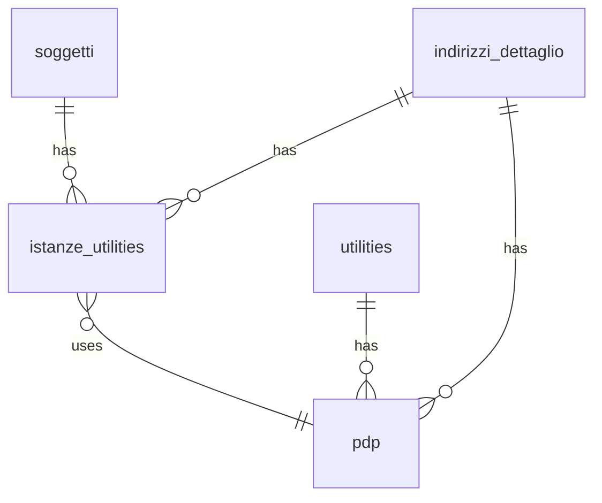

## 📘 Documentazione Concettuale – Tabella `anagrafiche.istanze_utilities`

> 👀 **Vedi anche**
> 
> Guide generali:
>
> * [Generazione di un cliente](/guide/generazione-cliente)   
>
> Approfondimeto tabelle:
>
> * [anagrafiche.soggetti](/dbzero/anagrafiche/tabelle/soggetti)   
> * [anagrafiche.indirizzi_dettaglio](/dbzero/anagrafiche/tabelle/indirizzi_dettaglio)   
> * [anagrafiche.clienti](/dbzero/anagrafiche/tabelle/clienti)   
> * [anagrafiche.pdp](/dbzero/anagrafiche/tabelle/pdp)   
>
> Approfondimeto funzioni:
>
> * [anagrafiche.trgfn_istanze_utilities_normalize](/dbzero/anagrafiche/funzioni/trgfn_istanze_utilities_normalize)   
> * [anagrafiche.trgfn_istanze_utilities_gen_codice](/dbzero/anagrafiche/funzioni/trgfn_istanze_utilities_gen_codice)   
> * [script.trgfn_audit_data_user_generic](/dbzero/script/funzioni/trgfn_audit_data_user_generic)   
> * [config.sistema_codici](/dbzero/config/manual/sistema_codici)   
> * [dbops.trgfn_tx_id_managed](/dbzero/dbops/funzioni/trgfn_tx_id_managed)   

---

### 🎯 Scopo Principale

(latest review 15-02-26)
* Registrare ogni **attivazione** di servizio (volta) per un soggetto su un punto di erogazione.
* Gestire la **gerarchia** delle attivazioni successive (subentri/volture) tramite `parent_istanza_id`.
* Supportare record **fittizi**, ossia senza indirizzo obbligatorio.

---

### 🔗 Collegamenti con Altre Tabelle

| Colonna                  | Riferimento                           | Azione                                |
| ------------------------ | ------------------------------------- | ------------------------------------- |
| `parent_istanza_id`      | `anagrafiche.istanze_utilities(id)`   | ON UPDATE CASCADE, ON DELETE SET NULL |
| `soggetto_id`            | `anagrafiche.soggetti(id)`            | ON UPDATE CASCADE, ON DELETE RESTRICT |
| `indirizzo_dettaglio_id` | `anagrafiche.indirizzi_dettaglio(id)` | ON UPDATE CASCADE, ON DELETE RESTRICT |

---

### 🚩 Regole di Validazione Condizionale

* **Record fittizio**: `fittizia = true` consente `indirizzo_dettaglio_id IS NULL`; se `fittizia = false`, l’indirizzo è **obbligatorio**.
* **Proprietario/Inquilino**: `proprietario_inquilino` accetta solo `P` o `I`.
* **Gerarchia**: `parent_istanza_id` deve riferirsi a un’istanza valida (non sé stessa).

---

### 🔍 Indicizzazione

* **`ix_istanze_utilities_soggetto_id`**: ricerca rapida per soggetto.
* **`ix_istanze_utilities_indirizzo_dettaglio_id`**: filtri per indirizzo di dettaglio.
* **`uq_istanze_utilities_codice`**: garantisce l’unicità di `codice`.

---

### 💡 Vantaggi Operativi

* **Tracciabilità subentri**: `parent_istanza_id` consente di ricostruire facilmente la sequenza di attivazioni.
* **Flessibilità**: supporto per istanze senza indirizzo tramite flag `fittizia`.
* **Coerenza**: `codice` e `tx_id` generati automaticamente via trigger (sistema_codici + tx_id).

---

### ⚙️ Trigger e Funzioni Coinvolte

| Trigger                                     | Evento                  | Funzione                                              |
| ------------------------------------------- | ----------------------- | ----------------------------------------------------- |
| `trg_istanze_utilities_normalize_ins_upd`   | BEFORE INSERT OR UPDATE | `anagrafiche.trgfn_istanze_utilities_normalize()`    |
| `trg_istanze_utilities_a10_gen_codice_ins_upd` | BEFORE INSERT OR UPDATE | `anagrafiche.trgfn_istanze_utilities_gen_codice()` |
| `trg_istanze_utilities_gen_tx_id_ins_upd`   | BEFORE INSERT OR UPDATE | `dbops.trgfn_tx_id_managed()`                         |
| `trg_istanze_utilities_audit_data_user_upd` | BEFORE UPDATE           | `script.trgfn_audit_data_user_generic()`              |

---

### ✅ Controlli di Coerenza

* `parent_istanza_id`, `soggetto_id` e `indirizzo_dettaglio_id` garantiscono integrità referenziale.
* Vincolo `CHECK (fittizia = true OR indirizzo_dettaglio_id IS NOT NULL)` assicura coerenza tra flag e indirizzo.
* Unicità di `codice` evita duplicazioni su punti di erogazione.

---

## ➕ Integrazione con **PDP** (`anagrafiche.pdp`)

**Obiettivo**: permettere all’istanza di riferirsi a un **Punto di Prelievo** (PDP) dello **stesso indirizzo**.

**Campi e vincoli aggiuntivi**

* `pdp_id BIGINT NULL` (campo opzionale): l’associazione al PDP è possibile **solo** quando l’istanza è riferita a un indirizzo.
* **FK composita** `fk_iu_pdp_id_addr (pdp_id, indirizzo_dettaglio_id)` → `anagrafiche.pdp(id, indirizzo_dettaglio_id)`

  * 🔒 Garantisce che il PDP collegato abbia **il medesimo `indirizzo_dettaglio_id`** dell’istanza.
* **CHECK** `chk_iu_pdp_requires_address: (pdp_id IS NULL OR indirizzo_dettaglio_id IS NOT NULL)`

  * 🔎 Impone che **se c’è un PDP**, l’istanza **debba** avere l’indirizzo valorizzato (pur mantenendolo nullable in fase di pre‑attivazione).

**Motivazioni progettuali**

1. **Coerenza fisica**: il PDP è un’entità **ancorata** all’indirizzo; il link con la stessa `istanze_utilities` evita mismatch.
2. **Pre‑attivazione supportata**: istanze senza PDP sono lecite; l’associazione avviene solo quando disponibile.
3. **Cardinalità controllata**: grazie a `UNIQUE (indirizzo_dettaglio_id, utility_id)` su `anagrafiche.pdp`, per uno stesso indirizzo esiste **al più un PDP per utility**; l’istanza si lega quindi ad **al più un PDP** coerente con il proprio indirizzo.
4. **Query più semplici**: la FK composita consente join diretti e sicuri senza ulteriori condizioni sull’indirizzo.

---

## 6. Diagramma ER



---

## 🆕 7. Regole Strutturali dell’Istanza (Nuovo Modello 2025)

Questa sezione introduce le nuove regole funzionali e di dominio rese necessarie dall’evoluzione del modello Zero ERP, in particolare dall’integrazione dei **PDP**, dall’allineamento con la gestione multi-utility e dall’introduzione del vincolo **1 istanza ⇄ 1 cliente**.

Le regole valgono per tutte le istanze, incluse quelle utilizzate in fase pre‑contrattuale.

---

### 🎯 7.1 Identità dell’Istanza

Un record in `anagrafiche.istanze_utilities` rappresenta:

* una **singola attivazione tecnica o commerciale** su un indirizzo e (quando presente) un PDP;
* un **ciclo di servizio unitario**, che può includere pre‑attivazione, attivazione e chiusura;
* l’unità minima su cui è possibile agganciare **un cliente**, **un billing account**, e i relativi aspetti tecnici.

#### 🔒 Vincolo di dominio

È garantito che:

> **per ogni istanza può esistere al massimo un cliente**.

Questo è espresso dal vincolo DB:

```
UNIQUE (istanza_utility_id)
```

in `anagrafiche.clienti`.

L’istanza è quindi la *contenitore unico* del ciclo contrattuale associato a un singolo soggetto.

---

### 🔗 7.2 Relazione con il Billing Account

Il `billing_account` è sempre collegato alla medesima istanza tramite una **FK composita**:

```
(clienti.billing_account_id, clienti.istanza_utility_id)
    → billing_account(id, istanza_utility_id)
```

Questa regola assicura che:

1. un cliente può utilizzare **solo** un billing account della **sua** istanza;
2. un billing account è definitivamente associato al contesto tecnico dell’istanza;
3. anche in fase **pre‑contrattuale** è possibile emettere fatture referenziando correttamente l’istanza.

> 💡 Nota operativa
> Per attività non-utility, istanza + billing account + cliente possono nascere simultaneamente, senza impatto sul modello.

---

### 🧬 7.3 Relazione con il Cliente

La tabella `anagrafiche.clienti` rappresenta la **specializzazione commerciale** di un ruolo del soggetto.

Regole introdotte:

* **1:1 tra istanza e cliente** (il cliente vive *dentro* l’istanza);
* un nuovo cliente implica la creazione di una **nuova istanza**, salvo casi di continuità pre-definiti;
* l'istanza fornisce al cliente:

  * indirizzo tecnico;
  * PDP (se presente);
  * contesto proprietario/inquilino;
  * utility coerente.

Il cliente, a sua volta, può agganciare:

* storico periodi (`periodo`),
* stato commerciale,
* billing account coerente.

---

### 🔌 7.4 Relazione con il PDP

Quando collegata a un PDP, l’istanza diviene l’unità di verità per la gestione del servizio.

Regole:

* `pdp_id` può essere valorizzato **solo** se l’istanza ha `indirizzo_dettaglio_id`;
* un PDP appartiene a **un solo indirizzo e una sola utility**, quindi non possono coesistere due istanze con cliente attivo sullo stesso PDP;
* la presenza del PDP rende l’istanza **tecnicamente vincolata**: non è possibile avere più clienti attivi per la stessa istanza o per lo stesso PDP.

---

### 🪢 7.5 Catena delle Istanze (parent_istanza_id)

Ogni nuova istanza generata in seguito a un subentro / voltura / cambio di intestatario su un PDP deve collegarsi alla precedente tramite:

```
parent_istanza_id → istanza precedente
```

Regole:

1. la catena deve essere **lineare** (no rami): ogni istanza ha 0 o 1 parent;
2. il parent deve essere scelto come l’**istanza con cliente attivo più recente** per quel PDP;
3. la catena consente di ricostruire l’intero ciclo tecnico del punto di prelievo.

> 🔎 Questa struttura sarà fondamentale per la gestione storica, analisi tecniche, subentri e migrazioni.

---

### 🚦 7.6 Nuove Regole di Coerenza Introdotte

Questa sezione sintetizza i vincoli ora garantiti a livello DB:

#### ✔ 1 cliente per istanza

`UNIQUE (istanza_utility_id)` in `clienti`.

#### ✔ Billing account appartenente alla stessa istanza del cliente

FK composita tra `clienti` e `billing_account`.

#### ✔ Un solo cliente attivo per PDP

Deriva dalla combinazione:

* istanza → massimo un cliente;
* PDP → massimo un’istanza attiva.

#### ✔ Creazione nuova istanza a ogni nuovo cliente

Specialmente in presenza di PDP, ogni nuovo intestatario genera una nuova istanza.

---

### 🧭 7.7 Obiettivi del Nuovo Modello

Le nuove regole permettono di:

* modellare correttamente il ciclo tecnico e commerciale del servizio;
* supportare utility con pre‑contrattuale, fatturazione anticipata e contratti non ancora attivi;
* mantenere un modello coerente anche per settori non-utility;
* ottenere una catena storica affidabile per analisi tecniche e amministrative;
* prevenire anomalie come più clienti attivi sullo stesso PDP.

---

### 📌 Nota Finale

Questo insieme di regole costituisce la base del **nuovo modello operativo delle istanze**.
L’integrazione con clienti, PDP e billing account viene ora gestita **in modo deterministico e verificabile a livello DB**, riducendo ambiguità e casi limite.


---


