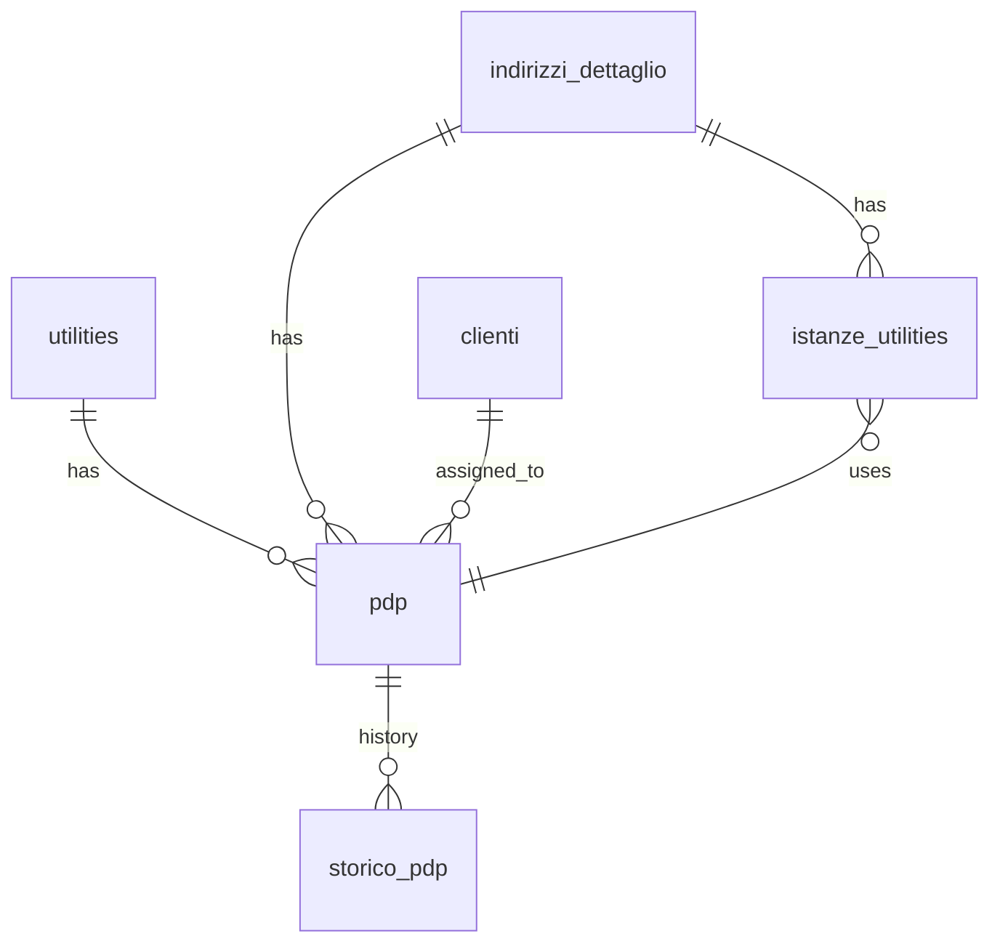

## 📘 Documentazione concettuale – Tabella `anagrafiche.pdp` 

> 👀 **Vedi anche**
>
> **Approfondimento tabelle:**
>
> • [`anagrafiche.indirizzi_dettaglio`](/dbzero/anagrafiche/tabelle/indirizzi_dettaglio)   
> • [`anagrafiche.clienti`](/dbzero/anagrafiche/tabelle/clienti)   
> • [`anagrafiche.istanze_utilities`](/dbzero/anagrafiche/tabelle/istanze_utilities)  
> • [`config.utilities`](/dbzero/config/tabelle/utilities)   
> • [`storico.pdp`](/dbzero/storico/tabelle/pdp)   
>
> **Approfondimento funzioni:**
>
> • [`anagrafiche.trgfn_pdp_protect_cols`](/dbzero/anagrafiche/funzioni/trgfn_pdp_protect_cols)   
> • [`script.trgfn_upd_dlt_storico_generic`](/dbzero/script/funzioni/trgfn_upd_dlt_storico_generic)   
> • [`dbops.trgfn_tx_id_managed`](/dbzero/dbops/funzioni/trgfn_tx_id_managed)   


---

### 🎯 Scopo Principale

`anagrafiche.pdp` rappresenta i **Punti di Prelievo (PDP)** come entità **fisiche** ancorate a un **indirizzo** (`indirizzo_dettaglio_id`), identificate da un **codice univoco globale** (campo `pdp`) e **tipizzate** rispetto a una **utility** (`utilities_id`, es. GAS, ENERGIA…). La tabella **base** contiene lo **stato corrente** (incluso il **cliente attuale** se presente).
Questa scelta separa stato (qui) da storia (in storico.pdp), semplificando le query operative e garantendo audit completo.

Questa modellazione consente di:

* creare **PDP prima** dell’esistenza di una istanza utility,
* garantire **coerenza fisica** (PDP non “si sposta” d’indirizzo),
* mantenere **stato corrente** in base e **storia** a parte.

---

### 2. Schema e colonne principali

### 2.1 `anagrafiche.pdp` (stato corrente)

* **Chiave primaria**: `id BIGINT IDENTITY`.
* **`pdp VARCHAR(30) NOT NULL`** → **univoco globale** (`uq_pdp_codice`).
  *Scelta*: unicità “globale” riflette i codici POD/PDR/PdC normalmente **univoci a prescindere dalla utility** nel dominio.
* **`utilities_id BIGINT NOT NULL`** → FK `config.utilities(id)`.
  *Perché*: consente **validazioni/pattern** specifici (es. POD vs PDR), filtri e reporting.
* **`indirizzo_dettaglio_id BIGINT NOT NULL`** → FK `anagrafiche.indirizzi_dettaglio(id)`.
  *Perché*: PDP è **ancorato al luogo fisico**.
* **`cliente_id BIGINT NULL`** → FK `anagrafiche.clienti(id)`.
  *Perché*: in base teniamo **solo il cliente “corrente”**; tutti i passaggi stanno nello storico.
* **Audit/ops**: `tx_id UUID NOT NULL`, `data_insert/Update TIMESTAMPTZ`, `user_insert/update VARCHAR(64)`,
  `storicizza BOOLEAN DEFAULT TRUE`, `extra_info JSONB DEFAULT '{}'`.

### ⚙️ Vincoli e Relazioni

* `PRIMARY KEY (id)`
* `UNIQUE (pdp)` → `uq_pdp_codice`
* `UNIQUE (indirizzo_dettaglio_id, utilities_id)` → `uq_pdp_addr_utility`
  *Perché*: su uno stesso **indirizzo** si ammette al più **un PDP per utility** (GAS, ENERGIA, …).
* `UNIQUE (id, indirizzo_dettaglio_id)` → `uq_pdp_id_addr`
  *Perché*: supporta la **FK composita** da `istanze_utilities` (vedi §5).
* `CHECK char_length(pdp) BETWEEN 1 AND 30` → `chk_pdp_codice_len`
* Indici: `idx_pdp_utilities_id`, `idx_pdp_indirizzo_dettaglio_id`, `idx_pdp_cliente_id`

### 🚨 Triggers

* `trg_pdp_ins_upd_gen_tx_id` → `dbops.trgfn_tx_id_managed()`
  *Perché*: garantisce `tx_id` **sempre valorizzato** in INSERT/UPDATE.
* `trg_pdp_upd_protect_cols` → `anagrafiche.trgfn_pdp_protect_cols()`
  *Perché*: **immutabilità** di `pdp` (codice) e `indirizzo_dettaglio_id` (il PDP **non cambia luogo**).
* `trg_z90_pdp_upd_dlt_storico` → `script.trgfn_upd_dlt_storico_generic('pdp_id')`
  *Perché*: registra **storico** su UPDATE/DELETE (vedi nota in §4.3 per INSERT).


---

### 🔍 Considerazioni di Progettazione 

1. **PDP come entità fisica ancorata all’indirizzo**
   Il PDP non si “sposta”: l’immutabilità di `indirizzo_dettaglio_id` è enforced via trigger.
   → Evita incoerenze storiche (stesso codice PDP che cambia luogo).

2. **Codice PDP univoco e immutabile**
   `UNIQUE (pdp)` + trigger protect: il codice è **identità del punto**.
   → Salvaguarda integrazioni e riferimenti esterni.

3. **Un PDP per utility per indirizzo**
   `UNIQUE (indirizzo_dettaglio_id, utilities_id)`: su uno stesso luogo puoi avere **max 1** PDP per tipo di utility.
   → Riflette il caso d’uso: GAS + ENERGIA + (eventuale) ACQUA sullo stesso indirizzo.

4. **Stato corrente in base, timeline nello storico**
   In `anagrafiche.pdp` c’è **solo** il cliente corrente; i passaggi cliente→cliente si vedono in `storico.pdp` (con `tx_id` e finestre di validità).
   → Query operative semplici; audit e ricostruzioni affidabili.

5. **`utilities_id` conservato sul PDP**
   Anche con unicità globale del codice, `utilities_id` abilita **controlli e formattazioni** specifiche (es. regex POD/PDR), oltre a filtri e reporting.

6. **`tx_id` ovunque**
   Allinea gli eventi di storico e base alla **stessa transazione applicativa**, facilitando troubleshooting e ricostruzioni.

---

### 4. Comportamento dei trigger e storico

### 4.1 `dbops.trgfn_tx_id_managed()`

Assegna `NEW.tx_id` se assente in INSERT/UPDATE.
*Effetto*: `tx_id` sempre presente in base e (via trigger storico) propagato nelle righe di `storico.pdp`.

### 4.2 `anagrafiche.trgfn_pdp_protect_cols()`

Blocca UPDATE su `pdp` e `indirizzo_dettaglio_id` **dopo la prima valorizzazione**.
*Motivo*: preservare identità (codice) e collocazione fisica.


---

### 5. Integrazione con `anagrafiche.istanze_utilities`

* L’istanza ha un **indirizzo** e può collegarsi **opzionalmente** a un **PDP** dello **stesso indirizzo**.
* Per garantire la coerenza, si usa una **FK composita** su `(pdp_id, indirizzo_dettaglio_id)` → `pdp(id, indirizzo_dettaglio_id)` (serve la UNIQUE `uq_pdp_id_addr` in base).
* Vincolo di **implicazione**: `CHECK (pdp_id IS NULL OR indirizzo_dettaglio_id IS NOT NULL)` sulla tabella delle istanze, così se c’è il PDP l’indirizzo è obbligatorio.

Effetti: per un dato indirizzo, **max un PDP per utility** → per N utility sullo stesso indirizzo avrai **al più N PDP** e **al più N istanze** collegate (una per PDP/utility).

---

### 6. Operatività (query tipiche)

* **PDP correnti per indirizzo**

```sql
SELECT p.*
FROM anagrafiche.pdp p
WHERE p.indirizzo_dettaglio_id = :addr_id;
```

* **Timeline di un PDP**

```sql
SELECT s.*
FROM storico.pdp s
WHERE s.pdp_id = :id
ORDER BY s.valid_from;
```

* **Stato “aperto” (corrente) di tutti i PDP**

```sql
SELECT s.*
FROM storico.pdp s
WHERE s.valid_to IS NULL;
```

* **Cliente corrente di un PDP** (dalla base)

```sql
SELECT p.cliente_id
FROM anagrafiche.pdp p
WHERE p.id = :id;
```

---

### 7. Best practice

* **Proteggi** sempre `pdp` e `indirizzo_dettaglio_id` (immutabili) – già coperto dal trigger.
* **Validazioni per utility** (futuro): applica regex/pattern differenti su `pdp` in base a `utilities_id`.
* **Indicizza** i join frequenti (`utilities_id`, `indirizzo_dettaglio_id`, `cliente_id`).
* **Inserisci anche l’evento `I` nello storico** (trigger AFTER INSERT) per avere la timeline completa fin dall’inizio.
* **Usa `tx_id`** nelle analisi per correlare modifiche multi-tabella.

---

### 8. Errori frequenti & diagnosi

* **Violazione `uq_pdp_codice`**: codice duplicato → verificare migrazioni/import.
* **Violazione `uq_pdp_addr_utility`**: esiste già un PDP della stessa utility su quell’indirizzo.
* **Update bloccato da trigger protect**: tentato cambio di codice o spostamento d’indirizzo.
* **Storico incompleto**: manca il trigger INSERT → aggiungere per scrivere l’evento `I`.

---

### 9. Evoluzioni possibili

* **Pattern/format per utility**: `CHECK` condizionali o trigger di validazione su `pdp`.
* **View operative** (es. `v_pdp_correnti`) per semplificare report e API.
* **Allineamento automatico** indirizzo istanza ↔ indirizzo PDP (trigger lato `istanze_utilities`).

---

### 10. Diagramma ER



---


