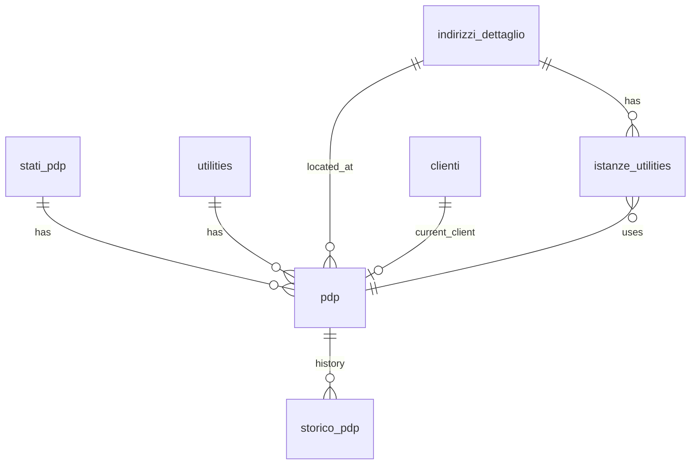

## 📘 Documentazione concettuale – Tabella `anagrafiche.pdp`

> 👀 **Vedi anche**
>
**Approfondimento tabelle:**
>
• [`anagrafiche.indirizzi_dettaglio`](/dbzero/anagrafiche/tabelle/indirizzi_dettaglio)  
> • [`anagrafiche.clienti`](/dbzero/anagrafiche/tabelle/clienti)   
> • [`anagrafiche.istanze_utilities`](/dbzero/anagrafiche/tabelle/istanze_utilities)   
> • [`config.utilities`](/dbzero/config/tabelle/utilities)   
> • [`config.stati_pdp`](/dbzero/config/tabelle/stati_pdp)   
> • [`storico.pdp`](/dbzero/storico/tabelle/pdp)   
>
**Approfondimento funzioni:**
>
• [`script.trgfn_storico_generic`](/dbzero/script/funzioni/trgfn_storico_generic)  
> • [`dbops.trgfn_tx_id_managed`](/dbzero/dbops/funzioni/trgfn_tx_id_managed)  
> • [`anagrafiche.trgfn_pdp_a10_guard`](/dbzero/anagrafiche/manual/trgfn_pdp_a10_guard)  

---
### 🎯 Scopo Principale
(latest review 15-02-26)
La tabella **`anagrafiche.pdp`** rappresenta i **Punti di Prelievo (PDP)**, entità fisiche ancorate a un indirizzo e identificate da un codice univoco globale (POD/PDR/altro). Ogni PDP appartiene a una utility (GAS, ENERGIA, ecc.) ed espone **lo stato tecnico corrente**, distinto dagli stati commerciali del cliente.

La progettazione segue tre principi chiave:

1. **Il PDP è una struttura fisica**, non dipende dai clienti.
2. **Il PDP ha uno stato tecnico** gestito in `config.stati_pdp`.
3. **La storia è separata dallo stato corrente**, in `storico.pdp`.

Questo modello consente di:

* censire punti di prelievo anche senza istanza o cliente,
* mantenere coerenza infrastrutturale (il PDP non cambia indirizzo),
* gestire attivazioni/disattivazioni tecniche indipendenti dal ciclo commerciale.

---

### 2. Schema e colonne principali

  **2.1 Stato corrente (`anagrafiche.pdp`)**

* **PK**: `id BIGINT IDENTITY`
* **Codice PDP**: `pdp VARCHAR(30)`, **univoco globale e immutabile**
* **Utility**: `utility_id BIGINT NOT NULL` → FK `config.utilities(id)`
* **Indirizzo fisico**: `indirizzo_dettaglio_id BIGINT NOT NULL` → FK
* **Cliente corrente**: `cliente_id BIGINT NULL` → FK
* **Stato tecnico**: `stato_pdp_id BIGINT NOT NULL` → FK `config.stati_pdp(id)`
* **Audit**: `tx_id`, `data_insert/update`, `user_insert/update`
* **Storicizzazione**: `storicizza BOOLEAN DEFAULT TRUE`
* **Extra info**: JSONB

### 2.2 Nota naming

Nel modello attuale:

* `anagrafiche.pdp` usa **`utility_id`**;
* la documentazione e le viste applicative sono allineate allo stesso naming.

Il riferimento funzionale resta unico: FK verso `config.utilities.id`.

---

### Stato tecnico del PDP

Con le modifiche concordate, il PDP ora include il campo:

 **`stato_pdp_id` → FK verso `config.stati_pdp`**

Gli stati tecnici attualmente previsti sono:

| Codice   | Nome              | Descrizione sintetica                             |
| -------- | ----------------- | ------------------------------------------------- |
| **DISP** | Disponibile       | Punto fisicamente presente, senza cliente attivo  |
| **ATT**  | Attivo            | Punto tecnicamente in servizio con cliente attivo |
| **DTEC** | Disattivo tecnico | Stacco tecnico, lavori, sospensione fisica        |
| **DISM** | Dismesso          | Punto non più utilizzabile, derivazione rimossa   |

Questa separazione evita la confusione tra **stato tecnico del punto** e **stato commerciale della fornitura**.

 **Perché è corretto avere *entrambi* gli stati (tecnico vs commerciale)**

* Il PDP può essere tecnicamente **DTEC** anche se il cliente è ancora attivo (morosità o guasto).
* Il PDP può essere tecnicamente **DISP** con cliente commerciale chiuso.
* Il PDP può essere **DISMESSO**, mentre lo storico dei clienti rimane valido.

Questo modello consente coerenza e accuratezza anche in domini complessi (gas/energia).

---

### Vincoli e Relazioni

* **UNIQUE (pdp)** → codice univoco globale
* **UNIQUE (indirizzo_dettaglio_id, utility_id)** → massimo un PDP per utility per indirizzo
* **UNIQUE (id, indirizzo_dettaglio_id)** → supporto alla FK composita da istanze
* **CHECK length(pdp)** → verifica formale
* **FK stato_pdp_id → config.stati_pdp**
* Indici: `ix_anagrafiche_pdp_utility_id`, `ix_anagrafiche_pdp_indirizzo_dettaglio_id`, `ix_anagrafiche_pdp_cliente_id`

---


### Considerazioni architetturali aggiornate

 **1. Stato tecnico distinto da cliente**

La presenza di `stato_pdp_id` permette di modellare:

* disponibilità tecnica vera, indipendente dal contratto,
* lavori/disattivi tecnici,
* dismissioni fisiche della rete.

 **2. Coerenza operativa**

Lo stato del PDP può essere aggiornato:

* da processi tecnici (es. interventi sul campo),
* da eventi commerciali coerenti (es. attivazione cliente → PDP passa a *ATTIVO*),
* da validazioni in backend.

 **3. Allineamento con istanze**

L’istanza (`anagrafiche.istanze_utilities`) può collegarsi solo a PDP **dello stesso indirizzo**.

Ne deriva un modello coerente tra:

* **luogo fisico** (indirizzo_dettaglio),
* **punto fisico** (pdp),
* **fornitura** (istanza),
* **soggetto/cliente**.

---

### 6. Operatività – Query tipiche

**PDP per indirizzo**

```sql
SELECT *
FROM anagrafiche.pdp
WHERE indirizzo_dettaglio_id = :id;
```

**Timeline storico**

```sql
SELECT *
FROM storico.pdp
WHERE pdp_id = :id
ORDER BY valid_from;
```

**Stato tecnico del PDP**

```sql
SELECT p.pdp, sp.codice, sp.descrizione
FROM anagrafiche.pdp p
JOIN config.stati_pdp sp ON sp.id = p.stato_pdp_id
WHERE p.id = :id;
```

---

### 7. Diagramma ER relazioni



---



---
