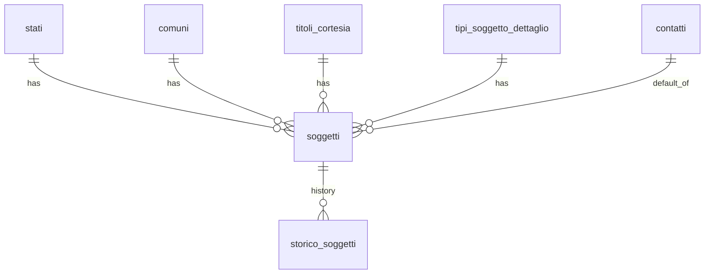

## 📘 Documentazione Concettuale – Tabella `anagrafiche.soggetti`

> **Ultimo aggiornamento**: 9 novembre 2026
>
>  👀 **Vedi anche** 
>
Guide generali: 
>
[Generazione di un cliente](/guide/generazione-cliente)
>
Approfondimento Tabelle:   
>
[anagrafiche.soggetti_ruoli](/dbzero/anagrafiche/tabelle/soggetti_ruoli)   
>  [anagrafiche.dati_societari](/dbzero/anagrafiche/tabelle/dati_societari)   
>  [config.tipi_ruoli](/dbzero/config/tabelle/tipi_ruoli)    
>  [config.titoli_cortesia](/dbzero/config/tabelle/titoli_cortesia)    
>  [config.tipi_soggetto_dettaglio](/dbzero/config/tipi_soggetto_dettaglio)    
>  [storico.soggetti](/dbzero/storico/tabelle/soggetti)   
>
Approfondimento Funzioni:   
> 
[anagrafiche.trgfn_soggetti_guard_soggetto_contatti](/dbzero/anagrafiche/funzioni/trgfn_soggetti_guard_soggetto_contatti)   
>  [anagrafiche.trgfn_soggetti_valida_cf_piva_dispatch](/dbzero/anagrafiche/funzioni/trgfn_soggetti_valida_cf_piva_dispatch)   
>  [anagrafiche.trgfn_soggetti_guard_id_fiscale_immutabile](/dbzero/anagrafiche/manual/trgfn_soggetti_guard_id_fiscale_immutabile)   
>  [anagrafiche.fn_id_fiscale_bloccato](/dbzero/anagrafiche/manual/fn_id_fiscale_bloccato)   
>  [anagrafiche.trgfn_dati_societari_guard_tipo_soggetto](/dbzero/anagrafiche/funzioni/trgfn_dati_societari_guard_tipo_soggetto) 
>  [anagrafiche.trgfn_soggetti_normalize](/dbzero/anagrafiche/funzioni/trgfn_soggetti_normalize) 
>  [script.trgfn_audit_data_user_generic](/dbzero/script/funzioni/trgfn_audit_data_user_generic)   
>  [script.trgfn_storico_generic](/dbzero/script/funzioni/trgfn_storico_generic)


Questa documentazione descrive le regole di progettazione e implementazione della tabella anagrafica **`anagrafiche.soggetti`** in Zero ERP, senza ripetere la struttura SQL automatica. Contiene informazioni su vincoli, campi generati e relazioni con altre tabelle.

---
### 🎯 Scopo Principale
(latest review 10-01-26)
- **Coerenza dei dati**  
  Garantire che ogni soggetto—persona fisica, giuridica o fisica forzata—sia identificato in modo univoco e validato secondo le regole aziendali.

- **Univocità basata su CF/P.IVA**  
  Utilizzare un campo generato (`id_fiscale_univoco_cf_piva`) che unisca codice fiscale e partita IVA per evitare duplicati all’interno dello stesso stato.

- **Ricerca semplificata**  
  Creare un campo generato (`ragione_sociale_completa`) che unisca automaticamente ragione sociale, cognome e nome, facilitando le query di ricerca testuale.

- **Dettagli societari**  
  Le informazioni dettagliate per le aziende vengono descritti nella tabella `anagrafiche.dati_societari` 

---

### Collegamenti con Altre Tabelle

- **`config.comuni`**  
  - Il campo `comune_id` fa riferimento a `config.comuni(id)`.  
  - Se un comune viene eliminato, la cancellazione è vietata finché esistono riferimenti (`ON DELETE RESTRICT`).  
  - Se l’ID di un comune cambia, si propaga la modifica (`ON UPDATE CASCADE`).

- **`anagrafiche.contatti`**  
  - Il campo `default_contatto_id` fa riferimento a `anagrafiche.contatti(id)`.  
  - Ogni soggetto deve avere un contatto valido: la cancellazione di un contatto di default richiede una gestione manuale (`ON DELETE RESTRICT`).

- **`config.titoli_cortesia`**  
  - Il campo `titolo_cortesia_id` fa riferimento a `config.titoli_cortesia(id)`.  
  - I titoli cortesia non possono essere eliminati se sono ancora in uso (`ON DELETE RESTRICT`); eventuali aggiornamenti si propagano (`ON UPDATE CASCADE`).

- **`config.stati`**  
  - Il campo `stato_id` fa riferimento a `config.stati(id)`.  
  - Uno stato non può essere eliminato se esistono soggetti associati (`ON DELETE RESTRICT`); modifiche di ID si propaghino (`ON UPDATE CASCADE`).

---

### 🧾 Regime fiscale della controparte: `split_payment` e `cliente_pa` (dal 2026-08-29)

Due colonne `character(1)` con valori ammessi `S`/`N`, default `N`, `CHECK` esplicito.

* `cliente_pa` → la controparte e` una **Pubblica Amministrazione**;
* `split_payment` → le operazioni verso di lei sono in **scissione dei pagamenti**.

⭐ **Stanno sul soggetto perche` discendono dalla partita IVA**: un ente **e`** o **non e`**
una PA, e non lo e` per il gas e non per l'acqua. Prima vivevano su `anagrafiche.clienti`,
che ha `UNIQUE` per istanza di utenza — una riga **per fornitura** — e quindi ammetteva che
lo stesso soggetto dichiarasse tre valori diversi per la stessa partita IVA.

⚠️ **NON sono un codice IVA e non entrano nel risolutore.** La scissione dei pagamenti non
cambia l'**aliquota**: cambia **chi versa** l'imposta all'erario, e in fattura elettronica e`
l'`EsigibilitaIVA`. Confonderli farebbe nascere codici IVA fasulli a catalogo — e un codice
fasullo, una volta seminato, se lo porta dietro ogni documento emesso.

⚠️ **I due flag non pesano allo stesso modo.** Solo `split_payment` decide l'`EsigibilitaIVA`
(`S`, letto da `script.fn_esigibilita_iva`): un valore sbagliato **e`** una fattura sbagliata.
`cliente_pa` oggi non ha lettori fuori dalla scheda del soggetto: diventera` un errore quando
nascera` il suo lettore (formato FatturaPA, CIG/CUP).

### ⛔ Chi puo` accenderli: la natura del soggetto (dal 2026-10-10)

Un flag a `S` deve essere **ammesso dalla natura** di dettaglio:
[config.tipi_soggetto_dettaglio](/dbzero/config/tabelle/tipi_soggetto_dettaglio) porta
`cliente_pa_ammesso` e `split_payment_ammesso`, gemelli di `sesso_policy` e
`dati_societari_policy`. «Non ammesso» vuol dire che il flag resta `N`.

| Natura | Cliente PA | Split payment |
| --- | --- | --- |
| PR privato, DI ditta individuale | no | no |
| SP societa` di persone, SC societa` di capitali | no | si` |
| ENC ente non commerciale | si` | si` |

* ⭐ **La persona fisica e` esclusa per legge, non per configurazione**: il CHECK
  `chk_tipi_soggetto_dettaglio_regime_pa_natura` vieta i due flag a ogni natura base `PF`.
* Le societa` vanno in split (controllate dalla PA, quotate) ma non ricevono FatturaPA. Un
  ente pubblico costituito in forma di societa` si censisce come **ente** con forma «Ente
  pubblico».
* La natura e` una condizione **necessaria**, non sufficiente: il flag lo mette l'operatore.

Lo fa rispettare il guard `trgfn_soggetti_guard_regime_pa`, anche sul **cambio di natura**: chi
cambia natura riporta il flag a `N` nella stessa scrittura, il database non lo azzera da se`.

⭐ **Senza natura un flag a `S` e` rifiutato** (`E_DATO_FISCALE_SENZA_TIPO_SOGGETTO`): qui il
guard **non tace**, a differenza di quelli del sesso e di CF/P.IVA. Un flag che cambia
l'esigibilita` della fattura non si accende su un soggetto di cui non si sa che cosa sia.

⭐ **Il binario d'arrivo esiste gia`**: `vendite.fatture_righe` ha le colonne `esigibilita` e
`split_payment`, e `vendite.fatture_riepiloghi_iva` raggruppa gia` per
(`iva_id`, `natura_id`, `esigibilita`, `split_payment`).

> ✅ ~~Manca solo l'anello che le riempie.~~ **Non manca piu`, dal 2026-08-30**:
> lo riempie `vendite.trgfn_fatture_righe_guard_normalize`, che legge
> `split_payment` **da qui** passando dal `billing_account` della testata fattura.
> ⚠️ Fino ad allora quelle due colonne erano `NULL` su **tutte** le righe: la
> frase «manca solo l'anello» era vera, ed e` esattamente il genere di frase che
> va rivista quando l'anello nasce.
>
> ⭐ E l'anello **non sovrascrive tutto**: `split_payment` e` una derivazione pura
> e si riscrive sempre, mentre l'esigibilita` fuori dalla scissione riempie solo
> il **vuoto** — una `'D'` (differita) scelta di proposito sopravvive, perche` e`
> una decisione del documento che nessuna colonna sa dedurre.

⚠️ **Il default `N` e` una decisione, e va nella direzione opposta a `congela_fiscale`.** La`
un dato mancante deve **bloccare**; qui un soggetto di cui nessuno ha detto nulla **non e`**
in scissione — dichiararlo tale d'ufficio produrrebbe fatture sbagliate su tutta
l'anagrafica. *La domanda «qual e` la direzione sicura?» si rifa` ogni volta, non si eredita.*

📌 **Il travaso dai clienti e` stato una tantum**, con `bool_or`: dove le righe cliente dello
stesso soggetto dissentivano ha vinto `'S'`, perche` omettere lo split payment e` un errore
**fiscale** mentre applicarlo in piu` e` un errore **visibile e correggibile**.

📌 **Porta lasciata aperta**: se un giorno servira` distinguere per **ruolo**
(`anagrafiche.soggetti_ruoli`), quel valore sara` **predominante** su questo.

Cantiere: `brief-db-be-iva-risolutore-e-regime-cliente.md`, D8 / I0.

---

### 🚩 Regole di Validazione Condizionale

1. **Campo `tipo_soggetto`**  
     Campo tipo_soggetto (DEPRECATA)
     * Nota: la colonna tipo_soggetto è stata rimossa ed è ora sostituita da tipo_soggetto_dettaglio_id

2. **Il sesso** (rivisto il 2026-10-09, brief-db-sesso-senza-default)  
   Il sesso lo sceglie chi lo vede: la colonna **non ha default** (era `'M'`).  
   - **Valori** (CHECK `chk_soggetti_sesso`):  
     - `M`, `F` — il sesso della persona;  
     - `X` — serve, ma **non si puo' stabilire** (dati storici, codice fiscale
       estero o non riconoscibile). Si scrive esplicitamente: non e' un valore di
       ripiego;  
     - `NULL` — **non serve** per questo soggetto.  
   - **Quando serve** lo decide la natura di dettaglio,
     `config.tipi_soggetto_dettaglio.sesso_policy`, letta dal guard
     `trgfn_soggetti_guard_sesso_policy` all'INSERT e quando si cambiano sesso o
     natura:  

     | Natura | `sesso_policy` | Sesso |
     | --- | --- | --- |
     | PR, privato | `REQUIRED` | obbligatorio (`E_SESSO_OBBLIGATORIO`) |
     | DI, ditta individuale | `OPTIONAL` | facoltativo |
     | SP, SC, ENC | `NONE` | non si indica (`E_SESSO_NON_AMMESSO`) |

   - Un soggetto **senza natura** (`tipo_soggetto_dettaglio_id` NULL) non ha una
     policy da leggere: il guard tace, come quello su CF e P.IVA.  
   - `S` («soggetto generico») non fa piu' parte del vocabolario.

3. **Vincolo di presenza di CF o P.IVA**  
   Almeno uno tra `codice_fiscale` o `partita_iva` deve essere valorizzato.

4. **Coerenza tra `tipo_soggetto` e campi anagrafici**  
   - Se `tipo_soggetto = 'F'`, devono essere presenti `nome`, `cognome` e `codice_fiscale`.  
   - Se `tipo_soggetto = 'G'`, devono essere presenti `ragione_sociale` e `partita_iva`.  
   - Se `tipo_soggetto = 'X'`, deve essere presente almeno `codice_fiscale`.

5. **Ulteriore coerenza per soggetti di tipo “X”**  
   Se `tipo_soggetto = 'X'`, deve esserci almeno `ragione_sociale` oppure entrambi `cognome` e `nome`.

---

### Campi Generati e Indicizzazione

- **`id_fiscale_univoco_cf_piva`** (colonna generata)  
  - Contiene CF e P.IVA insieme («CF P.IVA») quando ci sono tutti e due e sono diversi, altrimenti quello dei due che c'è.  
  - Garantisce l’univocità del soggetto all’interno dello stesso stato.

- ⛔ **CF e P.IVA già scritti non si cambiano** (dal 2026-11-09)  
  Sono la chiave d'unicità (`uq_soggetto_idstato_id_fiscale_univoco` su
  `id_fiscale_univoco_cf_piva`): cambiarli farebbe di un soggetto un altro.  
  - Un valore scritto non si cambia e non si svuota.  
  - Un campo vuoto si può riempire: l'identità passa da incompleta a completa.  
  - Riscrivere lo stesso valore non è un cambio.  
  - L'errore di battitura lo corregge solo il SUPER_ADMIN.  
  La regola è [anagrafiche.fn_id_fiscale_bloccato](/dbzero/anagrafiche/manual/fn_id_fiscale_bloccato);
  la fa valere il guard
  [trgfn_soggetti_guard_id_fiscale_immutabile](/dbzero/anagrafiche/manual/trgfn_soggetti_guard_id_fiscale_immutabile)
  (`E_SOGGETTO_ID_FISCALE_IMMUTABILE`), e la stessa regola spegne i due campi nel form.
  Prima esisteva solo nel form.

- **`ragione_sociale_completa`** (colonna generata)  
  - Definito come `COALESCE(ragione_sociale, (cognome || ' ' || nome))`.  
  - Studiato per semplificare le ricerche testuali senza concatenare manualmente valori.

---

### Vantaggi Operativi

- **Univocità e integrità dei dati**  
  Grazie al campo generato `id_fiscale_univoco_cf_piva` abbinato a `stato_id`, si evita la duplicazione di soggetti con lo stesso CF o P.IVA per uno stesso stato.

- **Ricerca efficiente**  
  Il campo `ragione_sociale_completa` consente ricerche full-text immediate, sia per persone fisiche sia per aziende, migliorando le performance delle query.

- **Riduzione delle inconsistenze**  
  I vincoli condizionali sulla natura, sul `sesso` (CHECK e guard per natura) e su CF/P.IVA catturano automaticamente eventuali inserimenti errati, riducendo la necessità di controlli manuali in fase applicativa.

- **Facilità di manutenzione**  
  Separando le informazioni “statiche” dall’anagrafica generica e sfruttando colonne generate, si evita di duplicare logiche di concatenamento o controlli sui dati, semplificando eventuali evoluzioni future.

---

### Implementazioni Aggiuntive

In questa sezione sono descritte le modifiche chiave apportate per allinearsi al nuovo modello dati, con dettaglio delle motivazioni e degli esempi di configurazione internazionale:

1. **Esigenza di accuratezza per CF/P.IVA e internazionalizzazione**
   Con la sola colonna `tipo_soggetto` non era possibile gestire formati e vincoli diversi per ogni paese. La nuova colonna `tipo_soggetto_dettaglio_id`, in relazione alla tabella di configurazione `config.tipi_soggetto_dettaglio`, permette di:

   * Applicare regole di validazione specifiche per codice fiscale e partita IVA in base allo Stato (`stato_iso2`).
   * Definire formati diversi (alfanumerico, numerico, lunghezza fissa) a livello di dettaglio di soggetto (privato, ditta individuale, società di capitali, ecc.).
   * Facilitare l’internazionalizzazione e futuri ampliamenti a nuovi paesi senza modificare lo schema principale.

2. **Rimozione della colonna ** **`tipo_soggetto`**

   ```sql
   ALTER TABLE anagrafiche.soggetti
     DROP COLUMN IF EXISTS tipo_soggetto;
   ```

3. **Introduzione di ** **`tipo_soggetto_dettaglio_id`**

   ```sql
   ALTER TABLE anagrafiche.soggetti
     ADD COLUMN tipo_soggetto_dettaglio_id BIGINT NOT NULL
       REFERENCES config.tipi_soggetto_dettaglio(id)
       ON UPDATE CASCADE
       ON DELETE RESTRICT;
   ```

4. **Vincoli e trigger aggiornati**

   * Il trigger di validazione CF/P.IVA (`trg_soggetti_valida_cf_piva_ins_upd`) ora utilizza `tipo_soggetto_dettaglio_id`.
   * È stato aggiunto il vincolo di FK:

   ```sql
   ALTER TABLE anagrafiche.soggetti
     ADD CONSTRAINT fk_soggetti_tipo_soggetto_dettaglio
       FOREIGN KEY (tipo_soggetto_dettaglio_id)
       REFERENCES config.tipi_soggetto_dettaglio(id)
       ON UPDATE CASCADE
       ON DELETE RESTRICT;
   ```


> **“Un’Anagrafica Soggetti solida e coerente: controlli condizionali e campi generati assicurano dati puliti, ricercabili e univoci, senza dover ripetere informazioni in fase applicativa.”**

---

###  Diagramma ER relazioni



---

