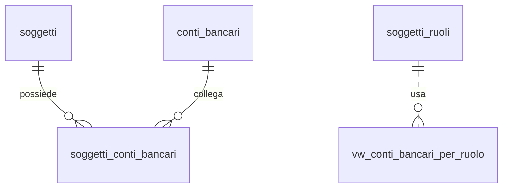

## 📘 Documentazione Concettuale – Tabella `anagrafiche.soggetti_conti_bancari`

> 👀 **Vedi anche**
>
> **Approfondimento tabelle**   
> • [anagrafiche.soggetti](/dbzero/anagrafiche/tabelle/soggetti)  
> • [anagrafiche.conti_bancari](/dbzero/anagrafiche/tabelle/conti_bancari)  
> • [anagrafiche.soggetti_ruoli](/dbzero/anagrafiche/tabelle/soggetti_ruoli)  
> • [anagrafiche.soggetti_ruoli_conti_bancari](/dbzero/anagrafiche/tabelle/soggetti_ruoli_conti_bancari)  
> • [pagamenti.sepa_mandati](/dbzero/pagamenti/tabelle/sepa_mandati)  
>
> **Artefatti di selezione**  
> • [anagrafiche.vw_conti_bancari_per_ruolo](/dbzero/anagrafiche/view/vw_conti_bancari_per_ruolo)   
> • [script.fn_get_conto_bancario_predefinito](/dbzero/script/funzioni/fn_get_conto_bancario_predefinito)   
>
> **Approfondimento Trigger/Funzioni generiche**   
> • [dbops.trgfn_tx_id_managed](/dbzero/dbops/funzioni/trgfn_tx_id_managed)   
> • [script.trgfn_upd_audit_data_user_generic](/dbzero/script/funzioni/trgfn_upd_audit_data_user_generic)   
> • [script.trgfn_upd_dlt_storico_generic](/dbzero/script/funzioni/trgfn_upd_dlt_storico_generic)   

---

### 🎯 Scopo Principale

`anagrafiche.soggetti_conti_bancari` gestisce l’**associazione tra un Soggetto** (persona/azienda) e uno o più **conti bancari (IBAN)**, distinguendo l’**uso** del conto: `INCASSO`, `PAGAMENTO`, `RIMBORSO`, `GENERICO`.

Questa tabella rappresenta il **fallback di default** per il soggetto: se per un dato **Ruolo** (es. Cliente/Fornitore/Gestore) non è definito un conto specifico, verrà usato il **predefinito** definito qui, grazie alla **VIEW** e alla **FUNCTION** di selezione.

---

### 🔗 Relazioni

| Tipo       | Tabella ↔ Campo                              | Descrizione                                   |
| ---------- | -------------------------------------------- | --------------------------------------------- |
| FK →       | `anagrafiche.soggetti(id)` ← `soggetto_id`   | Soggetto fiscale proprietario del legame      |
| FK →       | `anagrafiche.conti_bancari(id)` ← `conto_bancario_id` | Conto bancario registrato nell’anagrafe unica |
| (usata da) | `anagrafiche.vw_conti_bancari_per_ruolo`     | Selezione con fallback RUOLO → SOGGETTO       |

> **Nota:** le cancellazioni sono **NO ACTION** per evitare orfani; disattivare un legame si fa con `valido_al` o `bloccato=true`.

---

### 🧱 Struttura logica (campi chiave)

* `soggetto_id` (**FK** obbligatoria)
* `conto_bancario_id` (**FK** obbligatoria)
* `uso VARCHAR(16)` → `INCASSO | PAGAMENTO | RIMBORSO | GENERICO` (default `GENERICO`)
* `predefinito BOOLEAN` → indica il conto di default per l’uso
* `valido_dal DATE`, `valido_al DATE` → finestra di validità
* `intestazione_dichiarata VARCHAR(140)` → opzionale, se diversa dall’intestatario del conto
* Flag operativi: `verificato BOOLEAN`, `bloccato BOOLEAN`
* Estensioni: `meta JSONB`
* Audit: `tx_id UUID`, `storicizza BOOLEAN`, `data_*`, `user_*`

---

### 🚦 Vincoli & Regole

* **Unicità combinazione**: `UNIQUE (soggetto_id, conto_bancario_id, uso)` → evita duplicati dello stesso uso sullo stesso conto.
* **Predefinito per uso**: **unique parziale** `UNIQUE (soggetto_id, uso) WHERE predefinito=true` → **un solo predefinito** per `(soggetto, uso)`.
* **Validità temporale**: `CHECK (valido_al IS NULL OR valido_dal IS NULL OR valido_al >= valido_dal)`.
* **Valori ammessi `uso`**: `CHECK (uso IN ('INCASSO','PAGAMENTO','RIMBORSO','GENERICO'))`.
* **Guard‑rail conto attivo**: trigger di guardia impedisce associazioni a `conti_bancari.attivo=false`.

---

### 🔍 Indicizzazione

* `ix_soggetti_conti_bancari_soggetto_id (soggetto_id)`
* `ix_soggetti_conti_bancari_conto_bancario_id (conto_bancario_id)`
* `ix_soggetti_conti_bancari_predef_per_uso (soggetto_id, uso) WHERE predefinito` *(unique)*

---

### ⚙️ Trigger e Funzioni coinvolte

| Nome                                             | Tipo                           | Scopo                                                             |
| ------------------------------------------------ | ------------------------------ | ----------------------------------------------------------------- |
| `trg_soggetti_conti_bancari_ins_upd_guard`       | Trigger (BEFORE INSERT/UPDATE) | Impedisce collegamenti a conti disattivati; normalizza audit base |
| `trg_soggetti_conti_bancari_ins_upd_gen_tx_id`   | Trigger                        | Assegna `tx_id` se nullo                                          |
| `trg_upd_soggetti_conti_bancari_audit_data_user` | Trigger                        | Mantiene `data_update`/`user_update`                              |
| `trg_z90_soggetti_conti_bancari_upd_dlt_storico` | Trigger                        | Snapshot storico su UPDATE/DELETE se `storicizza=true`            |
| `script.trgfn_soggetti_conti_guard()`            | Funzione                       | Guard‑rail richiamata dal trigger di tabella                      |

---

### 🔎 Query tipiche

**1) Predefinito d’incasso per un soggetto (oggi valido)**

```sql
SELECT scb.*
FROM anagrafiche.soggetti_conti_bancari scb
JOIN anagrafiche.conti_bancari cb ON cb.id = scb.conto_bancario_id
WHERE scb.soggetto_id = :soggetto_id
  AND scb.uso = 'INCASSO'
  AND scb.predefinito = true
  AND (scb.valido_dal IS NULL OR scb.valido_dal <= CURRENT_DATE)
  AND (scb.valido_al  IS NULL OR scb.valido_al  >= CURRENT_DATE)
  AND scb.bloccato = false
  AND cb.attivo = true
LIMIT 1;
```

**2) Tutti i conti attivi del soggetto (per auditing)**

```sql
SELECT scb.uso, scb.predefinito, cb.iban, cb.verificato
FROM anagrafiche.soggetti_conti_bancari scb
JOIN anagrafiche.conti_bancari cb ON cb.id = scb.conto_bancario_id
WHERE scb.soggetto_id = :soggetto_id
  AND (scb.valido_al IS NULL OR scb.valido_al >= CURRENT_DATE)
ORDER BY scb.uso, scb.predefinito DESC, scb.data_update DESC;
```

---

### 💡 Ruolo nella strategia di **fallback**

* In assenza di un conto specifico su `soggetti_ruoli_conti_bancari`, la **VIEW** `vw_conti_bancari_per_ruolo` seleziona il **predefinito del soggetto** (per l’uso richiesto).
* La **FUNCTION** `fn_get_conto_bancario_predefinito` restituisce **al massimo una riga**, prioritizzando RUOLO e poi SOGGETTO, con fallback finale a `GENERICO`.

---

### 🧭 Best practice

* Mantieni **un solo predefinito per uso** per soggetto (vincolo unico parziale).
* Usa `valido_dal/valido_al` per cambi programmati; **non cancellare**, storicizza.
* Blocco AML: setta `bloccato=true` sul legame (lasciando il conto in anagrafe), così la VIEW lo esclude.
* Per privacy, evita di esporre IBAN fuori contesto: interroga questa tabella solo per **ID conto** e mostra l’IBAN dalle viste/servizi autorizzati.

---

### Diagramma ER relazioni (focus soggetto)



---



---
