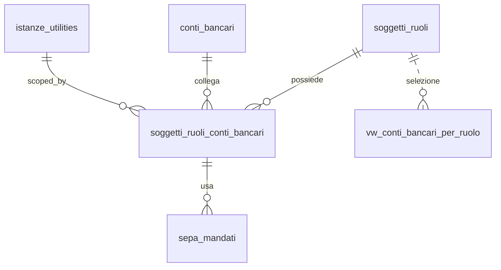

## 📘 Documentazione Concettuale – Tabella `anagrafiche.soggetti_ruoli_conti_bancari`

> 👀 **Vedi anche**
>
**Appronfondimento Tabelle correlate**   
> • [anagrafiche.soggetti](/dbzero/anagrafiche/tabelle/soggetti)    
> • [anagrafiche.soggetti_ruoli](/dbzero/anagrafiche/tabelle/soggetti_ruoli)    
> • [anagrafiche.conti_bancari](/dbzero/anagrafiche/tabelle/conti_bancari)    
> • [anagrafiche.soggetti_conti_bancari](/dbzero/anagrafiche/tabelle/soggetti_conti_bancari)    
> • [pagamenti.sepa_mandati](/dbzero/pagamenti/tabelle/sepa_mandati)    
>
**Artefatti di selezione**   
> • [anagrafiche.vw_conti_bancari_per_ruolo](/dbzero/anagrafiche/view/vw_conti_bancari_per_ruolo)    
> • [script.fn_get_conto_bancario_predefinito](/dbzero/script/funzioni/fn_get_conto_bancario_predefinito)   
>
**Approfondimento Trigger/Funzioni generiche**   
> • [dbops.trgfn_tx_id_managed](/dbzero/dbops/funzioni/trgfn_tx_id_managed)    
> • [script.trgfn_audit_data_user_generic](/dbzero/script/funzioni/trgfn_audit_data_user_generic)    
> • [script.trgfn_storico_generic](/dbzero/script/funzioni/trgfn_storico_generic)   
 
---
### 🎯 Scopo Principale
(latest review 25-03-26)
`anagrafiche.soggetti_ruoli_conti_bancari` gestisce l’**associazione tra un Ruolo** di un soggetto (CLIENTE, FORNITORE, GESTORE, …) e uno o più **conti bancari (IBAN)**, distinguendo l’**uso** del conto: `INCASSO`, `PAGAMENTO`, `RIMBORSO`, `GENERICO`.

Supporta la **differenziazione per istanza di servizio** tramite `istanza_utility_id` (opzionale, `bigint`, FK → `anagrafiche.istanze_utilities`): due istanze GAS dello stesso soggetto possono avere conti INCASSO diversi.

La cascata di selezione è a **3 livelli** (istanza → ruolo generico → soggetto), implementata dalla vista `vw_conti_bancari_per_ruolo` (flat) e dalla funzione `fn_get_conto_bancario_predefinito` (cascata 7 livelli con fallback uso GENERICO).

---

### Relazioni

| Tipo       | Tabella ↔ Campo                                        | Descrizione                                          |
| ---------- | ------------------------------------------------------ | ---------------------------------------------------- |
| FK →       | `anagrafiche.soggetti_ruoli(id)` ← `soggetto_ruolo_id` | Ruolo del soggetto (es. Cliente, Fornitore)          |
| FK →       | `anagrafiche.conti_bancari(id)` ← `conto_bancario_id`  | Conto bancario registrato nell’anagrafe unica        |
| (usata da) | `anagrafiche.vw_conti_bancari_per_ruolo`               | Selezione con priorità RUOLO → fallback SOGGETTO     |
| (usata da) | `pagamenti.sepa_mandati`                               | Collega il mandato al **conto di ruolo** selezionato |

> **Nota:** cancellazioni **NO ACTION** per evitare orfani; disattiva un legame impostando `valido_al` o `bloccato=true`.

---

### Struttura logica (campi chiave)

* `soggetto_ruolo_id` (**FK** obbligatoria)
* `conto_bancario_id` (**FK** obbligatoria)
* `istanza_utility_id` (**FK** opzionale, `bigint` → `anagrafiche.istanze_utilities`) — se valorizzato, il legame è specifico per quell’istanza di servizio; se NULL, è generico del ruolo
* `uso VARCHAR(16)` → `INCASSO | PAGAMENTO | RIMBORSO | GENERICO` (default `GENERICO`)
* `predefinito BOOLEAN` → predefinito per l’uso **in questo ruolo/istanza**
* `valido_dal DATE`, `valido_al DATE` → finestra di validità del legame
* `intestazione_dichiarata VARCHAR(140)` → opzionale (se diversa da intestatario del conto)
* Flag operativi: `verificato BOOLEAN`, `bloccato BOOLEAN`
* Estensioni: `meta JSONB`
* Audit: `tx_id UUID`, `storicizza BOOLEAN`, `data_*`, `user_*`

---

### 🚦 Vincoli & Regole

* **Unicità combinazione** (4 partial unique index per gestire NULL su `istanza_utility_id`):
  - `uq_src_bancari_ruolo_istanza_conto_uso (soggetto_ruolo_id, istanza_utility_id, conto_bancario_id, uso) WHERE istanza_utility_id IS NOT NULL`
  - `uq_src_bancari_ruolo_conto_uso_no_istanza (soggetto_ruolo_id, conto_bancario_id, uso) WHERE istanza_utility_id IS NULL`
* **Predefinito per uso/ruolo/istanza** (2 partial unique index):
  - `uq_src_bancari_predefinito_istanza (soggetto_ruolo_id, istanza_utility_id, uso) WHERE predefinito=true AND istanza_utility_id IS NOT NULL`
  - `uq_src_bancari_predefinito_no_istanza (soggetto_ruolo_id, uso) WHERE predefinito=true AND istanza_utility_id IS NULL`
* **Validità temporale**: `CHECK (valido_al IS NULL OR valido_dal IS NULL OR valido_al >= valido_dal)`.
* **Valori ammessi `uso`**: `CHECK (uso IN ('INCASSO','PAGAMENTO','RIMBORSO','GENERICO'))`.
* **Guard‑rail conto attivo**: trigger impedisce associazioni a `conti_bancari.attivo=false`.


---

### Query tipiche

**1) Predefinito d’incasso per un ruolo (oggi valido)**

```sql
SELECT srcb.*
FROM anagrafiche.soggetti_ruoli_conti_bancari srcb
JOIN anagrafiche.conti_bancari cb ON cb.id = srcb.conto_bancario_id
WHERE srcb.soggetto_ruolo_id = :soggetto_ruolo_id
  AND srcb.uso = 'INCASSO'
  AND srcb.predefinito = true
  AND (srcb.valido_dal IS NULL OR srcb.valido_dal <= CURRENT_DATE)
  AND (srcb.valido_al  IS NULL OR srcb.valido_al  >= CURRENT_DATE)
  AND srcb.bloccato = false
  AND cb.attivo = true
LIMIT 1;
```

**2) Tutti i conti attivi del ruolo (per auditing)**

```sql
SELECT srcb.uso, srcb.predefinito, cb.iban, cb.verificato
FROM anagrafiche.soggetti_ruoli_conti_bancari srcb
JOIN anagrafiche.conti_bancari cb ON cb.id = srcb.conto_bancario_id
WHERE srcb.soggetto_ruolo_id = :soggetto_ruolo_id
  AND (srcb.valido_al IS NULL OR srcb.valido_al >= CURRENT_DATE)
ORDER BY srcb.uso, srcb.predefinito DESC, srcb.data_update DESC;
```

---

### Cascata di selezione (3 livelli + fallback uso)

La funzione `fn_get_conto_bancario_predefinito(ruolo, uso, istanza_utility_id)` implementa una cascata a **7 livelli**:

1. Ruolo + istanza specifica + uso richiesto
2. Ruolo + istanza NULL (generico) + uso richiesto
3. Soggetto + uso richiesto
4. Ruolo + istanza specifica + uso GENERICO
5. Ruolo + istanza NULL + uso GENERICO
6. Soggetto + uso GENERICO
7. NULL (nessun conto trovato)

La vista `vw_conti_bancari_per_ruolo` e **flat** (espone tutte le candidate senza DISTINCT ON). La selezione singola e nella funzione.

---

### Best practice

* Definisci **un solo predefinito per uso** per ciascuna combinazione ruolo/istanza (vincolo unico parziale).
* Usa `valido_dal/valido_al` per cambi programmati; **non cancellare**, storicizza.
* Per **ruoli sensibili** (es. Gestore con CI SEPA), documenta nel `meta` eventuali vincoli di utilizzo.
* Limita la visibilità degli IBAN via servizi/vista: qui lavora per **ID conto**.
* Per conti generici del ruolo (validi per tutte le istanze), lascia `istanza_utility_id = NULL`.

---

### Diagramma ER relazioni (focus ruolo)



---



---
