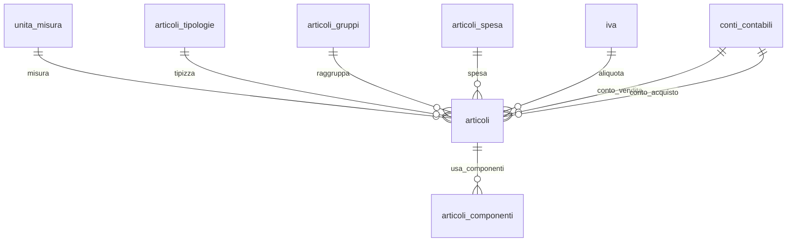

## 📘 Documentazione Concettuale – Tabella `catalogo.articoli`

> 👀 **Vedi anche**
>
> **Approfondimento Tabelle**   
> • [`catalogo.unita_misura`](/dbzero/catalogo/tabelle/unita_misura)     
> • [`vendite.articoli_tipologie`](/dbzero/vendite/tabelle/articoli_tipologie)    
> • [`vendite.articoli_gruppi`](/dbzero/vendite/tabelle/articoli_gruppi)    
> • [`vendite.articoli_spesa`](/dbzero/vendite/tabelle/articoli_spesa)   
> • [`config.iva`](/dbzero/config/tabelle/iva)   
> • [`config.conti_contabili`](/dbzero/config/tabelle/conti_contabili)   
> • *(opz.)* [`catalogo.articoli_componenti`](/dbzero/catalogo/tabelle/articoli_componenti) – per gli articoli compositi   
>
> **Approfondimento Trigger/Funzioni**   
> • [`dbops.trgfn_tx_id_managed`](/dbzero/dbops/funzioni/trgfn_tx_id_managed)    
> • [`script.trgfn_audit_data_user_generic`](/dbzero/script/funzioni/trgfn_audit_data_user_generic)   
> • [`script.trgfn_storico_generic`](/dbzero/script/funzioni/trgfn_storico_generic)   

---

### 🎯 Scopo Principale

(latest review 13-01-26)
`catalogo.articoli` è l’anagrafica **centrale** di articoli/voci, utilizzabile sia per il **catalogo prodotti** tradizionale sia per **voci utility** (canoni, oneri, misurazioni, ecc.). Supporta:

* **classificazione** (tipologia, gruppo, voce di spesa);
* **fiscalità** (IVA, conti contabili di vendita/acquisto);
* **logistica/serializzazione** (`requires_serial`);
* **distinta base leggera** (`is_composito`, via tabella componenti);
* **aspetti documentali** (`fondo_fattura`, `voce_utility`).

---

### 🔗 Relazioni

| Tipo | Tabella ↔ Campo                                                  | Descrizione                  |
| ---- | ---------------------------------------------------------------- | ---------------------------- |
| FK → | `catalogo.unita_misura(id)` ← `uom_id`                           | Unità di misura principale   |
| FK → | `vendite.articoli_tipologie(id)` ← `tipo_voce_id`                | Tipologia articolo/voce      |
| FK → | `vendite.articoli_gruppi(id)` ← `gruppo_voce_id`                 | Raggruppamento merceologico  |
| FK → | `vendite.articoli_spesa(id)` ← `spesa_id`                        | Collegamento a voce di spesa |
| FK → | `config.iva(id)` ← `iva_id`                                      | Aliquota IVA                 |
| FK → | `config.conti_contabili(id)` ← `conto_contabile_vendita_id`      | Conto vendite                |
| FK → | `config.conti_contabili(id)` ← `conto_contabile_acquisto_id`     | Conto acquisti               |
| FK → | `catalogo.note(target_tipo, id)` ← `(note_target_tipo, note_id)` | Nota associata all’articolo  |

---

### 🧱 Struttura logica (campi chiave)

* **Identità**: `id UUID` (PK), `codice VARCHAR(50)` (**UNIQUE**), `descrizione VARCHAR(150)`, `descrizione_breve VARCHAR(80)`
* **Classificazione**: `uom_id`, `tipo_voce_id`, `gruppo_voce_id`, `spesa_id`
* **Fiscale/Contabile**: `iva_id`, `conto_contabile_vendita_id`, `conto_contabile_acquisto_id`
* **Flag funzionali**: `is_composito` (distinta), `requires_serial` (serializzazione), `voce_utility` (voce utility), `fondo_fattura` (stampa in calce)
* **Note**: `note_target_tipo`, `note_id` (FK composita verso `catalogo.note`)
* **Tecnico**: `meta JSONB`, `attivo BOOLEAN` (default `true`), `storicizza BOOLEAN` (default `true`), `tx_id UUID`
* **Audit**: `user_insert`, `user_update`, `data_insert`, `data_update`

---

### 🚦 Vincoli & Regole

* **Univocità**: `uq_articoli_codice (codice)` → un codice per articolo.
* **Integrità referenziale**: tutte le FK sono `ON UPDATE CASCADE` / `ON DELETE NO ACTION` (salvo diversa policy su note).
* **Note**: `note_target_tipo` è vincolato a `ARTICOLI` quando valorizzato.

> 🔒 Consigliato: proteggere l’**immutabilità** del `codice` con un trigger `BEFORE UPDATE` dedicato (se è business‑key) e con GRANT mirati.

---

### 🔍 Indicizzazione

* **Ricerca case‑insensitive per codice**: `ix_articoli_codice_upper` su `upper(codice)`.
* *(Valuta se necessario)* indici su FK usate spesso in filtro: `tipo_voce_id`, `gruppo_voce_id`, `spesa_id`, `iva_id`, `attivo`.

---


---

### 🔎 Query tipiche

**1) Ricerca per codice case‑insensitive**

```sql
SELECT a.*
FROM catalogo.articoli a
WHERE upper(a.codice) = upper(:codice);
```

**2) Articoli attivi per tipologia e gruppo**

```sql
SELECT a.id, a.codice, a.descrizione
FROM catalogo.articoli a
WHERE a.attivo = true
  AND a.tipo_voce_id   = :tipo_id
  AND a.gruppo_voce_id = :gruppo_id
ORDER BY a.descrizione;
```

**3) Articoli compositi con componenti (schema indicativo)**

```sql
SELECT p.codice   AS prodotto,
       c.codice   AS componente
FROM catalogo.articoli_componenti ac
JOIN catalogo.articoli p ON p.id = ac.prodotto_id
JOIN catalogo.articoli c ON c.id = ac.componente_id
WHERE p.is_composito = true
  AND p.attivo = true
ORDER BY p.codice, c.codice;
```

**4) Verifica coerenza UoM attiva (diagnostica)**

```sql
SELECT a.id, a.codice
FROM catalogo.articoli a
LEFT JOIN catalogo.unita_misura u ON u.id = a.uom_id
WHERE a.uom_id IS NOT NULL
  AND (u.attivo IS DISTINCT FROM true);
```

---

### 🧭 Best practice

* **Normalizzazione codice**: valuta un trigger di normalizzazione (trim/uppercase opzionale) e **protezione update** del campo `codice`.
* **Serializzazione**: se `requires_serial=true`, prevedi controlli lato movimento (carico/scarico) e vincoli di coerenza.
* **IVA e conti contabili**: applica regole applicative per la coerenza tra `iva_id` e tipo articolo (es. voci esenti).
* **`meta` JSONB**: usa chiavi stabili (namespace logici: `utility.*`, `ui.*`, `calc.*`) e considera indici GIN se interrogato.
* **Storicizza** anziché cancellare: usa `attivo=false` e lascia che i trigger di storico fotografino le modifiche.

---

### Diagramma ER relazioni (focus articolo)



---



---
