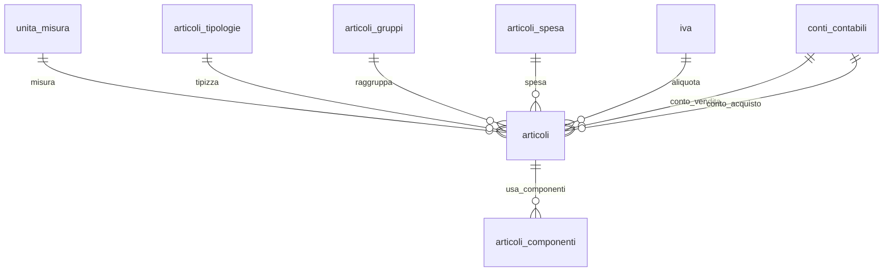

## 📘 Documentazione Concettuale – Tabella `catalogo.articoli`

> 👀 **Vedi anche**
>
**Approfondimento Tabelle**   
> • [`catalogo.unita_misura`](/dbzero/catalogo/tabelle/unita_misura)     
> • [`vendite.articoli_tipologie`](/dbzero/vendite/tabelle/articoli_tipologie)    
> • [`vendite.articoli_gruppi`](/dbzero/vendite/tabelle/articoli_gruppi)    
> • [`vendite.articoli_spesa`](/dbzero/vendite/tabelle/articoli_spesa)   
> • [`config.iva`](/dbzero/config/tabelle/iva)   
> • [`config.conti_contabili`](/dbzero/config/tabelle/conti_contabili)   
> • *(opz.)* [`catalogo.articoli_componenti`](/dbzero/catalogo/tabelle/articoli_componenti) – per gli articoli compositi   
>
**Approfondimento Trigger/Funzioni**   
> • [`dbops.trgfn_tx_id_managed`](/dbzero/dbops/funzioni/trgfn_tx_id_managed)    
> • [`script.trgfn_audit_data_user_generic`](/dbzero/script/funzioni/trgfn_audit_data_user_generic)   
> • [`script.trgfn_storico_generic`](/dbzero/script/funzioni/trgfn_storico_generic)   

---
### 🎯 Scopo Principale
(latest review 13-01-26)
`catalogo.articoli` è l’anagrafica **centrale** di articoli/voci, utilizzabile sia per il **catalogo prodotti** tradizionale sia per **voci utility** (canoni, oneri, misurazioni, ecc.). Supporta:

* **classificazione** (tipologia, gruppo, voce di spesa);
* **fiscalità** (IVA, conti contabili di vendita/acquisto);
* **logistica/tracciabilità** (`requires_serial`, `requires_lotto` — due domande **indipendenti**, vedi sotto);
* **distinta base leggera** (`is_composito`, via tabella componenti);
* **aspetti documentali** (`voce_utility`).

---

### Relazioni

| Tipo | Tabella ↔ Campo                                                  | Descrizione                  |
| ---- | ---------------------------------------------------------------- | ---------------------------- |
| FK → | `catalogo.unita_misura(id)` ← `uom_id`                           | Unità di misura principale   |
| FK → | `vendite.articoli_tipologie(id)` ← `tipo_voce_id`                | Tipologia articolo/voce      |
| FK → | `vendite.articoli_gruppi(id)` ← `gruppo_voce_id`                 | Raggruppamento merceologico  |
| FK → | `vendite.articoli_spesa(id)` ← `spesa_id`                        | Collegamento a voce di spesa |
| FK → | `config.iva(id)` ← `iva_id`                                      | Aliquota IVA                 |
| FK → | `config.conti_contabili(id)` ← `conto_contabile_vendita_id`      | Conto vendite                |
| FK → | `config.conti_contabili(id)` ← `conto_contabile_acquisto_id`     | Conto acquisti               |
| FK → | `catalogo.note(target_tipo, id)` ← `(note_target_tipo, note_id)` | Nota associata all’articolo  |
| FK → | `config.listini_tipologie(id)` ← `listino_tipologia_id`          | Tipologia listino v5         |

---

### Struttura logica (campi chiave)

* **Identità**: `id UUID` (PK), `codice VARCHAR(50)` (**UNIQUE**), `descrizione VARCHAR(150)`, `descrizione_breve VARCHAR(80)`
* **Classificazione**: `uom_id`, `tipo_voce_id`, `gruppo_voce_id`, `spesa_id`
* **Fiscale/Contabile**: `iva_id`, `conto_contabile_vendita_id`, `conto_contabile_acquisto_id`

> ⭐ **`iva_id` e` il PRIMO gradino del risolutore IVA** (dal 2026-08-29):
> `vendite.fn_resolve_iva_riga` chiede prima all'articolo, e se l'articolo
> risponde la sua risposta **vince** — nemmeno l'uso della fornitura la scavalca.
>
> ⛔ **E il suo `NULL` SIGNIFICA qualcosa: «non ho un'opinione sull'IVA».** Non e`
> un dato mancante da bonificare, ed e` il motivo per cui la colonna e` nullabile.
> Renderla `NOT NULL` «per igiene» spegnerebbe il secondo gradino — quello che
> legge il tipo d'uso della fornitura — perche` il risolutore non avrebbe piu`
> modo di sapere quando l'articolo non ha niente da dire.
* **Flag funzionali**: `is_composito` (distinta), `is_solo_componente` (solo componente), `requires_serial` (serializzazione), `requires_lotto` (partita, dal 2026-09-14), `voce_utility` (voce utility)
* **Note**: `note_target_tipo`, `note_id` (FK composita verso `catalogo.note`)
* **Tecnico**: `meta JSONB`, `attivo BOOLEAN` (default `true`), `storicizza BOOLEAN` (default `true`), `tx_id UUID`
* **Audit**: `user_insert`, `user_update`, `data_insert`, `data_update`

---

### 🚦 Vincoli & Regole

* **Univocità**: `uq_articoli_codice (codice)` → un codice per articolo.
* **Integrità referenziale**: tutte le FK sono `ON UPDATE CASCADE` / `ON DELETE NO ACTION` (salvo diversa policy su note).
* **Note**: `note_target_tipo` è vincolato a `ARTICOLI` quando valorizzato.
* **Solo componente**: se `is_solo_componente=true` l’articolo non può essere usato come prodotto in `articoli_componenti`.
* **`uom_id` obbligatorio**: dalla revisione del 07-04-2026 la colonna è `NOT NULL`. L'unità di misura principale è anagrafica e necessaria per il seed automatico della UoM operativa base.
* **Tipologia listino (pricing v5, 14-04-2026)**: `listino_tipologia_id` nullable, FK a `config.listini_tipologie`. Un articolo senza tipologia non puo' essere inserito in un listino tipizzato (motivo di `script.fn_check_articolo_riga` per la versione di listino, sollevato dal guard `trg_listini_righe_a10_guard_articolo_ammesso_ins_upd`; codice errore `E_ARTICOLO_TIPOLOGIA_MANCANTE`). Un articolo con tipologia diversa dalla tipologia del listino genera `E_ARTICOLO_TIPOLOGIA_INCOMPATIBILE`. Backfill iniziale (14-04-2026): articoli con `voce_utility = false` mappati automaticamente a `PRODOTTI`; articoli voce utility lasciati NULL per mapping manuale alle 4 tipologie tecniche (`CONSUMO`, `QUOTA_FISSA`, `IMPOSTA`, `ONERE_SISTEMA`).

> Consigliato: proteggere l’**immutabilità** del `codice` con un trigger `BEFORE UPDATE` dedicato (se è business‑key) e con GRANT mirati.

---

### Seed automatico UoM operativa base

(introdotto 07-04-2026)

Quando viene inserito un articolo, il trigger **`trg_articoli_a10_seed_uom_base_ins`**
(funzione `catalogo.trgfn_articoli_seed_uom_base`) crea automaticamente una riga
in `catalogo.articoli_uom_operativa` con:

* `articolo_id` = `NEW.id`
* `uom_id` = `NEW.uom_id` (la UoM anagrafica dell'articolo)
* `is_base` = `true`
* `factor_to_base` = `1`
* `attivo` = `true`

Questo garantisce che la **UoM principale** dell'articolo sia sempre disponibile come
**UoM operativa base** senza richiedere uno step manuale dopo la creazione.

**Caratteristiche del seed**:

* Trigger `AFTER INSERT` per garantire che la riga padre in `articoli` esista già
* Idempotente via `ON CONFLICT ON CONSTRAINT uq_artuomop_articolo_uom DO NOTHING`
* Nessun backfill sugli articoli pre-esistenti: si applica solo ai nuovi `INSERT`

---

### Lock di `codice` e `uom_id` su UPDATE

`codice` e `uom_id` di `catalogo.articoli` sono bloccati in UPDATE da **un solo**
trigger, `trg_articoli_a10_lock_columns_upd`, che riusa `script.trgfn_lock_columns`.
Il codice è l'identità dell'articolo e la UoM principale è **anagrafica**: nessuno
dei due si cambia dopo la creazione.

* **Codice errore**: `E_CODICE_NON_MODIFICABILE` (messaggio parametrico sul nome della colonna)
* **Override manutenzione**: `SET LOCAL zeroerp.allow_lock_columns_override = 'on';` consente la modifica nei contesti di migrazione/manutenzione
* **Per cambiare la UoM principale**: creare un nuovo articolo (l'articolo storico resta intatto)

⚠️ **Fino al 22-09-2026 i trigger erano DUE e scritti a mano**
(`trg_articoli_a10_protect_codice_upd`, `trg_articoli_a10_protect_uom_id_upd`):
sollevavano `CODICE_NON_MODIFICABILE`, ritirato il 2026-08-05, e — pur usando la
stessa funzione dell'automazione — `codice` non era nel registro
[dbops.automation_lock_columns](/dbzero/dbops/tabelle/automation_lock_columns),
cioè erano oggetti che *sembravano* governati dall'automazione e non lo erano.
Dal 23-09 il registro li dichiara entrambi e il trigger lo **genera l'automazione**:
uno solo, con tutte le colonne. Brief: `brief-db-codici-ritirati-negli-argomenti-dei-trigger`.

⛔ **Il nome non si cita come contratto**: lo decide il template dell'automazione.
Chi deve verificare il lock lo cerca per **funzione e argomenti**, come fa
`db/pgtap/catalogo/test-articoli-seed-uom-base-lock.sql` (test 3) — che infatti era
diventato rosso pinnando il nome vecchio.

---

### Indicizzazione

* *(Valuta se necessario)* indici su FK usate spesso in filtro: `tipo_voce_id`, `gruppo_voce_id`, `spesa_id`, `iva_id`, `attivo`.

---


---

### Query tipiche

**1) Articoli attivi per tipologia e gruppo**

```sql
SELECT a.id, a.codice, a.descrizione
FROM catalogo.articoli a
WHERE a.attivo = true
  AND a.tipo_voce_id   = :tipo_id
  AND a.gruppo_voce_id = :gruppo_id
ORDER BY a.descrizione;
```

**2) Articoli compositi con componenti (schema indicativo)**

```sql
SELECT p.codice   AS prodotto,
       c.codice   AS componente
FROM catalogo.articoli_componenti ac
JOIN catalogo.articoli p ON p.id = ac.prodotto_id
JOIN catalogo.articoli c ON c.id = ac.componente_id
WHERE p.is_composito = true
  AND p.attivo = true
ORDER BY p.codice, c.codice;
```

**3) Verifica coerenza UoM attiva (diagnostica)**

```sql
SELECT a.id, a.codice
FROM catalogo.articoli a
LEFT JOIN catalogo.unita_misura u ON u.id = a.uom_id
WHERE a.uom_id IS NOT NULL
  AND (u.attivo IS DISTINCT FROM true);
```

---

### Best practice

* **Normalizzazione codice**: valuta un trigger di normalizzazione (trim/uppercase opzionale) e **protezione update** del campo `codice`.
* **Serializzazione e lotto — due booleani, non un enum** (magazzino Lotto 1, 2026-09-14):
  `requires_serial` dice *«ogni pezzo ha una matricola»* → `magazzino.assets`, una riga per
  pezzo, `|qta| = 1` sul movimento; `requires_lotto` dice *«ogni carico appartiene a una
  partita»* → `magazzino.lotti`, con data d'arrivo e scadenza. Un articolo può volerne uno,
  entrambi o nessuno (reagente / apparecchiatura / dispositivo medico). Li legge la
  **primitiva di scrittura del magazzino** (Lotto 2): un movimento senza il lotto o il
  seriale che l'articolo pretende è rifiutato lì.
  ⚠️ **Non sono simmetrici nel comportamento**: `requires_serial` è anche un **flag di
  struttura BoM** — congelato da `trgfn_articoli_guard_flags_struttura_bom_attiva` insieme a
  `is_composito`/`is_solo_componente` quando l'articolo è padre di una distinta attiva,
  registrato in `dbops.lock_columns_conditional`, e il drawer lo disabilita via
  `non_editable_fields`. `requires_lotto` è **fuori** da quel guard e da quel registro per
  decisione (analisi carico/scarico §7-quater p.3: una partita non è struttura di
  composizione): chi lo espone nel drawer **non** deve copiare il lucchetto. Dal 2026-09-18
  `requires_lotto` è in `vw_articoli_dettaglio` (in coda, `20260918-10`) e la primitiva di
  magazzino lo fa rispettare (`E_MAG_LOTTO_OBBLIGATORIO`/`_NON_AMMESSO`); il drawer lo prende
  con la richiesta BE/FE del Lotto 2. `gestito_a_magazzino` è la prima cosa che la primitiva
  guarda (`E_MAG_ARTICOLO_NON_GESTITO`, campo `articolo_id`), e la spia
  `dbops.vw_articoli_a_magazzino_prontezza` dice se almeno un articolo attivo è marcato.
* **IVA e conti contabili**: applica regole applicative per la coerenza tra `iva_id` e tipo articolo (es. voci esenti).
* **`meta` JSONB**: usa chiavi stabili (namespace logici: `utility.*`, `ui.*`, `calc.*`) e considera indici GIN se interrogato.
* **Storicizza** anziché cancellare: usa `attivo=false` e lascia che i trigger di storico fotografino le modifiche.

---

### 🔒 Un articolo usato non cambia la sua struttura (A-10, 2026-10-13)

Un articolo **usato** non cambia più i campi che decidono **come si vende** e **come sta a
magazzino**. A valle ci sono listini, ordini, bolle, giacenze: costruiti su quelle
caratteristiche, non le rincorrono se cambiano.

| Bloccate se usato | Libere |
| --- | --- |
| `is_composito`, `is_solo_componente`, `natura_vendita_id`, `causale_onere_id`, `listino_tipologia_id`, `gestito_a_magazzino`, `requires_lotto`, `requires_serial` | `iva_id` (l'aliquota cambia per legge, e ogni riga ha la sua), descrizioni, gruppi, conti, tempi di consegna, modo di approvvigionamento |

`codice` e `uom_id` sono immutabili sempre (sezione sotto).

* **Usato** = compare in una tabella che lo punta con una FK — righe di documento di vendita e
  d'acquisto, fatture, resi, offerte, listini e promo, commesse, magazzino — **in qualunque
  stato**, anche chiusa o annullata: lo dice
  [`catalogo.fn_articolo_usato`](/dbzero/catalogo/manual/fn_articolo_usato). Non contano le
  tabelle di anagrafica dell'articolo stesso (distinta, UoM operative, descrizioni, note, regole
  di fatturazione, ambiti IVA).
* **Tutte le aziende**: gli articoli sono unici per tutte le aziende, i documenti no. L'uso conta
  anche se sta in un documento che chi modifica non vede; il messaggio non dice dove.
* **Chi lo fa rispettare**: il guard
  [`trgfn_articoli_guard_struttura_se_usato`](/dbzero/catalogo/manual/trgfn_articoli_guard_struttura_se_usato)
  (`E_ARTICOLO_USATO_STRUTTURA_IMMUTABILE`) e, nel form, le regole gemelle in
  `dbops.lock_columns_conditional`, che spengono il campo con lo stesso predicato.
* **La via d'uscita** è un articolo nuovo (il vecchio non va per forza ritirato). Un errore di
  caricamento lo corregge un amministratore col verbo
  [`catalogo.fn_articolo_correggi_struttura`](/dbzero/catalogo/manual/fn_articolo_correggi_struttura)
  (solo SUPER_ADMIN).

Le regole della distinta sugli stessi campi (`trgfn_articoli_guard_flags_struttura_bom_attiva`)
restano: valgono anche per un articolo non ancora usato.

### Articolo-onere (porta oneri)

Un articolo **è un onere** quando ha `causale_onere_id` valorizzato (FK verso
[`config.causali_onere`](/dbzero/config/tabelle/causali_onere), legame **1:1** —
`uq_articoli_causale_onere`). È il modello «un articolo è un onere collegandogli una causale»:
così **ogni onere porta la propria IVA** (la `iva_id` dell'articolo — es. spese/trasferte 22%,
penale fuori campo art.15), mentre la causale ne è la classificazione business. La madre
[`vendite.fn_aggiungi_onere_commessa`](/dbzero/vendite/funzioni/fn_aggiungi_onere_commessa)
riceve l'articolo-onere e ne deriva causale, `uom` e IVA. Riferimento:
`brief-db-immutabilita-quantita-e-porta-oneri` §4c.8.

**Un onere non è merce** (dal 2026-10-13): la natura di un articolo-onere non ha
destinazione `ORDINE` (guard [`trgfn_articoli_guard_onere_natura`](/dbzero/catalogo/manual/trgfn_articoli_guard_onere_natura),
`E_ARTICOLO_ONERE_NATURA_MERCE`). `natura_vendita_id` ha come default la merce: un onere creato
senza dire la natura sarebbe stato un bene da evadere in ordine e in bolla, e una cessione di beni.
Gli oneri del seed hanno la natura del servizio una tantum (destinazione commessa).

---

### Diagramma ER relazioni (focus articolo)



---



---

### 🔄 rev 2026-09-13 — da dove arriva l'articolo: tre colonne di approvvigionamento

Nate con `20260913-05` (e `-10`/`-11` per il default), brief
`brief-db-modifiche-certe-ciclo-vendita-e-articolo`, sezione 3.

| Colonna | Che cosa dice | Vuoto ammesso? |
|---|---|---|
| `modo_approvvigionamento_id` | **da dove arriva la merce**: acquisto, produzione, stock, non applicabile — vocabolario [config.modi_approvvigionamento](/dbzero/config/tabelle/modi_approvvigionamento) | no, default **acquisto** |
| `gestito_a_magazzino` | l'articolo **movimenta giacenza** | no, default **no** |
| `lead_time_giorni` | giorni fra «lo chiedo» e «ce l'ho» | sì: per una prestazione non significa niente, e `0` non è «non si applica» |

⭐ **Perché tre domande e non una.** «Da dove arriva» non dice «passa da
magazzino» — una merce può essere consegnata direttamente dal fornitore — e
nessuna delle due si deduce dalla natura di vendita, che dice invece *dove va*
la riga venduta. Sono domande diverse, e vanno tenute separate anche quando oggi
le risposte coincidono.

⚠️ **Al rilascio tutti gli articoli risultano «non a magazzino».** Il default è
volutamente prudente — nessun articolo comincia a movimentare giacenza per
distrazione — ma la conseguenza è che la merce **va marcata**: è un lavoro di
dato, e il magazzino, finché non lo si fa, si comporta come se non ci fosse
merce, senza nessun errore. Il controllo di prontezza sta nel catalogo dei
presidi (`dbops.presidi`), non in un rosso.

Le tre colonne escono dalla vista
[vw_articoli_dettaglio](/dbzero/catalogo/views/vw_articoli_dettaglio) (con la
decodifica del modo) e sono configurate come colonne della lista articoli,
**spente** finché il backend non le proietta.
