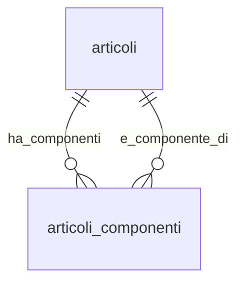

## 📘 Documentazione Concettuale – Tabella `catalogo.articoli_componenti`

> 👀 **Vedi anche**
>
**Approfondimento Tabelle**  
> • [`catalogo.articoli`](/dbzero/catalogo/tabelle/articoli)   
> • [`catalogo.note`](/dbzero/catalogo/tabelle/note)   
> • *(opz.)* [`catalogo.unita_misura`](/dbzero/catalogo/tabelle/unita_misura)   
>
**Approfondimento Trigger/Funzioni**   
> • [`dbops.trgfn_tx_id_managed`](/dbzero/dbops/funzioni/trgfn_tx_id_managed)   
> • [`dbops.trgfn_child_requires_active_parent`](/dbzero/dbops/funzioni/trgfn_child_requires_active_parent)   
> • [`script.trgfn_audit_data_user_generic`](/dbzero/script/funzioni/trgfn_audit_data_user_generic)   
> • [`script.trgfn_storico_generic`](/dbzero/script/funzioni/trgfn_storico_generic)  
> • [`catalogo.trgfn_articoli_componenti_block_modifica_struttura`](/dbzero/catalogo/funzioni/trgfn_articoli_componenti_block_modifica_struttura) *(immutabilità BoM, 22-04-2026)*  

---
### 🎯 Scopo Principale
(latest review 13-01-26)
`catalogo.articoli_componenti` rappresenta la **distinta base (BoM)** lato **vendita**, con **versionamento temporale**: ogni riga lega un **prodotto** a un **componente** con una finestra di validità (`valido_dal`..`valido_al`).

Supporta:

* **quantità/coefficiente** per unità di prodotto (`coeff_qta`): nei documenti la quantità del componente è sempre `quantità padre × coeff_qta`,
* **obbligatorietà** del componente (`obbligatorio`): oggi vuol dire solo «prezzo zero non ammesso»,
* **esposizione in fattura** (`esposizione_in_fattura`),
* **attivazione/disattivazione logica** (`attivo`) e **storicizzazione**.

---

### Relazioni

| Tipo      | Tabella ↔ Campo                           | Descrizione                                                                           |
| --------- | ----------------------------------------- | ------------------------------------------------------------------------------------- |
| FK →      | `catalogo.articoli(id)` ← `prodotto_id`   | Articolo **padre** (prodotto)                                                         |
| FK →      | `catalogo.articoli(id)` ← `componente_id` | Articolo **figlio** (componente)                                                      |
| (trigger) | `catalogo.articoli`                       | Il componente e il prodotto referenziati devono essere **attivi** (guard via trigger) |

> **Nota:** `chk_articoli_componenti_no_selfref` impedisce **self‑reference** (padre=figlio).

---

### Struttura logica (campi chiave)

* **Identità**: `id UUID` (PK)
* **Legame**: `prodotto_id UUID` (FK), `componente_id UUID` (FK)
* **Versioning**: `valido_dal DATE` (**obbligatorio**), `valido_al DATE` *(NULL = infinito)*
* **Quantità & logica**: `coeff_qta NUMERIC(18,6) ≥ 0`, `obbligatorio BOOLEAN`
* ~~`partecipa_qta`~~, ~~`determina_qta_padre`~~: **ritirate il 2026-10-02** (`20261002-60`, decisione di Tid). Si salvavano e il guard di immutabilità le congelava, ma nessuna logica le leggeva: la quantità segue sempre il padre via `coeff_qta`. Vedi [modello componenti BoM §2](/dev/manual/modello-componenti-bom).
* **Unità di misura**: il componente ha la sua, **libera**; nessun vincolo la lega a quella del prodotto (l'unico vincolo padre-componente è l'IVA). Un kit può essere fatto di pezzi, metri e ore. In fattura la riga del kit stampa quantità e UoM della **riga padre del documento**, congelate alla generazione (dal 2026-10-02): `coeff_qta` diversi fra i componenti non sono un problema. Vedi [modello componenti BoM §7.1](/dev/manual/modello-componenti-bom).
* **Esposizione in fattura** (rev 2026-10-01): `esposizione_in_fattura VARCHAR NOT NULL DEFAULT 'NASCOSTO'`, FK su `config.esposizioni_componente(codice_interno)`. Dice **come il componente si vede in fattura sotto il suo kit**, ed è solo una regola di presentazione: tutti i componenti attivi generano comunque righe nei documenti e in commessa (modello unificato del 2026-05-13).
    * `NASCOSTO`: il componente non compare; il suo valore sta nel totale del kit.
    * `DESCRITTIVO`: riga sotto il kit senza prezzo né importo; il valore sta nel totale del kit.
    * `VALORIZZATO`: riga sotto il kit con quantità, prezzo e importo suoi, **fuori** dal totale del kit.

    Le regole le applica la vista di rappresentazione [`vendite.vw_fattura_righe_esposte`](/dbzero/vendite/views/vw_fattura_righe_esposte). Fino al 2026-10-01 era il booleano `esposto_in_fattura` (introdotto il 14-04-2026, pricing v5), convertito sul posto: `false` → `NASCOSTO`, `true` → `DESCRITTIVO`.
* **Note**: `note_target_tipo`, `note_id` (FK composita verso `catalogo.note`)
* **Meta & Audit**: `meta JSONB`, `attivo`, `storicizza`, `tx_id`, `user_*`, `data_*`

---

### 🚦 Vincoli & Regole

* **Univocità puntuale**: `UNIQUE (prodotto_id, componente_id, valido_dal)` → identifica l’**inizio versione**.
* **Date coerenti**: `valido_al IS NULL OR valido_al > valido_dal`.
* **Quantità non negative**: `coeff_qta ≥ 0`.
* **No self‑reference**: `prodotto_id <> componente_id`.
* **Nessuna sovrapposizione nel tempo** per la **stessa coppia** `(prodotto, componente)`:
  `EXCLUDE USING gist (prodotto_id WITH =, componente_id WITH =, daterange(valido_dal, COALESCE(valido_al, 'infinity'), '[]') WITH &&)`
  ➜ **richiede estensione** `btree_gist` per supportare `uuid` su GiST.
* **Parent attivi**: sia `prodotto_id` sia `componente_id` devono puntare ad articoli **attivi**.
* **Solo componente**: un articolo con `is_solo_componente=true` non può essere usato come `prodotto_id`.
* **Prodotto composito**: un articolo con `is_composito=false` non può essere usato come `prodotto_id`.
* **Un livello solo** (dal 2026-10-13): il `componente_id` di un legame attivo non è un articolo composito, perché la distinta ha un livello (`E_BOM_COMPONENTE_COMPOSITO`). Le regole sul componente — non è il padre stesso, non è composito, ha l'IVA del padre — stanno in una check sola, [`script.fn_check_articolo_riga`](/dbzero/script/manual/fn_check_articolo_riga) (documento `ARTICOLO`), sollevata dal guard di tabella [`catalogo.trgfn_articoli_componenti_guard_componente`](/dbzero/catalogo/manual/trgfn_articoli_componenti_guard_componente) (Lotto 3c, 2026-10-13). Dal lato articolo, un componente di una distinta in vigore o futura non diventa composito (check 3 di [`trgfn_articoli_guard_flags_struttura_bom_attiva`](/dbzero/catalogo/manual/trgfn_articoli_guard_flags_struttura_bom_attiva)). Perché: [modello componenti BoM §9.2](/dev/manual/modello-componenti-bom).

> **Nota tecnica (trigger manuali)**
>
Questi vincoli sono **applicati tramite trigger dedicati** su `articoli_componenti`:
>
REQUIRE su `prodotto_id` (padre attivo)
> REQUIRE su `componente_id` (figlio attivo)
> GUARD su `is_composito` (del padre)
> GUARD «un livello» (il componente non è composito)
>
Non rientrano nella generazione automatica `automations` perché la tabella
> usa **due FK verso la stessa entità** (`catalogo.articoli`) con ruoli diversi
> (prodotto vs componente), e la logica richiede controlli **distinti e specifici**.

#### Immutabilità BoM (trigger `block_modifica_struttura`, 22-04-2026)

A partire dal trigger `trg_articoli_componenti_a10_block_update_struct_upd_dlt` (`20260422-01`), la BoM è **immutabile** sui campi di struttura:

* **DELETE**: sempre bloccato (errore `E_BOM_MODIFICA_VIETATA` id 387). Non si elimina una riga BoM: si chiude.
* **UPDATE** dei campi `coeff_qta`, `componente_id`, `obbligatorio`, `esposizione_in_fattura` (fino al 2026-10-01 `esposto_in_fattura`), `valido_dal`, `validita`: bloccato (fino al 2026-10-02 anche `partecipa_qta` e `determina_qta_padre`, ritirate) (`E_BOM_MODIFICA_VIETATA`).
* **UPDATE** di `valido_al`: ammesso. È l'unico modo per chiudere una riga. Che non preceda `valido_dal` lo verifica il guard comune delle date, `script.trgfn_guard_date_validita` (`E_DATA_AL_MINORE_DAL`), come su ogni tabella con la coppia di date.
* **UPDATE** di `note_*`, `meta`, `attivo`, e dei campi audit: ammesso (non sono campi di struttura).

**Pattern operativo "chiudi+inserisci nuova versione"**: per evolvere una BoM, l'admin chiude la riga corrente (UPDATE `valido_al = oggi`) e inserisce una nuova riga con `valido_dal` successivo. L'exclusion constraint daterange esistente garantisce non-overlap. Vedi [guida gestione listini §5.3](/guide/gestione-listini#53-immutabilita-della-bom-pattern-chiudi-nuova-versione).

**Razionale**: le righe `vendite.commesse_attivita` e le fatturazioni che hanno consumato la BoM restano ancorate ai valori `prezzo_snapshot`/`prezzo_bloccato` registrati al momento del push. Modificare la BoM "sotto" alle commesse rompe la ricostruzione storica e l'audit.

---

### Indicizzazione

* `ix_articoli_componenti_prodotto_from_to (prodotto_id, valido_dal, valido_al)` → espansione distinta per prodotto e per data.
* `ix_articoli_componenti_componente_from_to (componente_id, valido_dal, valido_al)` → “dove è usato” il componente.
* **Exclusion** GiST per prevenire **overlap** temporali (vedi sopra) + indice `ix_articoli_componenti_no_overlap_gist`.

---


### Query tipiche

**1) Distinta valida per una data**

```sql
SELECT ac.*
FROM catalogo.articoli_componenti ac
WHERE ac.prodotto_id = :prodotto
  AND ac.attivo = true
  AND ac.valido_dal <= :data_rif
  AND (ac.valido_al IS NULL OR ac.valido_al >= :data_rif)
ORDER BY ac.obbligatorio DESC, ac.coeff_qta DESC, ac.valido_dal DESC;
```

**2) Dove viene usato un componente (oggi)**

```sql
SELECT p.codice AS prodotto, c.codice AS componente
FROM catalogo.articoli_componenti ac
JOIN catalogo.articoli p ON p.id = ac.prodotto_id
JOIN catalogo.articoli c ON c.id = ac.componente_id
WHERE ac.componente_id = :componente
  AND ac.attivo = true
  AND ac.valido_dal <= CURRENT_DATE
  AND (ac.valido_al IS NULL OR ac.valido_al >= CURRENT_DATE)
ORDER BY p.codice;
```

**3) Diagnostica: possibili overlap (se l'estensione manca o è stata rimossa)**

```sql
SELECT ac1.id AS id1, ac2.id AS id2
FROM catalogo.articoli_componenti ac1
JOIN catalogo.articoli_componenti ac2
  ON ac1.prodotto_id = ac2.prodotto_id
 AND ac1.componente_id = ac2.componente_id
 AND ac1.id <> ac2.id
 AND daterange(ac1.valido_dal, COALESCE(ac1.valido_al, 'infinity'), '[]') &&
     daterange(ac2.valido_dal, COALESCE(ac2.valido_al, 'infinity'), '[]');
```

---

### Best practice

* **Versioning esplicito**: apri una **nuova riga** con nuovo `valido_dal` per variare `coeff_qta` o altri attributi; **non** aggiornare in‑place se vuoi tracciare la storia.
* **Controlli applicativi**: impedisci componenti su articoli che **non sono** `is_composito=true` (vincolo applicativo opzionale).
* **Chiusure automatiche**: se vuoi evitare “open‑ended” duplicati, implementa una procedura che chiude la riga precedente (imposta `valido_al`) quando inserisci una nuova versione.
* **Estensione `btree_gist`**: assicurati che sia installata (`CREATE EXTENSION IF NOT EXISTS btree_gist;`).
* **Storicizza** le modifiche e usa `attivo=false` per dismissioni logiche.

---

### Esempio realistico (distinta base)

Esempio: prodotto **SEDIA** con componenti **piedi**, **schienale**, **sedile**, **viti**.

In `catalogo.articoli` esistono:

* `SEDIA` (prodotto finito)
* `PIEDE_SX`, `PIEDE_DX`, `PIEDE_POST_SX`, `PIEDE_POST_DX`
* `SCHIENALE`
* `SEDILE`
* `VITE_M6`

In `catalogo.articoli_componenti` avrai una riga per ciascun componente:

* `prodotto_id = SEDIA`, `componente_id = PIEDE_SX`, `coeff_qta = 1`
* `prodotto_id = SEDIA`, `componente_id = PIEDE_DX`, `coeff_qta = 1`
* `prodotto_id = SEDIA`, `componente_id = PIEDE_POST_SX`, `coeff_qta = 1`
* `prodotto_id = SEDIA`, `componente_id = PIEDE_POST_DX`, `coeff_qta = 1`
* `prodotto_id = SEDIA`, `componente_id = SCHIENALE`, `coeff_qta = 1`
* `prodotto_id = SEDIA`, `componente_id = SEDILE`, `coeff_qta = 1`
* `prodotto_id = SEDIA`, `componente_id = VITE_M6`, `coeff_qta = 8`

---

### Esempio realistico (utility gas)

Esempio: prodotto **GAS_FACILE** composto da **MATERIA_PRIMA**, **QVD** e **SPREAD**.

In `catalogo.articoli` esistono:

* `GAS_FACILE` (prodotto/servizio finale)
* `MATERIA_PRIMA`
* `QVD`
* `SPREAD`

In `catalogo.articoli_componenti` avrai una riga per ciascun componente:

* `prodotto_id = GAS_FACILE`, `componente_id = MATERIA_PRIMA`, `coeff_qta = 1`
* `prodotto_id = GAS_FACILE`, `componente_id = QVD`, `coeff_qta = 1`
* `prodotto_id = GAS_FACILE`, `componente_id = SPREAD`, `coeff_qta = 1`

---

### 🕒 Esempio utilizzo temporale

Se la composizione cambia nel tempo, si inserisce **una nuova riga** con un nuovo
`valido_dal` e si chiude la precedente con `valido_al`.

Esempio: la quota **SPREAD** aumenta dal 2026-03-01.

* Versione attuale:
  * `prodotto_id = GAS_FACILE`, `componente_id = SPREAD`, `coeff_qta = 1`, `valido_dal = 2026-01-01`, `valido_al = 2026-02-28`
* Nuova versione:
  * `prodotto_id = GAS_FACILE`, `componente_id = SPREAD`, `coeff_qta = 1.2`, `valido_dal = 2026-03-01`, `valido_al = NULL`

---

### Diagramma ER relazioni (focus BoM)


---



---
