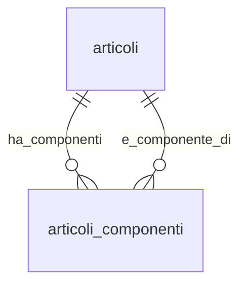

## 📘 Documentazione Concettuale – Tabella `catalogo.articoli_componenti`

> 👀 **Vedi anche**
>
> **Approfondimento Tabelle**  
> • [`catalogo.articoli`](/dbzero/catalogo/tabelle/articoli)   
> • [`catalogo.note`](/dbzero/catalogo/tabelle/note)   
> • *(opz.)* [`catalogo.unita_misura`](/dbzero/catalogo/tabelle/unita_misura)   
>
> **Approfondimento Trigger/Funzioni**   
> • [`dbops.trgfn_tx_id_managed`](/dbzero/dbops/funzioni/trgfn_tx_id_managed)   
> • [`dbops.trgfn_child_requires_active_parent`](/dbzero/dbops/funzioni/trgfn_child_requires_active_parent)   
> • [`script.trgfn_audit_data_user_generic`](/dbzero/script/funzioni/trgfn_audit_data_user_generic)   
> • [`script.trgfn_storico_generic`](/dbzero/script/funzioni/trgfn_storico_generic)  

---

### 🎯 Scopo Principale   

(latest review 13-01-26)
`catalogo.articoli_componenti` rappresenta la **distinta base (BoM)** lato **vendita**, con **versionamento temporale**: ogni riga lega un **prodotto** a un **componente** con una finestra di validità (`valido_dal`..`valido_al`).

Supporta:

* **quantità/coefficiente** per unità di prodotto (`coeff_qta`),
* **inclusione nel calcolo quantità** (`partecipa_qta`),
* **determinazione q.ta padre** (`determina_qta_padre`),
* **obbligatorietà** del componente (`obbligatorio`),
* **attivazione/disattivazione logica** (`attivo`) e **storicizzazione**.

---

### 🔗 Relazioni

| Tipo      | Tabella ↔ Campo                           | Descrizione                                                                           |
| --------- | ----------------------------------------- | ------------------------------------------------------------------------------------- |
| FK →      | `catalogo.articoli(id)` ← `prodotto_id`   | Articolo **padre** (prodotto)                                                         |
| FK →      | `catalogo.articoli(id)` ← `componente_id` | Articolo **figlio** (componente)                                                      |
| (trigger) | `catalogo.articoli`                       | Il componente e il prodotto referenziati devono essere **attivi** (guard via trigger) |

> **Nota:** `chk_articoli_componenti_no_selfref` impedisce **self‑reference** (padre=figlio).

---

### 🧱 Struttura logica (campi chiave)

* **Identità**: `id UUID` (PK)
* **Legame**: `prodotto_id UUID` (FK), `componente_id UUID` (FK)
* **Versioning**: `valido_dal DATE` (**obbligatorio**), `valido_al DATE` *(NULL = infinito)*
* **Quantità & logica**: `coeff_qta NUMERIC(18,6) ≥ 0`, `partecipa_qta BOOLEAN`, `determina_qta_padre BOOLEAN`, `obbligatorio BOOLEAN`
* **Note**: `note_target_tipo`, `note_id` (FK composita verso `catalogo.note`)
* **Meta & Audit**: `meta JSONB`, `attivo`, `storicizza`, `tx_id`, `user_*`, `data_*`

---

### 🚦 Vincoli & Regole

* **Univocità puntuale**: `UNIQUE (prodotto_id, componente_id, valido_dal)` → identifica l’**inizio versione**.
* **Date coerenti**: `valido_al IS NULL OR valido_al > valido_dal`.
* **Quantità non negative**: `coeff_qta ≥ 0`.
* **No self‑reference**: `prodotto_id <> componente_id`.
* **Nessuna sovrapposizione nel tempo** per la **stessa coppia** `(prodotto, componente)`:
  `EXCLUDE USING gist (prodotto_id WITH =, componente_id WITH =, daterange(valido_dal, COALESCE(valido_al, 'infinity'), '[]') WITH &&)`
  ➜ **richiede estensione** `btree_gist` per supportare `uuid` su GiST.
* **Parent attivi**: sia `prodotto_id` sia `componente_id` devono puntare ad articoli **attivi**.
* **Solo componente**: un articolo con `is_solo_componente=true` non può essere usato come `prodotto_id`.
* **Prodotto composito**: un articolo con `is_composito=false` non può essere usato come `prodotto_id`.

> **Nota tecnica (trigger manuali)**
>
> Questi vincoli sono **applicati tramite trigger dedicati** su `articoli_componenti`:
>
> * REQUIRE su `prodotto_id` (padre attivo)
> * REQUIRE su `componente_id` (figlio attivo)
> * GUARD su `is_composito`
>
> Non rientrano nella generazione automatica `automations` perché la tabella
> usa **due FK verso la stessa entità** (`catalogo.articoli`) con ruoli diversi
> (prodotto vs componente), e la logica richiede controlli **distinti e specifici**.

---

### 🔍 Indicizzazione

* `ix_articoli_componenti_prodotto_from_to (prodotto_id, valido_dal, valido_al)` → espansione distinta per prodotto e per data.
* `ix_articoli_componenti_componente_from_to (componente_id, valido_dal, valido_al)` → “dove è usato” il componente.
* **Exclusion** GiST per prevenire **overlap** temporali (vedi sopra) + indice `ix_articoli_componenti_no_overlap_gist`.

---


### 🔎 Query tipiche

**1) Distinta valida per una data**

```sql
SELECT ac.*
FROM catalogo.articoli_componenti ac
WHERE ac.prodotto_id = :prodotto
  AND ac.attivo = true
  AND ac.valido_dal <= :data_rif
  AND (ac.valido_al IS NULL OR ac.valido_al >= :data_rif)
ORDER BY ac.obbligatorio DESC, ac.coeff_qta DESC, ac.valido_dal DESC;
```

**2) Dove viene usato un componente (oggi)**

```sql
SELECT p.codice AS prodotto, c.codice AS componente
FROM catalogo.articoli_componenti ac
JOIN catalogo.articoli p ON p.id = ac.prodotto_id
JOIN catalogo.articoli c ON c.id = ac.componente_id
WHERE ac.componente_id = :componente
  AND ac.attivo = true
  AND ac.valido_dal <= CURRENT_DATE
  AND (ac.valido_al IS NULL OR ac.valido_al >= CURRENT_DATE)
ORDER BY p.codice;
```

**3) Diagnostica: possibili overlap (se l'estensione manca o è stata rimossa)**

```sql
SELECT ac1.id AS id1, ac2.id AS id2
FROM catalogo.articoli_componenti ac1
JOIN catalogo.articoli_componenti ac2
  ON ac1.prodotto_id = ac2.prodotto_id
 AND ac1.componente_id = ac2.componente_id
 AND ac1.id <> ac2.id
 AND daterange(ac1.valido_dal, COALESCE(ac1.valido_al, 'infinity'), '[]') &&
     daterange(ac2.valido_dal, COALESCE(ac2.valido_al, 'infinity'), '[]');
```

---

### 🧭 Best practice

* **Versioning esplicito**: apri una **nuova riga** con nuovo `valido_dal` per variare `coeff_qta` o altri attributi; **non** aggiornare in‑place se vuoi tracciare la storia.
* **Controlli applicativi**: impedisci componenti su articoli che **non sono** `is_composito=true` (vincolo applicativo opzionale).
* **Chiusure automatiche**: se vuoi evitare “open‑ended” duplicati, implementa una procedura che chiude la riga precedente (imposta `valido_al`) quando inserisci una nuova versione.
* **Estensione `btree_gist`**: assicurati che sia installata (`CREATE EXTENSION IF NOT EXISTS btree_gist;`).
* **Storicizza** le modifiche e usa `attivo=false` per dismissioni logiche.

---

### 🧩 Esempio realistico (distinta base)

Esempio: prodotto **SEDIA** con componenti **piedi**, **schienale**, **sedile**, **viti**.

In `catalogo.articoli` esistono:

* `SEDIA` (prodotto finito)
* `PIEDE_SX`, `PIEDE_DX`, `PIEDE_POST_SX`, `PIEDE_POST_DX`
* `SCHIENALE`
* `SEDILE`
* `VITE_M6`

In `catalogo.articoli_componenti` avrai una riga per ciascun componente:

* `prodotto_id = SEDIA`, `componente_id = PIEDE_SX`, `coeff_qta = 1`
* `prodotto_id = SEDIA`, `componente_id = PIEDE_DX`, `coeff_qta = 1`
* `prodotto_id = SEDIA`, `componente_id = PIEDE_POST_SX`, `coeff_qta = 1`
* `prodotto_id = SEDIA`, `componente_id = PIEDE_POST_DX`, `coeff_qta = 1`
* `prodotto_id = SEDIA`, `componente_id = SCHIENALE`, `coeff_qta = 1`
* `prodotto_id = SEDIA`, `componente_id = SEDILE`, `coeff_qta = 1`
* `prodotto_id = SEDIA`, `componente_id = VITE_M6`, `coeff_qta = 8`

---

### 🧩 Esempio realistico (utility gas)

Esempio: prodotto **GAS_FACILE** composto da **MATERIA_PRIMA**, **QVD** e **SPREAD**.

In `catalogo.articoli` esistono:

* `GAS_FACILE` (prodotto/servizio finale)
* `MATERIA_PRIMA`
* `QVD`
* `SPREAD`

In `catalogo.articoli_componenti` avrai una riga per ciascun componente:

* `prodotto_id = GAS_FACILE`, `componente_id = MATERIA_PRIMA`, `coeff_qta = 1`
* `prodotto_id = GAS_FACILE`, `componente_id = QVD`, `coeff_qta = 1`
* `prodotto_id = GAS_FACILE`, `componente_id = SPREAD`, `coeff_qta = 1`

---

### 🕒 Esempio utilizzo temporale

Se la composizione cambia nel tempo, si inserisce **una nuova riga** con un nuovo
`valido_dal` e si chiude la precedente con `valido_al`.

Esempio: la quota **SPREAD** aumenta dal 2026-03-01.

* Versione attuale:
  * `prodotto_id = GAS_FACILE`, `componente_id = SPREAD`, `coeff_qta = 1`, `valido_dal = 2026-01-01`, `valido_al = 2026-02-28`
* Nuova versione:
  * `prodotto_id = GAS_FACILE`, `componente_id = SPREAD`, `coeff_qta = 1.2`, `valido_dal = 2026-03-01`, `valido_al = NULL`

---

### Diagramma ER relazioni (focus BoM)


---



---
