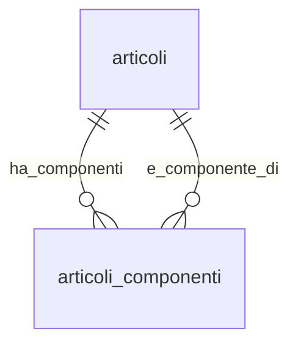

## 📘 Documentazione Concettuale – Tabella `catalogo.articoli_componenti`

> 👀 **Vedi anche**
>
> **Approfondimento Tabelle**
> • [`catalogo.articoli`](/dbzero/catalogo/tabelle/articoli)
> • *(opz.)* [`catalogo.unita_misura`](/dbzero/catalogo/tabelle/unita_misura)
>
> **Approfondimento Trigger/Funzioni**
> • [`dbops.trgfn_tx_id_managed`](/dbzero/dbops/funzioni/trgfn_tx_id_managed)
> • [`dbops.trgfn_child_requires_active_parent`](/dbzero/dbops/funzioni/trgfn_child_requires_active_parent)
> • [`script.trgfn_upd_audit_data_user_generic`](/dbzero/script/funzioni/trgfn_upd_audit_data_user_generic)
> • [`script.trgfn_upd_dlt_storico_generic`](/dbzero/script/funzioni/trgfn_upd_dlt_storico_generic)

---

### 🎯 Scopo Principale

`catalogo.articoli_componenti` rappresenta la **distinta base (BoM)** lato **vendita**, con **versionamento temporale**: ogni riga lega un **prodotto** a un **componente** con una finestra di validità (`valid_from`..`valid_to`).

Supporta:

* **quantità/coefficiente** per unità di prodotto (`coeff_qta`),
* **inclusione nel calcolo quantità** (`partecipa_qta`),
* **obbligatorietà** del componente (`obbligatorio`),
* **attivazione/disattivazione logica** (`attivo`) e **storicizzazione**.

---

### 🔗 Relazioni

| Tipo      | Tabella ↔ Campo                           | Descrizione                                                                           |
| --------- | ----------------------------------------- | ------------------------------------------------------------------------------------- |
| FK →      | `catalogo.articoli(id)` ← `prodotto_id`   | Articolo **padre** (prodotto)                                                         |
| FK →      | `catalogo.articoli(id)` ← `componente_id` | Articolo **figlio** (componente)                                                      |
| (trigger) | `catalogo.articoli`                       | Il componente e il prodotto referenziati devono essere **attivi** (guard via trigger) |

> **Nota:** `chk_articoli_componenti_no_selfref` impedisce **self‑reference** (padre=figlio).

---

### 🧱 Struttura logica (campi chiave)

* **Identità**: `id UUID` (PK)
* **Legame**: `prodotto_id UUID` (FK), `componente_id UUID` (FK)
* **Versioning**: `valid_from DATE` (**obbligatorio**), `valid_to DATE` *(NULL = infinito)*
* **Quantità & logica**: `coeff_qta NUMERIC(18,6) ≥ 0`, `partecipa_qta BOOLEAN`, `obbligatorio BOOLEAN`
* **Meta & Audit**: `meta JSONB`, `attivo`, `storicizza`, `tx_id`, `user_*`, `data_*`

---

### 🚦 Vincoli & Regole

* **Univocità puntuale**: `UNIQUE (prodotto_id, componente_id, valid_from)` → identifica l’**inizio versione**.
* **Date coerenti**: `valid_to IS NULL OR valid_to > valid_from`.
* **Quantità non negative**: `coeff_qta ≥ 0`.
* **No self‑reference**: `prodotto_id <> componente_id`.
* **Nessuna sovrapposizione nel tempo** per la **stessa coppia** `(prodotto, componente)`:
  `EXCLUDE USING gist (prodotto_id WITH =, componente_id WITH =, daterange(valid_from, COALESCE(valid_to, 'infinity'), '[]') WITH &&)`
  ➜ **richiede estensione** `btree_gist` per supportare `uuid` su GiST.
* **Parent attivi** (via trigger **deferrable**): sia `prodotto_id` sia `componente_id` devono puntare ad articoli **attivi**.

---

### 🔍 Indicizzazione

* `ix_articoli_componenti_prodotto_from_to (prodotto_id, valid_from, valid_to)` → espansione distinta per prodotto e per data.
* `ix_articoli_componenti_componente_from_to (componente_id, valid_from, valid_to)` → “dove è usato” il componente.
* **Exclusion** GiST per prevenire **overlap** temporali (vedi sopra).

---

### ⚙️ Trigger e Funzioni coinvolte

| Nome                                                              | Tipo                                                  | Scopo                                   |
| ----------------------------------------------------------------- | ----------------------------------------------------- | --------------------------------------- |
| `trg_articoli_componenti_ins_upd_gen_tx_id`                       | BEFORE INS/UPD                                        | Assegna `tx_id` se nullo                |
| `trg_chk_articoli_componenti_parent_fk_articoli_component_388af3` | AFTER INS/UPD OF `prodotto_id, attivo` (DEFERRABLE)   | Impone **articolo padre attivo**        |
| `trg_chk_articoli_componenti_parent_fk_articoli_component_86ae92` | AFTER INS/UPD OF `componente_id, attivo` (DEFERRABLE) | Impone **componente attivo**            |
| `trg_upd_articoli_componenti_audit_data_user`                     | BEFORE UPDATE                                         | Aggiorna `data_update`/`user_update`    |
| `trg_z90_articoli_componenti_upd_dlt_storico`                     | BEFORE UPDATE/DELETE                                  | Snapshot storico (se `storicizza=true`) |

---

### 🔎 Query tipiche

**1) Distinta valida per una data**

```sql
SELECT ac.*
FROM catalogo.articoli_componenti ac
WHERE ac.prodotto_id = :prodotto
  AND ac.attivo = true
  AND ac.valid_from <= :data_rif
  AND (ac.valid_to IS NULL OR ac.valid_to >= :data_rif)
ORDER BY ac.obbligatorio DESC, ac.coeff_qta DESC, ac.valid_from DESC;
```

**2) Dove viene usato un componente (oggi)**

```sql
SELECT p.codice AS prodotto, c.codice AS componente
FROM catalogo.articoli_componenti ac
JOIN catalogo.articoli p ON p.id = ac.prodotto_id
JOIN catalogo.articoli c ON c.id = ac.componente_id
WHERE ac.componente_id = :componente
  AND ac.attivo = true
  AND ac.valid_from <= CURRENT_DATE
  AND (ac.valid_to IS NULL OR ac.valid_to >= CURRENT_DATE)
ORDER BY p.codice;
```

**3) Diagnostica: possibili overlap (se l'estensione manca o è stata rimossa)**

```sql
SELECT ac1.id AS id1, ac2.id AS id2
FROM catalogo.articoli_componenti ac1
JOIN catalogo.articoli_componenti ac2
  ON ac1.prodotto_id = ac2.prodotto_id
 AND ac1.componente_id = ac2.componente_id
 AND ac1.id <> ac2.id
 AND daterange(ac1.valid_from, COALESCE(ac1.valid_to, 'infinity'), '[]') &&
     daterange(ac2.valid_from, COALESCE(ac2.valid_to, 'infinity'), '[]');
```

---

### 🧭 Best practice

* **Versioning esplicito**: apri una **nuova riga** con nuovo `valid_from` per variare `coeff_qta` o altri attributi; **non** aggiornare in‑place se vuoi tracciare la storia.
* **Controlli applicativi**: impedisci componenti su articoli che **non sono** `is_composito=true` (vincolo applicativo opzionale).
* **Chiusure automatiche**: se vuoi evitare “open‑ended” duplicati, implementa una procedura che chiude la riga precedente (imposta `valid_to`) quando inserisci una nuova versione.
* **Estensione `btree_gist`**: assicurati che sia installata (`CREATE EXTENSION IF NOT EXISTS btree_gist;`).
* **Storicizza** le modifiche e usa `attivo=false` per dismissioni logiche.

---

### Diagramma ER relazioni (focus BoM)


---



---