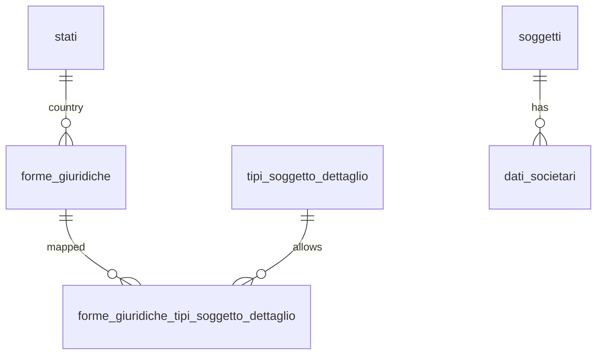

## 📘 Documentazione Concettuale – Tabella `config.forme_giuridiche`

> 👀 **Vedi anche**
>
> Guide:
>
> * [Soggetti & Tipologie](/guide/soggetti-e-ruoli-anagrafici)    
>
> Approfondimento Tabelle:
>
> * [config.stati](/dbzero/config/tabelle/stati)   
> * [config.tipi_soggetto_dettaglio](/dbzero/config/tabelle/tipi_soggetto_dettaglio)   
> * [config.forme_giuridiche_tipi_soggetto_dettaglio](/dbzero/config/tabelle/forme_giuridiche_tipi_soggetto_dettaglio)   
> * [anagrafiche.dati_societari](/dbzero/anagrafiche/tabelle/dati_societari)   
>
> Approfondimento funzioni/trigger:
>
> * [script.trgfn_sync_stato_iso2](/dbzero/script/funzioni/trgfn_sync_stato_iso2)   
> * [script.trgfn_audit_data_user_generic](/dbzero/script/funzioni/trgfn_audit_data_user_generic)   
> * [dbops.trgfn_tx_id_managed](/dbzero/dbops/funzioni/trgfn_tx_id_managed)   

---

### 🎯 Scopo Principale

(latest review 21-12-25)

La tabella **`config.forme_giuridiche`** è una **tabella di dominio** che definisce l’elenco delle **forme giuridiche** (es. SRL, SPA, SNC, SAS, …) in modo:

* **canonico** (codici consistenti, non testuali “liberi”),
* **internazionalizzabile** (valori per-paese),
* **governabile** tramite **policy di dominio** (es. REA e capitale sociale),
* **versionabile** e tracciabile con audit/tx_id.

Questa tabella consente di evitare incoerenze tipiche dei campi testo (SRL / S.R.L. / Srl, ecc.) e rende deterministiche le validazioni e la reportistica.

---

### 🧩 Ruolo nel Modello Dati

`config.forme_giuridiche` si colloca nel blocco **config/lookup**, e viene usata per:

* **popolare UI/servizi** con un elenco valido e controllato di forme giuridiche;
* supportare la **matrice di compatibilità** con i tipi soggetto (`config.forme_giuridiche_tipi_soggetto_dettaglio`);
* guidare la gestione dei **dati societari** (tabella operativa `anagrafiche.dati_societari`) attraverso policy di dominio.

---

### 🧱 Struttura – Attributi principali

| Colonna                   | Tipo         | Obblig. | Descrizione sintetica                                     |          |            |
| ------------------------- | ------------ | ------- | --------------------------------------------------------- | -------- | ---------- |
| `id`                      | bigint       | Sì      | PK tecnica (identity).                                    |          |            |
| `stato_iso2`              | varchar(2)   | Sì      | Codice ISO2 paese (internazionalizzazione).               |          |            |
| `stato_id`                | bigint       | No      | FK → `config.stati.id` (utile per sync/stabilità).        |          |            |
| `codice`                  | varchar(20)  | Sì      | Codice canonico forma giuridica (per-paese).              |          |            |
| `descrizione`             | varchar(150) | Sì      | Descrizione base.                                         |          |            |
| `descrizione_en`          | varchar(150) | No      | Descrizione in inglese (opzionale).                       |          |            |
| `rea_policy`              | text         | Sì      | Policy REA: `NONE                                         | OPTIONAL | REQUIRED`. |
| `capitale_sociale_policy` | text         | Sì      | Policy capitale sociale: `NONE                            | OPTIONAL | REQUIRED`. |
| `attivo`                  | boolean      | Sì      | Abilitazione logica.                                      |          |            |
| `meta`                    | jsonb        | Sì      | Metadati estendibili (alias, note, mapping legacy, ecc.). |          |            |
| `tx_id`                   | uuid         | No      | Transaction id (framework audit).                         |          |            |
| `user_insert/update`      | text         | Sì/No   | Audit utente.                                             |          |            |
| `data_insert/update`      | timestamptz  | Sì/No   | Audit temporale.                                          |          |            |
| `storicizza`              | boolean      | Sì      | Flag framework storico (se attivato).                     |          |            |

---

### ✅ Vincoli principali

* **Unicità per-paese**

  * `UNIQUE (stato_iso2, codice)`
  * garantisce che un codice (es. `SRL`) sia univoco nel contesto del paese.

* **Integrità referenziale**

  * `FK (stato_id) → config.stati(id)`

* **Policy validate**

  * `CHECK rea_policy IN ('NONE','OPTIONAL','REQUIRED')`
  * `CHECK capitale_sociale_policy IN ('NONE','OPTIONAL','REQUIRED')`

---

### ⚙️ Regole operative (concettuali)

 **1️⃣ Internazionalizzazione: `stato_id` + `stato_iso2`**

Il modello prevede sia:

* `stato_id` (FK stabile e normalizzata)
* `stato_iso2` (dato comodo e leggibile)

Con un trigger di sync (come già avviene su `config.tipi_soggetto_dettaglio`), `stato_iso2` può essere mantenuto coerente rispetto a `stato_id`.

> 📌 Scopo: evitare dati incoerenti e supportare import/migrazioni per-paese.

---

 **2️⃣ Policy REA / Capitale sociale**

Queste policy non sono “dati operativi”, ma **regole di dominio** associabili alla forma giuridica.

Esempi concettuali:

* `rea_policy = REQUIRED` → per quella forma giuridica, i dati REA sono attesi/obbligatori (validazione a livello servizi/trigger in tabelle operative).
* `capitale_sociale_policy = OPTIONAL/REQUIRED` → abilita/impone l’uso del capitale sociale nei dati societari.

> 📌 Nota: la tabella non contiene SDI/PEC per scelta progettuale (evita sovrapposizioni e mantiene il dominio pulito).

---

### 🔗 Collegamenti con altre tabelle

* **`config.forme_giuridiche_tipi_soggetto_dettaglio`**
  Matrice che dice **quali forme giuridiche sono compatibili** con un certo tipo soggetto dettaglio (SC/SP/DI/ENC…).

* **`config.tipi_soggetto_dettaglio`**
  Definisce i tipi soggetto per paese e le policy generali (`dati_societari_policy`). La forma giuridica si integra tramite matrice.

* **`anagrafiche.dati_societari`**
  Tabella operativa che contiene i dati aziendali estesi: in fase di refactor la forma giuridica sarà referenziata tramite FK (non più testo libero).

---

### 💡 Vantaggi Operativi

* **Qualità dati**: elimina varianti testuali e ambiguità.
* **Validazioni deterministiche**: policy di dominio consultabili dal DB/app.
* **Internazionalizzazione “ready”**: struttura per-paese senza complicare subito.
* **Evolvibilità**: meta JSONB per gestire mapping legacy, alias, note.

---

### 📌 Diagramma ER relazioni (concettuale)

---

> 🧠 **“`config.forme_giuridiche` è il dizionario canonico e per‑paese delle forme giuridiche: abilita qualità dati e regole di dominio (REA/capitale) senza hardcoding.”**


