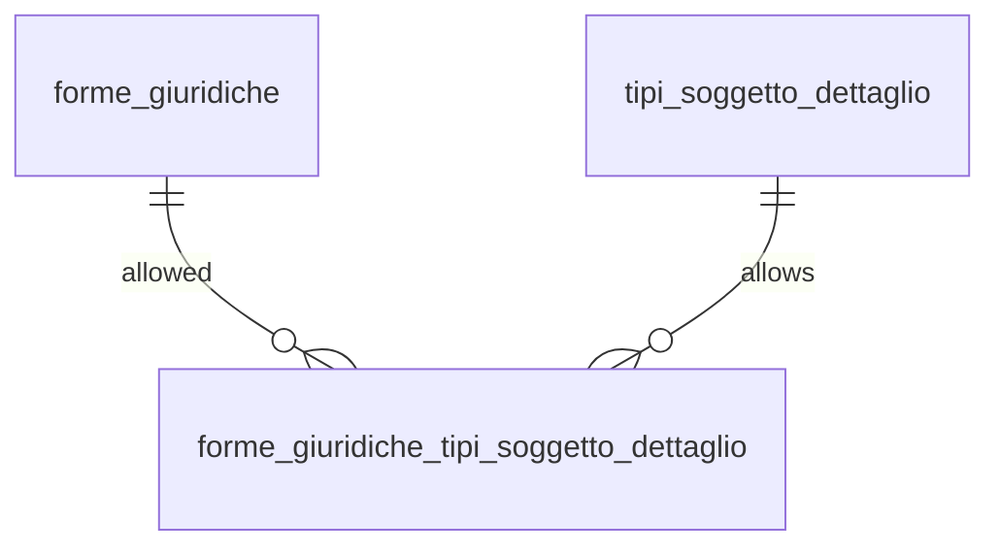

## 📘 Documentazione Concettuale – Tabella `config.forme_giuridiche_tipi_soggetto_dettaglio`

> 👀 **Vedi anche**
>
Approfondimento Tabelle:
>
[config.forme_giuridiche](/dbzero/config/tabelle/forme_giuridiche)   
> [config.tipi_soggetto_dettaglio](/dbzero/config/tabelle/tipi_soggetto_dettaglio)   
> [anagrafiche.dati_societari](/dbzero/anagrafiche/tabelle/dati_societari)   
>

🎯 Scopo Principale

(latest review 21-12-25)
La tabella **`config.forme_giuridiche_tipi_soggetto_dettaglio`** è una **matrice di configurazione** (Strada **B**) che definisce:

* **quali forme giuridiche** sono **ammissibili** per ciascun **tipo soggetto dettaglio** (per paese),
* con possibilità di gestire:

  * **attivazione logica** (`attivo`)
  * **validità temporale** (`valido_dal`, `valido_al`).

In pratica, è il punto in cui dichiari:

> “Per questo `tipo_soggetto_dettaglio` (es. IT/SC), queste forme giuridiche sono permesse; le altre no.”

Questa matrice evita regole hardcoded nei trigger e rende le compatibilità **configurabili e versionabili**.

---

### Ruolo nel Modello Dati

Nel modello Zero ERP:

* `config.tipi_soggetto_dettaglio` definisce **tipi soggetto** per paese e policy generali (es. `dati_societari_policy`).
* `config.forme_giuridiche` definisce il dizionario canonico delle **forme giuridiche** (per paese) e policy di dominio (REA/capitale).
* **`config.forme_giuridiche_tipi_soggetto_dettaglio`** collega i due mondi e stabilisce la **compatibilità**.

Questa tabella è utile per:

* controlli DB (trigger guard su tabelle operative, quando introdotti),
* validazioni applicative (UI/API),
* import/migrazioni (mappature controllate).

---

### Struttura – Attributi principali

| Colonna                      | Tipo        | Obblig. | Descrizione sintetica                                     |
| ---------------------------- | ----------- | ------- | --------------------------------------------------------- |
| `forma_giuridica_id`         | bigint      | Sì      | FK → `config.forme_giuridiche.id`.                        |
| `tipo_soggetto_dettaglio_id` | bigint      | Sì      | FK → `config.tipi_soggetto_dettaglio.id`.                 |
| `attivo`                     | boolean     | Sì      | Abilitazione logica dell’associazione.                    |
| `valido_dal` / `valido_al`   | date        | No      | Finestra temporale di validità (versioning).              |
| `meta`                       | jsonb       | Sì      | Metadati estendibili (note, mapping legacy, motivazioni). |
| `tx_id`                      | uuid        | No      | Transaction ID (audit/log).                               |
| `user_insert/update`         | text        | Sì/No   | Audit utente.                                             |
| `data_insert/update`         | timestamptz | Sì/No   | Audit temporale.                                          |
| `storicizza`                 | boolean     | Sì      | Flag framework storico (se attivato).                     |

---

### Vincoli principali

* **PK composta (tabella ponte)**

  * `PRIMARY KEY (forma_giuridica_id, tipo_soggetto_dettaglio_id)`
  * garantisce che una combinazione sia definita una sola volta.

* **Integrità referenziale**

  * `FK (forma_giuridica_id) → config.forme_giuridiche(id)`
  * `FK (tipo_soggetto_dettaglio_id) → config.tipi_soggetto_dettaglio(id)`

* **Validità temporale coerente**

  * `CHECK (valido_dal IS NULL OR valido_al IS NULL OR valido_al >= valido_dal)`

---

### Regole di Funzionamento (concettuali)

 **1️⃣ Matrice presente = vincolo attivo**

Quando viene introdotta una logica di validazione (DB o applicativa), la regola tipica è:

* se per un certo `tipo_soggetto_dettaglio` esistono righe attive nella matrice,
  allora **solo quelle forme giuridiche** sono ammesse.

La matrice si valuta filtrando tipicamente per:

* `attivo = TRUE`
* finestra temporale valida (se gestita):

  * `valido_dal <= CURRENT_DATE` (se non NULL)
  * `valido_al >= CURRENT_DATE` (se non NULL)

---

 **2️⃣ Matrice assente = policy “libero” (opzionale)**

A seconda della scelta progettuale, è possibile adottare la stessa logica usata in altre matrici Zero ERP:

* **se non esiste alcuna riga**, il sistema può considerare il dominio **libero** (non vincolato).

> Questa policy è una decisione di sistema: se vuoi evitare combinazioni casuali, puoi scegliere “matrice obbligatoria” per certi paesi.

---

### Esempi d’Uso (concettuali)

 **✔ IT – Società di capitali (SC)**

`tipo_soggetto_dettaglio` = IT/SC

* Ammesse: SRL, SPA, SRLS, SAPA, …
* Non ammesse: SNC, SAS (che tipicamente saranno su IT/SP)

 **✔ IT – Società di persone (SP)**

`tipo_soggetto_dettaglio` = IT/SP

* Ammesse: SNC, SAS, …
* Non ammesse: SPA

 **✔ IT – Ente non commerciale (ENC)**

* Ammesse: associazione, fondazione, ente…

---

### Vantaggi Operativi

* **Configurazione e versioning**: regole come dati, non codice.
* **Coerenza cross-sistema**: DB e applicazione leggono la stessa matrice.
* **Internazionalizzazione**: il `tipo_soggetto_dettaglio` è per‑paese, la matrice resta coerente.
* **Migrazioni guidate**: `meta` può contenere mapping legacy e note operative.

---

### Diagramma ER relazioni (concettuale)

---

> **“`config.forme_giuridiche_tipi_soggetto_dettaglio` è la matrice che governa la compatibilità tra tipologie soggetto (per paese) e forme giuridiche, rendendo le regole configurabili, tracciabili e versionabili.”**


