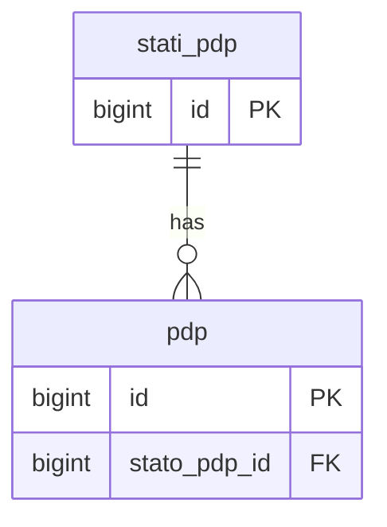
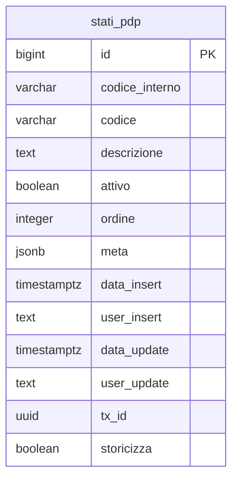

## 📘 Documentazione Concettuale – Tabella `config.stati_pdp`

> 👀 **Vedi anche**
>
Approfondimento Tabelle:
>
[config.stati_cliente](/dbzero/config/tabelle/stati_cliente)
> [anagrafiche.pdp](/dbzero/anagrafiche/tabelle/pdp)
>
Approfondimento funzioni/trigger:
>
[dbops.trgfn_tx_id_managed](/dbzero/dbops/funzioni/trgfn_tx_id_managed)
> [script.trgfn_storico_generic](/dbzero/script/funzioni/trgfn_storico_generic)

La tabella **`config.stati_pdp`** definisce il **dominio degli stati tecnici** applicabili ai **punti di prelievo (PDP)**, separando in modo chiaro lo **stato fisico/tecnico del punto** dallo **stato commerciale del cliente** (`config.stati_cliente`).

È il riferimento unico per determinare se un PDP è tecnicamente:

* pronto per essere assegnato a un cliente,
* attualmente in erogazione,
* temporaneamente disattivato per interventi tecnici,
* definitivamente dismesso.

---
### 🎯 Scopo Principale
* **Dominio degli stati tecnici del PDP**
  Fornisce il catalogo centralizzato degli stati tecnici ammessi per i punti di prelievo, utilizzato da `anagrafiche.pdp.stato_pdp_id`.

* **Separazione tra stato tecnico e stato commerciale**
  Mantiene distinto lo **stato tecnico** del punto (infrastruttura) dallo **stato commerciale** del cliente (`config.stati_cliente`), evitando duplicazioni e incoerenze.

* **Supporto a logiche di processo e integrazioni**
  Il campo `meta` (JSONB) permette di estendere ogni stato con metadati, mapping verso codici esterni (es. distributore, sistemi tecnici) o flag specifici di dominio.

* **Gestione ordinata in UI**
  I campi `attivo` e `ordine` consentono di controllare facilmente quali stati siano selezionabili e in quale sequenza mostrarli nelle interfacce applicative.

---

### Stati Tecnici Attualmente Definiti

Gli stati iniziali inseriti in `config.stati_pdp` recepiscono le decisioni architetturali su **come modellare il ciclo di vita tecnico di un PDP**, distinguendolo chiaramente dagli aspetti commerciali.

Di seguito il significato **funzionale** di ciascuno stato:

#### 1️⃣ `DISP` / `DISPONIBILE`

> **Punto tecnicamente presente e utilizzabile, attualmente senza cliente attivo associato.**

* L'infrastruttura (derivazione/contatore/attacco) è presente e tecnicamente funzionante.
* Nessun cliente risulta **attivo** su quel PDP nel periodo corrente.
* È lo stato naturale di un PDP **dopo una cessazione commerciale** quando il punto resta fisicamente disponibile per nuove attivazioni.

Uso tipico:

* fine contratto → cliente chiuso, ma PDP ancora presente → `stato_pdp = DISPONIBILE`.

---

#### 2️⃣ `ATT` / `ATTIVO`

> **Punto fisicamente in servizio, con almeno un cliente attivo associato.**

* Il PDP è tecnicamente alimentato/abilitato all'erogazione.
* Esiste almeno un record in `anagrafiche.clienti` collegato a quel `pdp_id` con **stato cliente attivo**.
* Rappresenta la condizione “normale” di esercizio del punto durante la vita di una fornitura attiva.

Uso tipico:

* nuova attivazione o subentro → creazione cliente attivo collegato al PDP → `stato_pdp = ATTIVO`.

---

#### 3️⃣ `DTEC` / `DISATTIVO_TECNICO`

> **Punto tecnicamente staccato, ma ancora esistente come infrastruttura.**

Esempi:

* sospensione per lavori programmati,
* stacco tecnico conseguente a morosità,
* chiusura valvola/sigillo senza rimozione del punto.

Caratteristiche:

* Il PDP fisicamente esiste ma **non eroga**.
* Dal punto di vista commerciale il cliente può essere in stato di **sospensione** o situazioni analoghe; la componente tecnica viene esplicitata qui.
* Lo stato è pensato come **temporaneo**, con possibilità di ritorno a `ATTIVO` o di transizione a cessazione definitiva.

Uso tipico:

* intervento tecnico di stacco/riattacco:

  * stacco → `DISATTIVO_TECNICO`
  * riattivazione → torna `ATTIVO`.

---

#### 4️⃣ `DISM` / `DISMESSO`

> **Punto dismesso o non più utilizzabile: infrastruttura rimossa o rete non più attiva.**

* Rappresenta lo **stato finale** di un PDP che non può più essere utilizzato per future attivazioni senza interventi infrastrutturali significativi.
* Tipici scenari:

  * derivazione rimossa,
  * tratta di rete dismessa,
  * punto fisico definitivamente eliminato.
* In questo stato non ha senso creare nuovi clienti o istanze collegate al PDP.

Uso tipico:

* dopo chiusura definitiva e rimozione punto → il PDP viene marcato `DISMESSO` e rimane solo a scopo storico/di tracciamento.

---

### Collegamenti con Altre Tabelle

* **`anagrafiche.pdp`**
  Il campo `stato_pdp_id` è una FK verso `config.stati_pdp.id` e rappresenta lo **stato tecnico corrente** del punto di prelievo. A livello di dominio:

  * gli eventi sul cliente (`anagrafiche.clienti`) possono suggerire transizioni di stato (es. attivazione → `ATTIVO`, cessazione → `DISPONIBILE`),
  * eventuali processi tecnici (lavori, dismissioni) aggiornano il PDP in `DISATTIVO_TECNICO` o `DISMESSO`.

* **`config.stati_cliente`**
  Contiene gli **stati commerciali** dei clienti (attivo, sospeso, chiuso, ecc.). La separazione tra questo dominio e `config.stati_pdp` evita ambiguità tra **stato del contratto** e **stato fisico del punto**.

* **`dbops.trgfn_tx_id_managed` / `script.trgfn_storico_generic`**
  Tramite i campi `tx_id` e `storicizza` la tabella può essere integrata nei meccanismi generici di audit e storicizzazione, in modo coerente con il resto del modello Zero ERP.

---

### Vantaggi Operativi

* **Chiarezza architetturale**
  Uno stato tecnico unico e centralizzato per i PDP evita conflitti e duplicazioni con gli stati cliente.

* **Supporto a processi misti tecnico–commerciali**
  Le applicazioni possono combinare:

  * `stato_cliente` (commerciale), e
  * `stato_pdp` (tecnico),
    per ottenere una vista completa della fornitura (es. cliente attivo ma PDP disattivo per lavori).

* **Estendibilità controllata**
  Nuovi stati tecnici (se necessari in futuro) possono essere aggiunti in `config.stati_pdp` senza impatti strutturali sulle tabelle operative.

* **Coerenza con gli standard Zero ERP**
  Audit (`data_insert`, `user_insert`, `data_update`, `user_update`), `tx_id` e `storicizza` allineano la tabella alle best practice già adottate per gli altri cataloghi di dominio.

---

### Diagramma ER relazioni

---

### Diagramma ER attributi

---



---
