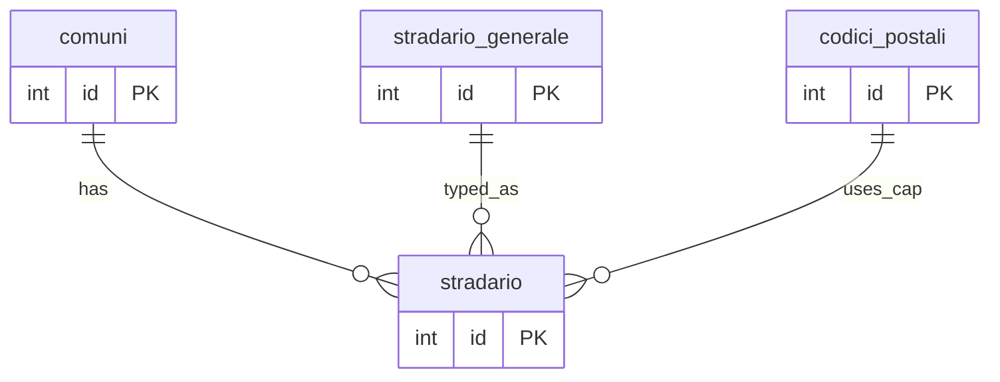
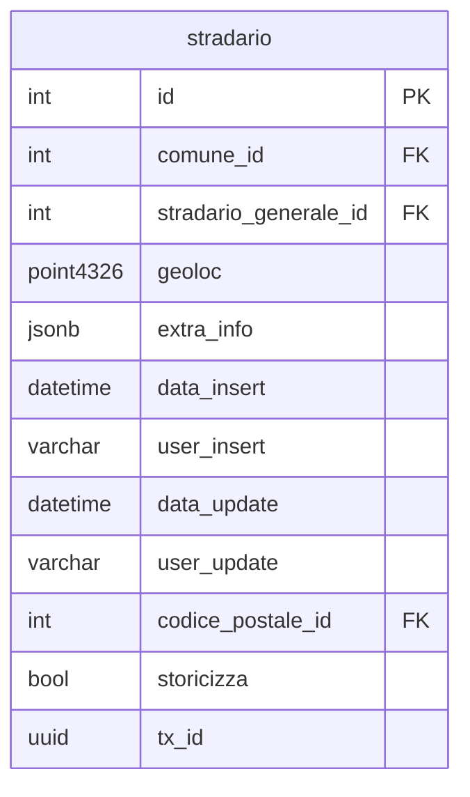

## 📘 Documentazione Concettuale – Tabella `config.stradario`

>  👀 **Vedi anche** 
>
> Approfondimento Tabelle:  
>
> * [config.comuni](/dbzero/config/tabelle/comuni)      
> * [config.stradario_generale](/dbzero/config/tabelle/stradario_generale)   
> * [config.codici_postali](/dbzero/config/tabelle/codici_postali)  
> * [storico.stradario](/dbzero/storico/tabelle/stradario)
> 
> Approfondimento funzioni:    
>
>* [script.trgfn_storico_generic](/dbzero/script/funzioni/trgfn_storico_generic)   
 * [dbops.trgfn_tx_id_managed](/dbzero/dbops/funzioni/trgfn_tx_id_managed)   

La tabella **`config.stradario`** definisce la mappa delle vie e strade di ciascun comune, completando il processo di indirizzamento con informazioni di localizzazione e dettagli aggiuntivi.

---

### 🎯 Scopo Principale
(latest revision 06-12-25)
* **Mappa comunale delle vie**
  Contiene l’elenco delle strade e vie di ogni comune, con riferimento al prefisso e al nome forniti da `config.stradario_generale`.
* **Geolocalizzazione**
  Il campo `geoloc` (geometry Point, SRID 4326) consente di associare ogni via a coordinate geografiche per mappe e ricerche spaziali.
* **Associazione CAP**
  Collega ogni via a un codice postale obbligatorio (`codice_postale_id`), gestito nella tabella `config.codici_postali`.
* **Informazioni estese**
  Il campo `extra_info` (JSONB) permette di memorizzare dati aggiuntivi, come eventuali frazioni, indicazioni o note specifiche.
* **Storicizzazione**
  Il campo `storicizza` se true attiva il trigger per la storicizzazione delle informazioni sulla tabella `storico.stradario`. Il front-end dovrà sempre impostare a true il valore, solo per funzioni administrator si potrà non gestire a true.
  
---

### 🔗 Collegamenti con Altre Tabelle

* **`config.comuni`**
  Il campo `comune_id` identifica il comune di appartenenza, instaurando la relazione tra strade e territorio.
* **`config.stradario_generale`**
  Il campo `via_id` fa riferimento al catalogo neutro di prefissi e nomi delle vie.
* **`config.codici_postali`**
  `codice_postale_id` impone il CAP di competenza per ciascuna via.
* **`storico.stradario`**
  `storico` True attiva il trigger per il salvataggio delle informazioni.
---

### 💡 Vantaggi Operativi

* **Copertura completa del territorio**
  Permette di mappare ogni strada all’interno del comune, gestendo situazioni di vie duplicate con CAP diversi.
* **Supporto GIS**
  Grazie al campo di geometria, rende disponibili servizi di geocoding, routing e rappresentazione cartografica.
* **Flessibilità di estensione**
  Il JSONB `extra_info` consente di aggiungere attributi specifici (es. frazioni, note storiche) senza modificare lo schema.
* **Auditing e storicizzazione**
  Trigger automatici mantengono traccia di modifiche e cancellazioni, garantendo consistenza storica dei dati.

---

> 🧠 **"Una vista dettagliata e georeferenziata delle strade comunali, con CAP obbligatorio e informazioni flessibili per ogni via."**

---

###  Diagramma ER relazioni 

---

###  Diagramma ER attributi

---


---