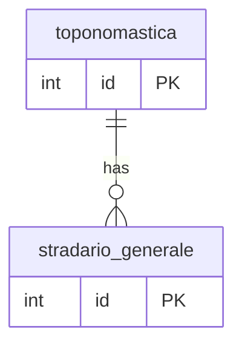

## 📘 Documentazione Concettuale – Tabella `config.stradario_generale`

>  👀 **Vedi anche** 
>
> Approfondimento Tabelle:  
>
> * [config.stradario](/dbzero/config/tabelle/stradario)      
> * [config.toponomastica](/dbzero/config/tabelle/toponomastica) 
>
> Approfondimento funzione:   
>
> * [config.trgfn_stradario_generale_protect_update](/dbzero/config/funzioni/trgfn_stradario_generale_protect_update)   
> * [config.trgfn_stradario_generale_normalize](/dbzero/config/funzioni/trgfn_stradario_generale_normalize)   

La tabella **`config.stradario_generale`** elenca i nomi delle vie, strade e piazze, associandoli ai tipi di toponimo definiti in **`config.toponomastica`**. Agisce come base indipendente dalla localizzazione geografica: per ottenere l’indirizzo completo e posizionarlo su un comune specifico, si collega alla tabella **`config.stradario`**.

---

### 🎯 Scopo Principale

(latest review 30-12-25) 
* **Composizione del toponimo**
  Unisce il prefisso toponomastico (es. `VIA`, `PIAZZA`) al nome specifico (es. `Garibaldi`, `Roma`) per formare la descrizione completa.
* **Indipendenza geografica**
  Mantiene un catalogo centralizzato dei nomi senza riferimenti a comuni o aree, favorendo il riuso e la coerenza.
* **Integrazione con stradario locale**
  Collegata a **`config.stradario`**, che associa ogni record di **`stradario_generale`** al comune di appartenenza, consentendo la geolocalizzazione e l’uso nei processi di indirizzamento.

---

### 💡 Vantaggi Operativi

* **Standardizzazione dei nomi**
  Assicura che tutte le vie e piazze abbiano una descrizione uniforme, evitando varianti e duplicazioni.
* **Flessibilità di utilizzo**
  Essendo indipendente dal territorio, lo stesso nome può essere utilizzato in comuni diversi, collegando poi ciascuna occorrenza a un’area specifica.
* **Manutenzione semplificata**
  Aggiornamenti e aggiunte di nuovi nomi avvengono in un unico luogo, propagandosi a tutti i dataset di indirizzi.

---

### 🧩 Nota su manutenzione toponomastica

Se un toponimo viene corretto, la policy prevede **nuova riga** in `config.toponomastica` e riallineamento dei record di `config.stradario_generale` interessati.  
Il riallineamento forza la rigenerazione di `indirizzo_normalizzato`, mantenendo coerente il prefisso (es. VIA/PIAZZA).

---

> 🧠 **"Un catalogo neutro di nomi di vie e piazze, pronta base per costruire indirizzi completi e localizzati attraverso l’associazione con i comuni."**

---

###  Diagramma ER relazioni 

---


---
