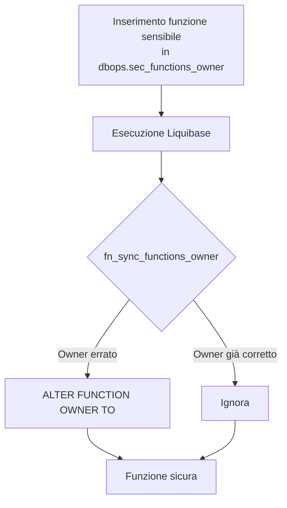

## 📘 Documentazione Concettuale – Tabella `dbops.sec_functions_owner`

> 👀 **Vedi anche**
>
Approfondimenti funzioni tecniche:
>
[`dbops.fn_sync_functions_owner`](/dbzero/dbops/funzioni/fn_sync_functions_owner)→ Funzione di hardening permessi   
> [`dbops.fn_get_or_create_session_tx_id`](/dbzero/dbops/funzioni/fn_get_or_create_session_tx_id) → Gestione sessione TX SQL   
> [`script.fn_ensure_logconn`](/dbzero/script/funzioni/fn_ensure_logconn) → Verifica configurazione `dblink`    
>
Contesto correlato:
>
Documento["Estensione PostgreSQL: dblink"](/postgresql/dblink) –   Configurazione connessione tecnica     (problematica iniziale)
> Gestione sicurezza funzioni tecniche (Hardening)

---

La tabella **`dbops.sec_functions_owner`** definisce le *funzioni sensibili* che, per garantire la stabilità e la sicurezza dell'ambiente Zero ERP, **devono essere possedute da un ruolo specifico** (generalmente `postgres`).

Questa tabella è stata introdotta a seguito di problemi riscontrati durante la **riconfigurazione dell'estensione `dblink`**, dove alcune funzioni operative (es. logging remoto o gestione di sessioni e TX ID) non riuscivano a eseguire operazioni privilegiate poiché l'utente applicativo non disponeva dei permessi necessari.

La soluzione è stata quindi la creazione di un meccanismo automatico di *hardening* (irrobustimento) per mantenere la coerenza dei permessi delle funzioni critiche nel tempo, anche dopo aggiornamenti, restore o clonazioni del database.

---
### 🎯 Scopo Principale
* **Centralizzare l'elenco delle funzioni "sensibili"** che richiedono owner dedicato.
* **Garantire automaticamente la corretta assegnazione dei permessi**, tramite `dbops.fn_sync_functions_owner()`.
* **Prevenire errori operativi o di sicurezza** derivanti da modifiche accidentali o ripristini non controllati.
* Supportare la procedura di *hardening post-deploy*, mantenendo coerenza anche in CI, dopo migrazioni o clonazioni del database.

> *"La tabella `dbops.sec_functions_owner` rappresenta la policy tecnica per la sicurezza delle funzioni operative di sistema."*

---

### Problematiche che hanno portato all'introduzione

| Problema riscontrato                                        | Effetto                                                      | Soluzione introdotta                       |
| ----------------------------------------------------------- | ------------------------------------------------------------ | ------------------------------------------ |
| Configurazione `dblink` fallita                             | La funzione non riusciva a connettersi per mancanza permessi | Forzare owner `postgres`                   |
| Funzioni tecniche eseguite da utente applicativo (`titodb`) | Mancanza privilegi su operazioni sensibili                   | Gestione SECURITY DEFINER + owner coerente |
| Clone DB / restore / CI non eseguite da superuser           | Permessi alterati o persi                                    | Meccanismo di *runAlways* via Liquibase    |
| Errori casuali dopo modifiche o refactor                    | Instabilità del sistema                                      | Introduzione hardening automatico          |

---

### Struttura Logica

| Campo            | Tipo | Descrizione                                                    |
| ---------------- | ---- | -------------------------------------------------------------- |
| `schema_name`    | text | Schema in cui risiede la funzione                              |
| `function_name`  | text | Nome funzione                                                  |
| `arg_types`      | text | Tipi degli argomenti nella signature (es. `'uuid,text,jsonb'`) |
| `required_owner` | text | Ruolo richiesto (es. `'postgres'`)                             |
| `note`           | text | Descrizione motivazione sicurezza                              |

🔎 È presente una **chiave univoca** su `(schema_name, function_name, arg_types)` per individuarle univocamente.

---

### ⛔ Chi la scrive: il migratore, e basta (dal 2026-09-26)

Chi scrive questa tabella sceglie il proprietario delle funzioni sensibili,
perché `dbops.fn_sync_functions_owner()` applica ciò che vi trova. Per questo:

* la **scrive solo il migratore** — il seed CSV (`80_data/20251123-51`) e i
  changeSet che prendono una funzione «in prestito» per sostituirla;
* l’**applicazione la legge** e basta: `SELECT` sì, `INSERT`, `UPDATE`, `DELETE`
  no. Leggere il registro senza poterlo scrivere né eseguire la sync non dà
  nessuna leva.

La postura sta in tre sedi, come per le altre tabelle in sola lettura (loop dei
grant, provisioning, changeSet `90_end/20260926-12`): il perché è in
[linee guida SQL §11.8](/linee-guida-sql). La sync, a sua volta, rifiuta chi non
è il migratore: vedi
[`dbops.fn_sync_functions_owner`](/dbzero/dbops/funzioni/fn_sync_functions_owner).

---

### Flusso Operativo



---

### Esempio Inserimento (fn_get_or_create_session_tx_id)

```yaml
- insert:
    schemaName: dbops
    tableName: sec_functions_owner
    columns:
      - column: { name: schema_name, value: dbops }
      - column: { name: function_name, value: fn_get_or_create_session_tx_id }
      - column: { name: arg_types, value: "" }
      - column: { name: required_owner, value: postgres }
      - column: { name: note, value: "Gestione session_tx_id; utilizza log dblink" }
```

---

### Hardening Automatico

Ogni esecuzione di `liquibase update` (grazie a `runAlways: true`) esegue:

```sql
SELECT dbops.fn_sync_functions_owner();
```

🔹 In ambienti **prod/DEV reali** → la funzione applica gli `ALTER FUNCTION` richiesti.
🔹 In **CI o ambienti senza privilegi elevati** → vengono mostrati avvisi ma l’esecuzione non fallisce (`insufficient_privilege` gestito).

---

### Vantaggi Operativi

✔️ Mantiene coerenti i permessi delle funzioni critiche nel tempo.
✔️ Evita la necessità di interventi manuali ripetuti su restore/cloni.
✔️ Rafforza la sicurezza della piattaforma senza impattare sulle pipeline CI.
✔️ Permette estensioni future (altri controlli di sicurezza sulle funzioni).

---

> *“Gestire preventivamente le funzioni sensibili tramite hardening riduce rischi operativi e garantisce solidità all'architettura tecnica di Zero ERP.”*

---


