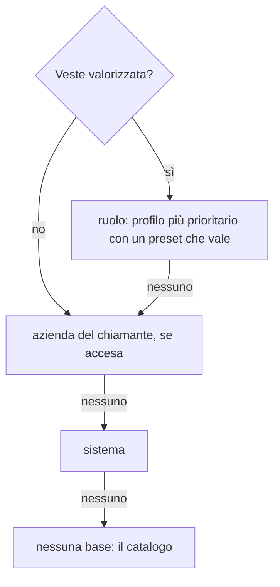

## 📘 Documentazione Concettuale – Funzione `ui.fn_preset_di_base`

> **Ultimo aggiornamento**: 21 novembre 2026
>
> 👀 **Vedi anche**
>
> Approfondimento tabelle:
>
> * [ui.lista_preset](/dbzero/ui/tabelle/lista_preset) — i preset delle liste, un acceso per posto
> * [ui.lista_preset_colonna](/dbzero/ui/tabelle/lista_preset_colonna) — le colonne che danno contenuto a un preset di lista
> * [ui.dashboard_preset](/dbzero/ui/tabelle/dashboard_preset) — i preset delle dashboard, un acceso per posto
> * [ui.dashboard_preset_widget](/dbzero/ui/tabelle/dashboard_preset_widget) — i widget che danno contenuto a un preset di dashboard
> * [ui.dashboard_widget](/dbzero/ui/tabelle/dashboard_widget) — il pool della dashboard
> * [anagrafiche.emittenti_fiscali](/dbzero/anagrafiche/tabelle/emittenti_fiscali) — l'azienda, che vale solo se accesa
>
> Approfondimento funzioni:
>
> * [script.fn_get_profili_accesso_applicabili](/dbzero/script/funzioni/fn_get_profili_accesso_applicabili) — i profili dell'utente nella veste, con la loro priorità
> * [ui.fn_resolve_lista_config](/dbzero/ui/funzioni/fn_resolve_lista_config) — la legge per le liste
> * [ui.fn_resolve_dashboard_config](/dbzero/ui/funzioni/fn_resolve_dashboard_config) — la legge per le dashboard
> * [ui.fn_preset_aggiornato](/dbzero/ui/funzioni/fn_preset_aggiornato) — le chiavi del banner, calcolate sulla base scelta qui
>
> Guide:
>
> * [Configurazione liste](/guide/configurazione-liste) — la cascata vista dall'amministratore

---

### 🎯 Scopo Principale

`ui.fn_preset_di_base` sceglie il **preset di base** di una lista o di una dashboard per un utente:
il preset che dà le chiavi che la preferenza non ha, e sul quale si misura il banner del preset
aggiornato. Restituisce una riga (l'id del preset, il suo ambito e la data del suo contenuto per
chiave, la mappa `{chiave: data}`), oppure nessuna se nessun preset vale.

È la sede unica della scelta: i due resolver la chiamano, e non hanno una copia propria della
cascata dei preset.

---

### Un candidato vale se è acceso e ha contenuto

Un preset spento non è mai base. Un preset acceso vale solo se ha qualcosa da mostrare:

* per una **lista**, almeno una riga di composizione che cita una colonna accesa del catalogo;
* per una **dashboard**, almeno un widget acceso che sta nel **pool** della dashboard.

Il filtro sta dentro ogni livello, prima della scelta: un preset vuoto non ferma la cascata, che
passa al livello successivo, e non presta nemmeno l'ordinamento di partenza o la misura. Se nessun preset
ha contenuto, la funzione non risponde niente, e ogni chiave viene dal catalogo.

---

### L'ordine: ruolo, azienda, sistema

1. **Ruolo** — il preset del profilo applicabile all'utente con la priorità migliore (ad hoc, poi
   reparto, poi portale). Il passo vale **solo con la veste valorizzata**: con la veste nulla la
   cascata parte dall'azienda. Senza una veste i profili di tutte le identità dell'utente
   concorrerebbero, e due profili di pari priorità darebbero una scelta decisa dall'id: il ripiego
   non allarga e non sceglie a caso. Con una veste, ogni priorità ha al più un profilo.
2. **Azienda** — il preset dell'azienda passata dal chiamante, solo se l'azienda è **accesa**. Senza
   un'azienda il passo si salta.
3. **Sistema** — il preset che vale per tutti.

La scelta è deterministica: un posto (il contenitore, l'ambito, il profilo, l'azienda) ha al più un
preset acceso, e il ruolo ha al più un profilo per priorità.

---

### ⭐ Una funzione per le due famiglie

Liste e dashboard hanno la stessa regola per l'ordine e l'ammissione dei livelli: due copie
divergerebbero. La famiglia (`lista` o `dashboard`) sceglie solo la tabella dei preset e la prova
del contenuto, l'unica cosa che le distingue.

---

### ⚠️ Che cosa oggi non copre

* **I permessi dei widget.** Per la dashboard il contenuto è «un widget acceso nel pool», non «un
  widget che l'utente può vedere»: un preset fatto di widget protetti da permessi che l'utente non
  ha vince lo stesso, e la dashboard resta con le sole card aggiunte invisibili.
* **Una famiglia diversa dalle due** non è un errore: la funzione non risponde niente, come se
  nessun preset valesse.

---

### Codici errore

Nessuno: un contenitore senza preset che valgano dà nessuna riga, non un rifiuto.

---

### Test

* `db/pgtap/ui/test-fn-preset-di-base-v1.sql` — un preset d'azienda senza colonne attive che non
  ferma la cascata, e con una colonna attiva che vince; l'azienda spenta che non si applica; il
  preset di ruolo con la veste, saltato con la veste nulla; nessuna base quando nessun preset ha
  contenuto; per la dashboard, il preset fatto dei soli widget spenti del pool, che non è base, e quello con un
  widget del pool che lo è.

---

### Note di migrazione

* 2026-11-20 — nasce, e prende il posto delle tre letture del preset per livello che ognuno dei due
  resolver ripeteva. Insieme cambiano tre regole: il filtro del contenuto entra in ogni livello
  (prima il ruolo guardava solo il profilo più prioritario), il ruolo si salta con la veste nulla
  (prima la parità fra due profili si scioglieva a caso), l'azienda spenta non si applica più. La
  scelta non legge più `is_default`, ritirato dai preset.
* 2026-11-20 — si ricrea con la data del contenuto per chiave: la colonna `contenuto_aggiornato_il`
  del risultato è la mappa. Scelta e firma restano le stesse.
* 2026-11-21 — si ricrea quando l'azienda dei preset di dashboard passa a `bigint`: le due famiglie si
  leggono senza conversione. Scelta e firma restano le stesse.

---


