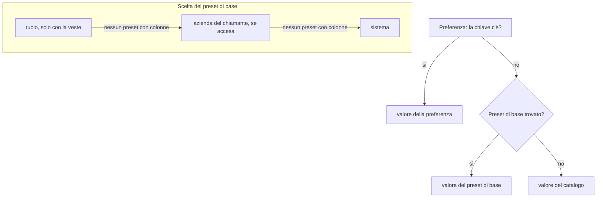

## 📘 Documentazione Concettuale – Funzione `ui.fn_resolve_lista_config`

> **Ultimo aggiornamento**: 20 novembre 2026
>
> 👀 **Vedi anche**
>
> Approfondimento tabelle:
>
> * [ui.lista_definizione](/dbzero/ui/tabelle/lista_definizione) — la lista, la soglia di ricerca, le dichiarazioni sull'emittente
> * [ui.lista_colonna](/dbzero/ui/tabelle/lista_colonna) — il catalogo delle colonne
> * [ui.lista_preset](/dbzero/ui/tabelle/lista_preset) — i preset fra cui si sceglie la base
> * [ui.lista_preset_colonna](/dbzero/ui/tabelle/lista_preset_colonna) — le colonne del preset di base
> * [ui.lista_preferenza_utente](/dbzero/ui/tabelle/lista_preferenza_utente) — la preferenza dell'utente
> * [ui.lista_colonna_permesso](/dbzero/ui/tabelle/lista_colonna_permesso) — i permessi di colonna
> * [ui.misure_pagina](/dbzero/ui/tabelle/misure_pagina) — le misure «righe per pagina»
>
> Approfondimento funzioni:
>
> * [ui.fn_lista_da_codice](/dbzero/ui/funzioni/fn_lista_da_codice) — la riga della lista dal codice
> * [ui.fn_veste_corrente](/dbzero/ui/funzioni/fn_veste_corrente) — la veste della sessione
> * [ui.fn_preset_di_base](/dbzero/ui/funzioni/fn_preset_di_base) — la scelta del preset di base
> * [ui.fn_preset_aggiornato](/dbzero/ui/funzioni/fn_preset_aggiornato) — il flag del banner
> * [ui.fn_lista_colonne_livello](/dbzero/ui/funzioni/fn_lista_colonne_livello) — il livello di ogni colonna per l'utente
> * [ui.fn_misura_pagina_ammessa](/dbzero/ui/funzioni/fn_misura_pagina_ammessa) — una misura è del catalogo?
> * [ui.fn_misura_pagina_default](/dbzero/ui/funzioni/fn_misura_pagina_default) — la misura di default `PAGINA`
> * [ui.fn_resolve_dashboard_config](/dbzero/ui/funzioni/fn_resolve_dashboard_config) — la gemella delle dashboard
>
> Guide:
>
> * [Configurazione liste](/guide/configurazione-liste) — la cascata vista dall'amministratore

---

### 🎯 Scopo Principale

`ui.fn_resolve_lista_config` risponde come si presenta una lista a un utente: quali colonne, in
che ordine e con che permessi, l'ordinamento, i filtri e le righe per pagina, e da dove viene
ciascuna di queste scelte. È l'unica sede della cascata preferenza → preset → catalogo; il backend
la chiama a ogni apertura di lista e passa il risultato al frontend.

---

### La lista e la veste

La riga della lista la legge [fn_lista_da_codice](/dbzero/ui/funzioni/fn_lista_da_codice): una
lista che non c'è o è spenta dà `E_UI_LISTA_NON_TROVATA`. Dalla stessa riga vengono la soglia della
ricerca libera e le due dichiarazioni sull'emittente (se la lista sa dire l'emittente di ogni riga,
e se ha un perimetro di emittente), che il risultato ripete così come sono.

La veste della sessione la legge [fn_veste_corrente](/dbzero/ui/funzioni/fn_veste_corrente): una
veste che non esiste vale come nessuna veste. La veste serve alla scelta del preset di base e al
livello di colonna, che leggono i profili dell'utente ciascuno nella propria sede.

---

### ⭐ La cascata è per chiave

Le quattro chiavi (`colonne`, `ordinamento`, `filtri`, `pagina_dimensione`) si risolvono ognuna per
conto suo, dal primo di questi livelli che la contiene:

1. **la preferenza dell'utente**, se ha quella chiave (una chiave null vale come assente);
2. **il preset di base**;
3. **il catalogo**: tutte le colonne accese, visibili, con l'identificatore fissato; nessun
   ordinamento, nessun filtro, la misura di default `PAGINA`.

Il preset di base si cerca sempre, anche quando c'è una preferenza: dà le chiavi che la
preferenza non ha. Lo sceglie [fn_preset_di_base](/dbzero/ui/funzioni/fn_preset_di_base), la sede
comune a liste e dashboard: un preset acceso con almeno una colonna attiva, cercato

* fra i preset di ruolo, nell'ordine di priorità dei profili dell'utente, solo con la veste
  valorizzata;
* poi il preset dell'azienda passata dal chiamante, se l'azienda è accesa;
* poi il preset di sistema.

Un preset senza colonne attive non conta a nessun livello, e la ricerca scende. Il preset scelto
dà tutte e quattro le chiavi; se nessuno vale, tutte vengono dal catalogo.

---

### Le righe per pagina e lo standard

Per `pagina_dimensione` vale solo una misura del catalogo. Lo **standard** è la misura del preset
di base se è nel catalogo, altrimenti il default `PAGINA`. Risponde la misura della preferenza se
è nel catalogo, altrimenti lo standard. Il risultato porta anche lo standard da solo, perché il
frontend lo mostra come «come lo standard (N)». La misura che risponde non è mai vuota.

---

### L'origine di ogni chiave

Per ognuna delle quattro chiavi il risultato dice da dove viene: `preferenza`, l'ambito del preset
di base (`ruolo`, `emittente_fiscale`, `sistema`) o `catalogo`. Il frontend, al salvataggio,
rimanda solo le chiavi di origine `preferenza` più quella toccata: così salvare una chiave non
congela le altre. Una misura della preferenza fuori catalogo non ha origine `preferenza`, e quindi
non si rimanda.

---

### Le colonne nuove del catalogo

Sulle colonne risolte, da qualunque livello vengano, il resolver aggiunge in coda le colonne
accese del catalogo che mancano, **nascoste**, dopo tutte le altre. Il contatore `colonne_nuove`
dice quante sono, contate **dopo** il filtro dei permessi: annuncia solo colonne che l'utente può
davvero trovare nel pannello.

---

### Normalizzazione e permessi di colonna

Ogni colonna risolta che non è accesa nel catalogo della lista si scarta. Sulle altre:

* una colonna identificatore o azione è sempre visibile, e un identificatore è sempre fissato;
* il livello dell'utente lo dà [fn_lista_colonne_livello](/dbzero/ui/funzioni/fn_lista_colonne_livello),
  la stessa sede che usa la ricerca libera: `BLOCCATO` toglie la colonna, `LETTURA` la rende non
  esportabile, `TUTTO` la lascia com'è;
* tipo, etichetta i18n, esportabilità e la priorità di ritiro si leggono sempre freschi dal
  catalogo, mai dalla preferenza o dal preset.

Ordine, larghezza, visibilità e fissaggio vengono dal livello che ha dato le colonne.

---

### Il preset di base nel risultato, e il banner

Il risultato porta `preset_base`: l'id, l'ambito e la data del contenuto del preset di base di
oggi, oppure null. È ciò che il backend salva con la preferenza; lo snapshot lo scrive poi il
database.

Il banner ha due esiti, che non si accendono insieme:

* `preset_base_cambiato` — la preferenza ha salvato una base che non è quella di oggi (spenta,
  cancellata, o scavalcata da un altro preset): il banner propone il riallineamento;
* `preset_aggiornato` — la base salvata è quella di oggi, e il suo contenuto è cambiato dopo lo
  snapshot senza che l'utente abbia premuto «ignora» dopo quel cambio. Lo calcola
  [fn_preset_aggiornato](/dbzero/ui/funzioni/fn_preset_aggiornato), sulla data del contenuto che la
  scelta della base ha già letto.

Senza preferenza, o con una preferenza senza base, tutti e due sono spenti.

---

### ⚠️ Che cosa oggi non copre

* **Ordinamento e filtri non filtrati.** Passano così come sono, dalla preferenza o dal preset:
  possono nominare colonne spente, non ordinabili, non filtrabili o bloccate per l'utente.
* **La forma della preferenza.** Una voce di colonna con un ordine o una larghezza non interi
  ferma la funzione con un errore di conversione, e la lista non si apre per quell'utente; una voce
  senza visibilità esce con la visibilità vuota; un codice ripetuto esce due volte. Una preferenza
  di colonne i cui codici sono tutti spariti lascia visibili solo identificatore e azioni.
* **Il flag è per preset intero.** Guarda tutto il contenuto del preset di base, anche quando la
  preferenza segue già il preset per le chiavi cambiate: una preferenza di sola misura vede il
  banner quando cambia l'ordinamento del preset.

---

### Codici errore

* `E_UI_LISTA_NON_TROVATA` — lista inesistente o spenta (dal building block della lista).
* `E_UI_MISURA_PAGINA_DEFAULT_MANCANTE` — il catalogo delle misure non ha il default `PAGINA`.

---

### Test

* `db/pgtap/ui/test-fn-resolve-lista-config.sql` — lista inesistente, catalogo, preset di sistema e
  di profilo, preferenza, colonna sensibile con e senza grant, identificatore normalizzato, colonna
  nuova, priorità dei profili, veste, priorità di ritiro.
* `db/pgtap/ui/test-fn-resolve-lista-config-cascata-per-chiave-v1.sql` — la cascata per chiave,
  l'origine, la misura standard, la lista senza preset.
* `db/pgtap/ui/test-fn-resolve-lista-config-contatore-colonne-nuove-v1.sql` — il contatore dopo il
  filtro dei permessi.
* `db/pgtap/ui/test-fn-resolve-lista-config-preset-aggiornato-v1.sql` — il flag.
* `db/pgtap/ui/test-fn-preset-di-base-v1.sql` — `preset_base` nel risultato, `preset_base_cambiato`
  quando la base salvata è un'altra, `preset_aggiornato` solo sulla base di oggi.
* `db/pgtap/ui/test-misure-pagina-v1.sql` — la misura sempre del catalogo.
* `db/pgtap/ui/test-lista-ricerca-min-caratteri-v1.sql`,
  `db/pgtap/ui/test-lista-definizione-multi-emittente-v1.sql`,
  `db/pgtap/ui/test-lista-definizione-perimetro-emittente-v1.sql` — le proprietà della lista nel
  risultato.
* `db/pgtap/ui/test-fn-lista-colonne-ricerca-full-v1.sql` — la stessa regola di livello della
  ricerca libera.
* `db/pgtap/ui/test-lista-contratti-seed.sql` — una lista del seed risolta.

---

### Note di migrazione

* 2026-09-23 — veste e livello di colonna passano a due building block condivisi con la ricerca
  libera.
* 2026-09-25 — la riga della lista dal building block; nel risultato la soglia della ricerca.
* 2026-09-30 — la misura di pagina dal catalogo delle misure: prima un 25 scritto nella funzione,
  e senza preferenza né preset poteva uscire vuota.
* 2026-11-01 — la cascata diventa per chiave; nel risultato l'origine e la misura standard. Prima
  si sceglieva un livello solo, il primo con le colonne, e se ne prendevano tutte e quattro le
  chiavi.
* 2026-11-08 — il flag legge la data del contenuto del preset, non più l'audit.
* 2026-11-20 — la scelta del preset di base passa a `ui.fn_preset_di_base`: prima tre letture,
  una per ambito, filtrate su `is_default`, col ruolo che guardava solo il profilo più prioritario.
  Nel risultato `preset_base` e `preset_base_cambiato`; il flag si calcola solo sulla base di oggi.

---


