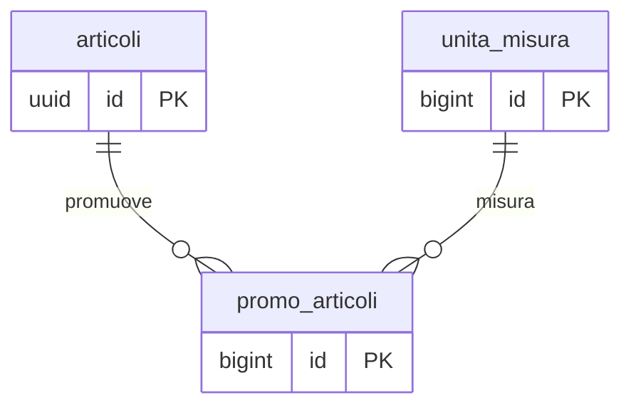

## 📘 Documentazione Concettuale – Tabella `vendite.promo_articoli`

> 👀 **Vedi anche**
>
**Guide generali:**
>
• [Gestione listini](/guide/gestione-listini)
>
**Approfondimento tabelle:**
>
• [anagrafiche.categorie_clienti](/dbzero/anagrafiche/tabelle/categorie_clienti)
> • [vendite.listini](/dbzero/vendite/tabelle/listini)
> • [catalogo.articoli](/dbzero/catalogo/tabelle/articoli)
> • [catalogo.unita_misura](/dbzero/catalogo/tabelle/unita_misura)

---

### 🎯 Scopo Principale
(latest review 2026-10-14: l'articolo ammesso, D-6)

`vendite.promo_articoli` e' l'**overlay promo** del sistema pricing v5: rappresenta un'offerta temporale per la coppia `(articolo, uom)` che **batte** tutto il resto nel resolver (STADIO 0). La promo si applica **sopra** il prezzo base risolto dagli stadi inferiori (contratto o categoria), mai su un prezzo gia' scontato.

Caratteristiche principali:

* Una riga = una promo per `(articolo, uom)` su un periodo definito
* La partecipazione del BA alla promo dipende **solo** dal flag `categorie_clienti.partecipa_promo`
* Supporta 3 tipi di variazione: `PERCENTUALE`, `VALORE_FISSO`, `PREZZO_FISSO`
* `PREZZO_FISSO` e' ammesso **solo qui** (vietato nei listini e nella matrice categoria): rappresenta un prezzo assoluto temporale indipendente dal prezzo base

---

### Collegamenti con altre tabelle

| Campo         | Tabella di riferimento        | Azione                                 |
| ------------- | ----------------------------- | -------------------------------------- |
| `articolo_id` | `catalogo.articoli(id)`       | ON UPDATE CASCADE, ON DELETE NO ACTION |
| `uom_id`      | `catalogo.unita_misura(id)`   | ON UPDATE CASCADE, ON DELETE NO ACTION |

---

### Campi principali

| Colonna             | Tipo          | Nullable | Descrizione                                                              |
| ------------------- | ------------- | -------- | ------------------------------------------------------------------------ |
| `id`                | bigint        | NO       | PK surrogata                                                             |
| `codice`            | varchar(64)   | NO       | Codice univoco (UNIQUE `uq_promo_articoli_codice`)                       |
| `descrizione`       | varchar(255)  | NO       | Descrizione estesa UI                                                    |
| `articolo_id`       | uuid          | NO       | Articolo oggetto della promo                                             |
| `uom_id`            | bigint        | NO       | Unita' di misura del prezzo                                              |
| `tipo_variazione`   | varchar(16)   | NO       | `PERCENTUALE` \| `VALORE_FISSO` \| `PREZZO_FISSO`                        |
| `valore_variazione` | numeric(10,4) | NO       | Valore libero (segno gestito da UI/business)                             |
| `valido_dal`        | date          | NO       | Inizio validita                                                          |
| `valido_al`         | date          | NO       | Fine validita (obbligatoria: promo e' per definizione temporale)         |
| `validita`          | daterange     | NO       | Colonna generata da `valido_dal`/`valido_al` (linee-guida-sql §7b)       |
| `meta` / `attivo` / audit | —        | —        | Campi standard                                                           |

---

### Regole di validazione

* **`chk_promo_articoli_tipo_variazione`**: `tipo_variazione` ∈ {`PERCENTUALE`, `VALORE_FISSO`, `PREZZO_FISSO`}.
* **Range di validita'**: `validita` e' una colonna generata, `daterange(valido_dal, valido_al, '[]')`. L'inversione delle date la rifiuta il guard comune `script.trgfn_guard_date_validita` (automazione `DATE_VALIDITA`) con `E_DATA_AL_MINORE_DAL`, prima che il costruttore del daterange arrivi al suo errore tecnico.
* **Valore variazione**: nessun vincolo sul segno (il CHECK `chk_promo_articoli_valore` rimosso il 15-04-2026 perche' restringeva inutilmente la semantica algebrica del resolver: negativo=sconto, positivo=maggiorazione).
* **`ex_promo_articoli_no_overlap`**: nessuna sovrapposizione temporale per la stessa coppia `(articolo_id, uom_id)` quando `attivo IS TRUE`. Implementato come `EXCLUDE USING gist` (richiede `btree_gist`, gia' attivo dalla baseline).
* **Quale articolo** (dal 2026-10-14, D-6 di brief-db-articoli-ammessi-per-documento): una promo si crea solo se il calcolo del prezzo la può applicare. Un articolo **solo componente** non ha un prezzo suo, e dentro un kit il resolver non applica le promo: è rifiutato con `E_PROMO_ARTICOLO_SOLO_COMPONENTE`, all'INSERT e quando cambia l'articolo. Il **composito** è ammesso: riceve la promo quando il contratto gli dà un prezzo con un'eccezione. La regola sta in [script.fn_check_articolo_riga](/dbzero/script/manual/fn_check_articolo_riga) (documento `PROMO_ARTICOLO`), e il picker [catalogo.fn_articoli_ammessi](/dbzero/catalogo/manual/fn_articoli_ammessi) la mostra prima della scelta.

---

### Semantica dei tipi di variazione

| Tipo             | Calcolo applicato al `prezzo_base`                                  | Tipico uso                                                |
| ---------------- | ------------------------------------------------------------------- | --------------------------------------------------------- |
| `PERCENTUALE`    | `prezzo_base * (1 - valore_variazione / 100)` (sconto percentuale)  | "Gas -10% dal 01/03 al 31/03"                             |
| `VALORE_FISSO`   | `prezzo_base - valore_variazione`                                   | "Luce a 5€/kWh in meno per aprile"                        |
| `PREZZO_FISSO`   | `valore_variazione` (ignora prezzo_base)                            | "Pacchetto XYZ a €12,50 secchi per tutto dicembre"        |

Il segno operativo (sconto/maggiorazione) e' gestito a livello applicativo/UI: DB conserva solo il valore assoluto e il tipo.

Il calcolo della promo si appoggia **sempre** al prezzo base risolto dal meccanismo "normale" (contratto o categoria): non si applica mai sopra un prezzo gia' scontato, per evitare doppio sconto implicito.

---

### Trigger coinvolti

Nessun trigger di tabella per `validita`: e' una colonna generata. L'ordine delle
due date lo verifica il guard comune `script.trgfn_guard_date_validita`, montato
dall'automazione `DATE_VALIDITA`.

Trigger di audit e `tx_id` si applicano per policy globale del progetto (vedi `linee-guida-trigger.md`).

`trg_promo_articoli_a10_guard_articolo_ammesso_ins_upd` (dal 2026-10-14): il guard di tabella
delle righe che scelgono un articolo,
[script.trgfn_righe_guard_articolo_ammesso](/dbzero/script/manual/trgfn_righe_guard_articolo_ammesso),
montato con `('PROMO_ARTICOLO', 'id')`. Parla prima del guard delle date
(`…_a10_guard_data_driven`).

---

### Ruolo nel resolver prezzi v5 (STADIO 0)

```
Esiste riga attiva in vendite.promo_articoli con (articolo_id, uom_id, data)?
  E il BA ha categoria_cliente_id con partecipa_promo = true?
    -> SI: prezzo_base   = risolvi(STADIO 1 -> STADIO 2)
            prezzo_finale = applica variazione promo su prezzo_base
            origine       = 'PROMO'
            STOP
    -> NO: vai a STADIO 1
```

La partecipazione non e' segmentata per singola categoria cliente: se una promo deve valere solo per "GOLD e PLATINUM", si creano due `promo_articoli` con criteri distinti oppure si disattivano temporaneamente le categorie non target.

---

### Diagramma ER



---


