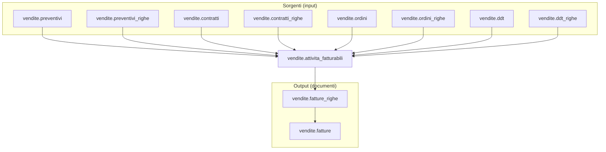

# Fatturazione - attivita di progetto (WIP)

> Documento di lavoro per pianificazione e avanzamento attivita. Contiene appendici e note operative.
> La guida principale resta `docs/it/guide/fatturazione.md`.

---

## ✅ Recap stato (sintesi)

- [x] Pipeline fatturazione su `vendite.fatturazione_pipeline` con fallback `utility_id`/`tipo_doc_fiscale_id`.
- [x] Orchestrazione Django (`pr_run_lotto_pipeline`, `fn_execute_pipeline_step`).
- [x] Registry task multi-dominio in DB (`dbops.domini_task`, `dbops.pipeline_task_registry`, `dbops.pipeline_task_registry_impl`).
- [x] `implementation_key` nei task JSON e dispatch via registry DB.
- [x] Log fatture e flag `critical` (tabella `vendite.fatture_log` + sync).
- [x] Area geografica fatturazione e colonne correlate.
- [ ] Pipeline dedicata per `attivita_fatturabili` (tabella + funzioni).
- [ ] Registry runtime multi-dominio completo in Django (mappa per dominio).

## 🔁 Note migrazione DB -> Django (parti trasferite)

Queste logiche sono state trasferite da funzioni SQL a servizi Django:

* orchestrazione pipeline lotto (ex `vendite.pr_run_lotto_pipeline`)
  * ora in `apps/vendite/services/pipeline_runner.py`
* esecuzione step pipeline (ex `vendite.fn_execute_pipeline_step`)
  * ora in `apps/vendite/services/pipeline_step_executor.py`
* grouping e generazione righe fattura (ex `vendite.fn_group_attivita_fatturabili`, `vendite.fn_generate_fatture_righe`)
  * ora in `apps/vendite/services/fatture_righe_service.py`

Regole chiave:

* il DB resta fonte di verita` per configurazione pipeline e fallback.
* il dispatch e` controllato da registry DB + mapping statico in Django.
* vincoli, trigger e funzioni di consistenza restano in DB.

## 📌 Generazione fatture puntuali (lotti giornalieri)

### Scopo
Gestire emissioni immediate (front-office) senza attendere il ciclo massivo,
ma mantenendo la tracciabilita` tramite lotto giornaliero.

### Modello operativo

* Il **lotto giornaliero** e` un contenitore operativo, non il driver di emissione.
* Le fatture vengono **create/emesse per documento** (processo puntuale).
* Il lotto resta **APERTO** e raccoglie le fatture emesse nella giornata.
* Il lotto passa a **INVIATA** solo nella fase batch di chiusura (invio/SDI).

### Impatti su pipeline e guard

* La pipeline `GIORNALIERO` non deve includere step di creazione/emissione.
* Il trigger `trgfn_fatturazione_lotti_guard_stato` non viene sollecitato
  per la fase EMESSA, perche` il lotto non transita in EMESSA.
* L'unico cambio stato lotto rilevante per il giornaliero e` la chiusura (INVIATA).

### Processo puntuale (fuori pipeline)

* Deve riusare **gli stessi servizi/primitive** del massivo:
  `select_attivita` (lock), `get_or_create_fattura_header`,
  `generate_fatture_righe`, `fn_numera_fattura_opz_emessa`.
* Deve garantire **idempotenza** e **lock** sul lotto giornaliero.
* Deve loggare su `fatturazione_lotti_log` per tracciabilita`.
* Deve agganciare sempre la fattura al lotto giornaliero aperto.

### Nota di coerenza

Il flusso puntuale non duplica logica: usa le stesse funzioni/servizi,
ma senza passare dalla pipeline lotto.

### Sviluppi necessari (minimo)

* Servizio Django “emissione immediata”:
  * risolve/crea lotto giornaliero APERTO
  * seleziona/locka attivita fatturabili
  * genera righe e numerazione documento
  * collega fattura al lotto
  * logga su `fatturazione_lotti_log`
* Pipeline giornaliera ridotta ai soli task batch (chiusura/invio)
* Chiusura batch tramite `vendite.fn_close_giornaliero_lotto`
* Endpoint API dedicato (o estensione dell’endpoint esistente)

---

## 1) Processo di alimentazione `attivita_fatturabili`

### 🎯 Scopo
Creare le righe pre‑documentali che rappresentano **tutto cio` che potra` essere fatturato**.

### 🔌 Sorgenti (macro‑tipi)
Le sorgenti sono definite in `config.sorgenti` e rappresentano **origini dati** eterogenee. Esempio:

1. ATTIVITA (RIGA)  
2. PREVENTIVO (DOCUMENTO)  
3. PREVENTIVO_RIGA (RIGA)  
4. CONTRATTO (DOCUMENTO)  
5. CONTRATTO_RIGA (RIGA)  
6. ORDINE_VENDITA (DOCUMENTO)  
7. ORDINE_VENDITA_RIGA (RIGA)  
8. DDT_VENDITA (DOCUMENTO)  
9. DDT_VENDITA_RIGA (RIGA)  
10. FATTURA (DOCUMENTO)  
11. FATTURA_RIGA (RIGA)

### 🧩 Logica di alimentazione
* Ogni sorgente genera righe in `vendite.attivita_fatturabili` con:
  `sorgente_tipo_id`, `sorgente_uid`/`sorgente_riga`, `articolo_id`, `istanza_utility_id`, `quantita`, `competenza_*`.
* L’idempotenza e` garantita dalla coppia `(sorgente_tipo_id, sorgente_uid)` con indice unico parziale.
* Le righe nascono **in bozza** (`approvato = false`) e vengono validate/approvate nel passaggio successivo.

### 🖥️ Dashboard “Input Fatturazione”
* Selezione sorgenti e intervalli (periodo, BA, istanza, utility).
* Visualizzazione righe candidate e preview dei conteggi.
* Avvio del processo di alimentazione (batch o manuale).

**Integrazione utilities (gas/energia/acqua)**  
Non tutte le sorgenti possono alimentare direttamente `attivita_fatturabili`:
nei casi utilities serve un **processo di calcolo preliminare** dei consumi.
La dashboard “Input” deve quindi gestire due flussi:

1) **Alimentazione diretta** → inserimento righe `attivita_fatturabili` da sorgenti semplici.  
2) **Alimentazione con calcolo** → generazione di `attivita_consumi` (testata consumi),
   log dedicato e successiva produzione di righe `attivita_fatturabili`.

Il processo di alimentazione avviene **prima** del lotto fatture e mantiene tracciabilita`
tramite `attivita_fatturabili_lotti`.

---

## 2) Processo operativo di calcolo (pre‑emissione)

### 🎯 Scopo
Trasformare attivita` approvate e fatturabili in **righe economiche** di fattura.

### 🔎 Selezione
* `approvato = true`
* `fatturato = false`
* `sospesa = false`
* `posticipa_al` in regola con la data fatturazione
* competenza mensile/puntuale in regola

### 🔒 Isolamento batch
* `lock_in_fatturazione` e `lock_batch_id` garantiscono coerenza di selezione.
* Evita doppie estrazioni concorrenti.

### 🧮 Output
* Generazione `vendite.fatture_righe` con snapshot economici (prezzo, IVA, UoM, importi).
* Aggancio a `vendite.attivita_fatturabili` (`fattura_riga_id`, `fatturato = true`).

### 🖥️ Dashboard “Pre‑Calcolo”
* Visualizzazione delle righe eleggibili e motivi di esclusione.
* Azioni: approva/sospendi/posticipa.
* Lancio calcolo batch con log esiti e anomalie.

---

## 3) Processo di emissione documento (output)

### 🎯 Scopo
Convertire il risultato del calcolo in **documento fiscale numerato**.

### ✅ Separazione dal calcolo
Il **calcolo** produce righe; l’**emissione** produce la testata, la numerazione e gli output fiscali.

### 🔢 Numerazione
* Assegnata **solo** in fase di emissione (cambio di stato).
* Regole gestite da `vendite.registri_fatturazione`.

### 📦 Output correlati
* `vendite.fatture_riepiloghi_iva`
* `vendite.fatture_scadenze`
* `vendite.note` (e partizioni dedicate)
* `vendite.fatture_indirizzi` (se previsto)

### 🖥️ Dashboard “Emissione”
* Preview del documento, controlli finali e numerazione.
* Conferma emissione con log degli esiti.

---

## 4) Dashboard e varianti operative

### ✅ Dashboard standard
* **Input Fatturazione** → alimenta `attivita_fatturabili`
* **Pre‑Calcolo** → selezione, approvazione, calcolo righe
* **Emissione** → numerazione e creazione documento

### 🔁 Variante: invio SDI (Italia)
* **Estrazione** del documento in formato fiscale (es. XML FatturaPA).
* **Invio** a canali SDI e registrazione esiti (accettato/scartato).
* **Nota di variante**: in altri paesi si sostituisce il canale SDI con sistemi locali o e‑invoicing alternativi.

### 📊 Variante: controlli e statistiche
* **Pre‑emissione**: controlli di anomalia (importi negativi, IVA mancante, competenze fuori periodo, mismatch BA/istanza).
* **Post‑emissione**: riepiloghi fiscali e gestionali:
  * per gruppi voce / articoli
  * per utility / BA / periodo
  * per stato documento (bozza, emessa, annullata)

---

## 🧠 Linee guida di progettazione

1. **Separare sempre calcolo vs emissione**  
   Il calcolo e` idempotente e ripetibile; l’emissione e` un’azione fiscale “finale”.

2. **Dashboard come orchestratore**  
   Il motore batch deve essere avviato da contesto visibile e controllato (input + pre‑calcolo + emissione).

3. **Idempotenza garantita dalle sorgenti**  
   Le sorgenti alimentano `attivita_fatturabili` evitando duplicazioni con chiavi uniche parziali.

4. **Audit e log sempre presenti**  
   Ogni fase deve loggare esiti, scarti, errori e motivi di esclusione.

---

## ✅ Risultato atteso

Un processo fatturazione **modulare**, verificabile e scalabile:

* sorgenti ingegnerizzate → `attivita_fatturabili`
* calcolo controllato → `fatture_righe`
* emissione separata → `fatture` numerate
* dashboard e output fiscali governati

---

## 🧩 Collegamenti tabellari (visione sintetica)

---

## 📎 Appendice – Lotto, raggruppamenti e stati (design operativo)

> **Nota importante (evidenza):**
> `area_geografica_id` restera` **solo** un filtro geografico.
> In futuro i raggruppamenti multi‑criterio (comuni + tipologia utenza + contratti, ecc.)
> saranno gestiti con un **nuovo livello** (`gruppo_fatturazione_id`), per evitare
> ambiguita` semantiche e mantenere la compatibilita` con l’attuale modello.

### 1) Lotto di fatturazione

Il **lotto** diventa l’elemento centrale per:

* ricalcolo controllato,
* tracciabilita` dei job,
* orchestrazione dei processi successivi (emissione, invio, statistiche).

**Campi proposti (minimi)**:

* `id` (bigint, PK)
* `uuid` (lock_batch_id)
* `codice` (es. LOT-YYYYMM-NN)
* `competenza_mese` (date, YYYY-MM-01)
* `utility_id` (opzionale, derivabile da BA)
* `tipo_doc_fiscale_id` (**obbligatorio**)
* `billing_account_id` (opzionale)
* `stato_lotto` (IN_ESECUZIONE | COMPLETATO | ERRORE)
* `stato_doc_fiscale_id` (FK -> `config.stati_doc_fiscale`)
* audit + `meta`

> Nota: `tipo_doc_fiscale_id` e` obbligatorio; `utility_id` puo` essere derivato da `billing_account_id`.
> Lo stato del lotto segue un **ordine** e supporta `stato_precedente_ammesso` per eventuali rollback.

**Rollback DRAFT (lotto MASSIVO)**  
Consentito solo per lotti **MASSIVO** in **DRAFT**.  
Rollback tecnico: elimina fatture/righe/riepiloghi/log e ripristina le
`attivita_fatturabili` (unlock + reset flag).  
Il lotto viene marcato: `stato_doc_fiscale = ANNULLATA`, `stato_operativo = CHIUSO`, `stato_lotto = COMPLETATO`.

---

### 1.1) Processo di alimentazione attivita_fatturabili (necessita`)

In ambito utilities (gas/energia/acqua) la **generazione** di `attivita_fatturabili`
non e` un semplice import ma un **calcolo complesso** (consumi, conguagli, minimi, fasce).
Questo richiede:

* **tracciabilita` batch** (quando e` stato eseguito il calcolo, con quali parametri);
* **log dedicato** (warning/critical specifici del calcolo consumi);
* **testata di calcolo** con totali e periodi per BA/competenza;
* separazione chiara tra **alimentazione** e **fatturazione**.

Per questo si introduce un **processo di alimentazione** separato dal lotto fatture,
ma collegabile in dashboard.

> Nota: le validazioni/normalizzazioni su `attivita_fatturabili` sono gestite da
> trigger dedicati (es. `trgfn_attivita_fatturabili_guard_ba_coerenza`,
> `trgfn_attivita_fatturabili_guard_fonte`, `trgfn_attivita_norm_competenza_mese`).

---

### 1.2) Lotto alimentazione + attivita_consumi (design)

**Lotto alimentazione** (`vendite.attivita_fatturabili_lotti`):
* batch di generazione `attivita_fatturabili` con parametri di calcolo (competenza, utility, BA);
* stato lotto (IN_ESECUZIONE | COMPLETATO | ERRORE);
* riferimento per dashboard e audit.

**Testata consumi** (`vendite.attivita_consumi`):
* totalizzatori per BA/periodo (consumo_totale, uom, periodo);
* punto di aggregazione per i dettagli futuri (fasce, minimi, ecc.);
* collegabile a `fattura_id` quando il documento e` emesso.

**Log dedicato** (`vendite.attivita_fatturabili_log`):
* messaggi W/C riferiti al lotto o alla testata consumi.

---

### 1.3) Area geografica (analisi)

Per esigenze di fatturazione (es. raggruppamenti per **comuni**), e` necessario
introdurre una **area geografica** dedicata.  
Questa area e` un filtro **specifico** e non va confusa con i futuri gruppi
multi‑criterio (che useranno un livello distinto).

> Nota: i BA senza area restano **fatturabili**. L’area geografica puo` essere
> NULL e le attivita vengono comunque generate, per non penalizzare chi non
> usa questa funzionalita`.

Le righe `attivita_fatturabili` generate da processi automatici
mantengono un riferimento al **lotto alimentazione** e, se disponibile,
alla **testata consumi**.

---

## 📌 Appendice – Modifiche richieste (giornaliero)

### A) Schema
* `vendite.fatturazione_lotti`
  * aggiungere `tipo_lotto` (`MASSIVO` | `GIORNALIERO`)
  * aggiungere `stato_operativo` (`APERTO` | `CHIUSO` | `ERRORE`)

### B) Regole operative
* **Giornaliero**:
  * fatture emesse subito (numerazione immediata)
  * **no retrocessione** a BOZZA
  * lotto `APERTO` finché `stato_doc_fiscale_id` ≠ INVIATA
* **Massivo**:
  * retrocessione ammessa (se previsto dalle transizioni)
  * `stato_operativo` può riaprire

### C) Pipeline
* pipeline dedicata **GIORNALIERO** (step ridotti fino a numerazione)
* pipeline MASSIVA invariata

### 2) Parametri funzione di calcolo (proposta)

* `p_competenza_mese` (obbligatorio, YYYY-MM-01)
* `p_billing_account_id` (opzionale)
* `p_utility_id` (opzionale)
* `p_tipo_doc_fiscale_id` (obbligatorio)
* `p_reseller_soggetto_ruolo_id` (opzionale)
* `p_lotto_id` (opzionale; se NULL/0 -> crea lotto)
* `p_preview` (opzionale)

**Regole**:

* se `p_lotto_id` e` valorizzato, il ricalcolo si aggancia al lotto (e ai suoi parametri).
* il lotto contiene **tutti i parametri** necessari per ricalcoli futuri.
* il `reseller` e` un filtro commerciale, **non** modifica il destinatario fattura.

---

### 3) Raggruppamento fatture

Chiavi di raggruppamento:

* `billing_account_id`
* `competenza_mese`
* `utility_id` (se valorizzato)
* `tipo_doc_fiscale_id`
* `valuta_id`
* `emittente_soggetto_ruolo_id` (se valorizzato)

La funzione **aggrega** su fattura bozza esistente con stessa chiave.

---

### 3.1) Multi‑emittente e fatturazione su parent billing account

**Multi‑emittente**:
* L’emittente fiscale e` un ruolo e puo` variare per utility/cliente.
* Il lotto puo` includere piu` emittenti (societa` diverse) e il raggruppamento
  deve mantenere separati i documenti per emittente.

**Parent billing account**:
* Un `billing_account` puo` avere un **parent**.
* La **testata fattura** viene emessa al parent.
* Le **righe** mantengono il dettaglio per **child** (es. `dest_billing_account_id`),
  cosi` il parent riceve una fattura aggregata ma con dettaglio per account figlio.

**Implicazioni di calcolo**:
* Il raggruppamento usa il parent per la testata.
* I calcoli di riga restano legati al child, per ripartizioni e riepiloghi separati.

---

### 3.2) Reseller (ruolo commerciale, non cliente)

* **Cliente unico**: il destinatario fattura resta sempre il **billing account** (o il suo parent).
* **Reseller opzionale**: non aggrega BA diversi in un’unica fattura; serve come filtro e
  metadato commerciale (report, provvigioni, selezioni batch).
* **Distribuzione esclusa**: il caso in cui il reseller diventa destinatario fattura
  e` fuori dallo standard e verra` trattato come processo dedicato.

---

### 4) Stati documento e stati SDI (separati)

Lo **stato SDI** deve essere **per documento**, non per lotto.
Si propone quindi lo **sdoppiamento** dello stato:

**A) Stato documento** (ciclo fiscale interno):

* DRAFT (Bozza)
* EMESSA
* INVIATA
* REGISTRATA
* ANNULLATA

**B) Stato SDI** (Italia, esito canale):

* NON_INVIATA
* INVIATA
* CONSEGNATA
* SCARTATA

Questa separazione evita sovrapposizioni tra **stato fiscale** e **stato di invio**.

**Operativamente**:

* gli stati `INVIATA`, `CONSEGNATA`, `SCARTATA` **escono** da `config.stati_doc_fiscale`
* si crea `config.stati_sdi` e si collega a `vendite.fatturazione_lotti_fatture.stato_sdi_id`
* `config.stati_doc_fiscale` resta unica, con flag di applicabilita`:
  * `applica_fattura` (stato valido per `vendite.fatture`)
  * `applica_lotto` (stato valido per `vendite.fatturazione_lotti`)

---

### 5) Regole di rollback (da definire in policy)

Proposta di base:

* da **EMESSA** → **DRAFT** ammesso per consentire ricalcolo (prima dell’invio)
* **REGISTRATA** e **ANNULLATA** non sono rollbackabili (salvo processo amministrativo dedicato)

**Regola proposta (config)**:

* ✅ in `config.stati_doc_fiscale` aggiungere `stato_precedente_ammesso boolean`
* la retrocessione e` consentita **solo** verso lo stato immediatamente precedente (per ordine), se il flag e` `true`

---

### 6) Tipo documento fiscale (regola proposta)

* `vendite.attivita_fatturabili` **deve** avere `tipo_doc_fiscale_id`.
* Se l’attivita` deriva da una sorgente **RIGA** (`config.sorgenti`), il `tipo_doc_fiscale_id` viene ereditato dalla sorgente.
* Per attivita` inserite manualmente (auto‑sorgente), il `tipo_doc_fiscale_id` deve essere valorizzato direttamente.
* **Fallback**: non previsto. Il tipo documento e` di sistema.
* **Ordine di risoluzione** per l’alimentazione di `attivita_fatturabili`:
  1) `config.sorgenti.tipo_doc_fiscale_id` (se sorgente RIGA e valorizzato)
  2) errore se ancora NULL

Questa regola rende il raggruppamento deterministico e permette casi semplificati con **un solo tipo documento per utility**.

---

### 7) Ricalcolo e note (policy)

**Ricalcolo:**

* Consentito solo per fatture **BOZZA**.
* Strategia: **delete & regen** delle righe fattura per lotto/BA/competenza.
* Le righe manuali **non sono ammesse** in fattura: eventuali inserimenti manuali devono passare da `attivita_fatturabili`.

**Note:**

* ✅ Le note associate a `attivita_fatturabili` confluiscono in `note_fatture_righe`.
* ✅ Il trasferimento avviene **in fase di emissione/numerazione**, tramite **processo dedicato** richiamabile.

---

### 8) Regole kit/BOM (flag componenti)

Quando `calcolo_qta_padre = somma_componenti_flaggate`, serve un flag **esplicito** sulle componenti
per definire quali righe contribuiscono alla quantita` del padre.

**Proposta**:

* ✅ aggiungere in `catalogo.articoli_componenti` il campo `determina_qta_padre boolean`
* ✅ la somma delle componenti con `determina_qta_padre = true` determina `qta_padre`

---

### 9) Emittente e valuta (regole di risoluzione)

Se in `attivita_fatturabili` non sono espliciti:

* ✅ **Emittente**: derivare da configurazione legata a `utility_id` (o a `billing_account`), con fallback su emittente di default.
* ✅ **Valuta**: derivare da `billing_account` o da default di utility; fallback su valuta di sistema.

Queste regole devono essere **deterministiche** e centralizzate (tabella/config dedicata),
per evitare fatture miste o ambiguita`.

---

### 10) Audit/Log di processo (modello job)

I processi di fatturazione vanno tracciati con il modello **job** previsto in guide:

* `dbops.jobs` (definizione)
* `dbops.job_runs` (esecuzione)
* `dbops.job_steps` (step)
* integrazione con `dbops.audit_log` ed `dbops.error_log`

In questo modo ogni esecuzione e` **monitorabile** e correlata al `lotto_id`.

> Nota: al momento queste tabelle **non risultano presenti** nelle migrazioni; vanno introdotte prima di adottare il modello.

---

### 11) Emittente fiscale e valuta in `attivita_fatturabili` (proposta)

**Emittente fiscale (ruolo):**

* ✅ introdurre una tabella di mapping **billing_account → emittente fiscale** (ruolo).
* ✅ l’emittente fiscale va **sempre valorizzato** per coerenza, anche quando coincide con il gestore.
* ✅ se un **billing_account** non e` associato, usare un **emittente di default** (per evitare configurazioni manuali in presenza di un solo emittente).

**Valuta + prezzo in attivita_fatturabili:**

* ✅ aggiungere `valuta_id` su `vendite.attivita_fatturabili`.
* ✅ aggiungere `prezzo_unitario numeric(20,8)`.
* ✅ la valuta di default resta derivabile da configurazione (utility/azienda), ma la riga deve avere il valore **esplicito** per calcoli deterministici.

---

### 12) Sottoprocessi richiamabili (scomposizione)

Per evitare monoliti, la pipeline deve essere composta da procedure richiamabili:

* `cleanup_righe_fattura(fattura_id)` → elimina righe e dipendenze in bozza
* `calcolo_righe_fattura(lotto_id, ...)` → genera righe da `attivita_fatturabili`
* `trasferisci_note(lotto_id | fattura_id)` → note da attivita` a righe fattura
* `emetti_fatture(lotto_id)` → numerazione + stato documento
* `invio_sdi(lotto_id)` → processo canale (solo Italia)

---

### 13) Tabelle da introdurre o modificare (prima della logica)

**Nuove tabelle (proposte):**

* ✅ `vendite.fatturazione_lotti` (lotto + stato job/documenti + lock uuid)
* ✅ `vendite.fatturazione_lotti_fatture` (relazione lotto ↔ fattura + stato SDI + esclusione)
  
* ✅ -`config.stati_sdi` (stati canale SDI)
* ✅ `config.stati_doc_fiscale` (stati documento con flag `applica_lotto` / `applica_fattura`)
  
* ✅ `vendite.tipi_doc_fiscale_registri` (mapping **tipo documento → registro**)

* ✅ `anagrafiche.emittenti_fiscali_billing_account` (mapping **billing_account → emittente fiscale**)
  * aggiungere `default boolean` con **unicita`** del valore `true`
 `dbops.jobs`, `dbops.job_runs`, `dbops.job_steps` (modello job)
  
* ✅ `vendite.fatture_log` (log anomalie documento)

* ✅  `anagrafiche.resellers_billing_account` (mapping **billing_account → reseller** senza default)
  * campi minimi: `id`, `billing_account_id`, `reseller_soggetto_ruolo_id`, `meta`, audit

**Tabelle da modificare (proposte):**

* ✅ `vendite.attivita_fatturabili` → aggiungere `tipo_doc_fiscale_id`, `valuta_id`, `prezzo_unitario`
* ✅ `config.sorgenti` → aggiungere `tipo_doc_fiscale_id` (per sorgenti RIGA)
* ✅ `config.utilities` → aggiungere `tipo_doc_fiscale_id` default
* ✅ `vendite.fatture` → aggiungere `registro_id` e `critical`

* ✅ `config.stati_doc_fiscale` → rimuovere stati SDI e aggiungere `stato_precedente_ammesso`
 
* ✅  `catalogo.articoli_componenti` → aggiungere `determina_qta_padre`

* ✅ `anagrafiche.resellers` → bloccare `attivo = false` se esistono mapping su `resellers_billing_account`

---

### 14) Collegamento lotto ↔ fatture e esclusioni

La relazione tra lotto e fatture deve essere esplicita:

* ✅ tabella `vendite.fatturazione_lotti_fatture` con `lotto_id`, `fattura_id`, `stato_sdi_id`
* ✅ flag `esclusa boolean` per escludere una fattura dal lotto
  * ✅ `esclusa = true` ammesso **solo** se `stato_doc_fiscale = DRAFT`

Questa tabella e` il punto estensibile per metadati futuri legati a lotto/fatture.

---

### 15) Log anomalie fattura e blocco numerazione/invio

* ✅ tabella `vendite.fatture_log` con:
  * `id`, `fattura_id`, `data_ora`, `messaggio`, `status` (W=warning, C=critical), `disabilitato`
  * audit + `meta`
* ✅ piu` messaggi per documento.
* ✅ un operatore autorizzato puo` **disabilitare** un errore ritenuto accettabile.
* ✅ se esiste almeno un log **critical** attivo, `fatture.critical = true` e la numerazione/invio devono essere bloccati.
* ✅ `disabilitato = true` esclude il log dal calcolo del flag `critical` sulla fattura.

---

### 16) Sviluppi funzioni (backlog)

**Preparazione lotto**

* ✅ `vendite.fn_create_fatturazione_lotto(...)` → crea lotto da parametri (competenza, utility, tipo documento, BA/reseller opzionali).
* ✅ `vendite.fn_get_or_create_lotto(...)` → valida lotto esistente o lo crea se assente (supporto ricalcolo).

**Selezione e lock attivita_fatturabili**

* ✅`vendite.fn_select_attivita_fatturabili(...)` → seleziona righe eleggibili e, se richiesto, esegue il lock in modo atomico.

**Aggregazione e chiavi documento**

* ✅`vendite.fn_group_attivita_fatturabili(...)` → applica regole di aggregazione (BA, utility, tipo documento, valuta, parent BA).
* ✅`vendite.fn_build_fattura_key(...)` → genera chiave logica di aggregazione per documento.

**Generazione documenti**

* ✅`vendite.fn_get_or_create_fattura_header(...)` → crea/recupera testata fattura in bozza (riuso per lotto/chiave).
* ✅`vendite.fn_generate_fatture_righe(...)` → genera righe da `attivita_fatturabili` secondo regole.

**Ricalcolo**

* `vendite.fn_reset_fattura_righe(...)` → elimina righe e dipendenze se lo stato lo consente.
* `vendite.fn_ricalcolo_lotto(...)` → reset + rigenerazione per lotto (eventuale filtro BA).

**Stato e validazioni**

* `vendite.fn_guard_lotto_stato(...)` → verifica transizioni ammesse per lotto.
* `vendite.fn_guard_fattura_stato(...)` → verifica transizioni ammesse per fattura.
* `vendite.fn_check_fattura_errors(...)` → aggiorna `critical` e log in base agli errori.

**Post-process**

* `vendite.fn_numera_fatture_lotto(...)` → assegna progressivi documento (registri).
* `vendite.fn_prepare_sdi_payload(...)` → prepara invio SDI (placeholder).

**Pipeline (orchestrazione lotto)**

*✅ `vendite.pr_run_lotto_pipeline(...)` → esegue la pipeline configurabile leggendo `vendite.fatturazione_pipeline`.
  * imposta `stato_lotto = IN_ESECUZIONE` all’avvio e `COMPLETATO` a fine job.
  * per ogni step:
    * aggiorna `stato_doc_fiscale_id` del lotto,
    * scrive un log `status=I` con `fase` su `fatturazione_lotti_log`,
    * esegue i task definiti in `processi`.
  * in caso di errore: `stato_lotto = ERRORE` + log errore.
* ✅`vendite.fn_execute_pipeline_step(...)` → esegue i task di uno step (lettura `processi`/`rollback`).
* ✅ `vendite.fn_log_pipeline_fase(...)` → inserisce log `I/W/C` con fase e stato lotto.
* Pipeline configurabile anche per `utility_id` e `tipo_doc_fiscale_id`, con fallback su `NULL`
  per mantenere una configurazione base riusabile.

---

### 18) Sviluppi – Area geografica (backlog)

**Tabelle**

* ✅`vendite.area_geografica_fatturazione`
  * id, codice, descrizione, attivo, meta, audit
* ✅`vendite.area_geografica_fatturazione_comuni`
  * id, area_id, comune_id, attivo, meta, audit

**Colonne da aggiungere**

* ✅`vendite.attivita_fatturabili.area_geografica_id` (FK, opzionale)
* ✅`vendite.fatturazione_lotti.area_geografica_id` (FK, opzionale)

**Funzioni / regole previste**

* risoluzione area da comune (BA/indirizzo/utenza) in normalize
* filtro area in `fn_select_attivita_fatturabili`

---

### 17) Nota su Fatturazione Elettronica (FE)

* Il mapping **FE** (es. TD01, TD04) non e` gestito nel tipo documento attuale.
* La classificazione FE verra` introdotta in una fase successiva con un dominio dedicato
  per l’emissione elettronica e l’invio SDI.

---

### 19) Promemoria refactor

* Rinominare `vendite.fatturazione_lotti_attivita` in `vendite.attivita_fatturabili_lotti`.
